# NSPanel HAUI 0.5.0

Version 0.5.0 brings a new Fleet/Device dashboard and a more capable panel editor. It also replaces the old Day/Night profiles and quiet hours with a flexible device schedule, and the old color schemes with a shared theme library. This release updates the Home Assistant integration, editor and ESPHome firmware; the Nextion TFT files are unchanged.

## Before updating

The schedule is a breaking configuration change. NSPanel HAUI does **not** convert the old Day/Night or quiet-hours settings. After updating, set the device's **Brightness** in the **Screen** section of the device settings, then recreate the time windows you need in the **Schedule** card in the device's **Panels** view. The old `day_night_*`, `day_*`, `night_*`, `use_do_not_disturb` and `quiet_hours_*` settings are ignored. Dimming and automatic page switching now follow the normal device settings rather than a Night profile. See the [upgrade instructions](docs/develop/update-process.md#21-schedule-replaces-daynight-profiles-and-quiet-hours).

Themes are also a breaking configuration change. The old color-scheme settings and per-device theme settings are not migrated. Configure devices with `theme_id` and `theme_variant`, and add custom palettes to the shared theme library; use `theme_definition` for a custom theme included with a panel. The **Device Colors** sidebar is now the **Theme** sidebar on Preview, and the Appearance section is gone from device settings. See the [theme upgrade notes](docs/user/update.md#themes-replace-color-schemes).

Install the matching firmware as well. It includes the brightness fix for schedules whose full-brightness value is below the panel's normal dimmed-brightness level; no new TFT is required.

## Changed

- **Fleet and Device dashboard** — the editor now opens to a fleet overview for discovering and managing panels, checking update availability and reviewing recent hub events. Each device has its own linkable screen with a preview, connection and diagnostic information, settings, updates and logs. The old Device Manager and Device Info dialogs have been removed.
- **Device health and logs** — diagnostics include display state, idle-page timing, recent disconnects and the entities used by the current page. Copy a privacy-conscious report for troubleshooting; filter and copy recent hub logs from the Fleet or Device screen.
- **Panel management** — search, rename and duplicate panels, copy panels from another device, and reorder them by dragging. The Add panel catalog is grouped by panel category and previews every type with representative entities and sample values. Entity popup previews use a matching entity when available.
- **Scoped editor saves** — device settings and panels are saved through per-device endpoints, with device order on its own endpoint; saving one device preserves other devices' settings and panels, and reordering no longer reloads the hub.
- **Device and panel sidebars** — **Theme**, **Schedule** and **Gestures** open in dedicated sidebars from **Manage this device**. In the **Panels** view, selecting a row shows its display render, type, key, group, item count, Home/Idle role and available actions in the side card; close the card or select the row again to return to the panel-group overview. The card adapts its fact layout to its width.
- **Live preview** — the editor keeps the most recent panel-card render visible while a new hub render is loading. Preview controls and diagnostics are easier to find, and opening the Current page tile can show that page in the simulated preview.
- **Themes** — a shared library of predefined and custom themes. The Theme sidebar and the device settings' **Theme** section use the same selector; the settings can create, import or export themes, while editing their semantic and state-icon colors stays in the sidebar. Each panel, including editable popups, can choose a theme; panels without an override follow the device theme, which colors the page, items and icons. Panel and item colors remain explicit overrides; applying a theme leaves them untouched.
- **Schedules** — add any number of time windows using clock times, sunrise or sunset, with per-boundary offsets and windows that cross midnight. Entries can control sound, brightness, dimming and display-off behavior. Empty optional values use the normal device setting. Folded rows show each window and the entry count; newly added entries open for editing. The firmware respects an entry's lower full-brightness value when dimming starts.
- **Swipe gestures** — configure single swipes and multi-swipe sequences together in the `gestures` list. Existing `swipe_actions` and `gesture_sequences` settings are converted when the panel store loads; the default actions retain the previous navigation behavior.
- **Device settings** — the settings sidebar has seven sections (General, Screen, Home & idle, Screen buttons & gestures, Hardware buttons, Sounds and Advanced), whose rows open the Theme, Schedule, Gestures and Updates sidebars. Field hints appear while you point at or focus a field instead of taking space in the form.
- **Dates and times** — the device's time and date formats now apply to every panel: date, time and timestamp entities show their state in them instead of as ISO text.
- **About page** — the version labels now read **Integration** and **Firmware** instead of **HAUI-Version** and **YAML-Version**.
- **Translations** — completed the frontend strings in English, German, French, Dutch and Polish, including the new theme, schedule and gesture controls. Slovak is a new language for the display, the editor and the integration's dialogs; select **Slovenčina** (`sk_SK`) as the device language (contributed in [#94](https://github.com/happydasch/nspanel_haui/pull/94)).
- **Update controls** — the Updates sidebar shows one clear status for firmware and display updates, with per-device install controls. Its **Update settings** card shows the Stable/Development channel, how often to check (15 minutes to one week, or never) and whether a new version waits for you or installs automatically; the manifest URL, retries and the display auto-install are under **Advanced**. Each change saves by itself.
- **Automatic installs** — update settings stay per device, and existing auto-install settings are kept. An automatic firmware install now waits 10 minutes first, and the Updates sidebar can install it now, put it off by an hour or a day, or skip the version. A failed automatic install is retried after an hour and stops after three attempts; this also applies to a display update the panel never confirms, which was not retried before.
- **Installing every device** — **Install updates** on Fleet installs one device at a time on the hub, so panels never all go offline at once. The first failure stops the devices after it, queued devices can be cancelled, and a card on Fleet shows each device's state.
- **Update progress** — while a firmware or display install runs, the Updates sidebar and Fleet show its step (starting, transferring, restarting and checking) and about how long is left. The panel reports no byte progress during a transfer, so this is an estimate from the usual duration.
- **Starter templates** — **Add panel** offers eight ready-made panels (lights grid, room overview, device row, thermostat, bedside clock, weather station, guest Wi-Fi, alarm keypad). A template opens in the editor with the entities it needs marked.
- **Option checks** — the panel editor marks an option that does not fit its panel type (an entity of the wrong kind, a missing entity, a number out of range, too many items, an unknown choice or colour) and the hub refuses to save it. An entity Home Assistant does not know only warns. Panels saved before keep working and show **Check settings** in the list.
- **Documentation** — the docs are now organized as separate user and developer guides, with updated configuration and upgrade instructions.

## Fixed

- Restored input handling for the unlock popup keypad, which had stopped accepting key presses.
- A **Date format** other than Default now takes effect; the default locale-aware date layout overrode it.
- The light panel no longer leaves the color marker on the display after you switch from the color wheel to another control.
- Prevented device-setting number fields from snapping to their minimum or losing unfinished input while edited.
- Kept keyboard focus within the open editor sidebar.
- Translated built-in theme names and reduced repeated warnings for missing panel entities.
- The preview's Idle control now explains when the device has no idle panels instead of doing nothing.
- Reloaded the editor cleanly when Home Assistant restarts with a newer frontend, avoiding duplicate custom-element errors and a blank panel.

## Screenshots

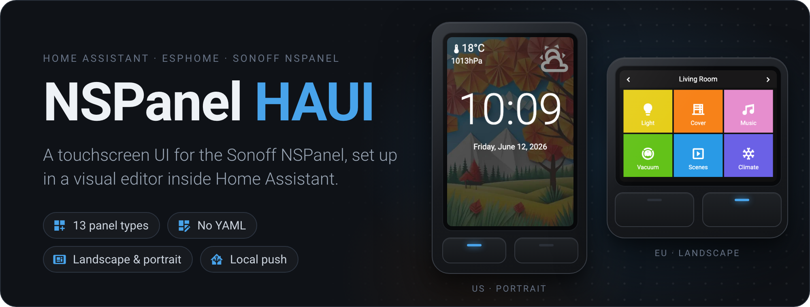

The editor follows your Home Assistant theme; each screen below is shown in the light and the dark theme.

<table>
  <tr>
    <td align="center" valign="top" width="50%">
      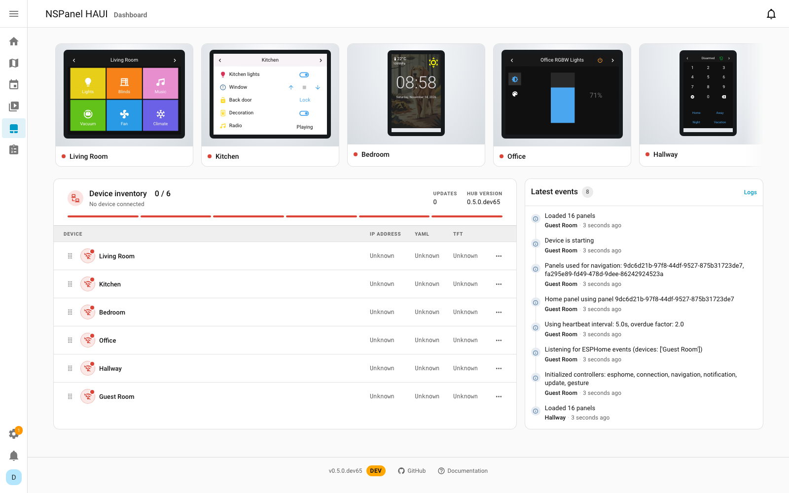
    </td>
    <td align="center" valign="top" width="50%">
      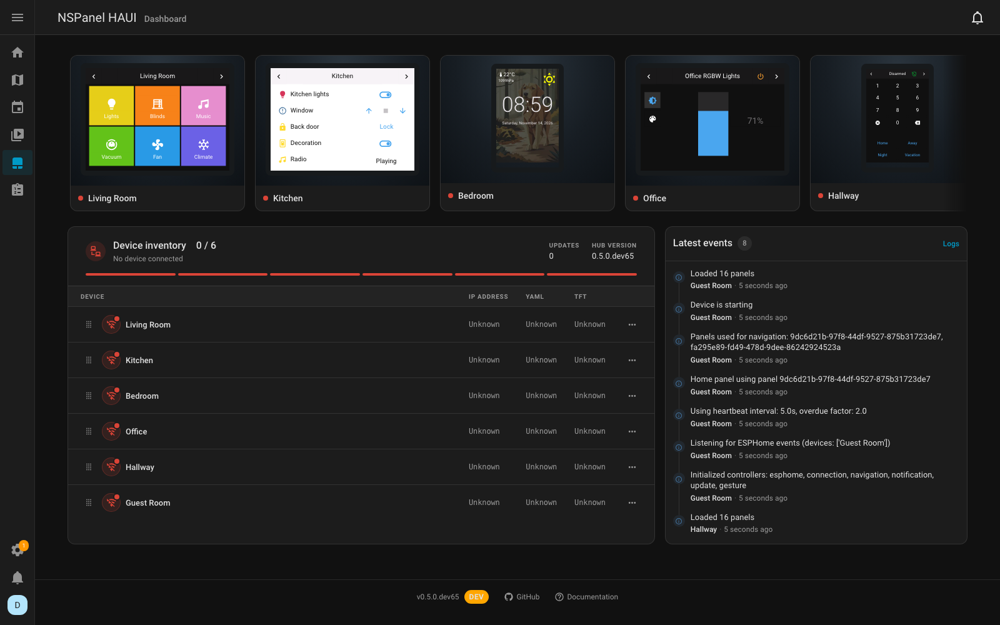
    </td>
  </tr>
  <tr>
    <td align="center" valign="top" colspan="2">
      <b>Fleet overview</b> 
      See every panel's home screen, connection status, firmware, updates and recent events at a glance.
    </td>
  </tr>
  <tr>
    <td align="center" valign="top" width="50%">
      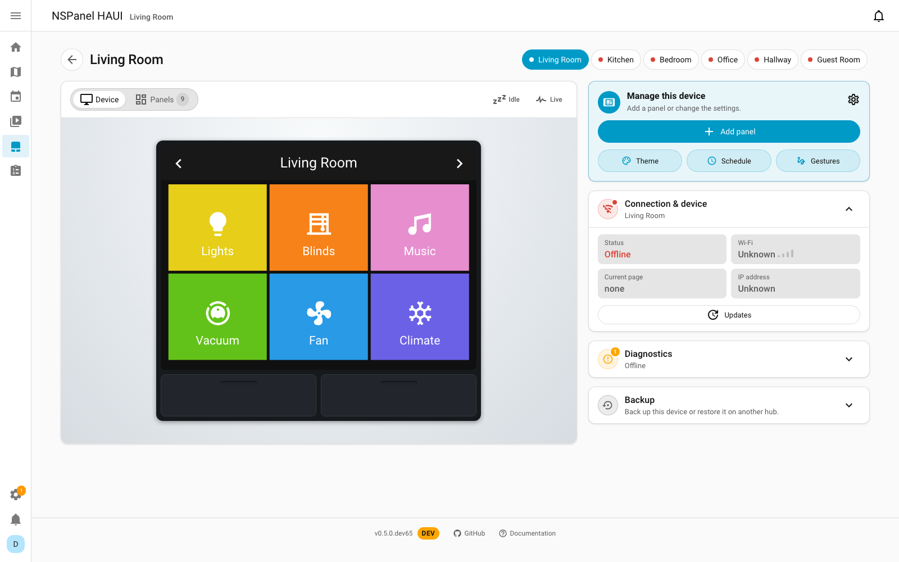
    </td>
    <td align="center" valign="top" width="50%">
      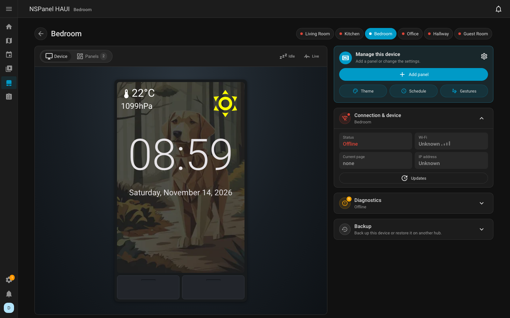
    </td>
  </tr>
  <tr>
    <td align="center" valign="top" colspan="2">
      <b>Device overview and preview</b> 
      Preview a device's panels, landscape or portrait, beside its connection, updates, diagnostics and backup.
    </td>
  </tr>
  <tr>
    <td align="center" valign="top" width="50%">
      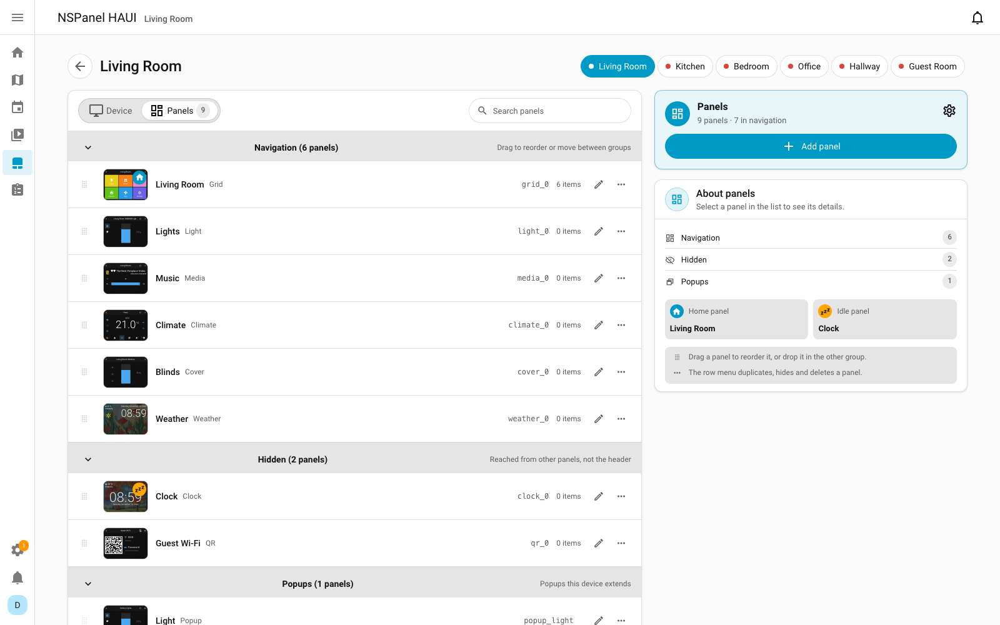
    </td>
    <td align="center" valign="top" width="50%">
      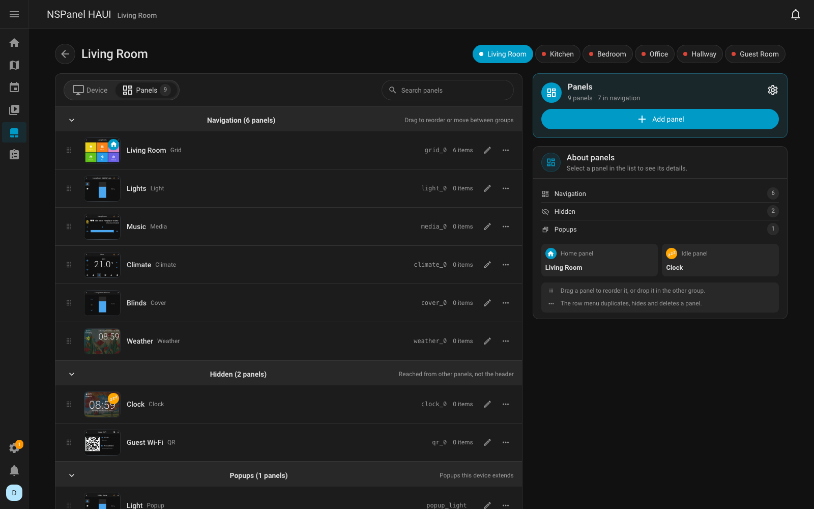
    </td>
  </tr>
  <tr>
    <td align="center" valign="top" colspan="2">
      <b>Organise panels per device</b> 
      Reorder panels and manage navigation, hidden panels and popups, with each panel's preview in the list.
    </td>
  </tr>
  <tr>
    <td align="center" valign="top" width="50%">
      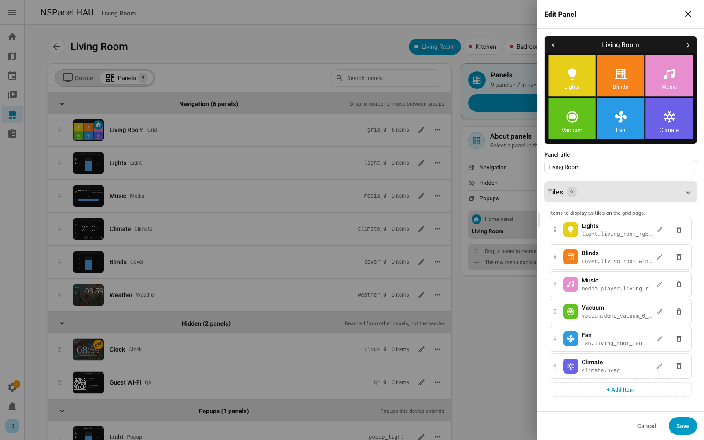
    </td>
    <td align="center" valign="top" width="50%">
      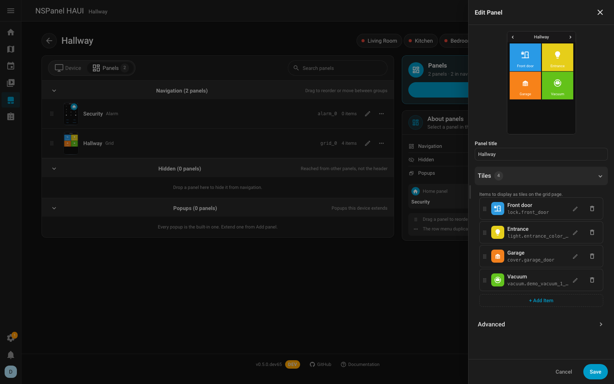
    </td>
  </tr>
  <tr>
    <td align="center" valign="top" colspan="2">
      <b>Edit a panel and its items</b> 
      Set a panel's title and items while its preview follows every change.
    </td>
  </tr>
  <tr>
    <td align="center" valign="top" width="50%">
      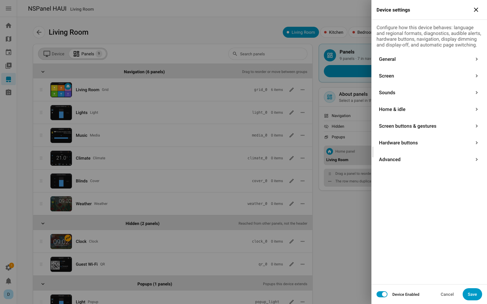
    </td>
    <td align="center" valign="top" width="50%">
      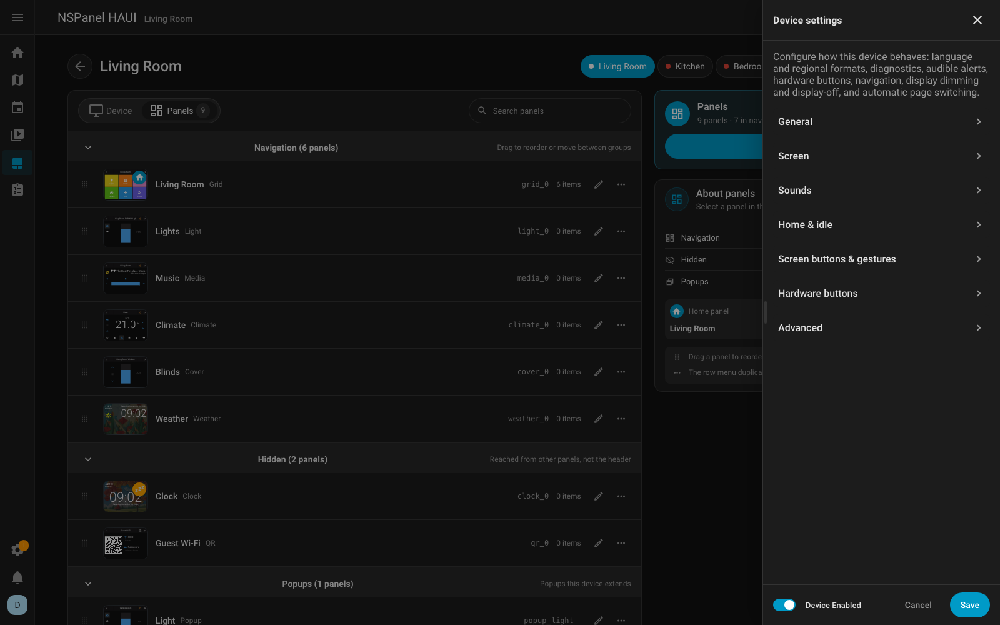
    </td>
  </tr>
  <tr>
    <td align="center" valign="top" colspan="2">
      <b>Configure device behaviour</b> 
      Language, screen, sounds, home and idle panels, buttons and gestures, all in one place.
    </td>
  </tr>
</table>

## Contributors

Thanks to [@pikas1](https://github.com/pikas1) for the Slovak translation
([#94](https://github.com/happydasch/nspanel_haui/pull/94)).

## Links

- [Changelog](CHANGELOG.md)
- [Device settings](docs/user/configuration/device.md)
- [Themes](docs/user/configuration/themes.md)
- [Upgrade process](docs/develop/update-process.md#21-schedule-replaces-daynight-profiles-and-quiet-hours)
- [Compare v0.4.7 to v0.5.0](https://github.com/happydasch/nspanel_haui/compare/v0.4.7...v0.5.0)
