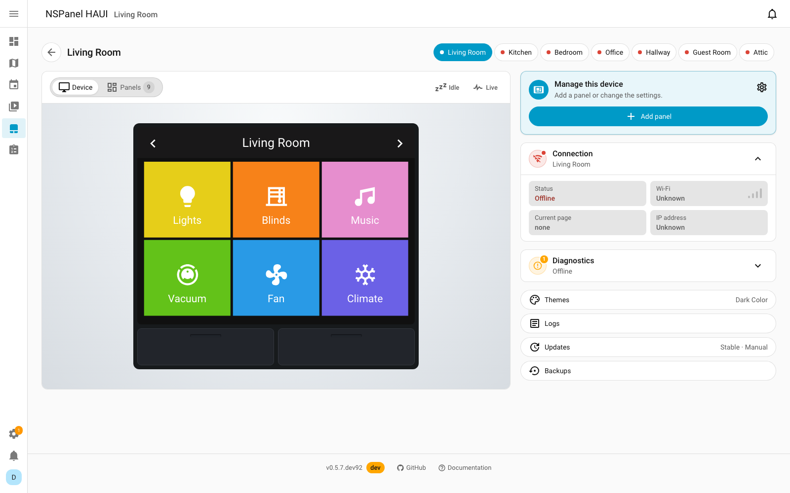

# NSPanel HAUI 0.5.3

0.5.3 makes a new panel quick to set up. **Quick start** builds a working device from six ready-made configurations, filled with real entities from your Home Assistant. **Copy to other devices** repeats a setup across the hub, and panel roles can be set right from the panel's detail card.

The dashboard card gains a status area and three display modes. The **Add panel** catalog is easier to browse, and light themes and header buttons get a round of fixes.

This release updates the integration and the editor. The firmware only carries the new version number and a shared component list; both TFTs are unchanged, so display version 0.4.5 remains required.

## Before updating

A Clock, ClockTwo or Weather panel that used **Use color scheme** as its **Background** now falls back to the plain fill matching the device's theme. Those pages never drew the theme's background colour, because the display can only show a picture compiled into the TFT. Choose **Dark Color** (the default), **Light Color** or a decorative picture in the panel editor ([upgrade notes](docs/user/update.md#background-pages-draw-a-picture-of-the-display)).

Nothing else needs a step. There is no TFT update, and no firmware change beyond the version number and the shared component list. The `/api/nspanel_haui/panel_templates` endpoint is gone; only the editor's old **Start from a template** list used it.

## Added

- **Quick start** — An empty device offers **Set up this device**. Pick a **Room panel**, **Home overview**, **Status board**, **Entry & alarm**, **Kitchen timer** or **Guest Wi-Fi** setup; its pages fill with entities from the area or installation you choose ([Quick Start Guide](docs/user/get-started.md)).
- **Preview before you build** — The second step shows the configuration and a preview of every page with its role: home panel, idle panel, navigation or hidden. The **Theme** you pick applies to the pages and their previews. New pages arrive in **Panels** marked **New**, with the home page selected.
- **Copy to other devices** — From **Backups**, write this device's settings, panels or update settings to any other devices. **Select all** and **Clear** speed up the selection, and **Copy** warns that it replaces what those devices have now ([Backups](docs/user/configuration/README.md)).
- **Roles on the panel** — The selected panel's detail card can set or clear its **Home panel** and **Idle panel** role. The Panels list marks every panel in the idle sequence and its place in the cycle ([Panel Configuration](docs/user/configuration/panels.md)).
- **Dashboard card modes** — `mode: fleet` draws every panel of the hub; `mode: device` draws one. `display_mode` chooses `big`, `small` or `status`, and the status area shows connection, display state, queued notifications, firmware and TFT versions and the button lights ([Dashboard Card](docs/user/dashboard-card.md)).
- **Card device id and scale** — The card editor stores the device id, so renaming a device no longer breaks dashboards, and offers disabled devices marked *(disabled)*. `scale` draws the big preview at 20–100 % of the card's space.

## Changed

- **Card options** — A saved `overview`, `home`, `live` or `tile` card keeps what it showed, and `devices`/`focus_mode` are no longer used. On narrow cards the compact preview stacks above the status; a disabled device keeps its render.
- **Add panel** — **Start from a template** is gone. A panel now starts from its type, a built-in popup or a copy of an existing panel, organised in collapsible groups ([The Panel List](docs/user/configuration/README.md#the-panel-list)).
- **One card style** — The **Add panel** catalog and the **Quick start** chooser now share the same card layout.
- **Settings order** — Device settings read **General**, **Home & idle**, **Hardware buttons**, **Screen buttons**, **Screen**, **Sounds**, **Gestures**, **Advanced**. On the Device screen, **Themes** now comes before **Updates** and **Backups**.
- **Panels view** — Group counts share one soft block, and the detail card's actions line up in equal columns with **Delete** across the row.
- **Quick start details** — The gallery speaks of the **idle panel**, needs and warnings sit in one banner, and grid or row pages are created even when the area has no matching entities.
- **Backups** — **Export** and **Import** sit side by side as one pair. **Copy to other devices** has its own card with outlined rows, badges and one primary action.
- **Titlebar** — It stays pinned while a screen scrolls; sticky panels on the Device screen pin below it.
- **Under the hood** — `make check`, `make screens-check`, `make release-preflight` and `publish_stable.py` tighten local checks and releases. CI uses uv and renders screens in their own job, the ESPHome configs share one component list, and feature ideas moved to `FEATURE_WISHLIST.md` ([Release process](docs/develop/release.md), [ESPHome](docs/develop/esphome.md)).

## Fixed

### Display

- **Light themes** — Body text and control icons on media, climate, vacuum, timer and notify pages stay readable, and active and accent icons use darker tones ([Color Themes](docs/user/configuration/themes.md)).
- **Collapsed header button** — With a single navigation panel, pages that update the button (QR, media, light, timer, vacuum) now update the widget actually on screen ([Panel QR-Code](docs/user/panels/panel_qr.md)).
- **Background fallback** — An empty or unresolved **Background** now uses the plain fill matching the device theme instead of leaving the previous picture visible ([Background pages](docs/user/configuration/device.md#background-pages)).
- **Word clock** — The quick start no longer stores the muted text tone for unlit letters. They sit a soft step off the page instead of competing with the time ([Panel Clock Two](docs/user/panels/panel_clocktwo.md)).
- **ClockTwo dot** — The top-left dot keeps its background patch on light pages ([Panel Clock Two](docs/user/panels/panel_clocktwo.md)).
- **Clock buttons** — Entity buttons follow a light or decorative background's palette instead of the compiled dark header colour ([Panel Clock](docs/user/panels/panel_clock.md)).

### Editor

- **Deleted panel roles** — A **Home panel** or **Idle panel** that no longer exists is treated as unset, and deleting or moving a panel removes its key from the old device's settings ([Panel Configuration](docs/user/configuration/panels.md)).
- **Keyless panels** — Unsaved drafts and templates no longer break a device's header buttons.
- **Names, not keys** — **Themes**, **Home & idle** and **Gestures** show translated theme names and panel names instead of `dark` or `clock_0`.
- **Device carousel** — An edge fades only when more cards follow, so the last device is never dimmed.
- **Empty list option** — **Add** now creates a plain entry, or opens the entity picker, instead of drawing an empty dropdown ([Media Panel](docs/user/panels/panel_media.md)).
- **Failed render** — The card shows the hub's message as text instead of hiding it in a tooltip, and a render that races app shutdown ends cleanly.

### Dashboard card

- A new card starts with every device of the hub, asks for a selection when one is missing, retries a failed device list and shows errors as plain sentences.
- The status area reports firmware and TFT versions for both home and live sessions.

### Device

- An `unknown` display model or brightness no longer aborts start-up.
- The display model defaults to `eu`, so the landscape panel is used when nothing is set ([Display Models](docs/user/configuration/display-models.md)).
