# NSPanel HAUI (HomeAssistant UI)

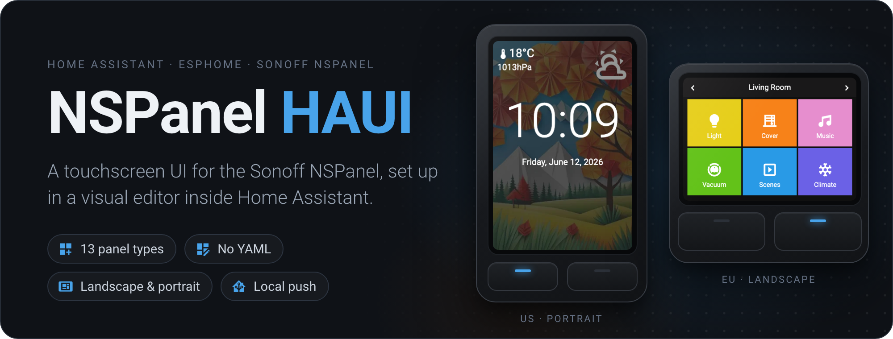

A flexible touchscreen UI for the Sonoff NSPanel, built on ESPHome. Everything is configured in a
visual editor inside Home Assistant, with no YAML to write.

Requires Home Assistant 2026.11 or later.

**[Documentation](https://happydasch.github.io/nspanel_haui/dev/)** ·
[Installation](https://happydasch.github.io/nspanel_haui/dev/user/install.html) ·
[Panels](https://happydasch.github.io/nspanel_haui/dev/user/panels/index.html) ·
[Screens](https://happydasch.github.io/nspanel_haui/dev/screens.html) ·
[FAQ](https://happydasch.github.io/nspanel_haui/dev/user/faq.html) ·
[Changelog](https://github.com/happydasch/nspanel_haui/blob/dev/CHANGELOG.md)

## Features

**On the panel**

- **Landscape and portrait**: one layout for the EU panel, one for the upright US panel
- **Multiple panel types**: clocks, weather, grid, row, light, media, climate, cover, vacuum,
  timer, alarm and QR code, plus built-in popups
- **Touch and gestures**: tap, slide and swipe, configurable gesture sequences, long press to go back
- **Idle page and dimming**: clock, weather or word clock as idle page, auto-dimming and a schedule
  for brightness, sound and display-off
- **Notifications and PINs**: a queue with severities, persistent alerts, silent times and protected
  panels
- **Hardware buttons**: switch the built-in relays or toggle any entity
- **Themes and pictures**: theme colours, per-item colour and icon overrides, background pictures
- **Updates**: firmware and display updates as Home Assistant update entities, stable or dev channel
- **Local and multilingual**: ESPHome native API, no cloud; English, German, Dutch, Polish, French
  and Slovak

**In the editor**

- **Compose panels visually**: choose from the panel catalog, add Home Assistant entities, text items
  or actions, then customise titles, icons and colours
- **Arrange the display**: drag panels between navigation, hidden and popup groups, and reorder them
  for each device
- **Preview as you work**: inspect panel thumbnails and the interactive virtual display, or switch to
  the live view of a connected panel
- **Tune each device**: set themes, language and regional formats, gestures, schedules, idle
  behaviour, dimming, hardware buttons and notifications
- **Manage a fleet**: see device connection and firmware details, recent events and available updates;
  back up or restore a device from its workspace

## Quick start

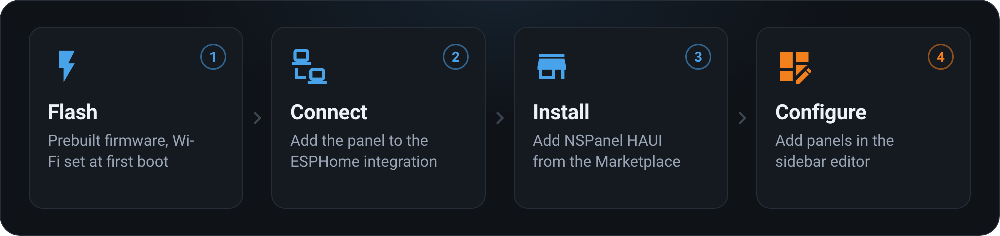

1. **Flash the panel**: download `nspanel_haui.bin` from the
   [latest release](https://github.com/happydasch/nspanel_haui/releases), flash it and connect to Wi-Fi.
   ([Install guide](https://happydasch.github.io/nspanel_haui/dev/user/install.html#flash-the-panel))
2. **Add it to ESPHome**: use Home Assistant's ESPHome integration. Enter the API key if asked.
3. **Install NSPanel HAUI**: in **Settings → Marketplace**, choose **Add from link** and enter
   `happydasch/nspanel_haui`, then restart Home Assistant. Existing HACS installs migrate automatically.
4. **Set it up**: add **NSPanel HAUI** from **Settings → Devices & Services → Add Integration**, then
   open the sidebar editor to add panels.
   ([Configuration guide](https://happydasch.github.io/nspanel_haui/dev/user/configuration/index.html))

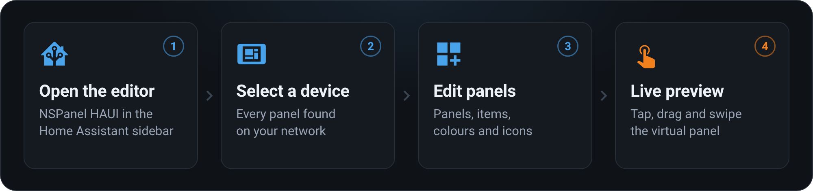

Open **NSPanel HAUI** in the Home Assistant sidebar (administrators only) to build and manage your
interface—no YAML required. Panel design, preview and device management are all in one editor.

## Editor

<table>
  <tr>
    <td align="center" valign="top" width="50%">
      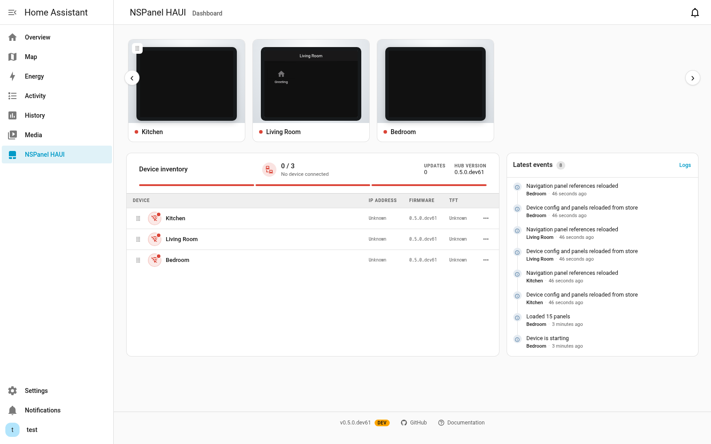 
      <b>Fleet overview</b> 
      See device status, firmware, updates and recent events across the fleet.
    </td>
    <td align="center" valign="top" width="50%">
      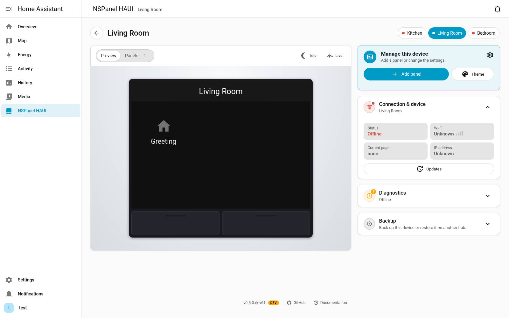 
      <b>Device overview and preview</b> 
      Preview the selected device's panel alongside connection health, updates, diagnostics and backup actions.
    </td>
  </tr>
  <tr>
    <td align="center" valign="top" width="50%">
      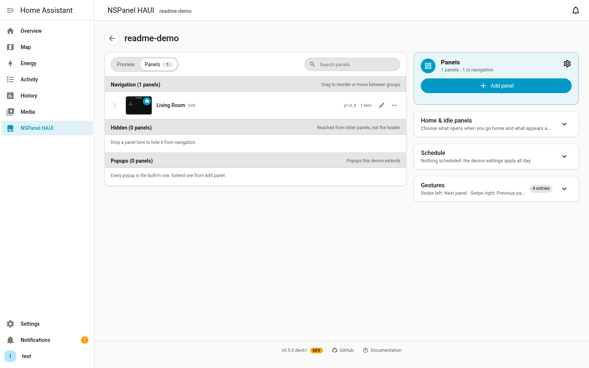 
      <b>Organise panels per device</b> 
      Reorder panels and manage navigation, hidden panels and popups alongside device settings.
    </td>
    <td align="center" valign="top" width="50%">
      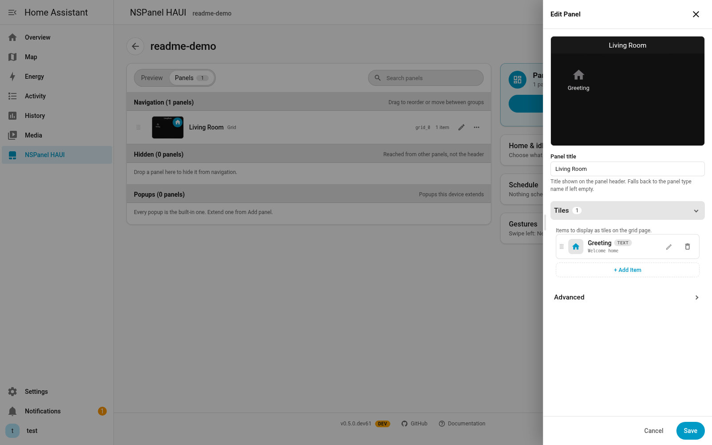 
      <b>Edit a panel and its items</b> 
      Preview the layout while setting a panel title and configuring its items.
    </td>
  </tr>
  <tr>
    <td align="center" valign="top" width="50%">
      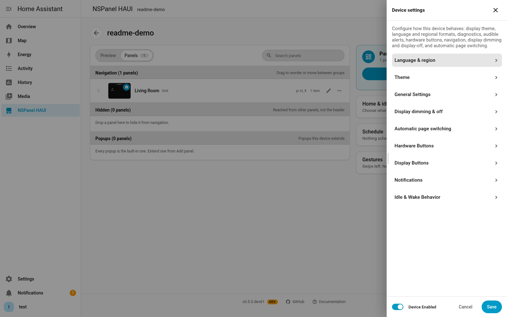 
      <b>Configure device behaviour</b> 
      Adjust language, theme, display, navigation, buttons, notifications and idle behaviour in one place.
    </td>
    <td align="center" valign="top" width="50%">
      <a href="https://happydasch.github.io/nspanel_haui/dev/user/configuration/index.html"><b>Explore the editor guide →</b></a> 
      See the full configuration walkthrough, including preview and device management.
    </td>
  </tr>
</table>

## Panels

A panel is one screen on the display. Add as many as you like and swipe between them. There are
13 panel types and a set of built-in popups. Select one to see what it shows and how to set it up.

<table>
  <tr>
    <td align="center" valign="top" width="25%">
       
      <a href="https://happydasch.github.io/nspanel_haui/dev/user/panels/panel_clock.html"><b>Clock</b></a> 
      Time, date and weather, with quick buttons
    </td>
    <td align="center" valign="top" width="25%">
       
      <a href="https://happydasch.github.io/nspanel_haui/dev/user/panels/panel_clocktwo.html"><b>ClockTwo</b></a> 
      The time in words
    </td>
    <td align="center" valign="top" width="25%">
       
      <a href="https://happydasch.github.io/nspanel_haui/dev/user/panels/panel_weather.html"><b>Weather</b></a> 
      Current weather and forecast
    </td>
    <td align="center" valign="top" width="25%">
       
      <a href="https://happydasch.github.io/nspanel_haui/dev/user/panels/panel_grid.html"><b>Grid</b></a> 
      Six entities as tiles
    </td>
  </tr>
  <tr>
    <td align="center" valign="top" width="25%">
       
      <a href="https://happydasch.github.io/nspanel_haui/dev/user/panels/panel_row.html"><b>Row</b></a> 
      Five entities as rows with toggles and sliders
    </td>
    <td align="center" valign="top" width="25%">
       
      <a href="https://happydasch.github.io/nspanel_haui/dev/user/panels/panel_light.html"><b>Light</b></a> 
      Brightness, color temperature, color, effects
    </td>
    <td align="center" valign="top" width="25%">
       
      <a href="https://happydasch.github.io/nspanel_haui/dev/user/panels/panel_media.html"><b>Media</b></a> 
      Playback, volume, sources, speaker groups
    </td>
    <td align="center" valign="top" width="25%">
       
      <a href="https://happydasch.github.io/nspanel_haui/dev/user/panels/panel_climate.html"><b>Climate</b></a> 
      Target temperature, modes, fan, presets
    </td>
  </tr>
  <tr>
    <td align="center" valign="top" width="25%">
       
      <a href="https://happydasch.github.io/nspanel_haui/dev/user/panels/panel_cover.html"><b>Cover</b></a> 
      Open, stop, close and position
    </td>
    <td align="center" valign="top" width="25%">
       
      <a href="https://happydasch.github.io/nspanel_haui/dev/user/panels/panel_vacuum.html"><b>Vacuum</b></a> 
      Start, dock, fan speed, locate
    </td>
    <td align="center" valign="top" width="25%">
       
      <a href="https://happydasch.github.io/nspanel_haui/dev/user/panels/panel_timer.html"><b>Timer</b></a> 
      Countdown timer and stopwatch
    </td>
    <td align="center" valign="top" width="25%">
       
      <a href="https://happydasch.github.io/nspanel_haui/dev/user/panels/panel_alarm.html"><b>Alarm</b></a> 
      Keypad to arm and disarm
    </td>
  </tr>
  <tr>
    <td align="center" valign="top" width="25%">
       
      <a href="https://happydasch.github.io/nspanel_haui/dev/user/panels/panel_qr.html"><b>QR Code</b></a> 
      Guest Wi-Fi as a QR code
    </td>
    <td align="center" valign="top" width="25%">
      <a href="https://happydasch.github.io/nspanel_haui/dev/user/panels/popup_notify.html">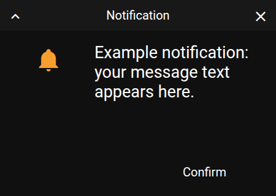</a> 
      <a href="https://happydasch.github.io/nspanel_haui/dev/user/panels/popup_notify.html"><b>Notification</b></a> 
      Popup for messages from Home Assistant
    </td>
    <td align="center" valign="top" width="25%">
      <a href="https://happydasch.github.io/nspanel_haui/dev/user/panels/popup_select.html">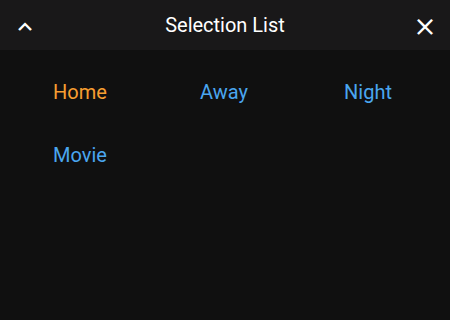</a> 
      <a href="https://happydasch.github.io/nspanel_haui/dev/user/panels/popup_select.html"><b>Select</b></a> 
      Popup to choose from a list
    </td>
    <td align="center" valign="top" width="25%">
      <a href="https://happydasch.github.io/nspanel_haui/dev/user/panels/popup_unlock.html">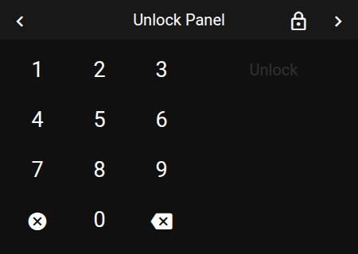</a> 
      <a href="https://happydasch.github.io/nspanel_haui/dev/user/panels/popup_unlock.html"><b>Unlock</b></a> 
      PIN popup for protected panels
    </td>
  </tr>
</table>

- **Tap to control**: tap a light, media player, climate, cover, vacuum or alarm entity on a grid or
  row, and its full controls open as a popup.
- **Both layouts**: every panel exists for the landscape and the portrait display.
- **Protect a panel**: give any panel a PIN.

Browse [all panel types](https://happydasch.github.io/nspanel_haui/dev/user/panels/index.html), see
[every screen in both layouts](https://happydasch.github.io/nspanel_haui/dev/screens.html), or copy an
[example layout](https://happydasch.github.io/nspanel_haui/dev/user/examples.html) for a room.

## How it works

The hub runs inside Home Assistant: it reads entity states, renders the display commands and sends
them over the ESPHome native API. The ESP32 relays them to the Nextion display over serial and
reports touches and button presses back. See
[Communication](https://happydasch.github.io/nspanel_haui/dev/develop/communication.html).

## Documentation

The full documentation is at **[happydasch.github.io/nspanel_haui](https://happydasch.github.io/nspanel_haui/dev/)**.

- **Start**: [Installation](https://happydasch.github.io/nspanel_haui/dev/user/install.html) · [Quick start](https://happydasch.github.io/nspanel_haui/dev/user/get-started.html) · [Updating](https://happydasch.github.io/nspanel_haui/dev/user/update.html) · [FAQ](https://happydasch.github.io/nspanel_haui/dev/user/faq.html) · [Troubleshooting](https://happydasch.github.io/nspanel_haui/dev/user/troubleshooting.html)
- **Configure**: [Overview](https://happydasch.github.io/nspanel_haui/dev/user/configuration/index.html) · [Device](https://happydasch.github.io/nspanel_haui/dev/user/configuration/device.html) · [Display models](https://happydasch.github.io/nspanel_haui/dev/user/configuration/display-models.html) · [Panels](https://happydasch.github.io/nspanel_haui/dev/user/configuration/panels.html) · [Items](https://happydasch.github.io/nspanel_haui/dev/user/configuration/items.html) · [Examples](https://happydasch.github.io/nspanel_haui/dev/user/examples.html)
- **Use**: [Gestures and display states](https://happydasch.github.io/nspanel_haui/dev/user/device.html) · [Services](https://happydasch.github.io/nspanel_haui/dev/user/services.html) · [Icons](https://happydasch.github.io/nspanel_haui/dev/cheatsheet.html) · [Screens](https://happydasch.github.io/nspanel_haui/dev/screens.html)
- **Develop**: [Development](https://happydasch.github.io/nspanel_haui/dev/develop/development.html) · [Design](https://happydasch.github.io/nspanel_haui/dev/develop/design.html) · [Communication](https://happydasch.github.io/nspanel_haui/dev/develop/communication.html) · [ESPHome](https://happydasch.github.io/nspanel_haui/dev/develop/esphome.html) · [Hub](https://happydasch.github.io/nspanel_haui/dev/develop/hub.html) · [Nextion](https://happydasch.github.io/nspanel_haui/dev/develop/nextion.html)

For custom firmware builds, see the
[ESPHome development instructions](https://happydasch.github.io/nspanel_haui/dev/develop/esphome.html#installation).

> **Upgrading from 0.3.x or earlier?** Read the [upgrade guide](https://happydasch.github.io/nspanel_haui/dev/user/update.html)
> first. Saved panels do not migrate, and settings stored in config entries by 0.3.2 or earlier are not
> carried over. See [device configuration](https://happydasch.github.io/nspanel_haui/dev/user/configuration/device.html#how-settings-are-saved).

## Credits

Inspired by [NSPanel Lovelace UI](https://github.com/joBr99/nspanel-lovelace-ui) by joBr99 and
[NSPanel HA Blueprint](https://github.com/Blackymas/NSPanel_HA_Blueprint) by Blackymas.

See the [GitHub contributors](https://github.com/happydasch/nspanel_haui/graphs/contributors)
for everyone who contributed. Special thanks to @jameshiscott, who contributed the
[live preview and the Nextion simulator](docs/user/configuration/README.md#the-live-preview).
