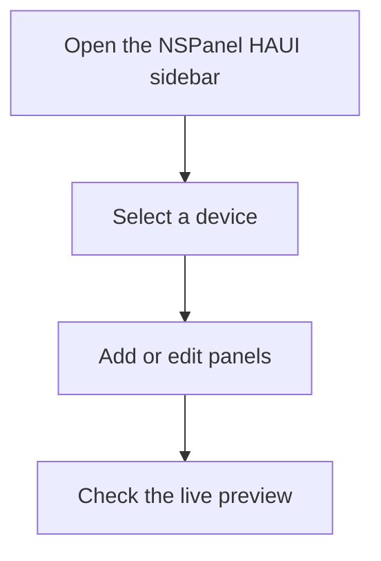
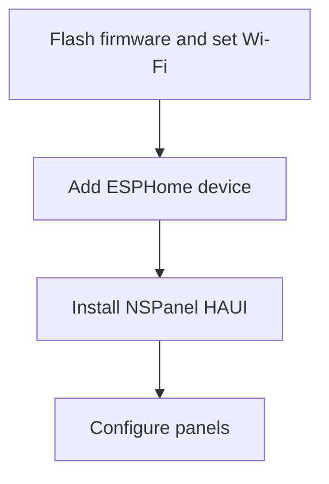

# NSPanel HAUI (HomeAssistant UI)

  

A flexible touchscreen UI for the Sonoff NSPanel, built on ESPHome. Everything is configured in a
visual editor inside Home Assistant, with no YAML to write.

**[Documentation](docs/README.md)** · [Installation](docs/install.md) · [Panels](docs/panels/README.md) ·
[Screens](https://happydasch.github.io/nspanel_haui/screens.html) · [FAQ](docs/faq.md) ·
[Changelog](CHANGELOG.md)

## Panels

Choose from 13 panel types for entity controls and room displays, including clocks, weather, and QR
codes. Each entity panel has a matching popup; notification, selection, and PIN popups are also
included. Browse [all panel types](docs/panels/README.md) or see rendered examples in the
[Screens overview](https://happydasch.github.io/nspanel_haui/screens.html) for both layouts.

## Features

- **Landscape and portrait**: the EU panel and the upright US panel each get their own display layout
- **Touch and gestures**: tap, slide, swipe through panels, named gesture sequences, long press to go back
- **Idle page and dimming**: clock, weather or word clock as idle page (also as a carousel), auto-dimming, display-off schedule, day/night profiles
- **Notifications**: a queue with severities, persistent alerts that keep sounding until dismissed, quiet hours
- **Panel PINs**: lock sensitive panels behind a code
- **Hardware buttons**: switch the built-in relays or any entity
- **Colours and icons**: theme colours, per-item colour and icon overrides, background pictures
- **Updates**: firmware and display updates as Home Assistant update entities, stable or dev channel
- **Local push**: ESPHome native API, no cloud; English, German, Dutch, Polish and French

## Editor

Open **NSPanel HAUI** in the Home Assistant sidebar (administrators only) to manage panels, items,
device settings, colours and devices. It is there as soon as the integration is added.

- **Live preview**: a virtual copy of each device running the real hub code. Tap, drag and swipe
  with the mouse; **sandbox mode** leaves your home untouched, **live mode** controls real entities.
- **Exact panel cards**: every card, popups and system panels included, is drawn by the hub, so
  it shows what the display shows, unsaved edits included.
- **Device manager**: find panels on the network, add, enable or remove them, and see connection,
  firmware and display versions.

The live preview and the Nextion simulator were created by
[@jameshiscott](https://github.com/jameshiscott). See [The Live Preview](docs/configuration/README.md#the-live-preview).

## Quick start

Requires Home Assistant 2026.11 or later.

1. **Flash**: load the prebuilt `nspanel_haui.bin` from the
   [latest release](https://github.com/happydasch/nspanel_haui/releases) and enter your Wi-Fi at
   first boot. ([Install guide](docs/install.md#flash-the-panel))
2. **Connect**: add the panel to Home Assistant's ESPHome integration. Use the key in the
   [install guide](docs/install.md#flash-the-panel) if prompted.
3. **Install**: add `happydasch/nspanel_haui` from **Settings → Marketplace → Add from link**,
   install NSPanel HAUI, then restart Home Assistant. HACS installs migrate automatically.
   ([Install guide](docs/install.md))
4. **Configure**: add **NSPanel HAUI** from **Settings → Devices & Services → Add Integration**, then
   open the editor and add panels. ([Integration](docs/custom_integration.md) · [Configuration](docs/configuration/README.md))

For custom firmware builds, see the [ESPHome development instructions](docs/esphome.md#installation).

> **Upgrading from 0.3.x or earlier?** Read the [upgrade guide](docs/update.md) first: services,
> ESPHome actions/events and two config entities were renamed. Device settings migrate
> automatically, saved panels do not, so check each panel after upgrading.

## How it works

The hub runs inside Home Assistant: it reads entity states, renders the display commands and sends
them over the ESPHome native API. The ESP32 relays them to the Nextion display over serial and
reports touches and button presses back. See [Communication](docs/communication.md).

## Documentation

- **Start**: [Installation](docs/install.md) · [Quick start](docs/get-started.md) · [Updating](docs/update.md) · [FAQ](docs/faq.md) · [Troubleshooting](docs/troubleshooting.md)
- **Configure**: [Overview](docs/configuration/README.md) · [Device](docs/configuration/device.md) · [Display models](docs/configuration/display-models.md) · [Panels](docs/configuration/panels.md) · [Items](docs/configuration/items.md) · [Examples](docs/examples.md)
- **Use**: [Gestures and display states](docs/device.md) · [Services](docs/services.md) · [Icons](https://happydasch.github.io/nspanel_haui/cheatsheet.html) · [Screens](https://happydasch.github.io/nspanel_haui/screens.html)
- **Develop**: [Development](docs/development.md) · [Design](docs/design.md) · [Communication](docs/communication.md) · [ESPHome](docs/esphome.md) · [Hub](docs/hub.md) · [Nextion](docs/nextion.md)

The full index is [docs/README.md](docs/README.md).

## Credits

Inspired by [NSPanel Lovelace UI](https://github.com/joBr99/nspanel-lovelace-ui) by joBr99 and
[NSPanel HA Blueprint](https://github.com/Blackymas/NSPanel_HA_Blueprint) by Blackymas.
