# NSPanel HAUI (HomeAssistant UI)

  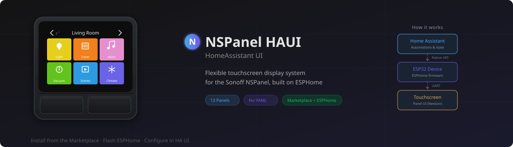

  <b>A flexible touchscreen display system for the Sonoff NSPanel, built on ESPHome.</b> 
  All configuration is done through a built-in web frontend — a Lovelace panel 
  inside Home Assistant that provides a visual editor for panels, entities, 
  gestures, colors, and more.

---

  <a href="docs/README.md"><b>Documentation</b></a> ·
  <a href="docs/panels/README.md"><b>Panels Overview</b></a> ·
  <a href="docs/install.md"><b>Installation Guide</b></a> ·
  <a href="docs/configuration/README.md"><b>Configuration</b></a> ·
  <a href="docs/faq.md"><b>FAQ</b></a> ·
  <a href="docs/examples.md"><b>Example Configs</b></a>

---

## Quick Start

Get NSPanel HAUI up and running with a display dashboard in just 4 steps:

  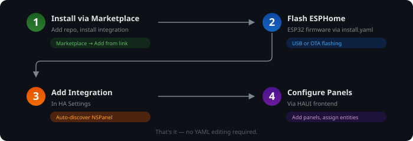

1. **Install from the Marketplace** — Home Assistant 2026.11 or later: under Settings → Marketplace → Add from link, add `happydasch/nspanel_haui`, install the integration, and restart Home Assistant. Coming from HACS? Home Assistant migrates it to the Marketplace automatically; NSPanel HAUI stays installed.
   Existing users on 0.3.x or earlier: read the [Upgrade guide →](docs/upgrading.md) first — the first stable release renames services, ESPHome actions/events and two config entities. Saved device settings are migrated automatically; saved panels are not, so verify each panel's settings after upgrading.

   [Install guide →](docs/install.md)

2. **Flash ESPHome** — Flash the prebuilt `nspanel_haui.bin` from the latest release and enter your Wi-Fi at first boot, or build your own from `esphome/install.yaml`.

   [Flashing guide →](docs/install.md#2-step-install-esphome)

3. **Add Integration** — Go to Settings → Devices & Services → Add NSPanel HAUI. It auto-discovers your device.

   [Config flow →](docs/custom_integration.md)

4. **Configure Panels** — Open the web frontend, add panels, assign entities, and set colors to your liking.

   [Configuration guide →](docs/configuration/README.md)

---

## What's New

Recent additions to NSPanel HAUI:

- **Live preview and exact panel cards** — the editor runs a virtual copy of each panel on the real hub code: try it in a sandbox or control your home live, and see every panel card exactly as the display draws it. Live preview and simulator by [@jameshiscott](https://github.com/jameshiscott). See [Live preview and Nextion simulator](#live-preview-and-nextion-simulator).
- **US portrait support** — the US NSPanel mounted vertically gets its own rotated TFT layout. Pick `European (standard)` or `US (portrait)` per device in the editor; edge-swipe gestures use the installed model's touch dimensions. See [Display Models](docs/configuration/display-models.md).
- **Display-off schedule** — a daily window (overnight ranges supported) during which the display may turn off after `timeout_display_off` seconds of inactivity; outside the window it only dims. The hub applies the schedule itself, so no automation is needed. See [Device Configuration](docs/configuration/device.md).
- **Quiet hours (Do Not Disturb)** — silence all notification sounds during a daily window while notifications are still queued and shown.
- **Persistent alerts** — notifications loop their alert sound and re-open their popup about every 60 seconds until dismissed on the panel, so an alarm stays reachable even after navigating away; ideal for alarms. Per-notification `text_size` (`auto` or `1`–`3`) is also available.
- **Universal prebuilt firmware** — one `nspanel_haui.bin` serves EU and US panels. Enter Wi-Fi once over the setup access point; the last six MAC digits are appended to the device name so one binary installs any number of panels.
- **Gesture navigation** — swipe left/right through navigation panels, up to About, down to Settings. Named gesture sequences open a panel after a configured swipe pattern.
- **Device discovery** — Device Manager → Scan finds ESPHome devices on your network and offers to add them.

---

## Features

**On the display**

- 🧩 **13 panel types** — grid, row, light, climate, cover, media, vacuum, alarm, timer, QR, weather, clock and word clock, plus popups for lights, covers, climate, media, vacuum, alarm and timers
- 📐 **Landscape and portrait** — the EU panel and the upright US panel each get their own display layout
- ✋ **Touch and gestures** — tap, slide, swipe through panels, named gesture sequences, long press to go back
- 🌙 **Screensavers and dimming** — clock, weather or word clock as idle page (also as a carousel), auto-dimming, display-off schedule, day/night profiles
- 🔔 **Notifications** — a queue with severities, persistent alerts that keep sounding until dismissed, quiet hours
- 🔒 **Panel PINs** — lock sensitive panels behind a code
- 🎛️ **Hardware buttons** — switch the built-in relays or any entity
- 🎨 **Colours and icons** — theme colours, per-item colour and icon overrides, background pictures
- 🌐 **Five languages** — English, German, Dutch, Polish and French

**In Home Assistant**

- ✏️ **Visual editor** — configure everything from the sidebar, no YAML needed
- 🖥️ **Live preview** — an interactive virtual panel running on the real hub code, with a sandbox that leaves your home untouched
- 🃏 **Exact previews** — every panel card shows exactly what the display will show, in landscape or portrait
- 🔄 **Updates** — firmware and display updates as Home Assistant update entities, on the stable or dev channel
- 🔍 **Discovery** — finds new panels on your network
- ⚡ **Local push** — ESPHome native API, no cloud

---

## Available Panels

Every screenshot below is rendered by the integration itself (see [Screen renderer](#live-preview-and-nextion-simulator)). Click a panel for its documentation, or open the **[Screens overview](https://happydasch.github.io/nspanel_haui/screens.html)** for every panel, popup and system screen in both layouts.

<table>
<tr>
<td align="center" width="33%"> <b><a href="docs/panels/panel_grid.md">Grid</a></b> · <code>grid</code> Up to 6 entities as tiles, paged, with colour overrides and power buttons.</td>
<td align="center" width="33%"><a href="docs/panels/panel_row.md">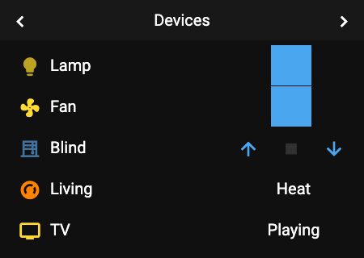</a> <b><a href="docs/panels/panel_row.md">Row</a></b> · <code>row</code> Up to 5 entities as rows, each with a control that suits the entity.</td>
<td align="center" width="33%"><a href="docs/panels/panel_light.md">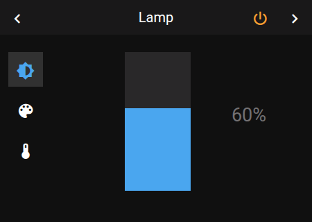</a> <b><a href="docs/panels/panel_light.md">Light</a></b> · <code>light</code> Brightness, colour temperature, colour wheel and effects.</td>
</tr>
<tr>
<td align="center" width="33%"><a href="docs/panels/panel_climate.md">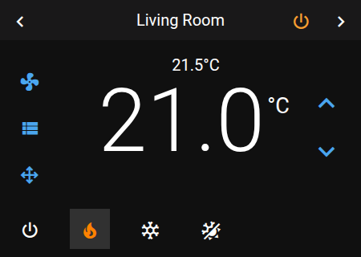</a> <b><a href="docs/panels/panel_climate.md">Climate</a></b> · <code>climate</code> Setpoints, HVAC modes, fan speed, swing and presets.</td>
<td align="center" width="33%"><a href="docs/panels/panel_cover.md">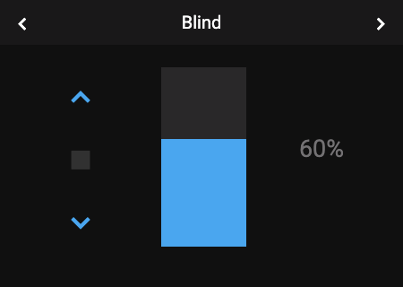</a> <b><a href="docs/panels/panel_cover.md">Cover</a></b> · <code>cover</code> Open, stop and close with a position slider.</td>
<td align="center" width="33%"><a href="docs/panels/panel_media.md">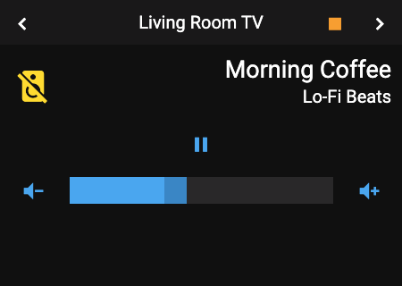</a> <b><a href="docs/panels/panel_media.md">Media</a></b> · <code>media</code> Playback, volume and track info for TVs, speakers and receivers.</td>
</tr>
<tr>
<td align="center" width="33%"><a href="docs/panels/panel_vacuum.md">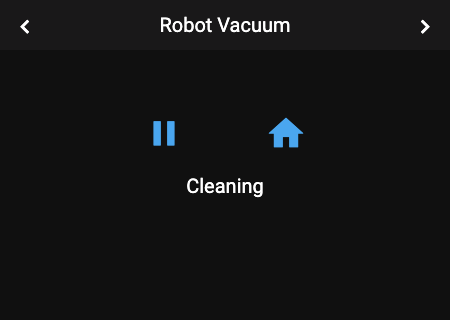</a> <b><a href="docs/panels/panel_vacuum.md">Vacuum</a></b> · <code>vacuum</code> Start, stop, dock, fan speed and locate, plus up to 6 extra items.</td>
<td align="center" width="33%"><a href="docs/panels/panel_alarm.md">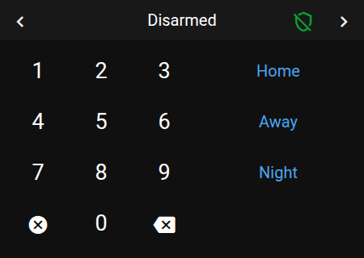</a> <b><a href="docs/panels/panel_alarm.md">Alarm</a></b> · <code>alarm</code> Keypad for the alarm code with arm and disarm modes.</td>
<td align="center" width="33%"><a href="docs/panels/panel_timer.md">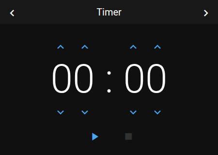</a> <b><a href="docs/panels/panel_timer.md">Timer</a></b> · <code>timer</code> Countdown timer with start, pause and stop.</td>
</tr>
<tr>
<td align="center" width="33%"><a href="docs/panels/panel_qr.md">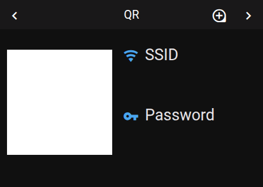</a> <b><a href="docs/panels/panel_qr.md">QR Code</a></b> · <code>qr</code> Wi-Fi details, a URL or any text as a QR code.</td>
<td align="center" width="33%"><a href="docs/panels/panel_weather.md">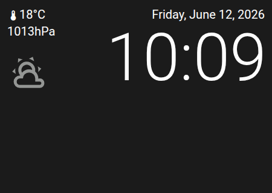</a> <b><a href="docs/panels/panel_weather.md">Weather</a></b> · <code>weather</code> Forecast, time and date. Ready to use as screensaver.</td>
<td align="center" width="33%"> <b><a href="docs/panels/panel_clock.md">Clock</a></b> · <code>clock</code> Large time and date with weather and entity buttons.</td>
</tr>
<tr>
<td align="center" width="33%"><a href="docs/panels/panel_clocktwo.md">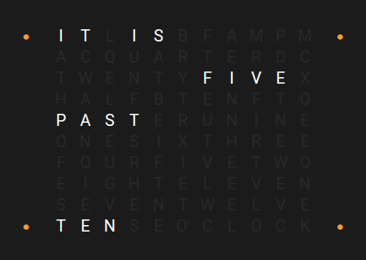</a> <b><a href="docs/panels/panel_clocktwo.md">ClockTwo</a></b> · <code>clocktwo</code> Word clock: the time spelled out on a letter grid.</td>
<td align="center" width="33%"> <b><a href="docs/panels/README.md#popups">Popups</a></b> Notifications, selections, PIN unlock and a popup for every entity panel.</td>
<td align="center" width="33%"><a href="docs/configuration/display-models.md">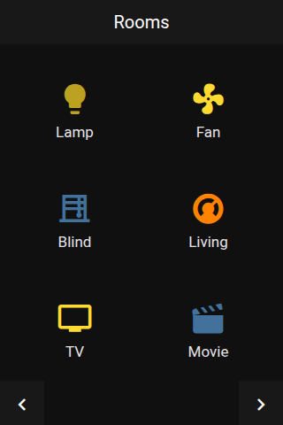</a> <b><a href="docs/configuration/display-models.md">US portrait</a></b> Every screen also has its own upright layout for the US panel.</td>
</tr>
</table>

See the [Panels Overview](docs/panels/README.md) for options and details.

---

## Web Frontend Editor

Everything is configured in a visual editor inside Home Assistant: open **NSPanel HAUI** in the sidebar (administrators only). It is there as soon as the integration is added, with nothing extra to install and no YAML to write.

  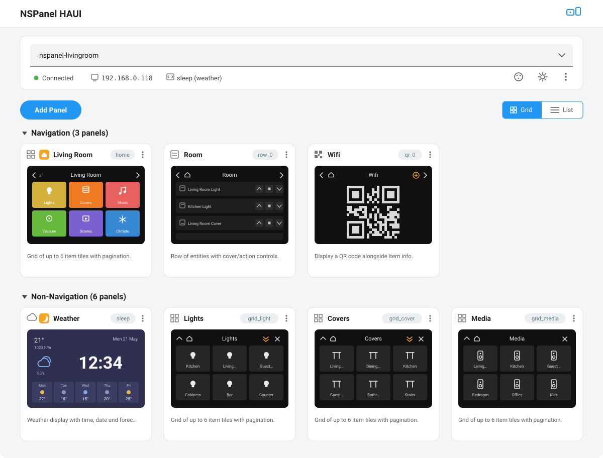

### Live preview and Nextion simulator

The editor shows your panels exactly as the display shows them, not as a mockup. A Nextion simulator built from the real display layout, landscape and portrait, runs the display's own page code and replays the commands the hub sends to the device. Because the hub renders every screen itself, entity values, translations, templates, the clock, the weather forecast and colour overrides are the same as on the real panel.

- **Live preview** — a virtual copy of each device, running on the real hub code. Tap, drag and swipe with the mouse or a finger, press the hardware buttons and trigger the idle page. **Sandbox mode** simulates every action, so nothing in your home changes; **Live mode** controls the real entities. **Show entities** names the entity under the pointer.
- **Exact panel cards** — every card in the panel list, system panels and popups included, is drawn by the hub, and unsaved edits show right away.
- **Screen renderer** — the same renderer produces the screenshots in this README and the [Screens overview](https://happydasch.github.io/nspanel_haui/screens.html). CI regenerates them after every dev build, so the documentation always shows the current screens.

The live preview and the Nextion simulator were created by [@jameshiscott](https://github.com/jameshiscott). Thank you!

See [The Live Preview](docs/configuration/README.md#the-live-preview) for how to use it.

### Everything else in the editor

| Area | What you can do |
|------|-----------------|
| **Panels** | Add, edit, reorder and delete panels in a grid or list view, and customise every popup. |
| **Items** | Pick entities from a searchable entity picker; override name, icon, colour, value and state per item. |
| **Device settings** | Display model, dimming, idle page, day/night profiles, display-off schedule, gestures, hardware buttons, sounds, quiet hours, time and date formats. |
| **Colours** | Override any colour of the built-in palette per device. |
| **Devices** | Device Manager: find panels on the network, add, enable or remove them, and see connection, firmware and display versions. Manage several NSPanels from one place. |
| **Diagnostics** | Device info, log viewer, notification queue, YAML import and export. |

Behind the scenes the editor talks to the hub through a REST API (`/api/nspanel_haui/...`) and Home Assistant's WebSocket API (live preview and panel cards). It lives in `custom_components/nspanel_haui/frontend/` and is written in vanilla JavaScript with Lit.

---

## Configuration

All device settings — panels, entities, gestures, dimming, display-off schedule, and colours — are managed through the Home Assistant interface.

- **[Configuration Overview](docs/configuration/README.md)** — All available options at a glance
- **[Device Configuration](docs/configuration/device.md)** — Sounds, screensaver, buttons, dimming
- **[Display Models](docs/configuration/display-models.md)** — EU landscape and US portrait panels
- **[Panel Configuration](docs/configuration/panels.md)** — Creating and arranging panels
- **[Item Configuration](docs/configuration/items.md)** — Entities, icons, colors, internal items
- **[Device Description](docs/device.md)** — Gestures, display states, hardware buttons, notifications
- **[Example Configs](docs/examples.md)** — Ready-to-use panel combinations

---

## Architecture

NSPanel HAUI uses a three-layer architecture:

  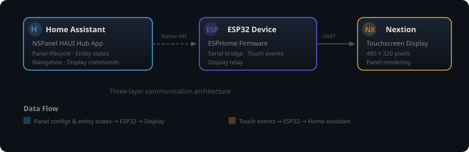

- **HAUI** (`NSPanelHAUI`, hub that runs in HA) — Reads entity states, renders display commands, manages navigation
- **ESP32** (ESPHome firmware) — Serial bridge between HA and the display, relays touch events
- **Nextion** (Touchscreen display) — Renders panels, manages widget state, handles touch input

Data flows both ways: panel configs and entity states flow **down** to the display, while touch events and button presses flow **up** to Home Assistant.

For detailed architecture information, see the [Communication Overview](docs/communication.md).

---

## Documentation

The full index — end-user guides and developer references — is at
**[docs/README.md](docs/README.md)**. Highlights:

- [Installation](docs/install.md) · [Quick Start](docs/get-started.md) · [Configuration](docs/configuration/README.md) · [Panels](docs/panels/README.md) · [Icons](https://happydasch.github.io/nspanel_haui/cheatsheet.html) · [Screens](https://happydasch.github.io/nspanel_haui/screens.html)
- [FAQ](docs/faq.md) · [Troubleshooting](docs/troubleshooting.md) · [Services](docs/services.md) · [Examples](docs/examples.md)
- [Development](docs/development.md) · [Design](docs/design.md) · [Communication](docs/communication.md) · [ESPHome](docs/esphome.md) · [Hub](docs/hub.md) · [Nextion](docs/nextion.md)

---

## Resources

Inspired by other NSPanel projects:

- [NSPanel Lovelace UI](https://github.com/joBr99/nspanel-lovelace-ui) by joBr99
- [NSPanel HA Blueprint](https://github.com/Blackymas/NSPanel_HA_Blueprint) by Blackymas
