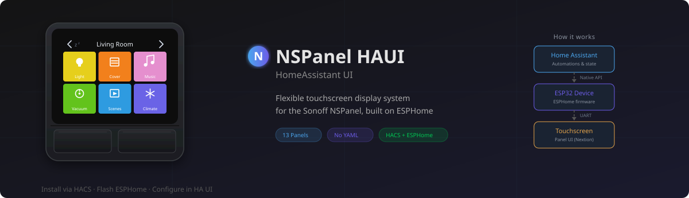
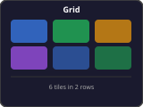
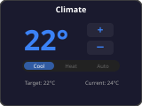
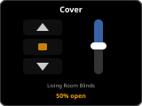
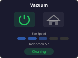
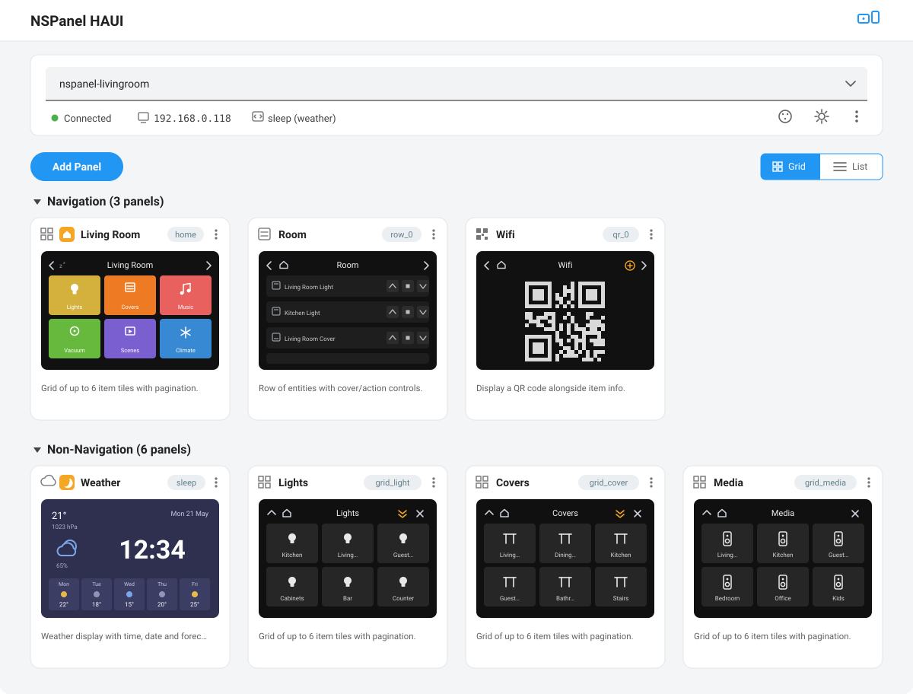

# NSPanel HAUI (HomeAssistant UI)

  

  <b>A flexible touchscreen display system for the Sonoff NSPanel, built on ESPHome.</b> 
  All configuration is done through a built-in web frontend — a Lovelace panel 
  inside Home Assistant that provides a visual editor for panels, entities, 
  gestures, colors, and more.

---

  <a href="docs/README.md"><b>Documentation</b></a> ·
  <a href="docs/panels/README.md"><b>Panels Overview</b></a> ·
  <a href="docs/install.md"><b>Installation Guide</b></a> ·
  <a href="docs/configuration/README.md"><b>Configuration</b></a> ·
  <a href="docs/faq.md"><b>FAQ</b></a> ·
  <a href="docs/examples.md"><b>Example Configs</b></a>

---

## Quick Start

Get NSPanel HAUI up and running with a display dashboard in just 4 steps:

  

1. **Install via HACS** — Add the custom repository, install the integration, and restart Home Assistant.
   Existing users on 0.3.x or earlier: read the [Upgrade guide →](docs/upgrading.md) first — the first stable release renames services, ESPHome actions/events and two config entities. Saved device settings are migrated automatically; saved panels are not, so verify each panel's settings after upgrading.

   [Install guide →](docs/install.md)

2. **Flash ESPHome** — Flash the prebuilt `nspanel_haui.bin` from the latest release and enter your Wi-Fi at first boot, or build your own from `esphome/install.yaml`.

   [Flashing guide →](docs/install.md#2-step-install-esphome)

3. **Add Integration** — Go to Settings → Devices & Services → Add NSPanel HAUI. It auto-discovers your device.

   [Config flow →](docs/custom_integration.md)

4. **Configure Panels** — Open the web frontend, add panels, assign entities, and set colors to your liking.

   [Configuration guide →](docs/configuration/README.md)

---

## What's New

Recent additions to NSPanel HAUI:

- **US portrait support** — the US NSPanel mounted vertically gets its own rotated TFT layout. Pick `European (standard)` or `US (portrait)` per device in the editor; edge-swipe gestures use the installed model's touch dimensions. See [Display Models](docs/configuration/display-models.md).
- **Display-off schedule** — a daily window (overnight ranges supported) during which the display may turn off after `timeout_display_off` seconds of inactivity; outside the window it only dims. The hub applies the schedule itself, so no automation is needed. See [Device Configuration](docs/configuration/device.md).
- **Quiet hours (Do Not Disturb)** — silence all notification sounds during a daily window while notifications are still queued and shown.
- **Persistent alerts** — notifications loop their alert sound and re-open their popup about every 60 seconds until dismissed on the panel, so an alarm stays reachable even after navigating away; ideal for alarms. Per-notification `text_size` (`auto` or `1`–`3`) is also available.
- **Universal prebuilt firmware** — one `nspanel_haui.bin` serves EU and US panels. Enter Wi-Fi once over the setup access point; the last six MAC digits are appended to the device name so one binary installs any number of panels.
- **Gesture navigation** — swipe left/right through navigation panels, up to About, down to Settings. Named gesture sequences open a panel after a configured swipe pattern.
- **Device discovery** — Device Manager → Scan finds ESPHome devices on your network and offers to add them.

---

## Features

- 🧩 **13 Panel Types** — Grid, light, climate, cover, media, weather, and more
- ✋ **Touch + Gestures** — Swipe navigation, gesture sequences, tap interactions
- 🎨 **Full Customization** — Per-entity colors, icons, backgrounds, themes
- 🌙 **Auto-Dimming** — Smart display-off/wake, daily off schedule, screensaver
- ✏️ **Visual Editor** — Built-in Lovelace panel with live previews, reordering, color pickers
- 🌐 **Multi-Language** — English, German, Dutch, Polish, French
- 🔔 **Notifications** — Sound alerts, toasts, persistent alerts, notification queue
- 🔒 **Panel Locking** — PIN-protected unlock for sensitive controls
- ⚡ **ESPHome Native API** — Fast, reliable communication with the display
- 🕐 **Screensaver Modes** — Clock, weather, clock-two (text) display modes
- 🎛️ **Hardware Buttons** — Physical rocker switch support with custom actions
- 📱 **QR Code Display** — Show Wi-Fi details, URLs, or text as QR codes

---

## Available Panels

See the [Panels Overview](docs/panels/README.md) for details.

-  **[Grid](docs/panels/panel_grid.md)** (`grid`) — Up to 6 entities in a scrollable grid layout. Color overrides, power buttons.
-  **[Row](docs/panels/panel_row.md)** (`row`) — Up to 5 entities as stacked rows. Compact, text-focused layout.
-  **[Light](docs/panels/panel_light.md)** (`light`) — Full light control: brightness, color temp, RGB color wheel, effects.
-  **[Climate](docs/panels/panel_climate.md)** (`climate`) — HVAC control: temperature, modes, fan speed, swing, presets.
-  **[Cover](docs/panels/panel_cover.md)** (`cover`) — Open/close/stop with vertical position slider. Blinds, garages, curtains.
-  **[Media](docs/panels/panel_media.md)** (`media`) — Media player controls, volume, queue. Supports TV, speakers, receivers.
-  **[Vacuum](docs/panels/panel_vacuum.md)** (`vacuum`) — Start/stop, return to dock, fan speed, locate. Up to 6 secondary items.
-  **[Timer](docs/panels/panel_timer.md)** (`timer`) — Local countdown timer with start/pause/stop. Uses display-local time.
-  **[Alarm](docs/panels/panel_alarm.md)** (`alarm`) — Numeric keypad for alarm code entry. Arm/disarm with mode buttons.
-  **[QR Code](docs/panels/panel_qr.md)** (`qr`) — Display QR codes for Wi-Fi, URLs, or custom text. Great for guest networks.
-  **[Weather](docs/panels/panel_weather.md)** (`weather`) — Screensaver-ready weather display. Forecast, backgrounds, info items.
-  **[Clock](docs/panels/panel_clock.md)** (`clock`) — Large time/date display. Optional weather, entity buttons, backgrounds.
-  **[ClockTwo](docs/panels/panel_clocktwo.md)** (`clocktwo`) — Word clock — the time spelled out on a letter grid. Minimalist screensaver.

---

## Web Frontend Editor

NSPanel HAUI ships with a **fully integrated web frontend** — a custom Lovelace panel that runs inside Home Assistant and provides a visual, point-and-click interface for configuring everything on your NSPanel.

  

| Capability | What you can do |
|------------|-----------------|
| **Panel management** | Add, remove and reorder panels. Each panel type (grid, light, climate, etc.) gets a visual **live preview** showing how it will look on the actual display. |
| **Entity assignment** | Pick entities from a searchable HA entity picker. Configure per-entity icons, display names, colors, and overrides. |
| **Color editing** | Full color picker for device-level theme colors and per-item overrides. |
| **Gesture & navigation** | Configure swipe directions, physical button actions, and auto-dimming behavior. |
| **Multi-device** | Manage multiple NSPanels from a single Lovelace panel. Switch between devices and their settings. |
| **Real-time status** | Live device connection status, uptime, firmware versions, and log viewer — all from the frontend. |

The frontend is **automatically available** once the integration is added — no separate installation step needed. Open it from **NSPanel HAUI** in the Home Assistant sidebar (administrators only).

Behind the scenes, the frontend communicates with the HAUI hub app through a REST API (`/api/nspanel_haui/...`) and the Home Assistant custom panel system. The frontend code lives in `custom_components/nspanel_haui/frontend/` and is written in vanilla JavaScript using Lit for components.

---

## Configuration

All device settings — panels, entities, gestures, dimming, display-off schedule, and colours — are managed through the Home Assistant interface.

- **[Configuration Overview](docs/configuration/README.md)** — All available options at a glance
- **[Device Configuration](docs/configuration/device.md)** — Sounds, screensaver, buttons, dimming
- **[Display Models](docs/configuration/display-models.md)** — EU landscape and US portrait panels
- **[Panel Configuration](docs/configuration/panels.md)** — Creating and arranging panels
- **[Item Configuration](docs/configuration/items.md)** — Entities, icons, colors, internal items
- **[Device Description](docs/device.md)** — Gestures, display states, hardware buttons, notifications
- **[Example Configs](docs/examples.md)** — Ready-to-use panel combinations

---

## Architecture

NSPanel HAUI uses a three-layer architecture:

  

- **HAUI** (`NSPanelHAUI`, hub that runs in HA) — Reads entity states, renders display commands, manages navigation
- **ESP32** (ESPHome firmware) — Serial bridge between HA and the display, relays touch events
- **Nextion** (Touchscreen display) — Renders panels, manages widget state, handles touch input

Data flows both ways: panel configs and entity states flow **down** to the display, while touch events and button presses flow **up** to Home Assistant.

For detailed architecture information, see the [Communication Overview](docs/communication.md).

---

## Documentation

The full index — end-user guides and developer references — is at
**[docs/README.md](docs/README.md)**. Highlights:

- [Installation](docs/install.md) · [Quick Start](docs/get-started.md) · [Configuration](docs/configuration/README.md) · [Panels](docs/panels/README.md) · [Icons](https://happydasch.github.io/nspanel_haui/cheatsheet.html)
- [FAQ](docs/faq.md) · [Troubleshooting](docs/troubleshooting.md) · [Services](docs/services.md) · [Examples](docs/examples.md)
- [Development](docs/development.md) · [Design](docs/design.md) · [Communication](docs/communication.md) · [ESPHome](docs/esphome.md) · [Hub](docs/hub.md) · [Nextion](docs/nextion.md)

---

## Resources

Inspired by other NSPanel projects:

- [NSPanel Lovelace UI](https://github.com/joBr99/nspanel-lovelace-ui) by joBr99
- [NSPanel HA Blueprint](https://github.com/Blackymas/NSPanel_HA_Blueprint) by Blackymas
