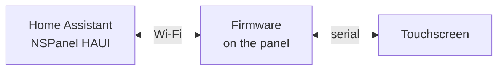

# NSPanel HAUI Docs

**NSPanel HAUI** turns a Sonoff NSPanel into a touchscreen for Home Assistant. You set it up in a visual editor inside Home Assistant, without writing YAML.

> **New here?** Start with the [Quick Start Guide](user/get-started.md).

## How it works

The integration in Home Assistant decides what the panel shows. The firmware on the panel passes it to the touchscreen and reports every touch back.

## User guide

### Set up

- [Quick Start](user/get-started.md) — the short path from a new panel to the first screen
- [Installation](user/install.md) — every step: flash the panel, install the integration, add the panel
- [Updating](user/update.md) — update the integration, the firmware and the display

### Configure

- [Configuration overview](user/configuration/README.md) — how the editor works
- [Device settings](user/configuration/device.md) — brightness, timeouts, sounds, buttons, colors
- [Display models](user/configuration/display-models.md) — landscape (EU) or portrait (US)
- [Panels](user/configuration/panels.md) — title, key, navigation, PIN
- [Items](user/configuration/items.md) — entities, names, icons, colors
- [Examples](user/examples.md) — panel layouts for common rooms

### Panels

- [Panel overview](user/panels/README.md) — every panel type with a picture
- [Screens](screens.html) — every screen in landscape and portrait
- [Icons](cheatsheet.html) — all icons you can use

### Use

- [Device](user/device.md) — gestures, buttons, display states, notifications
- [Services](user/services.md) — control the panel from automations

### Help

- [FAQ](user/faq.md) — answers to common questions
- [Troubleshooting](user/troubleshooting.md) — connection, display and update problems

## Developer guide

For contributors and everyone who wants to know how it works inside.

- [Development](develop/development.md) — architecture, setup, tests
- [Design guidelines](develop/design.md) · [Frontend](develop/frontend.md)
- [Communication](develop/communication.md) · [Notifications](develop/notifications.md)
- [Hub](develop/hub.md) · [ESPHome](develop/esphome.md) · [Nextion](develop/nextion.md) · [Nextion Editor](develop/nextion-editor.md)
- [Update process](develop/update-process.md) · [Release process](develop/release.md)
