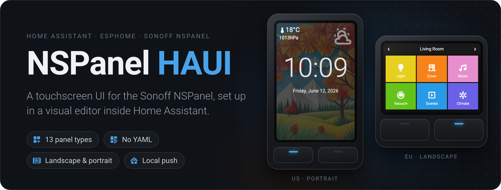
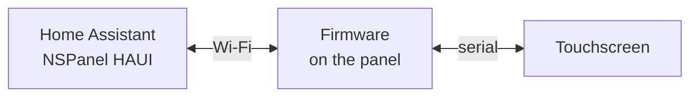

# NSPanel HAUI Docs

**NSPanel HAUI** turns a Sonoff NSPanel into a touchscreen for Home Assistant. You set it up in a visual editor inside Home Assistant, without writing YAML.

A Sonoff NSPanel is a cheap, always-on touchscreen that is already in the wall.
NSPanel HAUI exists so that such a panel behaves like a first-class Home
Assistant device: installed from the Marketplace, configured entirely inside
Home Assistant, and maintained as part of a household rather than as a firmware
project.

> **New here?** Start with the [Quick Start Guide](user/get-started.md).

## How it works

The integration in Home Assistant decides what the panel shows. The firmware on the panel passes it to the touchscreen and reports every touch back.

1. **A user gets a working panel without reading code.** Flash the prebuilt
   firmware, add the integration, add a panel in the editor — no ESPHome YAML, no
   Nextion Editor, no template language.
2. **The panel shows what Home Assistant knows.** Its values, its units, its
   localisation, its themes, its translations. Nothing on the glass is invented.
3. **A fleet stays healthy without attention.** Updates install on their own
   schedule, one device at a time, and a failure is visible instead of silent.
4. **Nothing is a dead end.** Every broken state — a half-installed display, a
   mismatched version, a wrong board batch — has a documented way back.
5. **It looks the same on the wall as in the editor.** The preview is the
   device's own render, so "it looks wrong in the preview" and "it looks wrong
   on the panel" are the same bug.

### On the panel

- **Swipe from an edge** to move between panels, open About or open Settings. Change the gestures in [Device settings](user/editor/device.md#gestures).
- **The display dims and turns off** after its timeouts. A touch wakes it; if an idle page is shown, the touch leaves that page. See [Screen](user/editor/device.md#screen).
- **An idle page** can open after inactivity, like a screensaver, and returns to the previous panel on wake. See [Home & idle](user/editor/device.md#home-idle).
- **Notifications queue** on the panel and blink the notification indicator until they are read. See [Actions → Notifications](user/actions.md#notifications).

## User guide

### Setup

- [Quick Start](user/get-started.md) — the short path from a new panel to the first screen
- [Installation](user/install.md) — every step: flash the panel, install the integration, add the panel
- [Back up the stock firmware](user/backup.md) — keep the original Sonoff firmware and its eWeLink credentials
- [Updating](user/update.md) — update the integration, the firmware and the display
- [Version compatibility](user/version-compatibility.md) — which Home Assistant, firmware and display versions work together

### Editor

- [Overview](user/editor/README.md) — the dashboard, device view, sidebars and live preview
- [Device settings](user/editor/device.md) — display model, brightness, idle page, buttons, sounds, gestures
- [Panels](user/editor/panels.md) — add, edit and arrange panels and popups
- [Items](user/editor/items.md) — entities, names, icons, colors and states
- [Themes](user/editor/themes.md) — page colors, icon palettes and backgrounds
- [Display models](user/editor/display-models.md) — landscape (EU) or portrait (US)

### Panel types

- [Panel types](user/panels/README.md) — every type with a picture
- [Screens overview](user/screens.md) — every screen in landscape and portrait
- [Icons cheatsheet](user/icons.md) — all icons you can use

### Dashboard and automation

- [Dashboard Card](user/dashboard-card.md) — show a hub's panels, or one panel, on a dashboard
- [Actions](user/actions.md) — control the panel from automations

### Help

- [FAQ](user/faq.md) — answers to common questions
- [Troubleshooting](user/troubleshooting.md) — connection, display and update problems

## Developer guide

For contributors and everyone who wants to know how it works inside. It follows the repository: the integration runtime, the firmware and display, the editor, and the delivery pipeline.

### General

- [Development setup](develop/development.md) — commands, test instances, hooks, test conventions
- [Hub & runtime](develop/hub.md) — app objects, threading, panel lifecycle, REST API
- [Communication](develop/communication.md) — handshake, heartbeats, reconnection, display reads
- [Notifications](develop/notifications.md) — queue, delivery paths, timers, presentation

### ESPHome & display

- [ESPHome firmware](develop/esphome.md) — configs, OTA, events, actions, sensors
- [Nextion component](develop/nextion.md) — display configuration, rendering, scripts
- [Editing the HMI](develop/nextion-editor.md) — working on both HMI projects
- [Design guidelines](develop/design.md) — style, fonts, icons, themes, new panels

### Frontend

- [Editor architecture](develop/frontend.md) — constraints, boot sequence, layers, feature map
- [Screens](develop/frontend-screens.md) — routes, the shared shell, Fleet, Device
- [Sidebars and overlays](develop/frontend-overlays.md) — sidebars, popovers, dialogs, focus
- [Visual foundations](develop/frontend-visuals.md) — tokens, breakpoints, text sizes
- [Components](develop/frontend-components.md) — primitives, composites, surface map
- [Tests](develop/frontend-testing.md) — conventions, local checks, assertions
- [Live preview and cards](develop/preview.md) — virtual panel, simulator, dashboard card

### Releases

- [Update process](develop/update-process.md) — channels, checks, installs, rollouts
- [Upgrading](develop/upgrading.md) — breaking changes per version, rollback
- [Release process](develop/release.md) — artifacts, versioning, branches, CI, runbook
