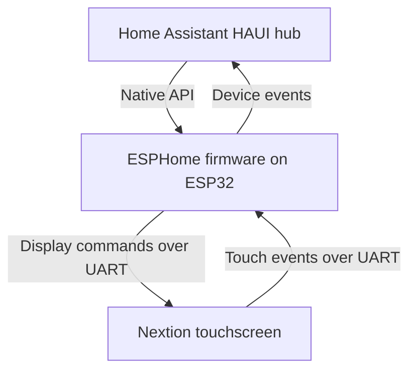
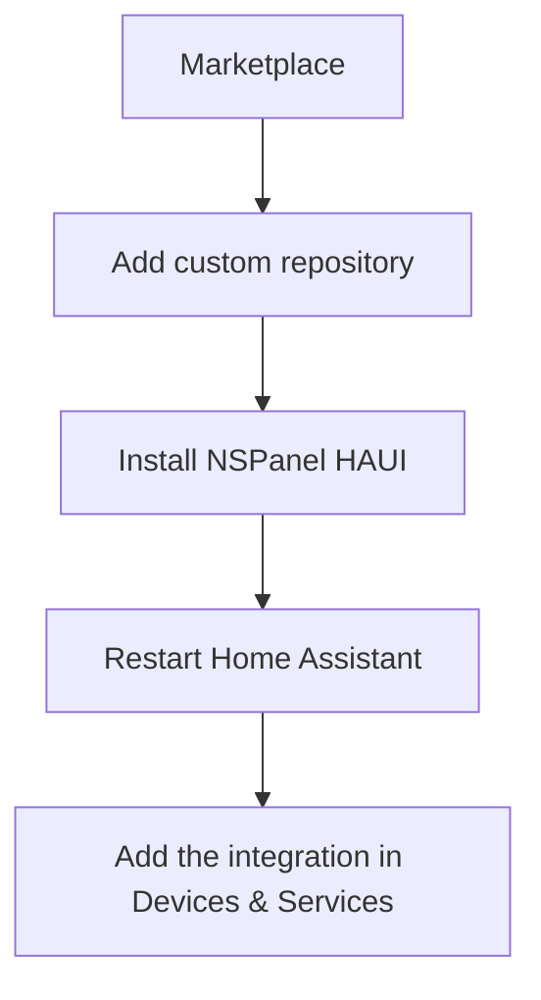
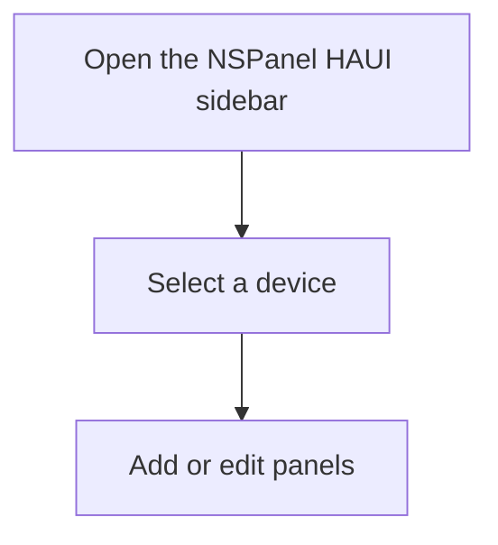

# Custom Integration

## Overview

NSPanel HAUI runs as a native Home Assistant custom integration. No external addon required.



## Requirements

- Home Assistant 2026.11+
- Panel flashed with the NSPanel HAUI firmware, connected to Wi-Fi, and added to Home Assistant's ESPHome integration (see the [Installation Guide](install.md))

## Installation

The recommended method is the Home Assistant Marketplace. NSPanel HAUI is a custom repository:



[Open the NSPanel HAUI repository in Home Assistant](https://my.home-assistant.io/redirect/marketplace_repository/?owner=happydasch&repository=nspanel_haui&category=integration).

1. Install from the Marketplace as a custom repository (see [Installation Guide](install.md#install-the-integration)) or copy the `custom_components/nspanel_haui/` folder into your HA config directory:
   ```
   <ha_config>/custom_components/nspanel_haui/
   ```
2. Restart Home Assistant.
3. Go to **Settings → Devices & Services → Add Integration → NSPanel HAUI** to set up via the config flow.

## Configuration

**The primary configuration method is the Home Assistant panel editor.** After adding the integration, open **NSPanel HAUI** in the sidebar (admin only), select your device, and manage its panels.



For full config options see [Configuration Details](configuration/README.md).
