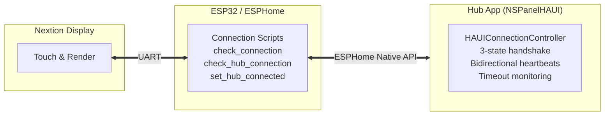
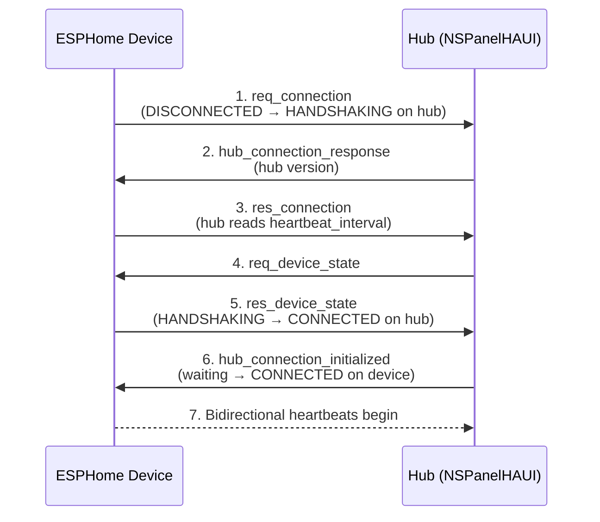
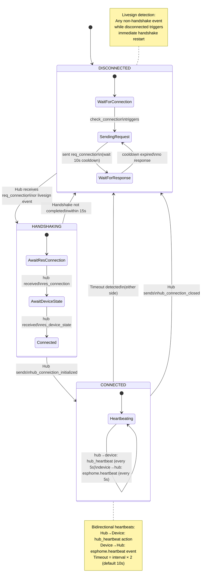
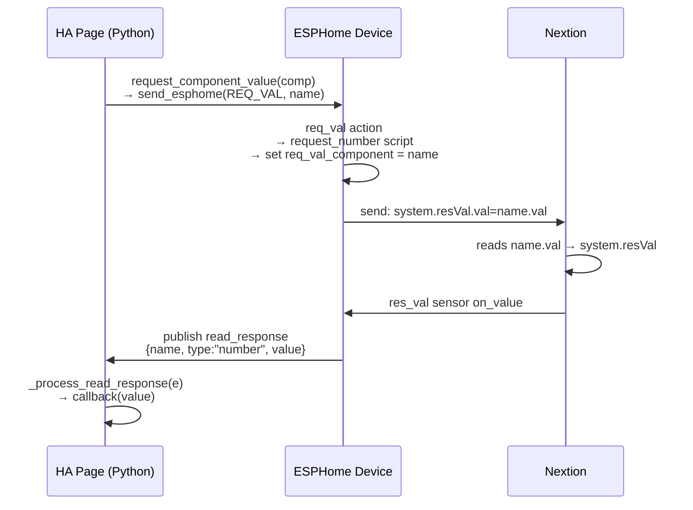

# Communication

The panel and the hub app are two independent sides of one wire protocol: a three-step handshake, a heartbeat in each direction, and a timeout on each side that drops the connection on its own. The display speaks UART to the ESP32 only, so every display change is a device action. Read this when you change `HAUIConnectionController`, the ESPHome connection scripts, or a page that reads a value out of the display.

## Participants



| Participant | Code | Role |
|-------------|------|------|
| Hub app | `haui/controller/connection.py` (`HAUIConnectionController`) | Handshake, hub→device heartbeat, device→hub timeout, connection callback |
| ESPHome component | `esphome/nspanel_haui/scripts_connection.yaml`, `api.yaml`, `interval.yaml` | Handshake scripts, `hub_availability`, device→hub heartbeat, hub timeout |
| Display | `nextion/nspanel_haui.HMI`, `nextion/nspanel_haui_portrait.HMI` | Renders pages, reports touches and read values |

## The three-step handshake

Both sides run the same three-state machine, `DISCONNECTED → HANDSHAKING → CONNECTED`.



### Messages

| # | Message | Sent by | Payload | Expected answer |
|---|---------|---------|---------|-----------------|
| 1 | `req_connection` | device | JSON: `yaml_version`, `hub_api_version`, `name`, `friendly_name`, `ip`, `ssid`, `rssi`, `uptime`, `firmware_variant` | `hub_connection_response` |
| 2 | `hub_connection_response` | hub | `version` (integration version) | `res_connection` |
| 3 | `res_connection` | device | JSON: `heartbeat_interval` | `req_device_state` |
| 4 | `req_device_state` | hub | empty | `res_device_state` |
| 5 | `res_device_state` | device | JSON device state, fields in [Events](esphome.md#events) | `hub_connection_initialized` |
| 6 | `hub_connection_initialized` | hub | empty | none, the device sets `hub_connection = true` |

`req_connection`, `res_connection` and `res_device_state` are the three hub-side steps; `hub_connection_initialized` completes the device side.

### Hub side (`HAUIConnectionController.process_event()`)

1. **`req_connection`** — parses the device info (`append=False`), logs a `WARNING` when `hub_api_compatible()` returns `False`, moves to HANDSHAKING and answers `hub_connection_response`. Ignored while HANDSHAKING (the device is retrying); while CONNECTED it is recorded as a drop and the handshake starts over.
2. **`res_connection`** — adopts the device's `heartbeat_interval` when it is above 0.5 s, merges the payload into the device info (`append=True`) and sends `req_device_state`. A duplicate while CONNECTED only refreshes the timeout clock; one while DISCONNECTED is logged as unexpected.
3. **`res_device_state`** — merges the device state and, from HANDSHAKING, enters CONNECTED; received while CONNECTED it is logged as a replay.

`_set_state()` runs the side effects once per transition. Entering CONNECTED sends `hub_connection_initialized`, starts the heartbeat timer and the timeout check, clears `_last_heartbeat` so a reboot gap counts as a drop instead of a late heartbeat, and calls the connection callback with `True`. Entering HANDSHAKING from CONNECTED calls the callback with `False` first, so a reported reconnect always follows a reported disconnect. A handshake that does not finish within `_HANDSHAKE_TIMEOUT` (15 s) falls back to DISCONNECTED with the reason `handshake timeout`.

### Device side

1. `check_connection` runs every 100 ms (`interval.yaml`).
2. When `haui_init` is true (display initialised), `hub_availability` is true and `hub_connection` is false, it publishes `req_connection` and starts a 10 s cooldown (`connecting`, `connecting_time`).
3. `hub_connection_response` runs `publish_connection_response` (answers `res_connection` with `heartbeat_interval`); `req_device_state` runs `publish_device_state` (answers `res_device_state`).
4. `hub_connection_initialized` runs `set_hub_connected(1, force=0)`.
5. `check_connection` also publishes `esphome.connected` whenever `haui_init and api_connected and hub_availability and hub_connection` changes, and resets the retry state on connect so a fast disconnect cannot block the next attempt for 10 s.

### API contract version

`req_connection` and `res_device_state` carry `hub_api_version`, declared in `esphome/nspanel_haui/version.yaml` and mirrored by `HUB_API_VERSION` in `haui/version.py`. The hub compares the major part only (`hub_api_compatible()`): a different major is logged at `WARNING` and reported as `hub_api_compatible` in the device status payload, a malformed value counts as incompatible, and a firmware that does not report the field at all stays compatible. Bump the major only for an incompatible handshake or payload change, and ship firmware and integration together.

## Heartbeats

Both sides send and monitor independently once connected:

| Direction | Mechanism | Interval | Timeout |
|-----------|-----------|----------|---------|
| Hub → device | `hub_heartbeat` action resets `hub_heartbeat` on the device | `heartbeat_interval`, default 5 s | device: `heartbeat_interval × 2` |
| Device → hub | `esphome.heartbeat` event refreshes `_last_time` on the hub | `heartbeat_interval`, default 5 s | hub: `max(heartbeat_interval × overdue_factor, 10 s)`, factor default `2.0` |

### Hub → device

- The timer starts on entering CONNECTED and fires at `now+0`. It runs on the event loop (`run_every(..., on_loop=True)`) and publishes with `publish_detached()`: the device force-disconnects the hub after two missed heartbeats and wakes the display when it does, so a busy worker thread must not delay this path.
- Every `esphome.heartbeat` from the device is answered immediately as well; the timer is the fallback. The timer stops as soon as the state leaves CONNECTED.

### Device → hub

- The 100 ms interval publishes `esphome.heartbeat` every `heartbeat_interval` while `hub_connection` is true; the hub records `_last_time` and keeps a gap above `heartbeat_interval × 1.5` (`LATE_HEARTBEAT_FACTOR`) as a late heartbeat.
- `_check_timeout` runs every `heartbeat_interval`, the first check one interval after connecting, and acts only in CONNECTED: a `_last_time` older than `max(heartbeat_interval × overdue_factor, 10.0)` moves the state to DISCONNECTED with the reason `heartbeat timeout`. `health()` reports `drops_24h`, `recent_drops`, `late_heartbeats_24h` and `longest_heartbeat_gap` for the editor's device diagnostics; the history is in memory and starts empty with the hub.

## Timeout and reconnection

### Device side

`check_hub_connection` runs every 100 ms and compares `millis() / 1000` with `hub_heartbeat + heartbeat_interval × 2`; a passed deadline, or `hub_availability` turning false, calls `set_hub_connected(false, force=1)`. A wrapped `millis()` (about 49.7 days) re-anchors `hub_heartbeat` instead of timing out.

`set_hub_connected(connected, force)` skips a disconnect only while another Native API client is still connected and `force` is 0. A hub-initiated close (`hub_connection_closed`) and a device-detected timeout are forced; the last-client API callback is not. The script updates `hub_connection`, stamps `hub_state_change_ms`, anchors `hub_heartbeat` on connect and resets it on disconnect, writes `system.firstRun.txt="0"` on connect, wakes the display on disconnect and publishes `client_status`.

Reconnecting is the 10 s retry loop of `check_connection` above: it keeps publishing `req_connection` until the hub answers, and each attempt is one handshake.

### Hub side

Entering DISCONNECTED from CONNECTED sends `hub_connection_closed`, calls the connection callback with `False`, stops the heartbeat and handshake timers and starts `_disconnected_since`; `_log_extended_disconnect` then warns at most once a minute. `hub_connection_closed` is authoritative even while another ESPHome Native API client is connected, which matters when several Home Assistant instances talk to one panel.

### Livesign detection

While DISCONNECTED, every event except `req_connection`, `res_connection` and `res_device_state` is a livesign: the device is alive but the connection was lost. `_initiate_handshake("livesign")` moves to HANDSHAKING and sends `hub_connection_response`, and the event is not processed any further. The next `res_connection` and `res_device_state` complete the handshake.

### Connection-state callbacks

`callback_connection(connected)` in `hub/app.py` is the single entry point of a state change: it calls `HAUIDevice.on_connection_changed()` and the update controller, fires the `nspanel_haui.connection_changed` event (`device`, `connected`) and publishes a `connection` preview state.

`HAUIDevice.on_connection_changed()` cancels stale navigation timeouts, syncs the device config, opens the System panel on the first connect only and restores the panel it was showing on a reconnect; a disconnect only resets the idle and touch guards.

## State machine



## Error scenarios

| Cause | Symptom | Recovery |
|-------|---------|----------|
| Native API client disconnects | `on_client_disconnected` sets `hub_availability` to `is_connected()` and calls `set_hub_connected(0, force=0)`, which is skipped while other clients remain | `on_client_connected` sets `hub_availability = true` and publishes `req_connection` after 500 ms; the hub answers with the normal handshake |
| Home Assistant restart | the hub app starts in DISCONNECTED | the device misses hub heartbeats after `heartbeat_interval × 2`, drops the connection and publishes `req_connection` until the new app answers |
| ESP32 reboot | the device starts in DISCONNECTED while the hub still holds CONNECTED | the `req_connection` is recorded as a drop and the handshake starts over |
| Network partition | both sides time out on their own (`check_hub_connection`, `_check_timeout`) | the first event after the link returns is a livesign and re-handshakes |
| Handshake stalls without `res_device_state` | HANDSHAKING for 15 s | the hub falls back to DISCONNECTED; the next `req_connection` retry re-handshakes |
| Display not initialised, or `Restart Display` running | `haui_init` is false, so the device never requests a connection | it completes when the display setup finishes; otherwise press `Restart Display` |

## Reading values from the display

The hub reads the current numeric value or text of any Nextion component or global variable, so a slider needs no mirror in the hub. End-user controls use it for brightness, colour temperature, cover position and volume; everything else renders from hub state.



The text path is identical with `REQ_TXT`, the `request_text` script and `system.resTxt.txt=name`, answered by the `res_txt` sensor with `type:"text"`. Both firmware scripts wake a sleeping display first, because a read from a dark panel returns nothing.

### Python API

`request_component_value(component)` sends `REQ_VAL`, `request_component_text(component)` sends `REQ_TXT`; both take a component or a plain name. Responses arrive asynchronously as `esphome.read_response` events, so register the callback **before** sending the request. The handler receives an `int` for a number read or a `str` for a text read.

```python
self.add_read_callback(comp, self._on_value_read)
self.request_component_value(comp)

# a Nextion component or variable without a COMPONENTS entry, by name
self.add_read_callback("tTitle", self._on_title_read)
self.request_component_text("tTitle")

def _on_value_read(self, value: int) -> None:
    self.log(f"Got brightness: {value}")

# a plain slider: drag control + value callback in one call
self.bind_slider(self.COMPONENTS.h_brightness, self._on_brightness)
```

`bind_slider(component, handler)` is the slider shorthand, equivalent to `on_release(component, self._callback_slider_release, drag=True)` plus `add_read_callback(component, handler)`: on release the page reads the value and the display's final value reaches the handler.

### Constraints

- **One read in flight.** The ESP32 has a single `req_val_component` / `req_txt_component` pair, so the page keeps one `_pending_read_request`; a request made while another is unexpired is skipped with a log line, so a response can never be attributed to the wrong component. The guard expires after `READ_PENDING_TIMEOUT` (6 s) and a later response is dropped as stale, so a lost event never wedges a control. Requests go out with `force=True`, so an identical repeat is not deduplicated.
- **Touch and page changes.** A `TOUCH_START` clears the pending request only when it has already expired, so a response that arrives just after a touch is still delivered. `_stop_panel()` clears the read callbacks and the pending read, so a response that arrives after the page switched is dropped, even when the new page binds the same slider, and the new page can read immediately.

### Pages that read

| Page | File | Method |
|------|------|--------|
| Light | `haui/page/light.py` | `bind_slider()` for brightness + color temp |
| Cover | `haui/page/cover.py` | `bind_slider()` for position |
| Media | `haui/page/media.py` | `bind_slider()` for volume |
| Settings | `haui/page/settings.py` | `bind_slider()` for brightness full/dim |
| Row | `haui/page/row.py` | `bind_slider()` per row slider |
