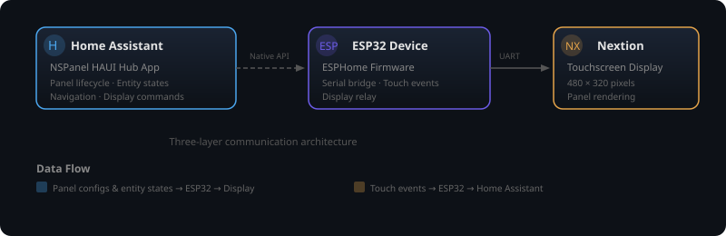

# Development setup

There is no build step: Home Assistant imports `custom_components/nspanel_haui/` and serves the editor from the same folder. This page covers the environments, the commands, the hooks and what a change must satisfy before review. The runtime itself is described in [Hub & runtime](hub.md).

## Requirements

| Tool | Version | Needed for |
|------|---------|------------|
| Python | 3.14 | the integration and every check |
| Node | 22+ | the editor tests and the backend's card-render replay |
| Docker | any recent | the Docker development instance, optional |
| ESPHome | 2026.11 | firmware builds only, in its own environment |

## Set up once

```bash
python3.14 -m venv .venv
source .venv/bin/activate
pip install -r requirements-dev.txt
pip install -r requirements-docs.txt   # make docs
npm ci                                 # the frontend type check
scripts/git_hooks/install.sh           # optional pre-commit hook
```

Activate `.venv` in every shell that runs a `make` target: the system `python` and `pytest` are not the project ones.

## Commands

`make` or `make help` lists every target.

| Target | Does |
|--------|------|
| `make -j4 check` | The routine gate: `test`, `format-check`, `lint`, `typecheck`, `typecheck-frontend`, `docs`, `version-check`, `generated-check`, in parallel |
| `make test` | Both suites: `test-integration` (backend) and `test-frontend` (editor) |
| `make format` / `make format-check` | Rewrite / verify Python formatting with Ruff |
| `make lint` | Ruff lint findings only, no fixes |
| `make typecheck` | `mypy` over `custom_components/nspanel_haui` |
| `make typecheck-frontend` | `tsc` over the modules marked `// @ts-check` |
| `make docs` | `zensical build --strict`; a broken page link fails it |
| `make hmi-check` | Both HMI layout specs, the generated layouts and preview coverage |
| `make screens-check` | `docs/screens.html` and its PNGs against a fresh render (needs Chrome) |
| `make version-check` | The integration version against its firmware mirrors |
| `make generated-check` | Icon cheatsheet and locale files are current |
| `make esphome-config`, `make esphome-compile`, `make esphome-size` | Firmware validation, build and partition fit, in the ESPHome environment |

Raw commands, for one check:

```bash
pytest tests/
node --test 'tests/frontend/*.test.mjs'
npm run typecheck:frontend
ruff format custom_components/ scripts/ tests/
ruff check custom_components/ scripts/
mypy
```

`make esphome-*` needs a second environment (`requirements-esphome.txt`); its pinned dependencies conflict with the Home Assistant development one. `make ha-docker-down` removes the container but keeps its config.

## Architecture

<p align="center">
  
</p>

| Layer | Component | Role |
|-------|-----------|------|
| **Hub app** | `NSPanelHAUI`, inside Home Assistant | Reads entity states, renders display commands, owns navigation |
| **ESP32** | ESPHome firmware | Serial bridge to the display, relays touches and button presses |
| **Nextion** | Touchscreen | Draws widgets, holds widget state, reports touch input |

### Design invariants

These hold today; changing one is an architecture decision, not a refactor.

- **Configuration lives in Home Assistant.** The panel config store and the device settings are the single source of truth; the display holds no user configuration.
- **Logic in the hub app, drawing on the display.** The Nextion draws, the hub decides. Display-side scripts exist for preparation and immediate feedback only.
- **The firmware is a stable substrate.** A feature ships in the integration without a reflash where possible, which is why the update entities exist and why the ESPHome package changes rarely.
- **The fleet is the unit of design.** Updates, backups and rollouts are fleet-wide concerns, not per-device afterthoughts.
- **Home Assistant's own vocabulary.** States, attributes, device classes, units and translations come from Home Assistant; the integration translates, it does not reinterpret.
- **Recoverable by default.** No step may leave a device in a state only a serial flash can fix, unless the editor documents it and reaches it.

## Running a development instance

Both instances are throwaway: state lives in the git-ignored `.dev/`, they run the Home Assistant version the integration requires ([2026.11](../user/install.md#requirements)), and they take it from `HA_VERSION` (`Makefile` and `compose.yaml`, default `2026.11.0`), so `make HA_VERSION=2026.12.0 ha-venv-setup ha-venv-start` tests a newer core.

### Exposing the checkout

Any Home Assistant instance can run the checkout by linking the folder into its config directory:

```bash
HA_CONFIG=/path/to/home-assistant/config
REPO=/path/to/nspanel_haui
mkdir -p "$HA_CONFIG/custom_components"
ln -sfn "$REPO/custom_components/nspanel_haui" \
  "$HA_CONFIG/custom_components/nspanel_haui"
```

`ln -sfn` replaces an earlier link; a plain `ln -s` follows it and creates a second link inside the integration folder, which Python imports instead of the package. Move a Marketplace or copied installation aside first, and inside a container either mount the checkout or copy the folder. Restart Home Assistant after Python or frontend changes: the editor is served as cached static assets under a content-hash URL computed at startup, so a browser reload alone keeps the old modules.

### Virtual environment

```bash
make ha-venv-setup     # .venv_ha with Python 3.14 + Home Assistant, plus the symlink
make ha-venv-start     # Ctrl+C stops it
make ha-venv-logs      # follow the log, also in .dev/ha-config/home-assistant.log
```

The first start installs the default integrations' requirements and takes a few minutes. Restart by stopping `hass` and starting it again — **Settings → System → Restart** only stops it here, because nothing starts it again. To reset, stop it and delete `.dev/ha-config`, then run `make ha-venv-setup`.

The instance runs on the host's network, so mDNS discovery works as on a regular installation: ESPHome offers the panels it finds and the hub picks them up through their ESPHome entries. On macOS, allow **Local Network** access for the terminal app that starts `hass`, or connections fail with "No route to host".

### Docker

`compose.yaml` bind-mounts `.dev/ha-docker` and the integration folder, so the container sees the checkout itself (a symlink would point outside it).

```bash
docker compose up -d                                   # or make ha-docker-up
docker compose restart                                 # Settings → System → Restart works here
docker compose logs -f
```

With the `ports` mapping the container sits on Docker's bridge network, which mDNS from the LAN does not reach: add the panels by IP address in the ESPHome integration. On Linux, `network_mode: host` instead of `ports` restores discovery. To reset, run `docker compose down` and delete `.dev/ha-docker`.

!!! warning "One hub per panel"
    Never point a development hub at a panel the production Home Assistant drives: two hubs sending commands to one display fight over it. Use a test panel or stop the production hub first.

### Firmware

`esphome/nspanel_haui_dev.yaml` adds the optional web server and `debug.yaml` diagnostics; `nspanel_haui_universal.yaml` is the release build. Configure the required secrets, install `requirements-esphome.txt` in its own environment, then:

```bash
esphome run esphome/nspanel_haui_dev.yaml
```

See [ESPHome firmware](esphome.md) for the configs and the build targets.

## Git hooks

`scripts/git_hooks/install.sh` sets `core.hooksPath` to the repository's `pre-commit` hook, which runs only when staged changes touch the display layouts or their inputs. It checks both HMI specs and regenerates the preview layouts, icon map, pictures and font metrics, and it refuses to regenerate from unstaged layout inputs — stage the inputs with the generated files. It never writes either HMI. For a read-only check use `make hmi-check`; the hook prefers the project `.venv`, so install the development dependencies first. `git config --unset core.hooksPath` removes the hook.

## Tests

### Backend tests

`pytest tests/` needs no running Home Assistant: `tests/conftest.py` stubs the `homeassistant` and `dateutil` modules through `sys.modules`, and a test file adds its own overrides where it must. Mock with `unittest.mock` and keep stub classes for Home Assistant types minimal. The suite needs Node 22+, because `tests/test_card_renders.py` replays every panel render.

- **Assert at the boundaries** — the display commands (`app.cmds`), the Home Assistant calls (`entity.calls`), the return values — never internals or copy. The frontend follows the same rule ([assertion boundaries](frontend-testing.md#assertion-boundaries)).
- **Build the real object on the shared fake** in `tests/support/page_app.py` (`PageApp`, `Entity`) and drive a page through `set_panel`. Extend that fake instead of copying it, and construct real objects rather than `Class.__new__` with assigned private attributes.
- **One file per module**, named after it (`test_page_<type>.py`, `test_<module>.py`). Do not copy a constant or key list into a test, and do not add a test that something removed stays removed.
- **`tests/test_page_commands_golden.py`** pins the exact commands, service calls and popup requests of the feature-gated pages in `tests/page_commands_golden.json`; regenerate deliberately with `PAGE_COMMANDS_REGEN=1 pytest tests/test_page_commands_golden.py`.
- **Generated assets have guards:** `test_gen_layout` (both HMI specs), `test_bump_version` (version sources, both HMIs, both TFTs), `test_preview_coverage`, `test_frontend_styles`.
- **`tests/test_page_options.py`** refuses `panel.get()` on a declared page option — read those with `self.option(panel, key)`. A `config_flow.py` change goes with `test_config_flow.py`; an option-rule change goes with `tests/fixtures/option_rules_cases.json`, which runs through both the Python and the JS engine.

### Frontend tests

`node --test 'tests/frontend/*.test.mjs'` runs the editor suite. Import `./support/browser.mjs` before DOM or Lit code, render through `support/render.mjs`, query through `support/queries.mjs`. A new primitive needs a semantic assertion in `ui-primitives.test.mjs` and a demo in `ui-primitives-preview.js`. Details: [Editor tests](frontend-testing.md).

### Display and preview

`make hmi-check` covers both HMI specs, the generated layouts and the preview coverage; `make screens-check` compares `docs/screens.html` and its PNGs with a fresh render. A change to the page lifecycle, the display commands, the WebSocket delivery or the simulator replay also needs the focused regression set:

```bash
pytest tests/test_live_panel.py tests/test_page_weather.py tests/test_card_renders.py
node --test tests/frontend/virtual-session.test.mjs
```

These cover a fresh full-page attach, replays of content drawn in different lifecycle hooks, reconnecting onto a blank simulator, live page switches and replaying real hub commands in the browser's Nextion simulator. Feed cross-layer tests with captured hub output instead of duplicating an expected command stream in JavaScript.

For live mode, verify on a connected device when one is available:

1. Open Live on a clock or weather page: time, weather details, forecast and page content are complete.
2. Close and reopen Live, then reconnect the device: the simulator starts clean and reproduces the current page.
3. Switch pages on the panel; the simulator follows. Move a slider or press a button; the device responds once.
4. Switch Simulated → Live and back: Live drops the simulated states, Simulated restarts on its home panel, and sandbox interactions never touch real entities.
5. Repeat on portrait hardware when the change affects layout or page ids.

Record hardware checks you could not run in the pull request instead of marking them verified.

## Code style

| Area | Rule |
|------|------|
| Python | 3.14, 100 columns, `from __future__ import annotations`, imports sorted |
| Ruff | `E,F,W,I,UP,B` with `S101` and `B008` ignored; `ruff format` before a commit |
| Docstrings | Google style, `Args:` and `Returns:` |
| Names | `NSPanelHAUI` for the app, `HAUI` prefix for core abstractions, `SuffixPage` for pages, snake_case purpose names for components |
| Logging | `_LOGGER` plus `self.log()` / `self.debug_log()` |
| JavaScript | No linter: match the file — 2 spaces, single quotes, semicolons, trailing commas, `.js` imports, `// @ts-check` to opt into typing |

Comments explain *why*; a comment that restates the next line is noise. Fail loudly: raise instead of swallowing, and a call site that must degrade logs at warning level.

## Developer guide

| Group | Page | Covers |
|-------|------|--------|
| **General** | [Hub & runtime](hub.md) | App objects, threading, panel lifecycle, controllers, REST API |
| | [Communication](communication.md) | Handshake, heartbeats, reconnection, reading values from the display |
| | [Notifications](notifications.md) | Queue, delivery paths, timers, presentation |
| **ESPHome & display** | [ESPHome firmware](esphome.md) | Configs, OTA, events, actions, brightness, sensors |
| | [Nextion component](nextion.md) | Display configuration, rendering, refresh, display scripts |
| | [Editing the HMI](nextion-editor.md) | Working in Nextion Editor on both projects |
| | [Design guidelines](design.md) | Style, fonts, icons, themes, adding a panel |
| **Frontend** | [Editor architecture](frontend.md) | The editor: constraints, boot sequence, layers, feature map |
| | [Screens](frontend-screens.md), [sidebars and overlays](frontend-overlays.md) | Routes, the Fleet and Device regions, overlays, focus |
| | [Visual foundations](frontend-visuals.md), [components](frontend-components.md) | Tokens, breakpoints, text sizes, primitives, composites |
| | [Tests](frontend-testing.md) | Conventions, local checks, assertion boundaries |
| | [Live preview and cards](preview.md) | Virtual panel, simulator, dashboard card |
| **Releases** | [Update process](update-process.md) | Channels, checks, installs, rollouts |
| | [Upgrading](upgrading.md) | Breaking changes per version, rollback |
| | [Release process](release.md) | Artifacts, versioning, branches, CI, runbook |

Direction and release gates live in [ROADMAP.md](https://github.com/happydasch/nspanel_haui/blob/master/ROADMAP.md), ideas in [FEATURE_WISHLIST.md](https://github.com/happydasch/nspanel_haui/blob/dev/FEATURE_WISHLIST.md), shipped changes in [CHANGELOG.md](https://github.com/happydasch/nspanel_haui/blob/master/CHANGELOG.md).

