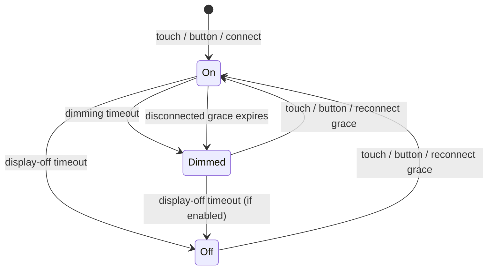

# ESPHome firmware

The panel runs an ESP32 with ESPHome, which is how the hub reaches it: the integration calls actions and receives events over the ESPHome Native API, and the firmware owns everything with hard real-time needs — the UART to the Nextion display, brightness and dimming, gestures, relays and the buzzer. The release image `nspanel_haui.bin` needs no ESPHome installation; read this when you build your own firmware or change `esphome/`.

## Installation

Three entry points share the components in `esphome/nspanel_haui/packages.yaml`:

| File | Use |
|------|-----|
| `esphome/install.yaml` | Your own device: real secrets from `esphome/secrets.yaml`, remote package from `master`, `firmware_variant: custom` |
| `esphome/nspanel_haui_dev.yaml` | Local development: hardcoded substitutions, `!secret` credentials, web server on, `debug.yaml` included |
| `esphome/nspanel_haui_universal.yaml` | The prebuilt release image: public documented credentials, no station network, `name_add_mac_suffix: true` |

`esphome/nspanel_haui.yaml` is the package all three include and takes its `$` substitutions from the entry point, so edit the entry point. `esphome.project.name` is fixed at `happydasch.nspanel_haui` because the config flow and the editor's device scan match it; keep it when forking.

Copy `esphome/secrets.yaml.example` to `esphome/secrets.yaml` (git-ignored) and fill it in, or enter the secrets through the ESPHome dashboard. The build needs ESPHome 2026.11.0 or later (`min_version` in `esphome/nspanel_haui/base.yaml`, pinned in `requirements-esphome.txt`), whose dependencies conflict with the development environment:

```bash
pip install -r requirements-esphome.txt
esphome run esphome/install.yaml                  # flash your own device
esphome run esphome/nspanel_haui_dev.yaml         # development build
make esphome-compile CONFIG=esphome/nspanel_haui_dev.yaml
make esphome-size                                 # newest image against its app partition
```

Once the device is in Home Assistant, install the TFT with **Install** on its **HAUI Display** update entity, or let the hub install the version the firmware needs about a minute after connecting.

`esphome/nextion_patch/` is the stock `nextion` component at 2026.11.0 plus two local changes: `upload_first_chunk_sent_` is never reset, so a TFT upload that fails and is retried requests the whole file again and stops after the first 4 KB with `Invalid range end`; and the upload names its own failures (`tft_upload_error_`) and marks the display's side of them (`tft_upload_display_fault()`), which is what lets the firmware retry at 115200 bps only what a lower rate can fix. Every config overrides the stock component through `external_components` with a **local source** (`path: nextion_patch`), never a git ref: a local path resolves against the config's own directory, so an installed panel that fetches this package at any ref compiles the patch that came with it. A git source instead let a build pair a fresh `display.yaml` with an older patch (`[tft_upload_http_buffer_size_tx] is an invalid option`), and once the patch carried C++ the firmware calls, a package from `dev` failed to compile against the patch of `master` (`no member named 'tft_upload_display_fault'`). Remove the patch and its override blocks once a released ESPHome contains the fix (conditions in `esphome/nextion_patch/README.md`), moving `min_version` and the `requirements-esphome.txt` pin together.

## Config

| Substitution | Default | Purpose |
|--------------|---------|---------|
| `name` | `nspanel-haui` | Device name, hostname and entity-ID prefix |
| `friendly_name` | `NSPanel HAUI` | Name in Home Assistant |
| `heartbeat_interval` | `5` | Seconds per heartbeat, both directions |
| `api_encryption_key` | `!secret` | Native API key; also encrypts native OTA |
| `wifi_ssid`, `wifi_password` | `!secret` | Station network; the universal image removes it and provisions over the access point |
| `ap_password` | `!secret` | Fallback access point, SSID `$name` |
| `tft_update_url` | release TFT URL | Compile-time fallback; the hub sends the URL of the TFT it installs |

`esphome: loop_interval` is set to `2ms` instead of ESPHome's 16 ms default: the nextion pacer leaves at most one command per component phase, so the loop interval is the display's command spacing ([Nextion component](nextion.md#command-pacing-costs-one-component-phase-per-command)).

### Display baud

The UART starts at 921600, the rate both shipped TFTs set in `Program.s`, or at the rate found on the previous boot. After boot the firmware waits 8 s for the Nextion; when it does not answer, `display_baud.yaml` power-cycles the display and probes the remembered rate, 921600, 115200, 9600 and the remaining Nextion rates, then stores the rate that answered. Every probe re-enables command returns (`bkcmd=3`): a display that was just power-cycled is back on its power-on defaults and answers no `get` otherwise, which would make a correct rate look silent. When no rate answers, the UART stays at 115200 — the rate every TFT before 0.4.6 and the stock one use — and the scan runs up to three more times a minute apart, so a missed banner cannot leave the panel without a display. Only the boot applies the rate remembered from the last one: a retry waits at whatever the last scan settled on, so a scan's 115200 fallback gets its window instead of being overwritten by the rate nothing answered at. Whichever path found the display republishes the device state with `display_baud` set to the live `id(haui_uart).get_baud_rate()`, so the editor's Diagnostics card shows the link speed the panel actually runs at; while no display answers it reports `0`, and the card shows **Unknown** rather than a rate nothing listens at. This is what lets a panel with an older 115200 TFT update over the air, and what makes the new rate survive a TFT upload (the upload reboots the ESP, so the same scan runs again). Do not lower `baud_rate` in `hardware.yaml` without rebuilding both TFTs; the scan is a fallback, not a substitute for matching rates.

### TFT transfer baud

`upload_tft()` transfers at the rate the link runs at, 921600 with a current TFT. `prepare_tft_upload` (`scripts_common.yaml`) retries a transfer that the display itself failed once at 115200, the rate every TFT before 0.4.6 and the stock one use: a failed transfer leaves the Nextion waiting for data, so the retry power-cycles it through `screen_power` first. Only the display's own failures are retried — marked by `tft_upload_display_fault()` when the display refuses the upload, rejects a chunk or stops acknowledging one — because a download, range or heap error repeats at any rate and every retry costs another full transfer. The retry is also skipped when the link already runs at 115200, and it republishes `tft_upload_started`, so the hub re-arms its install timeout and a retry that outlives the first window is still one install. Nothing is remembered: a transfer starts at the link rate again, and the panel reboots after a successful upload and rescans anyway.

### Encrypted native OTA

Wireless installs (dashboard **Install → Wirelessly**, `esphome run`, `esphome upload`) use native OTA, encrypted with the device's API key: `base.yaml` sets a bare `encryption:` block that inherits `api_encryption_key`. There is no OTA password — next to an API key ESPHome warns that one wastes significant flash and RAM. The `on_begin` hook that suspends device activities still runs before every OTA, and the separate `http_request` OTA platform behind the hub's **HAUI Firmware** entity stays; wired flashing and hub firmware updates do not use native OTA.

A panel still running a password build needs one migration install: add this to your device YAML (the file that includes `nspanel_haui.yaml` as a package) with the password the panel was flashed with. ESPHome merges it into the package's OTA block and logs "Found and merged multiple configurations for ota platform esphome"; the upload answers the old firmware's password prompt in plaintext, and the new firmware accepts encrypted uploads only.

```yaml
ota:
  - platform: esphome
    password: !secret ota_password
    encryption:
      allow_plaintext_upload: true
```

!!! warning "Delete the block after that install"
    Left in place, `allow_plaintext_upload` lets someone on the network downgrade a later upload to plaintext. A `password:` in your own `ota: platform: esphome` block otherwise fails validation ("'password' cannot be combined with 'encryption'"), and an `ota_password` substitution or secret is unused and can go.

### Web server (optional)

The shipped firmware does **not** enable the ESPHome web server: it costs flash and RAM that the HTTP OTA path (TLS, JSON, `http_request`) needs, so `esphome/nspanel_haui/base.yaml` leaves it out. Home Assistant shows a **Visit** link only for firmware that runs it.

Enable it in *your own* device YAML (the file that includes `nspanel_haui.yaml` as a package, not a package file itself):

```yaml
web_server:
  port: 80
  auth:
    username: admin
    password: !secret web_password
```

`esphome/nspanel_haui_dev.yaml` enables it for local development and reads `web_username` / `web_password` from `secrets.yaml`. The web UI's `/update` is plain HTTP and not covered by [OTA encryption](#encrypted-native-ota); ESPHome warns about it when it builds, and `ota: false` in the `web_server:` block turns that upload off.

## Hub ↔ firmware surface

The event and action names are the stable API between the two sides: the hub calls actions, the firmware publishes events. Connection state lives in the globals in `esphome/nspanel_haui/globals.yaml` (`hub_availability`, `hub_heartbeat`, `hub_state_change_ms`, `hub_connection`, `haui_init`, `haui_display_state`), driven by `set_hub_connected`, `check_hub_connection` and `check_connection` in `scripts_connection.yaml` — see [Communication](communication.md#timeout-and-reconnection).

### Events

Device → hub events, published under the `esphome.` prefix (`esphome.heartbeat`, `esphome.page`, …):

| Event | Value / notes |
|-------|---------------|
| `heartbeat` | Empty. Published every `heartbeat_interval` (5 s) while `hub_connection = true`. |
| `req_connection` | JSON: `yaml_version`, `hub_api_version`, `name`, `friendly_name`, `ip`, `ssid`, `rssi`, `uptime`, `firmware_variant`. Sent when disconnected and the hub is available. |
| `res_connection` | JSON: `heartbeat_interval`. Reply to `hub_connection_response`. |
| `res_device_state` | JSON: `page`, `brightness`, `button_left`, `button_right`, `relay_left`, `relay_right`, `use_relay_left`, `use_relay_right`, `display_state`, `yaml_version`, `hub_api_version`, `tft_required_version`, `tft_version`, `ssid`, `rssi`, `firmware_variant` (`universal` or `custom`). Reply to `req_device_state`. |
| `read_response` | JSON: `name`, `type` (`"number"` or `"text"`), `value`. Reply to `req_val` / `req_txt`. |
| `connected` | Empty. Sent whenever the device's overall connection state (display initialized, API client, hub available, handshake done) changes, on connect and on disconnect. |
| `component`, `touch_start`, `touch_end`, `gesture` | Input from the display: `page_id,component_id,touch_event` per touched widget, an empty `touch_start` (also the value `1` on a Nextion touch press), `start_x,start_y,end_x,end_y` on touch end, and `swipe_left`, `swipe_right`, `swipe_up` or `swipe_down` for an edge swipe. |
| `button_left` / `button_right` | `1` on press, `0` on release. |
| `relay_left` / `relay_right` | Relay state `1` or `0`. |
| `display_off` / `display_on` | Empty. Explicit hardware sleep and wake; the automatic display state machine does not hardware-sleep the display. |
| `display_state` | `on`, `dim` or `off`. |
| `page` | New page id. A new page was opened. |
| `send_notification` | JSON: `title`, `message`, `icon` (only if set), `persistent`, `text_size` (only if set), `icon_color` (only if set), `sound` (always). Published by the `send_notification` script. |
| `buffer_overflow` | `1`. The display reported a buffer overflow. |
| `tft_upload_started` | The TFT URL the panel accepted; the upload is running. Sent from `prepare_tft_upload` before the blocking transfer, so the hub can restart its install timeout. |
| `tft_upload_failed` | Why `upload_tft()` returned false: no network, an upload already running, the display refusing to leave reparse mode or the upload, the HTTP client failing, `HTTP <code>`, a server without range support, a file size out of range, a display-rejected chunk. A successful upload reboots inside the uploader, so there is no success event. |

The HAUI integration version is reported separately in the hub's status payload and is expected to match the firmware's `yaml_version`. The device reports its installed `tft_version` and the firmware-required `tft_required_version` separately, because a firmware release may reuse or require a newer TFT. `hub_api_version` is the firmware ↔ hub contract version; the hub compares its major part and reports a mismatch instead of guessing at an unknown payload.

### Actions

Hub → device actions (ESPHome Native API service calls):

| Action | Notes |
|--------|-------|
| `hub_heartbeat` | Resets the `hub_heartbeat` timestamp. |
| `hub_connection_response` (`version`) | Acknowledges `req_connection`; the device answers with `res_connection`. |
| `hub_connection_initialized` | Handshake complete; sets `hub_connection = true`. |
| `hub_connection_closed` | Sets `hub_connection = false`, forced even with other API clients connected. |
| `req_device_state` | The device answers with `res_device_state`. |
| `reset_last_interaction` (`offset`) | Resets the inactivity timer for dimming and display-off; the offset is applied to now. The hub's idle-page timer uses its own activity clock. |
| `req_val` / `req_txt` (`name`) | Read a number or text value from the display; answered with `read_response`. |
| `send_command` (`cmd`) / `send_commands` (`commands`: string[]) | Send one or more commands to the Nextion display. |
| `goto_page` (`page`) | Switch the active display page. |
| `set_brightness` (`intensity`) | Change display brightness. |
| `display_off` / `display_on` | Hardware sleep and wake (no-hub path). |
| `install_firmware_url` (`url`, `md5sum`) | Flash the OTA image at `url`. The hub sends it for every firmware install; use `nspanel_haui.update_firmware`, the **HAUI Firmware** entity or the editor's **Updates** sidebar instead — they track the install. |
| `upload_tft_url` (`url`) | Update the TFT from a URL. The hub sends it; use `nspanel_haui.update_tft` (optionally with `url`) or the **HAUI Display** entity instead. The panel publishes `tft_upload_started` or `tft_upload_failed` for it, but the hub acts on those only while its own install is in flight — a direct call's outcome reaches the ESPHome log, not the update entity. |
| `play_rtttl` (`song_str`) | Play any standard RTTTL string (`name:d=...,o=...,b=...:notes`). |
| `play_sound` (`name`) | Play a built-in sound: `startup`, `tone`, `tone_up`, `tone_down`, `seq_up`, `seq_down`, `notification`, `alert_fast`, `alert` or `elise` (`scripts_common.yaml` holds the RTTTL strings). |
| `send_notification` (`title`, `message`, `icon`, `persistent`, `text_size`, `icon_color`, `sound`) | All parameters are required here, while the HA action and notify entities expose them as optional: pass `""` for no icon or colour, `"none"` for a silent notification, `false` and `"auto"` for the defaults. `icon_color` accepts `#rrggbb` or an RGB565 number. No force-show and no timeout field; a persistent notification still opens immediately, loops its sound and re-opens the popup about every 60 s until dismissed. |

A playing tune is stopped before a TFT upload, an OTA firmware update or a reboot — those block the buzzer's main loop, so the current note would otherwise keep sounding.

## Page

- `page` (0–255): the page id the display shows; its `on_value` publishes `esphome.page`.
- `Current Page` (text sensor): the Nextion page name by that id (`grid`, `weather`, `light`, `clock`, …), from `PAGE_NAMES` in `esphome/nspanel_haui/sensor.yaml`. An entity popup reports its page (`light` for the light popup), and the value comes from the display itself, so it stays available while the hub is disconnected.
- `Current Page Number` (sensor): the same page id (`9` for `grid`; the order of the HMI pages).
- Both page sensors are disabled by default; enable them on the device page under **Settings → Devices & services → ESPHome** before using them in automations, e.g. `sensor.nspanel_kitchen_current_page`.

`timeout_page` and `use_auto_page` are **not** firmware settings: automatic page switching is owned by the hub, which checks the activity clock once per second. Page switching is separate from display brightness — the page timeout neither dims nor turns off the display — and a hub reconnect is no interaction: the hub restores the page and starts the page timeout again from the reconnect.

## Interaction

Configured in `esphome/nspanel_haui/scripts_interaction.yaml`. Two input methods count as interaction: the touchscreen and the buttons; `use_button_interaction` disables the buttons as a source. A touch counts when the firmware's coordinate poll (every 200 ms) sees it or when the display reports a touched widget, so a tap shorter than one poll still counts. A hub (re)connect, a changed setting and serial recovery are not interactions.

| Entity | Kind | Meaning |
|--------|------|---------|
| `touch` | binary sensor, disabled by default | Touch state, derived from `touch_x` / `touch_y` |
| `touch_x` | sensor, internal, 0–480 | Current x coordinate; 0..450 is visible, the rightmost 30 px are behind the bezel; 0 when released |
| `touch_y` | sensor, internal, 0–320 | Current y coordinate, 0 when released |
| `button_left` / `button_right` | binary sensor, GPIO 14 / GPIO 27 | Physical button state |
| `use_button_interaction` | switch | Whether a button press resets the inactivity timer |
| `use_auto_dimming` | switch | Automatic dimming |
| `use_auto_display_off` | switch | Automatic brightness 0 after the display-off timeout: brightness only, never a page switch, no idle page needed, and it reaches 0 whether or not auto-dimming is on |
| `relay_left` / `relay_right` | relay switch | The internal relays, `RESTORE_DEFAULT_OFF`, so they return to their last state after a reboot, a firmware update or a power loss |
| `use_relay_left` / `use_relay_right` | switch | Whether the physical buttons use the internal relays |

## Brightness and dimming

Configured in `esphome/nspanel_haui/scripts_display.yaml`. One `update_display` script runs every 100 ms and derives state and brightness from the same interaction age while connected: on (full brightness until the dimming timeout), dimmed (`brightness_dim` until the display-off timeout) and off (brightness 0). Both transitions ramp over `duration_dim` seconds, display-off is independent of auto-dimming, and neither transition switches a page.



While disconnected the firmware pins the display to System page 0, holds full brightness for `timeout_dim` plus its ramp, then dims whether or not auto-dimming is enabled; it never turns off and never hardware-sleeps. A reconnect gets the same full-brightness grace before the normal interaction age resumes, and the inactivity timer itself is not reset.

| Entity | Range | Meaning |
|--------|-------|---------|
| `brightness_full` | 0–100 | Full brightness |
| `brightness_dim` | 0–100 | Dimmed brightness |
| `duration_dim` | 0.0–5.0 | Ramp duration of each transition, in seconds |
| `timeout_dim` | 0–3600 | Inactivity before dimming, in seconds |
| `timeout_display_off` | 0–3600 | Inactivity before brightness 0, in seconds |

Every value is restored on reboot, and a timeout only acts while it is above 0.

## Temperature, buttons and diagnostics

| Entity | Range or kind | Meaning |
|--------|---------------|---------|
| `temperature` | °C | NTC temperature sensor reading |
| `temperature_correction` | -10.0–10.0 | Correction added to the sensor reading |
| `display_model` | `Landscape` / `Portrait` select | Display orientation, synced by the hub from the device's `display_model` setting; the gesture script uses it for edge detection |
| `Restart Display` | `restart_display` button, disabled by default | Restarts the display (`soft_reset()`) |
| `Screen Power` | `screen_power` switch, disabled by default | Powers the display; on after every boot, and switching it off leaves the screen without power until it is switched on again or the device restarts |

The production package and the universal release image expose the diagnostic entities the integration uses; the development config adds `debug.yaml` (uptime, heap, loop time, reset reason), which release firmware does not include. Your own device YAML must not duplicate entities that its selected packages already include. ESPHome `id:` values identify components inside the firmware, not Home Assistant entity IDs, and a component marked `internal: true` stays usable by ESPHome automations but is not exposed to Home Assistant. The entity IDs below are illustrative: Home Assistant may assign others from device naming, areas or later renames.

| Example entity ID (device `nspanel_kitchen`) | Purpose |
|----------------------------------------------|---------|
| `binary_sensor.nspanel_kitchen_touch` | A touch is currently active on the display; disabled by default |
| `binary_sensor.nspanel_kitchen_button_left` / `..._button_right` | Physical relay buttons (diagnostic) |
| `sensor.nspanel_kitchen_ip` / `..._ssid` / `..._rssi` | WiFi and network info; also read by the editor's device status |
| `sensor.nspanel_kitchen_client_status` | `online` / `offline`, the hub connection state |
| `sensor.nspanel_kitchen_current_page` / `..._current_page_number` | Nextion page name and id the display shows; disabled by default |
| `sensor.nspanel_kitchen_brightness` | Current display brightness — the last value the firmware set, not a value read back from the Nextion; disabled by default |
| `sensor.nspanel_kitchen_temperature` | Internal panel temperature (NTC, °C) |

The firmware-only readback components `touch_x`, `touch_y`, `tft_version`, `req_val_component`, `req_txt_component`, `res_txt` and `res_val` are `internal: true`: they carry the firmware ↔ hub pipeline instead of HA entities, their values travel through the unified `esphome.read_response` event, and the display reports `tft_version` through the device-state protocol. The current page sensors, the `touch` binary sensor, the `brightness` sensor, the WiFi BSSID and the temperature calculation's `adc` and `resistance` sensors are `disabled_by_default: true` instead — not enabled as entities, but not internal either.

When a sensor value is needed by both firmware and HAUI, keep the ESPHome `id:` for firmware references and expose the sensor to Home Assistant. HAUI resolves it by its domain and the ESPHome-authored name on the linked device — the built-in temperature sensor is found by the name `Temperature` — so a renamed device or an area-prefixed entity ID (e.g. `sensor.nspanel_bedroom_temperature`) does not break the clock and weather panels, and a panel can override the sensor with the editor's **Inside temperature sensor** picker.
