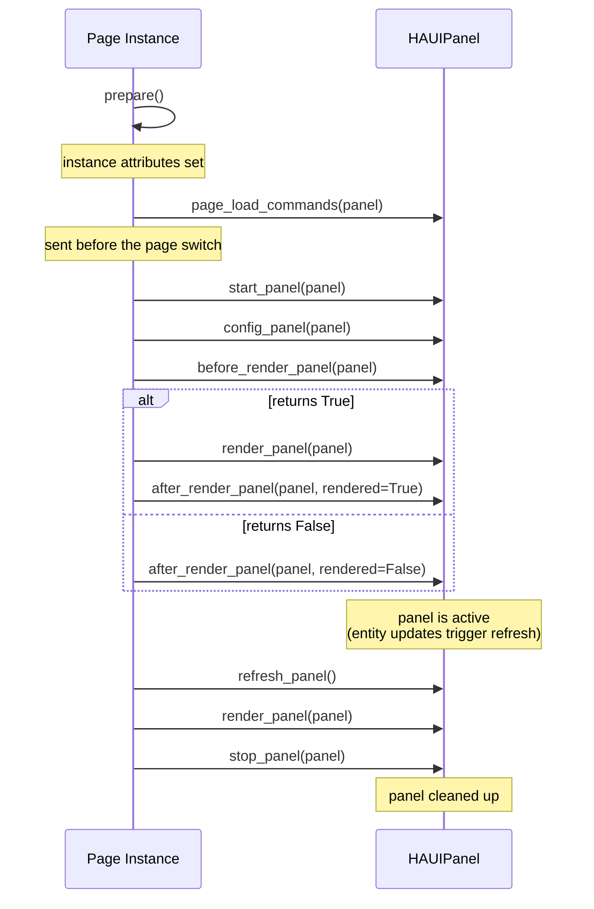
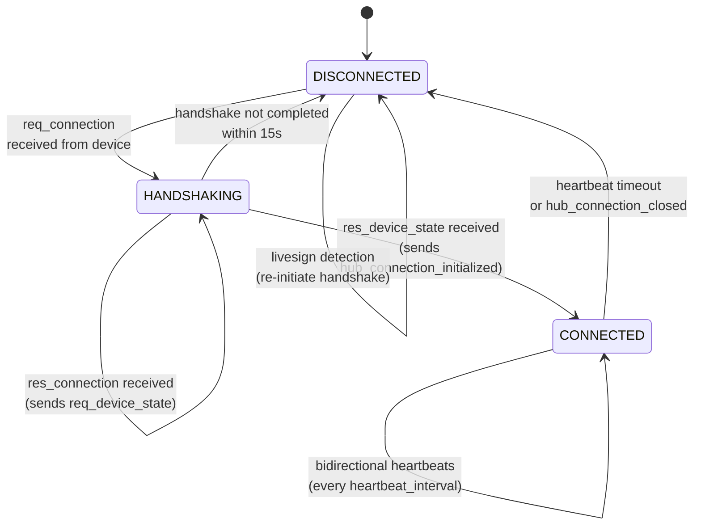

# Hub Component

NSPanelHAUI is the backend that allows to manage home automation devices using the NSPanel.

## Requirements

- Home Assistant with ESPHome integration
- Dependencies are auto-installed by Home Assistant (see `manifest.json`)

## Installation

1. Install the NSPanel HAUI custom integration from the Home Assistant Marketplace or by copying to `custom_components/nspanel_haui/`
2. Restart Home Assistant
3. Add the integration via **Settings → Devices & Services → Add Integration → NSPanel HAUI** (config flow)

## Structure

The classes are structured as described below.

### Base Component

All parts of haui are based on the `haui.abstract.haui_base.HAUIBase` class. This class provides some basic functionality. There are more specialized classes, which extend from `HAUIBase`:

- `haui.abstract.haui_base.HAUIBase`
  Base class with common functionality

- `haui.abstract.haui_page.HAUIPage`
  Page representation, this class is used when interacting with the page on the device

### App

`NSPanelHAUI`

The lifetime of the application is:

- **`initialize()`** — sets up config, device, controllers, then calls `start()` internally
- **`stop()`** — cancels timers, stops device and controllers

### Config

`haui.abstract.haui_config.HAUIConfig`

The configuration is built from the device's settings and panels in the panel store, over the `DEVICE_CONFIG` defaults. This class allows to process the config values and gives access to panels and entities.

### Device

`haui.device.HAUIDevice`

This class represents the whole device.

The lifetime of a device is:

- start
- stop

### Page

`haui.abstract.haui_page.HAUIPage`

This class represents a single page on the display.

A page lives as long as the panel it shows: navigation creates a new page
instance each time a panel opens and stops it when the panel closes. The panel
hooks below run on that instance.

### Panel

`haui.abstract.haui_panel.HAUIPanel`

The panel represents a configured page. The panel contains the configuration and entities to use. The configuration values are taken from the config.

The lifetime of a panel is:

- **prepare()** (optional) — set instance attribute defaults, called during `__init__()`
- **page_load_commands**(panel) — what the display reads while it loads the page (the theme colours, a picture background); `prepare_page_load()` sends it right before the page switch

page loaded ..

- **start_panel**(panel)
- **config_panel**(panel) — gives the header buttons `start_panel` registered without a function their default one (navigation, home or idle, unlock or notifications)
- **before_render_panel**(panel)
  -> if True, panel can be rendered
  -> if False, panel will not be rendered
  - **render_panel**(panel)
- **after_render_panel**(panel, rendered)
- **stop_panel**(panel)


While a panel is active, it can be refreshed using:

- **refresh_panel()** — re-renders the currently set panel by calling render_panel. This will not be triggered automatically.

The ESPHome controller keeps what the shown page was sent since it loaded (`page_commands()`: the last write to each target, an attribute or a widget's `vis`/`tsw`, in the order of those writes; a page switch starts it over). Replayed on a freshly loaded page after the page's `load_commands` (what `prepare_page_load` sent), it ends on the screen the panel shows: a new Live viewer gets the page this way, whichever hook drew each widget, and the panel draws nothing again.

A saved config shows the current panel again on the loaded page (`start_panel` and `render_panel` run again on the same page instance) as long as `is_loaded_for(panel)` holds, that is, the page would read the same `page_load_commands`; otherwise navigation loads the page again.

### Item

`haui.abstract.haui_item.HAUIItem`

An item represents a configured entry in a panel. It can wrap a real HA entity
(``HAUIEntity``) or be an internal item (``skip``, ``text``, ``navigate``, ``action``).
Configuration values (name, value, icon, color, state overrides) are taken from the
config and resolved through ``HAUIItem``.

## Connection

The connection between the Hub app and the device is managed by `haui.controller.HAUIConnectionController` using a 3-state machine: `DISCONNECTED → HANDSHAKING → CONNECTED`.

### State Machine



### Bidirectional Heartbeats

Once connected, both sides independently monitor liveness:

- **Hub→Device**: Periodic `hub_heartbeat` action at the device-declared `heartbeat_interval` (default 5s). First heartbeat fires immediately ("now+0"), then every interval. The hub also answers each incoming `esphome.heartbeat` with an immediate `hub_heartbeat`; the timer is a fallback.
- **Device→Hub**: `esphome.heartbeat` events update `_last_time` in the controller. Timeout = `interval × overdue_factor` (default 10s).

### Timeout Monitoring

The `_check_timeout()` method runs on a periodic timer (same interval as heartbeats):
- Only active in CONNECTED state
- If `time.monotonic() > _last_time + max(interval × factor, 10.0)`, transitions to DISCONNECTED
- Extended-disconnect warnings log every 60s when state stays DISCONNECTED

### Handshake Timeout

A handshake that does not complete within 15s (`_HANDSHAKE_TIMEOUT`) logs a warning and returns to DISCONNECTED; the device retries `req_connection` every 10s.

### Reconnection (Livesign Detection)

Any event received while in DISCONNECTED (except `req_connection`, `res_connection` and `res_device_state`) triggers immediate handshake re-initiation:
1. Sets state → HANDSHAKING
2. Sends `hub_connection_response` with hub version
3. Returns early (the same event is NOT processed further)
4. Subsequent `res_connection` → `res_device_state` complete the handshake

### Connection State Callbacks

On state transitions:
- **CONNECTED**: Sends `hub_connection_initialized`, starts timers, invokes `callback_connection(True)`; the firmware's inactivity timer is unchanged
- **DISCONNECTED** (from CONNECTED): Sends `hub_connection_closed`, stops timers, invokes `callback_connection(False)`

The callback propagates to `HAUIDevice.on_connection_changed()`, which handles navigation (open sys_system on first connect, restore panel on reconnect).

## Device Status and Details

The editor refreshes status by polling the authenticated
`/api/nspanel_haui/status/{entry_id}` endpoint every five seconds: the editor
store polls the selected device while the editor is open, and the Device
Manager polls every device while it is open. This is separate from the
`HAUIConnectionController`: that controller owns the device handshake and
heartbeats, not editor data refresh, and the integration does not use Home
Assistant's `DataUpdateCoordinator` for this status view.

For an enabled device, the API gathers mutable runtime details (connection, current page,
listeners and timers) on that device app's worker. It reads Wi-Fi readings from the linked
ESPHome entities on Home Assistant's event loop and combines them into the response. Disabled
devices have no running app, so the API returns a minimal status using only available HA entity
readings. **Diagnostics → Hub details** shows the display state (`on`, `dim` or `off`) apart from the
idle page, which is a hub-side page switch: shown, paused by an overlay opened from it, held off by
the current page, due in a given time, or off (`HAUINavigationController.idle_status()`). It counts
the drops of the last 24 hours (`HAUIConnectionController.health()`): every time an established
connection ended, by heartbeat timeout or because the device asked for a new connection (it
rebooted or gave up on the hub's heartbeats); a failed handshake is not a drop. It also counts the
device heartbeats that arrived more than 1.5 intervals after the previous one, with the longest gap.
The history is kept in memory and starts empty when the hub starts; three or more drops in 24 hours
show as an issue on the card. It lists the entities the current page listens to with their live
state from Home Assistant, flagging unavailable and missing ones; the raw listener and timer lists
go into **Copy report**.

### Status fields

The fields of the status response that the editor's **Connection & device** and
**Diagnostics** cards show:

| Field | Meaning |
|-------|---------|
| `haui_version` | Version of the running NSPanel HAUI hub integration |
| `haui_version_mismatch` | `true` when the known HAUI version differs from the device's `yaml_version`; `null` until both are reported |
| `connection_uptime` | Seconds since the ESPHome connection was last (re)established |
| `display_state` | Display brightness state reported by the firmware: `on`, `dim` or `off` |
| `idle_page` | Where the idle page stands: `state` is `active` (shown), `suspended` (an overlay was opened from it), `offline` (the device is disconnected, so the idle page waits for it), `held` (the current page holds it off), `pending` (it opens after `idle_in` more seconds without an interaction) or `off` |
| `connection_health` | Disconnects and late device heartbeats of the last 24 hours, kept in memory since the hub started: `drops_24h`, `recent_drops` (newest first, with `time` and `reason`), `late_heartbeats_24h` (a heartbeat more than 1.5 intervals after the previous one), `longest_heartbeat_gap` and `heartbeat_interval` |
| `last_disconnect_reason` | Why the connection dropped last (e.g. `heartbeat timeout`), if known |
| `disconnected_since` | When the device went offline that last time |
| `yaml_version` | ESPHome firmware version reported by the panel |
| `tft_version` / `tft_required_version` | Display TFT version installed vs the version required by firmware |
| `update` | TFT update state while an install runs: `checking`, `installing`, `done`, or `error` (with `version`, `started_at`, `last_error`) |

HAUI and firmware versions are expected to match; a known mismatch is an issue
on the **Diagnostics** card, while missing version data is not treated as a
mismatch. A display whose TFT is older than `tft_required_version` is flagged
**update pending**; if the firmware has not reported `tft_required_version`, none
is inferred from `yaml_version` and the display is not flagged. Firmware update
availability compares a release with `yaml_version`; the display check compares
`tft_version` with `tft_required_version`.

The status is only as fresh as the last poll: while a device is offline, the
editor keeps showing the last snapshot it received. The display gives no
byte-level progress during a TFT install, so `update` only moves through
`checking → installing → done` (or `error`).

In Live mode, **Reset interaction** on the Diagnostics card resets the
firmware's dim/off inactivity timer for the selected panel without changing the
current page or resetting the hub's separate idle-page timer.

## Navigation

The navigation is kept simple. There are navigateable panels and non-navigateable panels. Panels that are not navigateable will be kept in a stack when opened so that it is possible to return to the last navigateable item.

All navigation related functionality can be found in `haui.controller.HAUINavigationController`.

## Gestures

Supported gestures: swipe_left, swipe_right, swipe_up, swipe_down

All swipes go to `haui.controller.HAUIGestureController`. It runs the action of the gesture a swipe completes: a `GestureAction` (next or previous panel) or the key of a panel to open. Gestures are the `gestures` device setting (Panels view → Gestures card; see [Device Configuration](../user/configuration/device.md#gestures)), read on every swipe so a saved config applies without a restart. The controller keeps the latest swipes, as many as the longest gesture has; a swipe runs at most one action (the completed gesture with the most swipes, then the first in the list), and a gesture of several swipes that ran clears them. A slider drag also reports a swipe, so the controller ignores swipes while the page suppresses gestures. `hub/storage.py` (`migrate_gesture_settings`) converts the older `swipe_actions` and `gesture_sequences` settings.

## Updates

All update functionality can be found in `haui.controller.HAUIUpdateController`

## Events

All events are wrapped in the `haui.abstract.haui_event.HAUIEvent` class. This class provides basic access to events received via ESPHome.

## Communication

Most of the communication happens by publishing to ESPHome. There are two commands to change the display `send_cmd` and `send_cmds`. It is possible to record all calls to send_cmd of `haui.abstract.haui_page.HAUIPage` and to use them together with send_cmds:

```python
# batch multiple commands using the rec_cmd context manager
with self.rec_cmd:
    self.set_component_text(self.COMPONENTS.title, "Hello")
    self.set_component_value(self.COMPONENTS.t_info, 42)
    self.render_panel(panel)

# commands are deduplicated and sent automatically on exit
```

Commands recorded inside the `with rec_cmd:` block are deduplicated — only the last write to each target is sent — and the batch is sent automatically when the block exits. The lower-level `start_rec_cmd()` / `stop_rec_cmd()` methods are also available for manual use if needed.

## Available Pages

The pages represent pages on the nextion displays. The pages interact with the ESP and are the main place where to add code for interaction with the device. All pages are defined in `haui.page.*`. See `haui.abstract.haui_page.HAUIPage` for functionality.

## Device Linking

Each configured NSPanel HAUI device is linked to its underlying **ESPHome device** in the Home Assistant device registry. Instead of creating a separate `nspanel_haui` device entry, the hub adds an `nspanel_haui` identifier and attaches its config entry to the existing ESPHome device entry.

This means:

- The device shows up in the **nspanel_haui hub page** — you can see all claimed ESPHome devices under the integration
- **Clicking the device** in the hub page navigates to the ESPHome device page (the ESPHome config entry remains its primary one)
- The **service device picker** (`integration: nspanel_haui`) only shows ESPHome devices that have HAUI firmware — plain ESPHome devices are excluded
- When the integration is unloaded, the config entry is cleanly removed from the device
- **Deleting the device** in the hub page removes it from the hub like **Remove** in the editor (`async_remove_config_entry_device` in `__init__.py`); its settings and panels are deleted

The linking is handled in `_link_esphome_device()` in `__init__.py` and runs both during initial setup and when a device appears later (race condition handling via the device registry listener).

### Accessing sensor entities

An ESPHome YAML `id:` is a firmware-side component reference, not a Home
Assistant entity ID. Components marked `internal: true` are available to ESPHome
automations but are not exposed as HA entities. If both the firmware and HAUI
need a sensor value, keep its ESPHome `id:` and expose the sensor (do not mark
it internal). If HAUI needs a value that should not be exposed as an entity,
send it through the existing ESPHome ↔ hub event/device-state protocol instead.

For sensors explicitly selected in HAUI configuration, use the configured
entity ID. For a built-in ESPHome entity, resolve it through
`HAAdapter.find_entity_id()` using its HA domain and ESPHome-authored original
name, then read it through the adapter:

```python
entity_id = self.app.find_entity_id("sensor", "Temperature")
if entity_id is not None:
    state = self.app.get_item(entity_id).get_state()
```

The same registry lookup pattern is used for the built-in temperature sensor,
firmware-backed settings and the editor's IP/SSID/RSSI diagnostics. Resolve
against the linked HA device and skip an operation when no unique enabled
entity matches; do not substitute an ID guessed from another device. The
adapter marshals its entity-registry read onto Home Assistant's event loop.

Do not derive an HA entity ID from the ESPHome `id:` or the HAUI device slug:
HA may assign area-prefixed IDs, and entity IDs can differ after device renames.
If the registry has no unique enabled match on the linked device, treat the
entity as unavailable: do not read or write a guessed ID. HAUI's built-in
inside-temperature display shows its unavailable value in that case.

## Available Panels

Panels are configured representations of a page. A page can have multiple panels, like the alarm page, which is used for alarm activation and the unlock popup. There can be multiple panels using the same page. All panels can have a custom key defined, which is used for navigation. See [Panels Overview](../user/panels/README.md) for more details about the different panels.

### Popup parameters

`popup_notify` and `popup_select` take these parameters when they are opened from
code (`navigation.open_panel(PopupPanelKey.…, **kwargs)`). The user pages are
[Popup Notify](../user/panels/popup_notify.md) and
[Popup Select](../user/panels/popup_select.md).

**`popup_notify`**

- `notification`, `title` — Message text and title. Line breaks in the message (`\n`) render as line breaks on the display.
- `icon` (optional) — Shown only when set, beside the text (above it in portrait). When omitted, no icon is displayed and the text uses the icon's area too: the full width in landscape, the full height in portrait, so more text fits on each page. `icon_color` colours it.
- `btn_left`, `btn_right` (optional) — Button labels; a button is shown only when set. Colors via `btn_left_color`, `btn_left_back_color` and the `btn_right_*` equivalents.
- `icon_color` (optional) — Icon colour in any `parse_color_value` format (`#rrggbb`, RGB565 int, `[r, g, b]`, integer string). Leave it empty (or unset) for the theme's text colour.
- `text_size` — `auto` (default: the largest font that fits the message on one page) or a font size 1-3, paged at that size when the message does not fit. The per-notification `text_size` field on the service/actions overrides this panel value.
- `close_on_button` — Close when a button is pressed. Default: true.
- `button_callback_fnc`, `close_callback_fnc` — Callbacks.

Queued-notification popups do not use the popup's generic `close_timeout`.
Navigating away from a popup does not dismiss its notification; it stays queued
until dismissed or until its optional `timeout` expires. The notification
timeout countdown begins when the item is queued, not when its popup opens, and
expiry removes it from the queue (opening the next queued notification when
appropriate). A programmatic `open_panel` popup that is not a queued notification
can still use `close_timeout` to close itself after a number of seconds.

The text size is the largest font — large, medium or small — at which the whole
message fits on one page of the popup's text area, measured with the display
fonts' real character widths, so lines break between words exactly where the
display shows them.

**`popup_select`**

- `items` — The entries (`{value, name}` dicts or plain strings). At least one is required.
- `selected` — The currently selected value (a list with `multiple`).
- `select_mode` — Display style:
    - `default` — 3×4 button grid
    - `full` — Full-width list (4 buttons per page)
- `multiple` — Allow selecting multiple items. Default: false.
- `multiple_delay` — Delay in seconds before the selection is applied when `multiple` is enabled. Default: 1.5.
- `close_on_select` — Close the popup after a selection is made. Default: true.
- `close_timeout` — Automatically close after this many seconds. 0 = no auto-close.
- `selection_callback_fnc`, `close_callback_fnc` — Callbacks.

In single-selection mode, tapping the already selected entry keeps it selected
and applies it again.

## Virtual Panel (Live Preview)

The editor's [live preview](../user/configuration/README.md#the-live-preview) in Simulated mode and its panel cards run on one second `NSPanelHAUI` app per device, built from the device's stored config the same way setup builds it. Only the transport and the entity layer differ, so every page, controller and lifecycle hook is the real one. The app starts on first use, follows every save (`api.config.push_panels`) and stops after ten minutes without a viewer or a card render, or when the hub entry unloads.

| Part | File | Role |
|------|------|------|
| `VirtualNSPanelHAUI` | `web/preview/virtual_panel.py` | Reads states through the sandbox, routes service calls, suppresses HA bus events, uses an inert update controller |
| `VirtualESPHomeProxy` | `web/preview/virtual_panel.py` | Stands in for `ESPHomeProxy` and the firmware: answers the connection handshake, sends heartbeats, forwards display commands, page changes, brightness and sounds to the browser; refuses TFT and firmware uploads |
| `Sandbox` | `web/preview/sandbox.py` | Simulated entity states over the real ones; simulates the common services (on/off, light, cover, climate, media, lock, alarm, vacuum, number/select/text, button, timer) |
| `VirtualPanelHost` | `web/preview/virtual_panel.py` | Owns a device's virtual app: fans its display output out to every Simulated viewer (a late viewer gets the current panel redrawn) and renders panel cards |
| WebSocket commands | `web/websocket.py` | `nspanel_haui/virtual_panel/subscribe`, `/event`, `/home`, `/open`, `/idle`, `/reset_sandbox` and `/render` (admin only) |
| `LivePanel` | `web/preview/live_panel.py` | One Live viewer of the device's own app; its WebSocket commands are `nspanel_haui/live_panel/subscribe`, `/event`, `/slider` and `/action` (admin only) |

**Panel cards** (`/render`, `VirtualPanelHost.async_render`) run one panel's page through its real lifecycle (`prepare_page_load`, `start_panel`, `render_panel`, stop) on the shared app, isolated from the live display: the page sees a view of the app whose ESPHome controller records the display output, whose navigation ignores every action and which makes only service calls that return data (such as `weather.get_forecasts`). The result is `{"page", "before", "commands"}` — `before` is what the hub sends before switching to the page (the theme colours and its picture background) — and the editor replays it in the Nextion simulator. A user card renders the editor's config (unsaved edits included), a system card the device's configured panel by `key`. Popups open with the sample context the preview code defines (`web/preview/virtual_panel.py`: an example notification, sample choices, a panel to unlock) or, for entity popups (recognised by their system key, so an edited one too), an entity of their `item` option's domain while their config names none (an empty `{"item": null}` counts as none): the first one that is on, else the first one that is off. The panel editor passes its own `kwargs` for an entity popup it shows — a random entity of the domain, picked once per editing session — and the hub's sample gives way to them.

The browser end lives in `frontend/virtual/`: `nextion-script.js` runs the HMI's event code and the hub's display commands, `nextion-display.js` holds the display state, `nextion-view.js` renders it, `touch-input.js` turns pointer input into the firmware's `esphome.component`, `touch_start`/`touch_end` and `gesture` events, `qr-encode.js` draws QR widgets, `assets.js` loads the layouts, icon map and pictures, and `panel-session.js` connects it all to the WebSocket; `virtual-panel-session.js` (Simulated) and `live-panel-session.js` (Live) add their mode's commands and messages. Slider values come back the way the firmware returns them: the hub's `req_val`/`req_txt` go to the browser, which answers with `esphome.read_response`.

The **Current page** tile of the Connection & device card sends `/open` with the device status's `current_panel` (`VirtualPanelHost.async_show_panel`): the virtual app opens that panel by key, a popup with the sample context of its card, or as its idle page (`open_idle_panel(key=…)`) while the device's `idle_page` state is `active`. Live mode already shows the device's page, so the tile acts in Simulated mode only.

Once a Simulated preview has opened, the virtual app mirrors the device's notification queue: the device's app reports every change of its queue (`publish_preview_state`), and `VirtualPanelHost` copies it into the virtual queue, read-only.

In Simulated mode every non-query service call of the virtual app is simulated; queries with `return_response` (such as `weather.get_forecasts`) always reach Home Assistant. The virtual app also performs the relay switch action that ESPHome performs when a hardware button is pressed in relay mode. The browser can inject only the events a person causes on a panel: component touches, raw touches, gestures and hardware buttons.

Live mode does not use the virtual app. Each Live viewer (`web.preview.live_panel.LivePanel`) subscribes to the device's own running app: the commands that app sends through `HAUIESPHomeController.send_cmd` are streamed to the browser's Nextion simulator, so page changes and stateful controls show the app's own render output. Browser input is checked (an event a person can cause, a component of the current page, coordinates on the display, the device connected) and passed to that app's event handler, so its normal service calls act on real Home Assistant entities; in relay mode a hardware button also switches the real relay, as the firmware does for the real button. **Idle** and **Reset interaction** are explicit live actions: **Idle** toggles the idle page (opening it, or waking the panel back to the panel it covered or home, and restarting its interaction timer), and **Reset interaction** only restarts the inactivity clock. A new viewer gets the current page as the panel shows it: the page's `load_commands`, then the ESPHome controller's `page_commands()`, replayed in the browser; the panel itself draws nothing again. After a save, the viewers follow the reloaded app's button settings for the button lights. The page, display-state and connection snapshots are used only for the live controls and status. Live viewers are independent of each other and of the Simulated previews: a preview switching to Live first sends `/reset_sandbox` when the sandbox has simulated states; opening a Simulated preview and switching back to it from Live take nothing from the device and send `/home`, so the virtual app starts over: it drops the simulated states, leaves its idle page, restarts its inactivity clock (it got no touches while Live was shown) and opens its home panel.

The page layouts are exported from both HMI files by `scripts/hmi_layout/gen_virtual_layout.py` (see [Scripts for display](nextion.md#scripts-for-display)).
