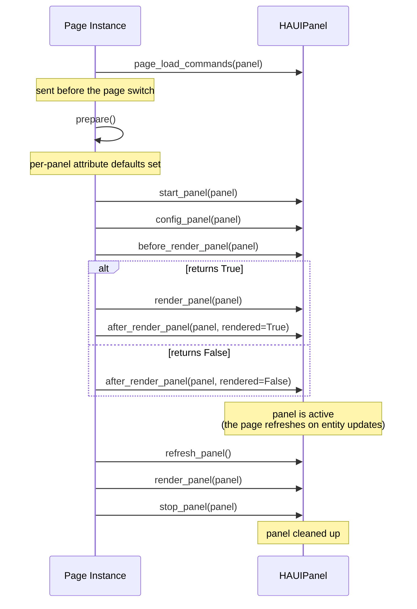

# Hub & runtime

`NSPanelHAUI` (`hub/app.py`) is the integration's runtime: one instance per enabled device, it reads entity states, renders display commands and sends them to the panel through the ESPHome native API. This page maps the objects it builds, the worker thread they run on, the controllers, the panel lifecycle and the HTTP surface the editor reads. The wire protocol is in [Communication](communication.md), the display queue and page rendering in [Nextion component](nextion.md); running a checkout in a throwaway instance in [Development setup](development.md#running-a-development-instance).

## The app

The app composes its collaborators and holds no business logic: pages, items, controllers and proxies do the work. Home Assistant is reached only through `self.app` in runtime objects, and display commands only through the page API, never through the ESPHome controller.

| Call | Does |
|------|------|
| `initialize()` | Builds `HAUIConfig`, applies the device's theme, creates the device and the six controllers, then calls `start()` |
| `start()` | Starts every controller, then the device |
| `stop()` | Cancels the app's timers, stops the device and the controllers |

## Objects

| Object | Module | Role |
|--------|--------|------|
| `HAUIBase` | `haui/abstract/haui_base.py` | Base of every runtime object: config access, logging, command batching (`rec_cmd`), ESPHome send helpers and the `start`/`stop` lifecycle |
| `HAUIConfigAccess` | `haui/abstract/haui_config_access.py` | The lighter sibling for data and config wrappers that need no display transport or lifecycle |
| `HAUIPage` | `haui/abstract/haui_page.py` | A page on the display; touch input, function buttons, component callbacks and paging come from the mixins in `haui/abstract/mixins/` |
| `DisplayInterface` | `haui/abstract/display_interface.py` | The display commands pages send (`send_cmd`, `set_component_text`, `set_component_value`), through the `DisplayTransport` protocol to the ESPHome controller |
| `HAAdapter` | `hub/adapter.py` | Bridges Home Assistant's async API to the synchronous `haui/` core, which imports nothing from `homeassistant`: `ItemProxy` wraps one entity's state, attributes and services, `ESPHomeProxy` sends actions to the device and listens for its events |
| `NSPanelHAUI` | `hub/app.py` | The app itself, one per enabled device: it composes the objects in this table |
| `HAUIConfig` | `haui/abstract/haui_config.py` | The device's settings and panels over the `DEVICE_CONFIG` defaults, with access to panels and entities |
| `HAUIDevice` | `haui/device.py` | The whole device: reported state and versions, physical buttons, gestures, sounds, firmware auto switches; started and stopped with the app |
| `HAUIPanel` | `haui/abstract/haui_panel.py` | A configured page: its configuration and the entities it uses, taken from the config |
| `HAUIItem` | `haui/abstract/haui_item.py` | A configured entry in a panel: `HAUIEntity` for a real Home Assistant entity, an internal item (`skip`, `text`, `navigate`, `action`); name, value, icon, colour and state overrides resolve through it |

A page lives as long as the panel it shows: navigation creates a new page instance each time a panel opens and stops it when the panel closes. The lifecycle hooks below run on that instance.

### Panel

The panel hooks, in order:

1. `page_load_commands(panel)` — what the display reads while it loads the page (the theme colours, a picture background); `prepare_page_load()` sends it right before the page switch.
2. `prepare()` (optional) — sets the page's per-panel attribute defaults. It runs during `__init__()` and again before every `start_panel`, so nothing one panel set carries over to the next panel on the same page.
3. `start_panel(panel)` — once the page is loaded: registers callbacks, creates items and reads panel options with `self.option(panel, key)`, which takes an option's default from the page's descriptor.
4. `config_panel(panel)` — gives the header buttons `start_panel` registered without a function their default one (navigation, home or idle, unlock or notifications).
5. `before_render_panel(panel)` — returns `False` to skip rendering.
6. `render_panel(panel)` — sends the display commands.
7. `after_render_panel(panel, rendered)`.
8. `stop_panel(panel)` — clears listeners and callbacks, then calls the page's `_stop_panel(panel)`.

`start_panel`, `config_panel` and `render_panel` go out as one command batch.



`refresh_panel()` re-renders the current panel with `render_panel` in one batch: pages call it from their state listeners and timers, navigation after buffer-overflow recovery and a restored idle snapshot, the notification controller when the open list changes.

The ESPHome controller keeps what the shown page was sent since it loaded: `page_commands()` holds the last write to each target (an attribute, or a widget's `vis`/`tsw`) in the order of those writes, and a page switch starts it over. Replayed on a freshly loaded page after the page's `load_commands`, it ends on the screen the panel shows, whichever hook drew each widget. A new Live viewer receives the page this way ([Live preview and cards](preview.md)).

A saved config shows the current panel again on the loaded page, with `start_panel` and `render_panel` on the same page instance, as long as `is_loaded_for(panel)` holds — the page would read the same `page_load_commands`. Otherwise navigation loads the page again.

## Worker thread

Every call into an app — device events, state changes, timers, reloads, services, notify — runs on that app's single worker thread, in order.

| Work | Use |
|------|-----|
| A callback from the event loop | `app.dispatch()` (fire-and-forget) or `await app.async_run_on_worker()` |
| Blocking work (HTTP, disk), result awaited | `app.run_off_worker(fn, *args, timeout=...)`; the callable must not touch app state |
| Blocking work, result applied later | `app.submit_off_worker(fn, on_done=...)`; `on_done` runs back on the worker |
| Liveness traffic only | `run_every(..., on_loop=True)` runs on the event loop, `publish_detached()` sends without waiting; the hub→device heartbeat uses both, so a busy worker never delays it |

Once the app has stopped (an entry unload, Home Assistant stopping), `dispatch()` drops the callback and `async_run_on_worker()` raises `AppStoppedError` (`hub/adapter.py`), so a caller waiting for a result says the app is gone instead of failing on the executor's "cannot schedule new futures after shutdown".

Never wait for an app's worker from code the worker may be blocked on — a service handler app code can call with `blocking=True`, for instance: queue the call with `dispatch()`, or the worker deadlocks.

## Controllers

| Key | Controller | Owns |
|-----|-----------|------|
| `esphome` | `HAUIESPHomeController` (`haui/controller/esphome.py`) | The command queue to the device and everything the display is sent ([Nextion component](nextion.md#panel-rendering-and-refresh)) |
| `connection` | `HAUIConnectionController` (`haui/controller/connection.py`) | The handshake, heartbeats, connection state and its health history |
| `navigation` | `HAUINavigationController` (`haui/controller/navigation.py`) | Open panels, the back stack, the unlock popup, the idle page |
| `notification` | `HAUINotificationController` (`haui/controller/notification.py`) | The notification queue and its delivery ([Notifications](notifications.md)) |
| `update` | `HAUIUpdateController` (`haui/controller/update.py`) | Firmware and TFT checks and installs ([Update process](update-process.md)) |
| `gesture` | `HAUIGestureController` (`haui/controller/gesture.py`) | Swipe sequences turned into actions |

Every device event arrives as a `HAUIEvent` (`haui/abstract/haui_event.py`), whose `as_*` accessors give its name and value.

**Connection.** `HAUIConnectionController` runs a `DISCONNECTED → HANDSHAKING → CONNECTED` state machine with a three-step handshake, bidirectional heartbeats, a 15 s handshake timeout and livesign detection (any non-handshake event while disconnected restarts the handshake). The protocol, timings and failure cases are in [Communication overview](communication.md). On entering CONNECTED and on leaving it (to DISCONNECTED, or to HANDSHAKING when the device reboots) the controller calls `callback_connection(bool)`, which `HAUIDevice.on_connection_changed()` handles: it opens the System panel on the first connect and restores the panel on a reconnect.

**Navigation.** `HAUINavigationController` owns navigation. Panels are navigable (`show_in_navigation`) or not; a non-navigable panel is kept on a stack when opened, so `close_panel()` / `go_back()` return to the last navigable one. It opens panels (`open_panel`, `open_home_panel`), waits for the display's page ack before rendering (see [Nextion component](nextion.md#panel-rendering-and-refresh)), and locks panels with an unlock code behind the unlock popup.

The idle page is `HAUINavigationController`'s job too: `open_idle_panel()` / `exit_idle_to_prev_or_home()` plus the once-per-second inactivity check that opens it. It is a page switch only; display dimming and off belong to the firmware.

**Gestures.** The supported gestures are `swipe_left`, `swipe_right`, `swipe_up` and `swipe_down`, and all swipes go to `HAUIGestureController`. It runs the action of the gesture a swipe completes: a `GestureAction` (next or previous panel) or the key of a panel to open. Gestures are the `gestures` device setting (the editor's Gestures sidebar, see [Device settings](../user/editor/device.md#gestures)), read on every swipe so a saved config applies without a restart.

The gesture controller keeps the latest swipes, as many as the longest gesture has. A swipe runs at most one action (the completed gesture with the most swipes, then the first in the list), and a gesture of several swipes that ran clears them. A slider drag also reports a swipe, so the controller ignores swipes while the page suppresses gestures.

**Updates.** `HAUIUpdateController` checks for and installs firmware and TFT updates and backs the **HAUI Firmware** and **HAUI Display** update entities; `haui/controller/release_source.py` fetches manifests and release lists off the worker and caches GitHub releases hub-wide. The whole cycle is in [Update process](update-process.md).

## Display commands

Pages change the display with `send_cmd` / `send_cmds` and the `set_component_*` helpers, never through the ESPHome controller directly. The `rec_cmd` context manager batches them into one `send_commands` action:

```python
with self.rec_cmd:
    self.set_component_text(self.COMPONENTS.title, "Hello")
    self.set_component_value(self.COMPONENTS.t_info, 42)
```

Commands recorded inside the block are deduplicated — only the last write to each target is sent — and the batch goes out when the block exits; `start_rec_cmd()` / `stop_rec_cmd()` are the lower-level form. `start_panel`, `config_panel` and `render_panel` are already one command batch, so `with self.rec_cmd:` is for callbacks from state listeners, timers and touches.

## Pages and panels

The page classes live in `haui/page/`, one module per page type. A panel is a configured instance of a page: one page can serve several panels (the alarm page serves alarm panels and the unlock popup), and every panel has its own key for navigation.

| Registry | Maps |
|----------|------|
| `PANEL_MAPPING` | Type key to its page name and page class |
| `SYS_PANEL_MAPPING` | System panel key to type key |
| `POPUP_PANEL_MAPPING` | Popup key to type key |
| `PAGE_MAPPING` | Nextion page id to page name |

The registries are derived from the page descriptors in `haui/mapping/panel.py`; never edit a mapping by hand. A system panel is identified by its key, never by its type: System, Blank, Settings and About are fixed, only popups can be overridden, and a user panel saved under a popup key replaces that popup without becoming a navigation target. The panel types themselves are in the [Panels overview](../user/panels/README.md).

### Popup parameters

`popup_notify` and `popup_select` take these parameters when they are opened from code with `navigation.open_panel(PopupPanelKey.…, **kwargs)`. The user pages are [Popup notify](../user/panels/popup_notify.md) and [Popup select](../user/panels/popup_select.md).

`popup_notify`

| Parameter | Meaning |
|-----------|---------|
| `notification`, `title` | Message text and title. Line breaks in the message (`\n`) render as line breaks on the display |
| `icon` (optional) | Shown only when set, beside the text (above it in portrait). When omitted, no icon is displayed and the text uses the icon's area too: the full width in landscape, the full height in portrait, so more text fits on each page. `icon_color` colours it |
| `btn_left`, `btn_right` (optional) | Button labels; a button is shown only when set. Colours via `btn_left_color`, `btn_left_back_color` and the `btn_right_*` equivalents |
| `icon_color` (optional) | Icon colour in any `parse_color_value` format (`#rrggbb`, RGB565 int, `[r, g, b]`, integer string). Empty or unset means the theme's text colour |
| `text_size` | `auto` (default: the largest font that fits the message on one page) or a font size 1-3, paged at that size when the message does not fit. The per-notification `text_size` field on the service/actions overrides this panel value |
| `close_on_button` | Close when a button is pressed. Default: true |
| `button_callback_fnc`, `close_callback_fnc` | Callbacks |

A queued notification's popup never takes `close_timeout`: the notification controller owns its lifetime (see [Notification process](notifications.md)). A popup opened directly with `open_panel` can use `close_timeout` to close itself after a number of seconds.

`popup_select`

| Parameter | Meaning |
|-----------|---------|
| `items` | The entries (`{value, name}` dicts or plain strings). At least one is required |
| `selected` | The currently selected value (a list with `multiple`) |
| `select_mode` | Display style: `default` for a 3×4 button grid, `full` for a full-width list of 4 buttons per page |
| `multiple` | Allow selecting multiple items. Default: false |
| `multiple_delay` | Delay in seconds before the selection is applied when `multiple` is enabled. Default: 1.5 |
| `close_on_select` | Close the popup after a selection is made. Default: true |
| `close_timeout` | Automatically close after this many seconds. 0 = no auto-close |
| `selection_callback_fnc`, `close_callback_fnc` | Callbacks |

In single-selection mode, tapping the already selected entry keeps it selected and applies it again.

## Device linking

Each configured NSPanel HAUI device is linked to its underlying ESPHome device in the Home Assistant device registry: instead of creating a separate `nspanel_haui` device entry, `_link_esphome_device()` in `__init__.py` adds an `nspanel_haui` identifier to the existing ESPHome entry and attaches the hub's config entry to it. It runs during initial setup and again when a device appears later: the device registry listener covers the race where the ESPHome device entry arrives after the hub's setup.

| Surface | Behaves as |
|---------|------------|
| Integration page | Lists every claimed ESPHome device; clicking one opens its ESPHome device page, which stays the primary config entry |
| Service device picker (`integration: nspanel_haui`) | Only ESPHome devices with HAUI firmware; plain ESPHome devices are excluded |
| Entry unload | The config entry is removed from the device again |
| Delete device | Removes the device from the hub like **Remove** in the editor (`async_remove_config_entry_device` in `__init__.py`); its settings and panels are deleted |

### Registry lookups

An ESPHome YAML `id:` is a firmware-side component reference, not a Home Assistant entity id, and a component marked `internal: true` reaches ESPHome automations without being exposed as an entity.

- Both the firmware and HAUI need a sensor value: keep its ESPHome `id:` and expose the sensor, without `internal: true`.
- HAUI needs a value that must not become an entity: send it through the existing ESPHome ↔ hub event/device-state protocol.
- HAUI configuration names a sensor: use the configured entity id.

A built-in ESPHome entity is resolved through `HAAdapter.find_entity_id()` with its Home Assistant domain and ESPHome-authored original name, then read through the adapter:

```python
entity_id = self.app.find_entity_id("sensor", "Temperature")
if entity_id is not None:
    state = self.app.get_item(entity_id).get_state()
```

The adapter marshals its entity-registry read onto Home Assistant's event loop. Resolve against the linked Home Assistant device and skip the operation when no unique enabled entity matches; the same lookup serves the built-in temperature sensor, firmware-backed settings and the editor's IP/SSID/RSSI diagnostics.

Never derive an entity id from the ESPHome `id:` or the HAUI device slug: Home Assistant may assign area-prefixed ids, and entity ids change after a device rename. Never substitute an id guessed from another device either: with no unique enabled match on the linked device the entity counts as unavailable, so HAUI's built-in inside-temperature display shows its unavailable value.

## HTTP API

`api/__init__.py` registers these views (`VIEWS`), all under `/api/nspanel_haui/`. Every view needs an authenticated Home Assistant user, and all but the editor lookups require an admin. The editor calls them through `frontend/api/client.js`.

| Module | Routes |
|--------|--------|
| `api/editor.py` | `GET translations/{language}`, `panel_types`, `color_defaults`, `icons` |
| `api/config.py` | `GET panels/{entry_id}` (the whole store, read-only); `GET`/`POST`/`DELETE devices/{entry_id}` (list, add, remove); `GET`/`PUT devices/{entry_id}/{device}` (settings); `PUT panels/{entry_id}/{device}`; `POST panels/{entry_id}/{device}/move`; `PUT device_order/{entry_id}`; `GET`/`POST yaml/{entry_id}` (export, import one device); `POST copy/{entry_id}` (write the panels, settings and update settings picked from one device onto the devices named) |
| `api/themes.py` | `GET`/`POST themes/{entry_id}` |
| `api/status.py` | `GET status/{entry_id}`; `GET`/`DELETE notifications/{entry_id}`; `POST refresh_display/{entry_id}` |
| `api/updates.py` | `POST update_tft/{entry_id}`, `update_firmware/{entry_id}`, `check_update/{entry_id}`, `update_control/{entry_id}` (start, defer or skip a scheduled install); `GET tft_releases/{entry_id}`, `firmware_releases/{entry_id}`; `POST update_upload/{entry_id}/{kind}` (a local file, served to the device once through `GET update_artifact/{token}`, which needs no login); `GET`/`POST`/`DELETE rollout/{entry_id}` and `DELETE rollout/{entry_id}/{device}` (Fleet's *Install updates*) |

The editor refreshes status by polling the authenticated `/api/nspanel_haui/status/{entry_id}` endpoint every five seconds: the editor store polls the selected device while the editor is open, and every device while the Fleet screen shows them. That is separate from `HAUIConnectionController`, which owns the handshake and the heartbeats, and the status view uses no Home Assistant `DataUpdateCoordinator`.

For an enabled device the API gathers the mutable runtime details (connection, current page, listeners, timers) on that device app's worker, reads the Wi-Fi readings from the linked ESPHome entities on Home Assistant's event loop and combines them into the response. A disabled device has no running app, so the API returns a minimal status from the entity readings it has.

The editor writes each store concern independently: `PUT /api/nspanel_haui/devices/{entry_id}/{device}` replaces one device's settings (and its `GET` reads current settings); `PUT /api/nspanel_haui/panels/{entry_id}/{device}` replaces only that device's panels; `POST /api/nspanel_haui/panels/{entry_id}/{device}/move` moves one panel to another device in one save of both; `PUT /api/nspanel_haui/device_order/{entry_id}` stores the editor's order; and `POST /api/nspanel_haui/themes/{entry_id}` manages shared themes. The whole-store panels route is read-only, so these writes never replace another device's data.

A write that removes a panel from a device (a panel save without it, or a move away from it) also drops that panel's key from the device's `home_panel`, `idle_panel` and `idle_panel_extra` settings, and answers with the settings it stored, so the editor shows the same roles the device has.

Panel-store edits hold Home Assistant's entry setup lock from loading the snapshot through applying it, so a save never interleaves with setup, device removal or preview startup ([Live preview and cards](preview.md)).

### Status fields

The fields of the status response that the editor's **Connection** and **Diagnostics** cards show:

| Field | Meaning |
|-------|---------|
| `integration_version` | Version of the installed NSPanel HAUI integration |
| `integration_version_mismatch` | `true` when the integration version differs from the device's ESPHome firmware `yaml_version`; `null` until both are reported |
| `connection_uptime` | Seconds since the ESPHome connection was last (re)established |
| `display_state` | Display brightness state reported by the firmware: `on`, `dim` or `off` |
| `idle_page` | Where the idle page stands: `state` is `active` (shown), `suspended` (an overlay was opened from it), `offline` (the device is disconnected, so the idle page waits for it), `held` (the current page holds it off), `pending` (it opens after `idle_in` more seconds without an interaction) or `off` |
| `connection_health` | Disconnects and late device heartbeats of the last 24 hours, kept in memory since the hub started: `drops_24h`, `recent_drops` (newest first, with `time` and `reason`), `late_heartbeats_24h` (a heartbeat more than 1.5 intervals after the previous one), `longest_heartbeat_gap` and `heartbeat_interval` |
| `last_disconnect_reason` | Why the connection dropped last (e.g. `heartbeat timeout`), if known |
| `disconnected_since` | When the device went offline that last time |
| `yaml_version` | ESPHome firmware version reported by the panel |
| `tft_version` / `tft_required_version` | Display TFT version installed vs the version required by firmware |
| `update` | TFT update state while an install runs: `checking`, `installing`, `done`, or `error` (with `version`, `started_at`, `last_error`) |

The display state (`on`, `dim`, `off`) is what the firmware reports; the idle page is a hub-side page switch, so it has states of its own (`HAUINavigationController.idle_status()`).

A drop is an established connection that ended, by heartbeat timeout or because the device asked for a new connection (it rebooted or gave up on the hub's heartbeats); a failed handshake is not a drop. The history is kept in memory and starts empty when the hub starts, and three or more drops in 24 hours show as an issue on the card.

The Diagnostics card also lists the entities the current page listens to, with their live state from Home Assistant, flagging unavailable and missing ones; the raw listener and timer lists go into **Copy report**.

HAUI and firmware versions are expected to match: a known mismatch is an issue on the **Diagnostics** card, while missing version data is not treated as a mismatch.

A display whose TFT is older than `tft_required_version` is flagged **update pending**; if the firmware has not reported `tft_required_version`, none is inferred from `yaml_version` and the display is not flagged. Firmware update availability compares a release with `yaml_version`; the display check compares `tft_version` with `tft_required_version`.

The status is only as fresh as the last poll: while a device is offline, the editor keeps showing the last snapshot it received. The display gives no byte-level progress during a TFT install, so `update` only moves through `checking → installing → done` (or `error`).
