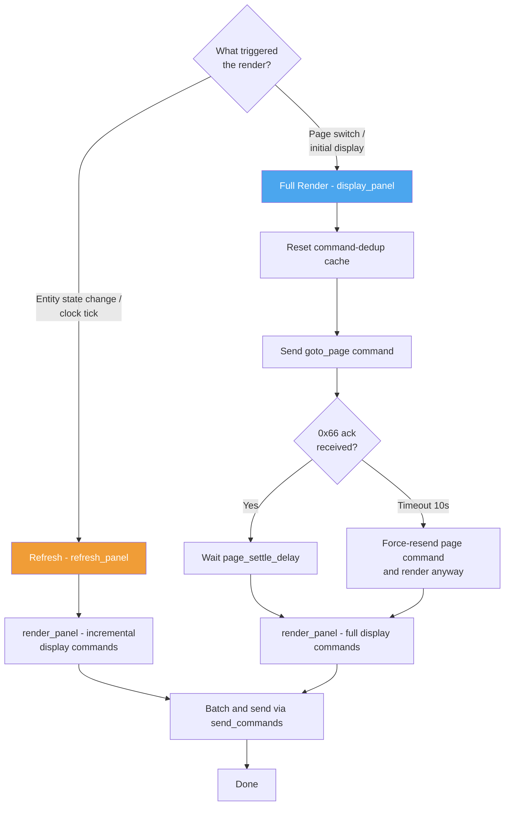

# Nextion Component

## Installation

To install the TFT file on the display, the device needs to be already flashed with the NSPanel HAUI firmware
and added to the integration. The hub installs the TFT the firmware needs when the device
connects; to install it by hand:

- **Using the update entity**:

  - Entity: `HAUI Display` (`update.<device>_haui_display`) — press **Install**.
    This installs the TFT release the firmware needs.

- **Using a service**:

  - Service: `nspanel_haui.update_tft`
    This installs the TFT release the firmware needs, or the TFT at the optional `url`.

See the [Services Reference](../user/services.md#tft-display-upload) for full details and examples.

## Nextion display configuration used in this project

### Display dimensions and non-visible area

The Sonoff NSPanel Nextion display has the following physical touch characteristics:

- **Total display/touch resolution:** 480 × 320 pixels
- **Visible (effective) area:** 450 × 320 pixels
- **Non-visible area:** 30 pixels on the right side (x = 450..479)

The display is 480 pixels wide, but the LCD bezel hides the rightmost 30 pixels. Touch coordinates in that band (x = 450..479) are valid but no pixels are visible there.

This is relevant for edge-based gesture detection — swipe-from-right gestures (swipe left) start in the non-visible zone. The ESPHome gesture logic in `scripts_interaction.yaml` uses `visible_width` (450 in landscape, 320 in portrait) for its right-border check (in landscape a swipe starting at x > 410 counts as a right-edge start, using a 40px margin), so touches in the non-visible zone also count as right-edge starts.

This project uses the stock ESPHome `nextion` display component (ESPHome 2026.10 or later, with the temporary vendored patch in `esphome/nextion_patch/`, see [ESPHome Component](esphome.md)) with a hardware UART and the following key options in `esphome/nspanel_haui/display.yaml`:

- `uart_id`: references the UART bus used for the Nextion display.
- `wake_up_page`: the Nextion page shown on wake-up from *hardware* sleep. The automatic display state machine does not hardware-sleep; while disconnected the firmware keeps System page 0 visible and only dims the backlight. This setting matters only if hardware sleep is explicitly requested.
- `tft_url`: default TFT URL. It reads the `tft_update_url` substitution; override
  it in your device YAML to install a local TFT build. The hub always passes the
  URL of the TFT it installs, so this value is only a compile-time default. (A
  `tft_url` is also what the component's validation requires next to
  `tft_upload_http_buffer_size_tx`.)
- `tft_upload_http_buffer_size_tx` (`2048`): HTTP TX buffer for the TFT download. GitHub redirects release TFTs to a signed URL of about 870 characters; the ESP-IDF default of 512 bytes cannot hold that request line and the upload fails with `HTTP_CLIENT: Out of buffer`. Comes from the vendored patch until a released ESPHome contains it.
- `on_setup`: triggered after ESPHome connects to the Nextion.
- `on_page`: triggered when the display changes pages.
- `on_touch`: triggered when a touch event happens.
- `on_buffer_overflow`: logs the warning and publishes a `buffer_overflow` event,
  which starts the hub's [buffer overflow recovery](#buffer-overflow-recovery).

The actions the hub calls on the device are listed in
[ESPHome Component → Actions](esphome.md#actions).

### Advanced queue tuning options

Also set in `display.yaml`:

- `max_queue_size` (default: 800): caps the command queue to prevent heap fragmentation when the Nextion serial buffer overflows and orphans pending entries. 800 entries is enough to absorb a full panel render burst plus concurrent state updates.

- `max_commands_per_loop` (default: 50): limits commands processed per loop iteration to spread out allocation/deallocation. With command pacing active, the pacer further limits output to one command per loop iteration.

- `command_spacing` (`2ms`): enables ESPHome's Nextion command pacer globally. The ESP32 loop timestamp is constant within an iteration, so the pacer sends at most one queued command per loop. This spreads large renders over time and prevents bursts from overrunning the Nextion's 1 KB RX buffer. The configured minimum is 2ms; actual throughput is also bounded by the ESPHome loop cadence.

### Panel rendering and refresh

Commands are batched at the HA layer to reduce native API service-call overhead, then queued and paced by ESPHome before being written to the UART. The firmware's `command_spacing` pacer is the protection against overrunning the Nextion's 1 KB RX buffer for every page and command source; HA batching alone does not prevent UART bursts.

The rendering cycle has two paths:

- **Full render** (`display_panel`): used for initial page display, panel switches, and overflow recovery. Resets the command-dedup cache so the first batch is never suppressed as a duplicate of the previous page.
- **Refresh** (`refresh_panel`): used for incremental updates (entity state changes, clock ticks, etc.). Re-runs `render_panel` on the already-active panel without a page transition.

#### Page settle delay

After a page-change command the Nextion sends a 0x66 ack once the new page is active. The hub waits for this ack before sending render commands — commands arriving before the ack are rejected with "Invalid variable name" (0x1A) because page components are not yet initialised.

After the ack the hub waits an additional settle delay (default `0.1s`, configurable via `page_settle_delay`) before calling `display_panel`. If the ack never arrives within 10 s, the hub force-resends the page command and renders anyway as a fallback.

#### Buffer overflow recovery

If the Nextion reports a buffer overflow (0x24), the hub debounces a full `display_panel` re-render, starting at a 500ms delay (doubling for each consecutive overflow, and pausing after 5 consecutive recoveries until the display has been overflow-free for 30s), to let the ESPHome queue drain any remaining commands before re-sending the complete panel state. This is a recovery safety net; normal output is paced in firmware by `command_spacing`.

## How to edit the HMI file

The HMI holds the interface design and only the page-scoped logic that must run on the display; everything else belongs in the Hub App. The rules that keep both HMIs in step (landscape and portrait) are in [Nextion Editor](nextion-editor.md#hard-rules).

All pages need to send a `sendme` in `Preinitialize`. This is needed to know of a page change event.

Prepare the page in the `Preinitialize` event because the Hub App cannot control the display at this stage. Only after a page is shown, it is possible to change anything or interact with it. What the page needs from the hub to load correctly goes into global variables the hub sets before the page switch: the theme colours (`Program.s` globals the solid-colour pages paint themselves from, see [Nextion Editor](nextion-editor.md#hard-rules)) and the picture background of the clock and weather pages.

If you want to process any click events, you need to enable `Send Component ID` on the event to be used.

The hub addresses a widget by its id and object name, declared in the page's `COMPONENTS` registry. Changing the order of components on a page changes their ids.

> ✍️ **Maintainers:** a step-by-step, human-oriented guide for editing the HMI
> in the Nextion Editor — adding widgets/pages, fonts & images, and creating
> or updating the US portrait TFT — lives in
> [Nextion Editor (Human Guide)](nextion-editor.md).

## Scripts for display

The display tools live in `scripts/` (overview in `scripts/README.md`). Which of
them to run after an HMI change, and in what order, is in
[Nextion Editor §8](nextion-editor.md#8-after-any-hmi-change-scripts-to-run).

- Fonts: `scripts/font_tools` and `scripts/charset`
- Images: `scripts/rgb565_image`, `scripts/backgrounds`, `scripts/spinner`,
  `scripts/color_wheel`
- Virtual panel assets: after every HMI change run
  `python -m scripts.hmi_layout.gen_virtual_layout`. It exports both
  HMI files' pages, widgets and event code to
  `custom_components/nspanel_haui/frontend/virtual/layout_<orientation>.json`,
  the icon-character→MDI map to `icon_map.json` and the pictures (as WebP, from
  `nextion/images`). These feed the editor's
  [live preview](../user/configuration/README.md#the-live-preview) and the panel-card
  previews alike — both render the real HMI pages through the shared Nextion
  simulator. `--check`, run by the test suite, fails while the layouts or the
  icon map are out of date.
  `gen_virtual_layout.py` depends on the shared Home Assistant import stubs in
  `scripts/_ha_stubs.py`. The panel cards themselves are the hub's own render;
  `tests/test_card_renders.py` replays a render of every panel type in these
  layouts.
- Preview coverage: `python -m scripts.check_preview_coverage` (also run by the
  test suite) confirms every exposed panel — user types, system panels and
  popup aliases — still resolves to a physical page in both preview layouts.
