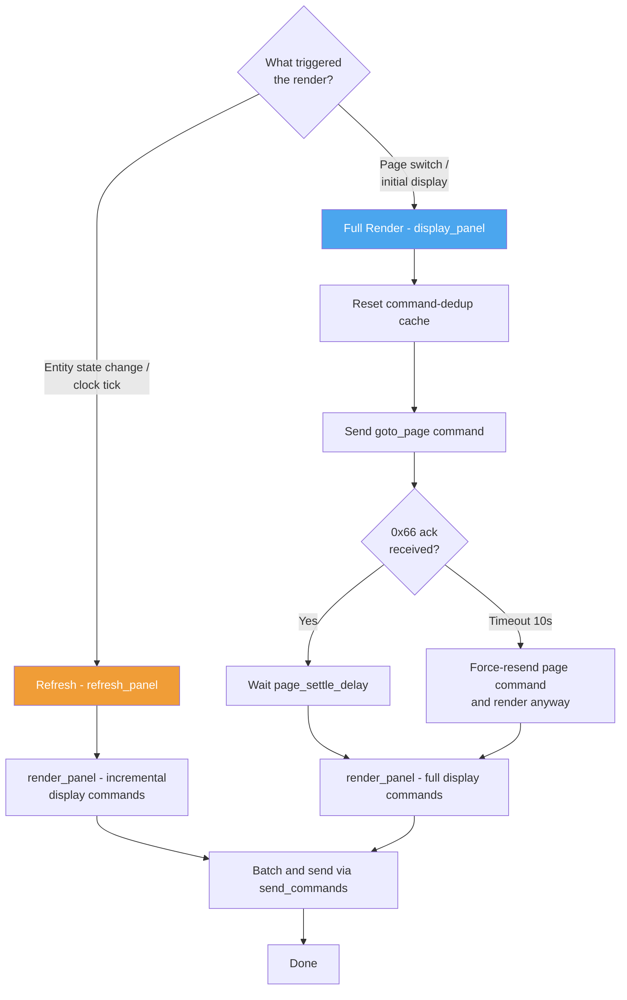

# Nextion component

The firmware drives the Nextion display and the hub renders panels through it. Read this page when you change the display configuration or the render cycle, or when you need to know which HMI script writes what.

## The component in the firmware

The firmware uses the stock ESPHome `nextion` display component (ESPHome 2026.11 or later) over a hardware UART, with the temporary vendored patch in `esphome/nextion_patch/`. The hub never sees the UART: it calls the device actions listed in [ESPHome component](esphome.md), and the firmware writes the Nextion commands.

## Display configuration

### Dimensions and non-visible area

| Area | Landscape | Portrait |
|------|-----------|----------|
| Display and touch resolution | 480 × 320 px | 320 × 480 px |
| Visible area | 450 × 320 px | 320 × 480 px |
| Hidden by the bezel | 30 px on the right (x 450..479) | none |

Touch coordinates in the hidden band are valid; no pixels are visible there. Edge gestures depend on it: `esphome/nspanel_haui/scripts_interaction.yaml` takes `visible_width` (450 in landscape, 320 in portrait) for its right-border check with a 40 px `border_margin`, so in landscape a swipe starting at x > 410 counts as a right-edge start and touches in the hidden band count too.

### Display options

These live in `esphome/nspanel_haui/display.yaml`:

| Option | Value | Effect |
|--------|-------|--------|
| `uart_id` | `haui_uart` | the UART bus the display is on |
| `wake_up_page` | `0` | page shown after *hardware* sleep. The display state machine never hardware-sleeps: it keeps System page 0 visible and dims the backlight, so this only matters if hardware sleep is requested explicitly |
| `tft_url` | `$tft_update_url` | compile-time default TFT URL, overridable per device YAML; the hub always passes the URL of the TFT it installs. The component's validation also requires it next to `tft_upload_http_buffer_size_tx` |
| `tft_upload_http_buffer_size_tx` | `2048` | HTTP TX buffer for the TFT download: GitHub redirects release TFTs to a signed URL of about 870 characters, and the ESP-IDF default of 512 fails with `HTTP_CLIENT: Out of buffer` |
| `max_queue_size` | `800` | caps the command queue so a Nextion buffer overflow cannot strand entries and fragment the heap; 800 absorbs a full panel render plus concurrent state updates |
| `max_commands_per_loop` | `50` | bound on the commands *sent* per loop and the replies *parsed* per loop. With `command_spacing` set the pacer already leaves one command per component phase, so on the transmit path this is inert — it only bounds reply parsing |
| `command_spacing` | `2ms` | enables the command pacer globally. The ESP32 loop timestamp is constant within a component phase, so at most one queued command leaves per phase; together with `loop_interval` (see below) that is one command every 2 ms and keeps bursts out of the Nextion's 1 KB RX buffer |
| `on_setup`, `on_page`, `on_touch` | — | triggers after the firmware connects to the display, on a page change, and on a touch |
| `on_buffer_overflow` | — | logs the warning and publishes a `buffer_overflow` event, which starts [buffer overflow recovery](#buffer-overflow-recovery) |

### Display baud

`Program.s` in both HMIs sets `bauds=921600`, and `hardware.yaml` starts the UART at the same rate. A panel still running an older or stock TFT boots at another rate and is unreachable, so `display_baud.yaml` waits 8 s for the display, power-cycles it and probes the remembered rate, 921600, 115200, 9600 and the remaining Nextion rates. The rate that answers is stored in flash and tried first on the next boot; a scan that finds nothing leaves the link at 115200 and keeps that fallback for its retries. A TFT transfer also starts at the link rate and falls back to 115200 once when the display cannot hold it. A successful TFT upload reboots the ESP, so the new TFT's rate is picked up by the same scan. Keep `bauds` identical in both HMIs; `tests/test_bump_version.py` checks it.

## Panel rendering and refresh

The HA layer batches commands to keep the native API payload small, ESPHome queues them and the `command_spacing` pacer writes them to the UART. The pacer, not HA batching, is what protects the Nextion's 1 KB RX buffer — except while a draw streams, which paces itself ([below](#a-draw-paces-itself-instead)).

### Command pacing costs one component phase per command

The pacer compares the spacing against `App.get_loop_component_start_time()`, which is a constant inside one component phase. It therefore sends **one command per component phase**, whatever `max_commands_per_loop` allows. The component phase is gated by `esphome: loop_interval` (default **16 ms**), so the pacing has two parts:

| `loop_interval` | Commands per second | A 200-command render |
|-----------------|---------------------|----------------------|
| `16ms` (ESPHome default) | ~62 | ~3.2 s |
| `2ms` (what this firmware sets) | ~500 | ~0.4 s |

`esphome/nspanel_haui/base.yaml` sets `loop_interval: 2ms`, which is what makes `command_spacing: 2ms` mean 2 ms between commands instead of 16 ms. That is the pace the config always intended; the loop interval silently overrode it.

Measured against the hub's own renders (`tests/page_commands_golden.json`, and a `set_panel` lifecycle on the `PageApp` fake):

| Action | Commands | at 16 ms | at 2 ms |
|--------|----------|----------|---------|
| Open a grid panel | 112 | 1.8 s | 0.22 s |
| Open a row panel | 156 | 2.5 s | 0.31 s |
| One `next_page` on a grid | 23 | 0.37 s | 0.05 s |
| One `next_page` on a row | 32 | 0.51 s | 0.06 s |

Those counts are flat in the number of panel items (only the visible tiles render), so the cost is set by the pacing alone. The headroom check: an average command is ~14 characters plus the three `0xFF` terminators, so 2 ms per command is ~8.6 KB/s, well under the 921600 UART's ~92 KB/s — the display keeps up while it is idle, and its 1 KB RX buffer covers ~60 commands (120 ms) while it is busy drawing a page. `4ms` is the safer fallback if overflows appear on a slow display: ~4.3 KB/s, still 4× faster than the old behaviour.

### A draw paces itself instead

A page render is a burst the display has to survive while it re-lays-out widgets, so the pacer keeps it slow. A draw is the opposite problem: thousands of `fill` instructions, none of which the display has to think about, and a fixed 2 ms per fill made an image cost `runs × 2 ms` — 24 s for the top of the `quality` range, while the display paints a fill in a fraction of that.

So `draw_runs` switches the pacer off for the duration of a program (`draw_spacing: '0'`, `image.yaml`) and flow-controls the stream by the display's own acknowledgements:

- `haui_draw_runs` sets the spacing to 0 and restores `command_spacing` in `haui_draw_report` — the single script every way a draw ends goes through (finished, refused, stalled, display gone). A pacer left at 0 would send page renders as fast as the UART takes them.
- A run counts as sent only when the queue grew: `send_command()` answers for the display's state, not for the entry, and a full queue or a failed allocation drops the run without an error. Counting it would leave a gap the report calls a success, so the slice fails instead and the hub re-sends the pass. Since the window check (`queue_size() < draw_window`) runs before every send, the queue can only be full through something other than this program — the check makes that visible rather than silent.
- A finished program is forgotten: `haui_draw_report` clears `haui_draw_program`, `ok` and `awaiting` after it built the payload and before it publishes it. A later buffer overflow therefore cannot re-send a band of an image that is long done, and `haui_draw_retry` gets a `retry` parameter so a re-send starts with the one-shot guard already set instead of clearing it.
- A page change ends a draw. The hub cancels its slice queue when it sends `goto_page`, and `goto_page` (the firmware script) stops `haui_draw_runs` and `haui_draw_enqueue_batch`, clears the same program state and restores the pacer before it queues the page — the band already sent finishes on the old page and nothing follows it onto the new one. `_handle_page_event` cancels again for a page the display switched to on its own, and a report that still arrives for the cancelled pass finds no draw in flight and is ignored.
- The enqueue pass keeps `draw_window` fills in flight — unsent or unacknowledged, which is exactly what `queue_size()` counts — and looks again every `draw_queue_poll` (one component phase). A run only goes out when an acknowledgement freed a place, so **the display's own rate is the rate of the draw**: a slow display is never overrun (12 × a 40-byte fill is a fifth of its 1 KB buffer) and a quick one is streamed until the UART is the limit — 921600 baud carries a 25-byte `fill` every 0.27 ms, about 3 700 a second against the pacer's 500.
- With the pacer off, one phase transmits everything queued up to `max_commands_per_loop` (12, matching the window), so no phase can dump more than ~300 bytes at the display.
- A display that stops acknowledging is caught by the draw itself: after `draw_stall_polls` passes with neither a freed place nor a queued run it fails the program and reports — the queue's own 8 s `max_queue_age` would be a long time to leave the pacer off.

The hub plans its run budget at the pacer's pace anyway (`draw_wire.COMMAND_SPACING_MS`), because that is a number it can trust, and `res_draw`'s `elapsed_ms` reports what the panel really took for one **slice** — the hub logs it as `runs/s` ([how to read those lines](#measuring-a-panels-real-draw-rate)). The fence timeout uses `draw_wire.RUN_MS_CEILING` (8 ms per run) instead: a slow panel legitimately takes longer than the planned pace, and a slice cut short is not harmless, because the next one restarts the firmware's program (`mode: restart`).

### Measuring a panel's real draw rate

The pace a draw reaches is the panel's own — the hub paces nothing while one streams — so the only honest figure for a frame budget is one measured on the panel that will draw the frames. `res_draw` reports **per slice**, not per pass: a slice ends with a fence that can only answer after that slice's last run was sent, and only then does the hub send the next one. A full-page `quality: 12000` pass is about 18 slices of ~570 runs and ~7.8 KB (`draw_wire.DRAW_SLICE_CHARS`), so one action call prints about 18 lines:

```
Draw program finished: 567 runs, ok=True, 862 ms, 657 runs/s
```

Both figures matter and they answer different questions:

| Figure | Where it comes from | What it is |
|--------|---------------------|------------|
| per-slice `runs/s` | a line's own value | the display's rate while it is being fed — the ceiling a stream plans against |
| pass-level rate | all `runs` added up ÷ the wall time between the first and last line | what the current design delivers, with 18 publishes and 18 fence round trips included |

The difference between them is the hub's own cost per slice: publishing ~7.8 KB over the ESPHome API, the panel staging and decoding it, and the fence read trip. That is the number that decides whether a frame may fence at all, because a stream that fences every frame pays it every frame — at 5 fps it would be most of the budget, on top of the fills.

Recipe:

1. Leave the panel's `log_level` at INFO (the default); the line is INFO, and a higher threshold drops it.
2. Call the action on the page the panel is showing, with `progressive: false` so the pass is one queue instead of a coarse pass in front of it:

   ```yaml
   action: nspanel_haui.show_image
   data:
     device: "abc123..."
     url: "https://example.com/frame.png"
     x: 0
     y: 0
     w: 480
     h: 320
     quality: 12000
     progressive: false
   ```

3. Read the whole block of `Draw program finished` lines from `home-assistant.log`: its timestamps carry milliseconds, while the editor's diagnostics card keeps the same lines at second resolution (`HAAdapter.log`).
4. Use the numbers, not the arithmetic in these pages: `fps = the best per-slice runs/s ÷ the runs one frame needs`, and a frame's run count follows the area that changed — `image_program` has no delta pass yet, so a program always costs the whole rectangle it paints.

The expected slice shape is predictable without a panel (`program_slices` over `image_plan`): a full-page photo is 564 runs in 1 slice at `quality: 600`, 2 754 in 5 at `3000`, and 10 213 in 18 at `12000`. A 200x200 logo reaches one rectangle per display pixel at 121 runs in a single slice whatever the budget, because detail cannot go below one pixel.

### Nothing on the display side switches a refresh off

The pause a caller wants for a frame — stop painting, send everything, show it — does not exist on this display, and the instructions that read like it do not do that:

- `ref_stop`/`ref_star` stop a **waveform** component from repainting per data point (instruction set 3.4/3.5). No drawing instruction is affected.
- `com_stop`/`com_star` stop *executing* serial instructions while the display keeps receiving them, and `com_star` then executes the backlog — but the backlog is the panel's **1 024-byte instruction buffer** (NX4832F035 datasheet), about 35 `fill`s, and the docs warn the pair overflows it. The draw's `draw_window` already keeps a dozen fills in the display's buffer without risking that overflow, and it waits for an acknowledgement instead of trusting a 1 KB buffer, so `com_stop` buys no rate and loses the flow control.
- `code_c` discards queued commands rather than holding them.
- `doevents` goes the other way: it *forces* a refresh. Deferral exists only inside Nextion-side code blocks (a `while`/`for` block refreshes when it finishes), and blocks cannot be sent over serial (general rule 16), so no program can be handed to the panel for it to paint by itself.

There is also nothing to defer. The drawing set is `cls`, `pic`, `picq`, `xpic`, `xstr`, `fill`, `line`, `draw`, `cir` and `cirs` (section 4), each writing straight to the display, and the panel offers no surface to draw into: 3 584 bytes of variable RAM, 16 MB of flash for the compiled HMI. A draw's cost is therefore its run count — one fill takes the display about 1–3 ms whatever its area ([above](#a-panel-that-drops-runs)) — and the fills *are* the picture. The bands a large draw shows are runs arriving, not a refresh being late.

Two consequences worth knowing before reaching for a frame rate:

- The only way to hide those bands is to blank the backlight for the frame (`dim=0`, then back), which trades them for a black flash; the panel has no double buffer to paint into instead.
- A frame that repaints its whole rectangle costs a whole image, i.e. seconds. A stream has to send only what changed, in runs proportional to the changed area; `image_plan` always returns a whole-rectangle program, so a delta pass would be new code rather than a setting.

### A delta pass is what would make a stream possible

Two ways to compute "what changed" were measured against camera-like frames (a textured scene, a walking person, sensor noise σ 6, 2 % lighting flicker, 480x320, grid cell 8 px, `rgb565_to_rgb` dead bands):

| Model | runs/frame | note |
|-------|-----------|------|
| previous **frame** vs this one, tolerance 8 | 293 | noise and flicker repaint the picture: unusable |
| **what the panel shows** vs this one, dead band 8 | 294 | same, the dead band is too small for camera noise |
| what the panel shows, dead band 16 | 12 | noise and flicker disappear |
| what the panel shows, dead band 24 | 9 | what a stream should use |

The second model is the one that works, and it needs the hub to keep the grid it last **painted**, not the grid of the previous frame: a cell whose real colour has not moved beyond the dead band costs nothing however much the sensor jitters inside it. On the same sequence a walking subject is 10–41 runs/frame at cell 6–12 (0.9–1.4 % of the cells), and an idle camera is **0 runs and no program at all**.

The bad case is a camera that pans or zooms: 12 px per frame moves every pixel, so 786 runs at cell 12 and 1 998 at cell 8 (73–83 % of the cells) — about a second per frame. A stream therefore needs a per-frame run cap, and its fps is scene-dependent, not a constant.

What is *not* the limit: the hub. A delta frame costs 0.9–3 ms at cell 8–12 on the host (`_cells` + span merge, frame already decoded), so the cost per frame is the publish and the fence round trip, not the arithmetic. It leaks the other way too — keep frames out of the preview and page-replay paths, or a stream rewrites `_page_commands` on every frame.

### A stream pauses, it does not stop

`hub/camera_stream.py` ends a stream only when the page changed or a TFT install owns the display — both are verdicts nothing would undo. A **dark display** is not one: the firmware switches the panel off after its own idle timeout and wakes it on a touch, and no wake re-renders the page, so a stream that stopped there left the last picture frozen on the wall until someone navigated away and back. It now idles instead (`_frame_status` → `"idle"`): no snapshot is fetched, nothing is painted, and the first frame after the wake is a full paint — hours of being dark leave the planner's model of the display worthless.

A **failing camera** is not a verdict either: `MAX_CAMERA_FAILURES` consecutive misses are reported once and the retry interval drops to `CAMERA_RETRY_INTERVAL` (30 s), so a doorbell that renegotiates or an integration that reloads carries on by itself. The picture the panel already has stays until then, which is the honest state.

Two smaller rules of the loop: the frame is planned on a `DeltaPlanner.clone()` **taken on the worker** (`deepcopy` on the executor read state the worker was replacing), and a snapshot is shared between the hub's streams of the same entity at the same size for `SNAPSHOT_SHARE_SECONDS` — two panels drawing one camera used to fetch and decode it twice per frame.

### Refining waits

A stream with `min_cell` below its cell sharpens when the deltas are cheap (`_should_refine`), and each refinement throws the model away for a **full paint**. A scene that keeps a cheap patch moving therefore walked from cell 4 to cell 2 within three frames on a 426x170 rectangle: two whole repaints for detail nobody had time to see, which reads as a flash. `REFINE_COOLDOWN` frames pass after a refinement before another is considered.


### What a draw program is

A pass is two steps, and only the second one is detail. One `fill` covers the
whole rectangle in the picture's **own most common colour**, and the blocks that
differ from that colour follow. `image_program._dominant_colour()` finds it on a
sampled histogram, bucketed to four bits a channel — the size of the tolerance a
block may differ by and still count as covered — so a logo's field, a photo's sky
and the margins a letterbox leaves are painted by that single instruction instead
of thousands of blocks of their own. On flat art that halves the count; on a
picture with a large area of one tone it saves a quarter; a gradient saves almost
nothing, and a photograph is still a mosaic that belongs in a page background
picture.

The covered blocks are dropped as **whole spans**, never cells: a flat area is one
span wherever it is, and cutting a span up to drop a piece of it would cost the
row and column merges that made it cheap. A program therefore never costs more
runs than painting every block at the same grid, and the clearing fill counts as
one of the budget's runs.

The grid is found by searching for the **finest** cell whose program fits the
budget — and that search cannot be a plain bisection, because the run count is not
monotone in the cell size: tolerance merging and the canvas drop make a coarser
grid sometimes cost *more* runs (a measured photo: 162 runs at cell 6, 231 at
cell 7, 242 at cell 8, 194 at cell 10). `_compile()` therefore bisects for a grid
that fits and then probes a bounded window below it
(`_FINEST_PROBE_STEPS`), taking the finest one that still fits. Before that probe
a budget could land on a grid that was both coarser and dearer than one below it —
at `quality: 200` the plan was cell 10 (190 runs) where cell 6 needed 157.

Every pass starts with that fill, including the coarse pass of a progressive
draw, so the full pass wipes the coarse one before its own blocks go down and
nothing of the approximation survives. The preview replays exactly these runs:
the editor's Nextion simulator and the dashboard card paint the hub's program,
and `scripts/image_program/gen_image_preview.py` replays it offline in the
display's own 65 536 colours, so a tile there is what the panel shows.

### A panel that drops runs

A detailed image is thousands of *hairline* fills — one per display pixel — and a `fill` costs the display about 1–3 ms whatever its area, because the per-instruction cost dominates. The pacer's fixed 2 ms is therefore not a safe pace for a draw: a firmware that streams a pass at it (any build without the acknowledged draw, i.e. `draw_format` 1) pushes the display harder than it paints, its 1 KB receive buffer (about 40 instructions) overflows, and the instructions in flight are **lost or truncated**. A truncated instruction is the nastier case: it still parses, so a run paints a valid rectangle in a wrong colour, and the picture gets thin gaps and stray coloured strips while the draw reports `ok: true` — every run *was* handed to the queue.

The acknowledged draw removes the overflow by construction (12 fills in flight, refilled only when the display answers), and four more things keep such a picture from staying wrong:

- On a firmware without it the hub cuts a slice at `draw_wire.LEGACY_SLICE_RUNS` (64) runs instead of 8 000 characters: the fence only answers after the display's last run, so a short slice lets it drain the backlog before the next one lands. That is slower than the acknowledged draw — a round trip per 64 runs — and updating the panel's firmware is the faster fix.
- `haui_draw_retry` re-sends the slice once after the display reports a buffer overflow (`0x24`, `on_buffer_overflow` in `display.yaml`).
- `haui_draw_report` reports `ok: false` when the stall guard trips, and the hub re-sends the whole pass once from its first run before giving up (`on_draw_report`) — a retried pass repaints everything, so remnants of the previous attempt disappear.
- The hub warns once per panel when its firmware reports `draw_format` 1, naming the state instead of leaving the artifacts unexplained.

`tests/test_esphome_controller.py` and `tests/test_draw_wire.py` pin the short slices, the retry and the warning.

### The pacing also sets the queue's drain rate

`max_queue_age` (the component's default is `8000ms`) purges a queue entry that has waited too long, whether or not it was ever sent. A full queue drains at one command per component phase, so the three settings are one equation:

```
max_queue_size × command_spacing  ≤  max_queue_age
        800 × 2 ms = 1.6 s        <  8 s
```

At 16 ms per command that read `800 × 16 ms = 12.8 s > 8 s`: once ~500 commands were queued, the tail expired **unsent**, so a heavy page could silently keep stale widgets instead of merely drawing slowly. That second, quieter failure mode came from the same root cause. Raise `command_spacing` past ~10 ms and it returns — raise `max_queue_age` with it. `tests/test_esphome_yaml.py` checks the inequality against the component's own default.

A panel render has two paths:

- **Full render** (`display_panel`): initial display, panel switches and the page-load path. Resets the command-dedup cache, so the first batch is never dropped as a duplicate of the previous page.
- **Refresh** (`refresh_panel`): re-runs `render_panel` on the active panel for entity state changes, clock ticks and overflow recovery, with no page transition.



### Page acknowledge and settle delay

The Nextion answers a page change with a 0x66 ack once the new page is active, and the hub waits for it before rendering: commands that arrive earlier are rejected with "Invalid variable name" (0x1A) because the page's components are not initialised yet. After the ack the hub waits `page_settle_delay` (default `0.05` s) and then calls `display_panel`. The ack already means the page is active, so the delay is a margin for a page still finishing its Preinitialize — it is the largest avoidable part of a panel open, which is why it is kept short. If no ack arrives within 10 s (`PAGE_ACK_TIMEOUT`), it force-resends the page command and renders anyway — unless a TFT install is in flight: the panel stops acking while it takes an upload, so the hub holds every display command until the install ends and the page is drawn again when the panel reconnects. `HAUIBase._display_busy()` is that guard, and it sits in `send_cmd`/`send_cmds` so no path can write into a transfer.

### Buffer overflow recovery

A Nextion buffer overflow (0x24) loses every instruction that was in flight, so the display shows a mix of stale and updated widgets. The hub debounces a `refresh_panel()` after `OVERFLOW_RECOVERY_DELAY` (0.5 s), doubling the delay for each consecutive overflow and pausing recovery after `OVERFLOW_RECOVERY_MAX_ATTEMPTS` (5) until the display has been overflow-free for `OVERFLOW_RECOVERY_RESET` (30 s). Recovery re-renders the active panel instead of switching pages, so its batch is smaller than the one that overflowed. The constants and the handler are in `haui/controller/navigation.py`.

## Editing the HMI

The HMI holds the interface design and only the page-scoped logic that must run on the display; everything else belongs to the hub. The rules that keep both HMIs in step are in [Nextion Editor](nextion-editor.md#the-hmipython-contract), and [HMI event scripts](nextion-scripts.md) is the inventory of the script that already exists — one entry per page and widget handler, with the hub command it pairs with.

- Every page sends `sendme` in `Preinitialize`: it is how a page change becomes an `esphome.page` event, and a page without it is never rendered.
- Prepare the page in `Preinitialize`, because the hub cannot touch the display before the page is shown. What the page needs at load time arrives in the globals the hub sets before the switch: the base theme colours in `Program.s` for solid-colour pages (and, on TFT `0.4.7+`, body foreground globals applied by the page), and the picture background of the clock and weather pages. Older or unknown TFT versions keep the hub's per-widget foreground updates; see [the theme rules](nextion-editor.md#hard-rules).
- Enable `Send Component ID` on any widget whose touch the hub must receive.
- The hub addresses a widget by id and object name from the page's `COMPONENTS` registry, so reordering components changes their ids.

The walkthrough for the editor itself — widgets, pages, fonts, images, the portrait project — is [Nextion Editor](nextion-editor.md).

## Scripts for display

The display tools live in `scripts/` (index in `scripts/README.md`) and run as modules from the repository root.

| Script | Writes | Run it | Guards it |
|--------|--------|--------|-----------|
| `python -m scripts.hmi_layout.gen_layout`, `--spec portrait` | the spec's geometry and attributes into the HMI, and the sibling's `sendkey` values | after a change to `landscape_layout.py` or `portrait_layout.py` | `--check` compares spec and HMI, including widget coverage across both |
| `python -m scripts.hmi_layout.gen_virtual_layout` | `frontend/virtual/layout_<orientation>.json`, `icon_map.json`, the preview pictures (WebP) and `haui/mapping/font_metrics.json` | after every HMI change | `--check` (in the suite) fails while any of them is stale; it also verifies every solid page's theme code |
| `python -m scripts.hmi_layout.gen_virtual_layout --theme-code <page>` | the `Preinitialize` theme code of one page | when a page's theme code must be pasted or refreshed | same `--check` |
| `python -m scripts.check_preview_coverage` | — | after adding a panel type | `tests/test_preview_coverage.py` |
| `python -m scripts.nextion2text.Nextion2Text -i <hmi> -o <dir> -d -s -p visual` | a text dump per page: widgets with ids and names, event code and visual properties | when you map widgets to `COMPONENTS` | — (read-only; `build/` is git-ignored) |
| `python -m scripts.bump_tft_version` | `system.tftVersion` in both HMIs, plus the virtual layouts that carry its text | with a release that ships new TFTs | `tests/test_bump_version.py` and the release manifest |
| `python -m scripts.design_grid.gen_grid` | `nextion/images/grid_landscape.png`, `grid_portrait.png`, the editor-only design grid | after a layout rule or theme colour changes | import them into both projects by hand |
| `python -m scripts.backgrounds.gen_backgrounds` | `nextion/images/bkg/landscape/`, `bkg/portrait/` | after a source picture in `nextion/src_images/bkg/` changes | import them by hand |
| `python -m scripts.spinner.gen_spinner` | `spinner_<orientation>_1.png`, `_2.png` (pictures 11 and 12) | after the `system` tile changes or `hSpinner` moves | `gen_virtual_layout --check` fails while the timer's `xpic` ids point elsewhere |
| `python -m scripts.charset.gen_char`, `scripts/font_tools/` | `charout.txt`, the `.zi` fonts, `docs/cheatsheet.html` | when the icon set or a font size changes | `make generated-check` fails while the cheatsheet is stale |
| `python -m scripts.rgb565_image.image_convert`, `python -m scripts.color_wheel.gen_color_wheel` | a `pixelData~` string, an HSV colour wheel picture | for ad-hoc assets | — |

`make hmi-check` runs the layout, generated-asset and preview-coverage guards in one go; `make screens-check` compares the docs screen images with a fresh render.

