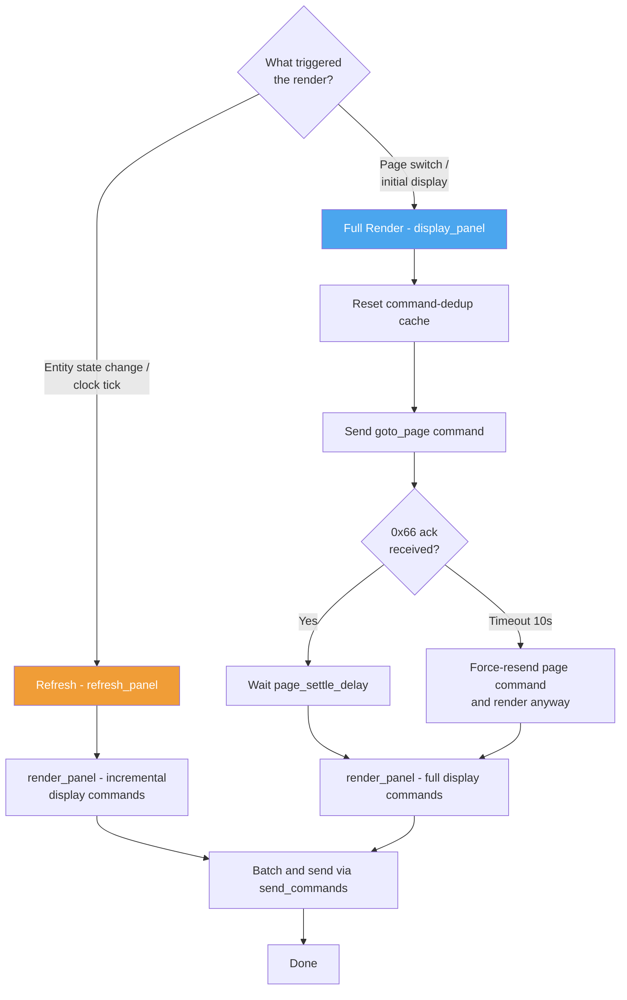

# Nextion component

The firmware drives the Nextion display and the hub renders panels through it. Read this page when you change the display configuration or the render cycle, or when you need to know which HMI script writes what.

## The component in the firmware

The firmware uses the stock ESPHome `nextion` display component (ESPHome 2026.11 or later) over a hardware UART, with the temporary vendored patch in `esphome/nextion_patch/`. The hub never sees the UART: it calls the device actions listed in [ESPHome component](esphome.md), and the firmware writes the Nextion commands.

## Display configuration

### Dimensions and non-visible area

| Area | Landscape | Portrait |
|------|-----------|----------|
| Display and touch resolution | 480 × 320 px | 320 × 480 px |
| Visible area | 450 × 320 px | 320 × 480 px |
| Hidden by the bezel | 30 px on the right (x 450..479) | none |

Touch coordinates in the hidden band are valid; no pixels are visible there. Edge gestures depend on it: `esphome/nspanel_haui/scripts_interaction.yaml` takes `visible_width` (450 in landscape, 320 in portrait) for its right-border check with a 40 px `border_margin`, so in landscape a swipe starting at x > 410 counts as a right-edge start and touches in the hidden band count too.

### Display options

These live in `esphome/nspanel_haui/display.yaml`:

| Option | Value | Effect |
|--------|-------|--------|
| `uart_id` | `haui_uart` | the UART bus the display is on |
| `wake_up_page` | `0` | page shown after *hardware* sleep. The display state machine never hardware-sleeps: it keeps System page 0 visible and dims the backlight, so this only matters if hardware sleep is requested explicitly |
| `tft_url` | `$tft_update_url` | compile-time default TFT URL, overridable per device YAML; the hub always passes the URL of the TFT it installs. The component's validation also requires it next to `tft_upload_http_buffer_size_tx` |
| `tft_upload_http_buffer_size_tx` | `2048` | HTTP TX buffer for the TFT download: GitHub redirects release TFTs to a signed URL of about 870 characters, and the ESP-IDF default of 512 fails with `HTTP_CLIENT: Out of buffer` |
| `max_queue_size` | `800` | caps the command queue so a Nextion buffer overflow cannot strand entries and fragment the heap; 800 absorbs a full panel render plus concurrent state updates |
| `max_commands_per_loop` | `50` | bound on the commands *sent* per loop and the replies *parsed* per loop. With `command_spacing` set the pacer already leaves one command per component phase, so on the transmit path this is inert — it only bounds reply parsing |
| `command_spacing` | `2ms` | enables the command pacer globally. The ESP32 loop timestamp is constant within a component phase, so at most one queued command leaves per phase; together with `loop_interval` (see below) that is one command every 2 ms and keeps bursts out of the Nextion's 1 KB RX buffer |
| `on_setup`, `on_page`, `on_touch` | — | triggers after the firmware connects to the display, on a page change, and on a touch |
| `on_buffer_overflow` | — | logs the warning and publishes a `buffer_overflow` event, which starts [buffer overflow recovery](#buffer-overflow-recovery) |

## Panel rendering and refresh

The HA layer batches commands to keep the native API payload small, ESPHome queues them and the `command_spacing` pacer writes them to the UART. The pacer, not HA batching, is what protects the Nextion's 1 KB RX buffer.

### Command pacing costs one component phase per command

The pacer compares the spacing against `App.get_loop_component_start_time()`, which is a constant inside one component phase. It therefore sends **one command per component phase**, whatever `max_commands_per_loop` allows. The component phase is gated by `esphome: loop_interval` (default **16 ms**), so the pacing has two parts:

| `loop_interval` | Commands per second | A 200-command render |
|-----------------|---------------------|----------------------|
| `16ms` (ESPHome default) | ~62 | ~3.2 s |
| `2ms` (what this firmware sets) | ~500 | ~0.4 s |

`esphome/nspanel_haui/base.yaml` sets `loop_interval: 2ms`, which is what makes `command_spacing: 2ms` mean 2 ms between commands instead of 16 ms. That is the pace the config always intended; the loop interval silently overrode it.

Measured against the hub's own renders (`tests/page_commands_golden.json`, and a `set_panel` lifecycle on the `PageApp` fake):

| Action | Commands | at 16 ms | at 2 ms |
|--------|----------|----------|---------|
| Open a grid panel | 112 | 1.8 s | 0.22 s |
| Open a row panel | 156 | 2.5 s | 0.31 s |
| One `next_page` on a grid | 23 | 0.37 s | 0.05 s |
| One `next_page` on a row | 32 | 0.51 s | 0.06 s |

Those counts are flat in the number of panel items (only the visible tiles render), so the cost is set by the pacing alone. The headroom check: an average command is ~14 characters plus the three `0xFF` terminators, so 2 ms per command is ~8.6 KB/s of the UART's 11.5 KB/s — the display keeps up while it is idle, and its 1 KB RX buffer covers ~60 commands (120 ms) while it is busy drawing a page. `4ms` is the safer fallback if overflows appear on a slow display: ~4.3 KB/s, still 4× faster than the old behaviour.

### The pacing also sets the queue's drain rate

`max_queue_age` (the component's default is `8000ms`) purges a queue entry that has waited too long, whether or not it was ever sent. A full queue drains at one command per component phase, so the three settings are one equation:

```
max_queue_size × command_spacing  ≤  max_queue_age
        800 × 2 ms = 1.6 s        <  8 s
```

At 16 ms per command that read `800 × 16 ms = 12.8 s > 8 s`: once ~500 commands were queued, the tail expired **unsent**, so a heavy page could silently keep stale widgets instead of merely drawing slowly. That second, quieter failure mode came from the same root cause. Raise `command_spacing` past ~10 ms and it returns — raise `max_queue_age` with it. `tests/test_esphome_yaml.py` checks the inequality against the component's own default.

A panel render has two paths:

- **Full render** (`display_panel`): initial display, panel switches and the page-load path. Resets the command-dedup cache, so the first batch is never dropped as a duplicate of the previous page.
- **Refresh** (`refresh_panel`): re-runs `render_panel` on the active panel for entity state changes, clock ticks and overflow recovery, with no page transition.



### Page acknowledge and settle delay

The Nextion answers a page change with a 0x66 ack once the new page is active, and the hub waits for it before rendering: commands that arrive earlier are rejected with "Invalid variable name" (0x1A) because the page's components are not initialised yet. After the ack the hub waits `page_settle_delay` (default `0.05` s) and then calls `display_panel`. The ack already means the page is active, so the delay is a margin for a page still finishing its Preinitialize — it is the largest avoidable part of a panel open, which is why it is kept short. If no ack arrives within 10 s (`PAGE_ACK_TIMEOUT`), it force-resends the page command and renders anyway.

### Buffer overflow recovery

A Nextion buffer overflow (0x24) loses every instruction that was in flight, so the display shows a mix of stale and updated widgets. The hub debounces a `refresh_panel()` after `OVERFLOW_RECOVERY_DELAY` (0.5 s), doubling the delay for each consecutive overflow and pausing recovery after `OVERFLOW_RECOVERY_MAX_ATTEMPTS` (5) until the display has been overflow-free for `OVERFLOW_RECOVERY_RESET` (30 s). Recovery re-renders the active panel instead of switching pages, so its batch is smaller than the one that overflowed. The constants and the handler are in `haui/controller/navigation.py`.

## Editing the HMI

The HMI holds the interface design and only the page-scoped logic that must run on the display; everything else belongs to the hub. The rules that keep both HMIs in step are in [Nextion Editor](nextion-editor.md#the-hmipython-contract).

- Every page sends `sendme` in `Preinitialize`: it is how a page change becomes an `esphome.page` event, and a page without it is never rendered.
- Prepare the page in `Preinitialize`, because the hub cannot touch the display before the page is shown. What the page needs at load time arrives in the globals the hub sets before the switch: the theme colours in `Program.s` for solid-colour pages, and the picture background of the clock and weather pages.
- Enable `Send Component ID` on any widget whose touch the hub must receive.
- The hub addresses a widget by id and object name from the page's `COMPONENTS` registry, so reordering components changes their ids.

The walkthrough for the editor itself — widgets, pages, fonts, images, the portrait project — is [Nextion Editor](nextion-editor.md).

## Scripts for display

The display tools live in `scripts/` (index in `scripts/README.md`) and run as modules from the repository root.

| Script | Writes | Run it | Guards it |
|--------|--------|--------|-----------|
| `python -m scripts.hmi_layout.gen_layout`, `--spec portrait` | the spec's geometry and attributes into the HMI, and the sibling's `sendkey` values | after a change to `landscape_layout.py` or `portrait_layout.py` | `--check` compares spec and HMI, including widget coverage across both |
| `python -m scripts.hmi_layout.gen_virtual_layout` | `frontend/virtual/layout_<orientation>.json`, `icon_map.json`, the preview pictures (WebP) and `haui/mapping/font_metrics.json` | after every HMI change | `--check` (in the suite) fails while any of them is stale; it also verifies every solid page's theme code |
| `python -m scripts.hmi_layout.gen_virtual_layout --theme-code <page>` | the `Preinitialize` theme code of one page | when a page's theme code must be pasted or refreshed | same `--check` |
| `python -m scripts.check_preview_coverage` | — | after adding a panel type | `tests/test_preview_coverage.py` |
| `python -m scripts.nextion2text.Nextion2Text -i <hmi> -o <dir> -d -s -p visual` | a text dump per page: widgets with ids and names, event code and visual properties | when you map widgets to `COMPONENTS` | — (read-only; `build/` is git-ignored) |
| `python -m scripts.bump_tft_version` | `system.tftVersion` in both HMIs | with a release that ships new TFTs | `tests/test_bump_version.py` and the release manifest |
| `python -m scripts.design_grid.gen_grid` | `nextion/images/grid_landscape.png`, `grid_portrait.png`, the editor-only design grid | after a layout rule or theme colour changes | import them into both projects by hand |
| `python -m scripts.backgrounds.gen_backgrounds` | `nextion/images/bkg/landscape/`, `bkg/portrait/` | after a source picture in `nextion/src_images/bkg/` changes | import them by hand |
| `python -m scripts.spinner.gen_spinner` | `spinner_<orientation>_1.png`, `_2.png` (pictures 11 and 12) | after the `system` tile changes or `hSpinner` moves | `gen_virtual_layout --check` fails while the timer's `xpic` ids point elsewhere |
| `python -m scripts.charset.gen_char`, `scripts/font_tools/` | `charout.txt`, the `.zi` fonts, `docs/cheatsheet.html` | when the icon set or a font size changes | `make generated-check` fails while the cheatsheet is stale |
| `python -m scripts.rgb565_image.image_convert`, `python -m scripts.color_wheel.gen_color_wheel` | a `pixelData~` string, an HSV colour wheel picture | for ad-hoc assets | — |

`make hmi-check` runs the layout, generated-asset and preview-coverage guards in one go; `make screens-check` compares the docs screen images with a fresh render.

