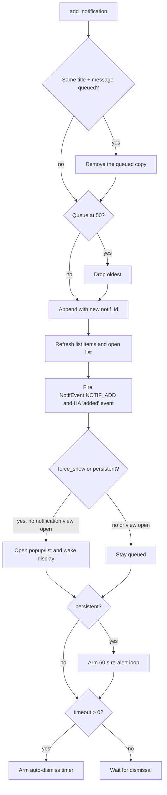

# Notification Process

This page describes how a notification travels from Home Assistant to the
display. It is the developer reference; end-user behaviour is documented in
[Notifications](../user/device.md#notifications), the service fields in
[Services](../user/services.md#nspanel_hauisend_notification), and the popup layout in
[Popup Notify](../user/panels/popup_notify.md).

Everything below the entry points happens inside one
`HAUINotificationController` per device, on that device app's worker thread.

## Components

| Component | File | Responsibility |
|-----------|------|----------------|
| `HAUINotificationController` | `haui/controller/notification.py` | Queue, delivery, timers, queue player, HA events |
| `Notification` | `haui/controller/notification.py` | One queued entry (a `NamedTuple`) |
| `NotifyPage` | `haui/page/notify.py` | Detail popup: icon and its colour, text fitting and paging, buttons |
| `SelectPage` | `haui/page/select.py` | List popup when several notifications are queued |
| `NotificationBlinker` | `haui/utils/notification_blinker.py` | Shared 1 s blink timer for the notification indicator |
| `NSPanelNotifyEntity` | `notify.py` | HA `notify` entities, one normal and one persistent per device |
| `_handle_send_notification` | `services.py` | `nspanel_haui.send_notification` service handler |
| `send_notification` script/action | `esphome/nspanel_haui/scripts_common.yaml`, `api.yaml` | Device-side ESPHome action |
| `NotificationsView` | `api/status.py` | REST API for the editor's notification inbox |

## Data model

`Notification` is an immutable tuple with the fields below. Being a tuple keeps
index access and value equality working for older code, but new code should use
the named fields.

| Field | Type | Default | Meaning |
|-------|------|---------|---------|
| `title` | `str` | — | Headline shown in the popup header and queue list |
| `message` | `str` | — | Body text; may be empty |
| `icon` | `str` | `""` | MDI icon name; empty means no icon |
| `persistent` | `bool` | `False` | Sound loops and the popup re-opens until dismissed; forces `force_show` |
| `force_show` | `bool` | `False` | Open immediately when nothing notification-related is on screen |
| `icon_color` | `int \| str \| list[int] \| None` | `None` | Icon colour in a `parse_color_value` format; `None`/`""` keeps the theme's `component_text` colour |
| `sound` | `str` | `"notification"` | Name of an ESPHome `play_sound` sound; `""` is silent (`"none"` is normalised to `""`) |
| `text_size` | `str \| int` | `"auto"` | `"auto"` or a font size 1–3 |
| `timeout` | `int \| None` | `None` | Seconds from queueing until auto-dismiss; `None`/`0` never expires |
| `notif_id` | `str` | controller-generated | `uuid4().hex`; identifies the entry in events, the REST API, and the list |

`notif_id` is assigned when the notification is queued, never by the caller. Do
not substitute `id(notification)`: CPython reuses the identity of a freed tuple,
and the queue replaces entries.

The service and the queue take the generic fields only.

For `info`/`warning`/`alert`/`critical`/`silent` presets there is a Home Assistant script:
[Services → Preset notification script](../user/services.md#preset-notification-script).

## Delivery paths

All three entry points converge on
`HAUINotificationController.add_notification()`. Only the HA service carries the
full option set.

| Path | Options | Notes |
|------|---------|-------|
| `nspanel_haui.send_notification` service | `title`, `message`, `icon`, `persistent`, `force_show`, `icon_color`, `sound`, `text_size`, `timeout` | Recommended; may target one device or every panel (omit `device`). The controller applies `force_show = force_show or persistent` |
| `notify.<device>` / `notify.<device>_persistent_notification` | `title`, `message` only | The persistent entity sets only `persistent`; the controller's persistent rule supplies `force_show`, the loop and the icon/sound defaults |
| ESPHome `send_notification` action | `title`, `message`, `icon`, `persistent`, `text_size`, `icon_color`, `sound` (all required) | ESPHome 2026.10 has no optional action variables. Sends an `esphome.send_notification` JSON event; no force-show or timeout, and the hub defaults missing `icon_color`/`sound` for older payloads |

The service schema validates `icon_color` as `#rrggbb`, an RGB565 number,
`[r, g, b]` or an integer string, `sound` against `SOUND_NAMES` plus `none`,
`text_size` as `auto` or `1..3`, and `timeout` as `0..3600`. A service call
without a matching device raises `ServiceValidationError` instead of silently
doing nothing. A sound name outside `SOUND_NAMES` raises `ValueError` in the
controller.

The ESPHome action does not force-show explicitly, but a persistent notification
is force-shown by the controller's persistent rule.

## Queue lifecycle



Important ordering rules in `add_notification()`:

1. **Replacement first.** A queued entry with the same `title` and `message` is
   removed before the new one is appended. The new entry gets a new `notif_id`,
   goes to the end of the queue, and alerts again.
2. **Queue cap.** `MAX_QUEUE_SIZE` is 50; a full queue drops the oldest entry.
3. **Persistent means immediate.** `add_notification()` applies
   `force_show = force_show or persistent` for every path, so a persistent
   notification always opens its popup (when no notification view is on screen).
4. **Force-show waits its turn.** `force_show` only opens a popup when no
   notification view is on screen. This prevents a new
   arrival from ripping away the popup the user is reading; it opens when the
   current one closes.
5. **Persistent starts its loop.** The re-alert timer is independent of the
   timeout.
6. **Timeout counts from queueing**, not from display. A notification can expire
   while it is still waiting.
7. **Normalisation first.** `icon_color` `""` becomes `None` (theme text
   colour), and `sound` `""`/`"none"` become `""` (silent); any other sound name
   must be in `SOUND_NAMES`.

Only the controller mutates the queue. `get_notifications()` returns a copy;
`remove_notification()` matches by value but removes the stored instance.

## Viewing and the queue player

`open_notifications()` is the tap handler for the notification indicator. It
marks the queue read and then:

- **one entry** → `open_notification()` opens the `popup_notify` page with the
  notification's icon, icon colour, title, message, and text size;
- **several entries** → `open_notification_list()` opens `popup_select` in
  `full` mode. Items are `{"value": notif_id, "name": label}`, where `label` is
  `title: message` (or just the title when there is no message). Selecting one
  opens its detail popup without closing the list.

Queue-popup details:

- The right button is **Dismiss**. It calls `remove_notification()`, and
  `close_on_button=True` closes the popup.
- The popup carries a `notif_id` marker. `_is_notification_view()` uses that
  marker (and, for the list, the identity of the controller's selection
  callback) to distinguish queue popups from other users of the same pages.
- Closing a popup without dismissing keeps the notification queued and does
  **not** advance the queue.
- The close callback fires on any close, including navigation away. It arms the
  queue advance only when the notification is no longer queued (dismissed or
  expired).
- The advance is deferred with `run_in(..., 0)` so the navigation operation that
  closed the popup can settle before the next popup opens.
- `_advance_queue()` opens the first queued entry unless another notification
  view is already open.

Queue-item removal keeps an open list truthful: the shared item list is updated
in place, and the list is closed when its last item disappears. A new
notification appears in an already-open list without switching pages.

## Timers

The controller owns three timer kinds; all are cancelled by `stop_part()` and
`clear_notifications()`.

| Timer | Arm | Cancel | Callback |
|-------|-----|--------|----------|
| Auto-dismiss | `app.run_in(_expire, timeout)` | On removal/clear | Removes the entry; closes its own popup if that popup is showing |
| Persistent re-alert | `app.run_every(..., "now+1", 60)` | On removal/clear; self-stops when the entry is gone | Re-opens the popup unless a notification view is open |
| Queue advance | `app.run_in(_advance_queue, 0)` | On clear | Opens the next entry |

Expiry follows the normal removal path: timers cancelled, list refreshed,
`NOTIF_REMOVE` and the HA `removed` event fired. If the expired notification's
own popup was open, it is closed; the close callback then advances the queue.
An expiry never closes a different popup or the list.

The re-alert loop does not steal an open notification popup or list. It may
re-open a persistent notification's popup over the idle/screensaver page;
a schedule entry with sound off still keeps the display dark
(`wake_for_notification()` is the authority on waking).

**Threading.** Controller methods run on the app's worker thread. HA callers
enter through `app.dispatch()` (fire-and-forget, as the service and notify
entities do) or `await app.async_run_on_worker()`. Timers use the adapter's
`run_in`/`run_every`, so callbacks also run on the worker. Do not block the
worker waiting for HA or for itself.

## Presentation

`NotifyPage` renders the detail popup.

- **Icon.** `icon_color` colours the icon (any `parse_color_value` format);
  when it is `None` or `""` the page uses the theme's `component_text` colour.
  Without an icon, the icon widget is hidden and the text uses the full text
  area.
- **Text.** `"auto"` picks the largest font that fits the message on one page;
  otherwise the fonts are tried largest to smallest and the smallest is paged.
  A fixed `text_size` pages at that size. Fitting uses the display fonts' real
  glyph widths, so the display never re-wraps.
- **Paging.** Long messages are split into static pages. The title shows a
  `(page/total)` counter and the inner-right header button advances manually;
  the button disappears on the last page, which stays visible. Nothing advances
  on its own and text is never truncated.
- **Buttons.** `btn_left`/`btn_right` are shown only when set, with optional
  colours. The outer-right header slot keeps the normal close action, which is
  the only dismissal for buttonless popups.
- **Lifetime.** The queue and its timers own a queued popup's lifetime: never
  pass `close_timeout` to one. `NotifyPage.suspends_auto_page()` returns `True`,
  so the automatic page switch waits while a notification is on screen.

The popup page is also used for non-queued notices (entity unavailable, update
notices, timer finished). Those bypass the queue and can use `close_timeout`;
they have no `notif_id`, so the controller does not treat them as notification
views.

## Sound, waking, and muted schedule entries

`HAUIDevice.process_event()` reacts to the controller's internal events:

- `NOTIF_ADD` plays `notification.sound` when it is non-empty, but only when
  the device setting `sound_on_notification` is on (default `False`). A silent
  notification (`sound=""`) plays nothing.
- A persistent notification starts the repeating sound loop at
  `persistent_sound_interval` seconds (default 5). Each round plays the sound of
  the **first queued audible persistent notification** (queue order); a silent
  persistent notification neither mutes the loop nor blocks a later audible one.
  When the sounding notification leaves the queue the next audible one takes
  over, and the loop stops as soon as no audible persistent notification
  remains. The loop stays silent while the schedule mutes sounds and sounds
  once that entry ends.
- `NOTIF_REMOVE` and `NOTIF_CLEAR` stop the loop when no persistent
  notification remains.

`force_show` and the persistent re-alert call `device.wake_for_notification()`,
which resets the firmware inactivity timer unless the schedule mutes sounds.
Then the popup still opens but the display stays dark; the popup is what the
user sees on the next touch. While a notification popup is open the display
still dims and turns off on its normal timers.

Sounds are muted while the active entry of the device's `schedule` setting has
`sound` off (`HAUIDevice._sounds_muted()`). That gates
`HAUIDevice.play_sound()` (every hub sound, including startup, notification,
persistent-loop and timer alerts) and `wake_for_notification()`; it never
drops, delays or hides a notification.

## Notification indicator

Pages do not own a blink timer. They register a renderer with the shared
`NotificationBlinker` hosted on the controller:

```python
# start_panel()
self.app.controller["notification"].set_blinker_callback(self._refresh_notif)

# render_panel()
self.app.controller["notification"].blinker.refresh()

# _stop_panel()
self.app.controller["notification"].clear_blinker_callback()
```

`_refresh_notif` checks `blinker.new_notifications` and draws the bell or header
button accordingly. The blinker ticks once per second while unread, skips ticks
while the display is not visible, and stops on `mark_read()` (opening the queue
or emptying it) or `NOTIF_CLEAR`. `NOTIF_ADD` sets the unread flag;
`NOTIF_REMOVE` refreshes without clearing it.

## Events and external surfaces

Every queue change is observable:

- **Internal bus.** `NotifEvent.NOTIF_ADD`, `NOTIF_REMOVE`, and `NOTIF_CLEAR`
  are dispatched through `app.callback_event()`. Controllers, the device, and
  the blinker react to them.
- **HA event.** `nspanel_haui.notification` with fields `device`, `id`,
  `state` (`added`/`removed`), `title`, `message`, `icon`, `icon_color`,
  `sound`, `persistent`, `force_show`, and `timeout`. Fired for queueing,
  dismissal, expiry, replacement, clearing (one `removed` per entry), and when
  a full queue drops the oldest.
- **REST API** (`NotificationsView`, admin only):
  `GET /api/nspanel_haui/notifications/{entry_id}` returns the queue for a
  device or the whole entry; `DELETE ...?device=<name>&id=<notif_id>` dismisses
  one entry. Both read/mutate through the app's worker.
- **Editor inbox.** `frontend/store/store.js` subscribes to the HA event for live
  updates, loads the initial queue over REST, and dismisses through the same REST
  endpoint; the titlebar's notification centre renders that queue.
- **Preview.** `NSPanelHAUI.callback_event()` publishes a `notifications`
  preview-state event so the sandbox preview mirrors the queue.

## Sending from your own code

From hub or page code, call the controller directly. Do not publish ESPHome
actions for hub-side notifications; the ESPHome path lacks force-show and
timeout.

```python
notification = self.app.controller["notification"].add_notification(
    title="Doorbell",
    message="Someone is at the front door",
    icon="mdi:doorbell",
    icon_color="#4aa5ee",
    sound="alert",
    persistent=True,
    timeout=120,
)
notification.notif_id  # stable id for later removal
```

For a one-shot popup that must not enter the queue, use the navigation
controller and the public popup parameters instead:

```python
self.app.controller["navigation"].open_panel(
    PopupPanelKey.POPUP_NOTIFY,
    title="Heads up",
    notification="This popup is not queued.",
    icon="mdi:information",
    close_timeout=10,
)
```

Keep the two mechanisms apart: queued popups must go through the notification
controller, and only the controller may set `notif_id` on a `popup_notify`
panel.

## Tests

Behaviour is covered by:

- `tests/test_notification.py` — queue, replacement, force-show, queue player,
  timers, persistent alerts, muted schedule entries, events;
- `tests/test_notification_blinker.py` — blink lifecycle;
- `tests/test_notify_entity.py` — notify entities;
- `tests/test_device_notify.py` — sound and waking;
- `tests/test_page_notify.py` — text fitting, paging, and popup rendering.
