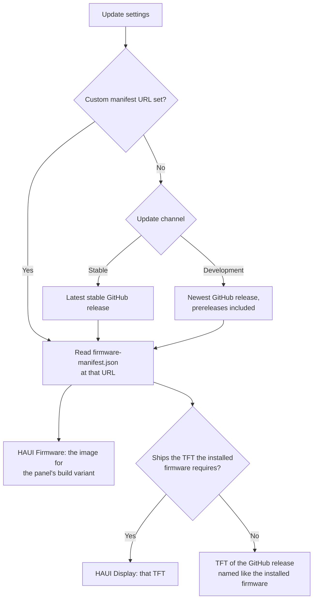
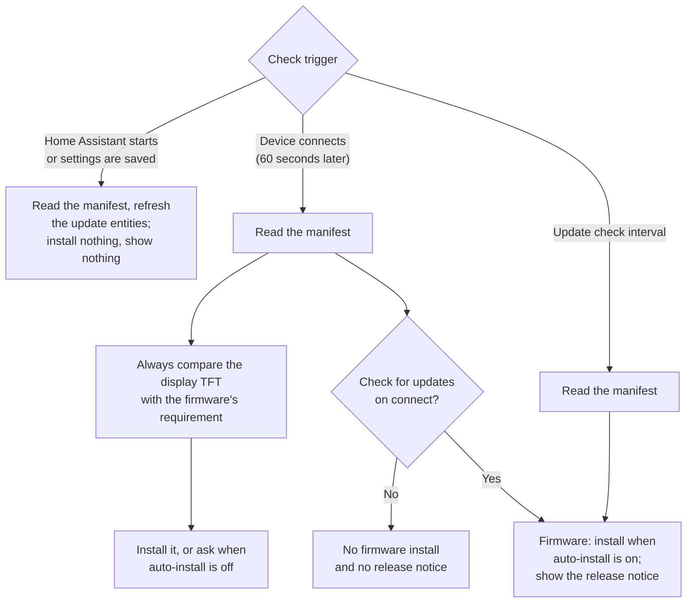
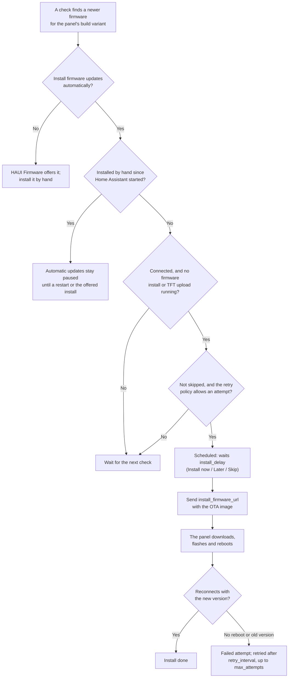
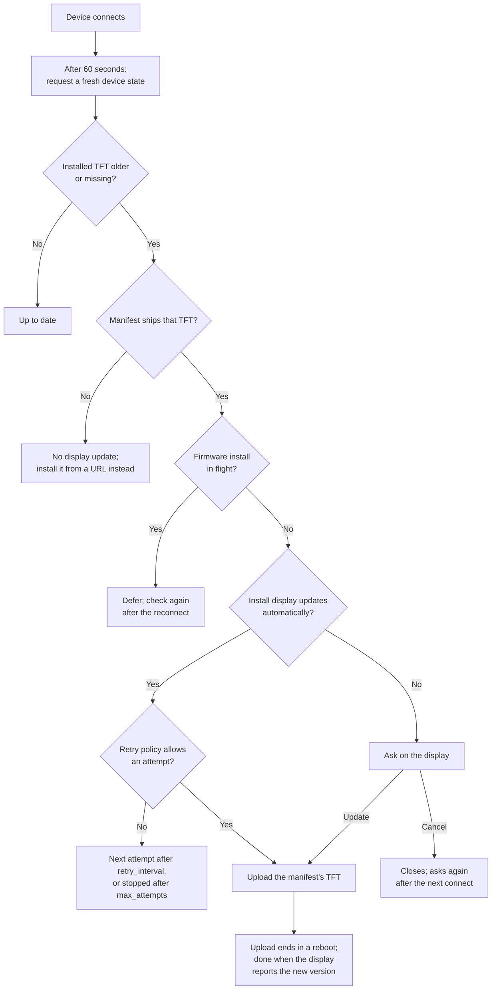
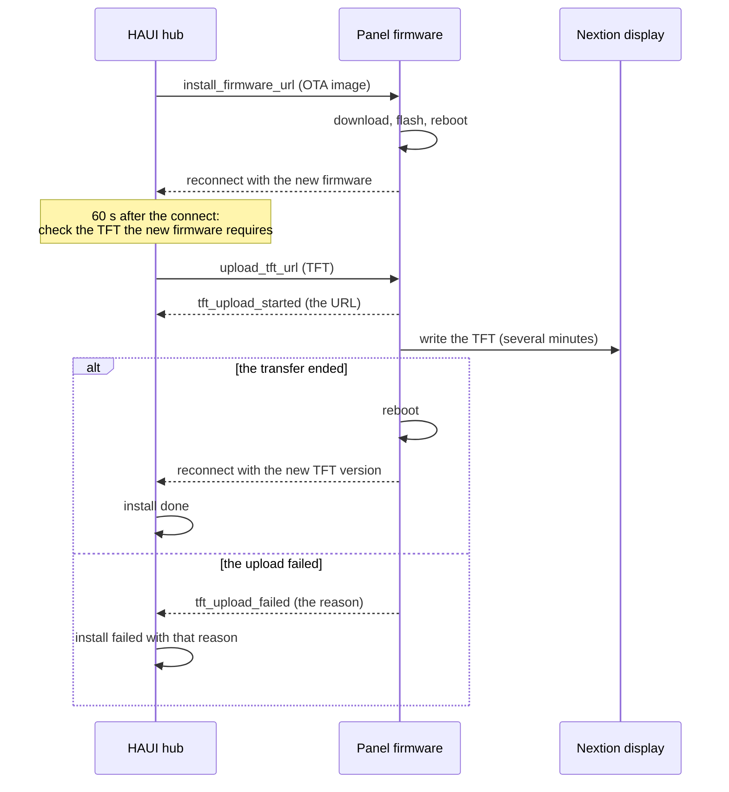

# Update process

The hub updates each panel's **ESPHome firmware** (**HAUI Firmware**, `update.<device>_haui_firmware`) and its **display TFT** (**HAUI Display**, `update.<device>_haui_display`). The integration itself comes from the Marketplace, see [Updating](../user/update.md). `haui/controller/update.py` runs every check and install, `haui/controller/release_source.py` fetches and resolves the artifacts, `api/updates.py` serves the editor and `hub/rollout.py` installs one device at a time.

Read this when you change a check trigger, an update setting, the manifest format or the install path. The two update entities and the editor's **Updates** sidebar only display what the controller publishes.

## Where updates come from

Every release publishes a **firmware manifest** (`firmware-manifest.json`) that names the firmware version with its over-the-air image (`nspanel_haui_ota.bin` and its md5) and the display TFT for each display model. The hub reads one manifest per device:

| Channel | Manifest |
|---------|----------|
| **Stable** (`stable`, default) | The latest stable GitHub release |
| **Development** (`dev`) | The newest release in the GitHub release list that ships a manifest, development builds included (see [Published development firmware](release.md#published-development-firmware)) |
| **Custom manifest URL** | The URL set under **Update settings → Advanced** overrides the channel, for example to follow the local manifest that `scripts/dev_release.py` writes into Home Assistant's `www` folder |

The display always gets the TFT the **installed** firmware needs: the firmware reports the version it requires (`tft_version`) and the hub installs that version from the manifest. A newer TFT is never installed ahead of its firmware; after a firmware update it follows once the device has rebooted into it. A manifest without a TFT (a local test release ships none) offers no display update; when the channel's manifest ships another TFT version, the hub takes the one from the GitHub release named like the installed firmware.



## Build variants

The manifest names its build variant and the device reports the one it runs (`firmware_variant`); the hub offers, lists and installs only a matching variant, and treats two unknown variants as incompatible.

| | Universal firmware | Custom firmware |
|---|---|---|
| What it is | The prebuilt `nspanel_haui.bin` of every release | Built from your own YAML: `esphome/install.yaml`, `esphome/nspanel_haui_dev.yaml`, or a device YAML that includes `nspanel_haui.yaml` |
| Wi-Fi and API key | Wi-Fi entered in the panel's access point at first boot; the public fixed API key | Your own, from the YAML |
| Firmware updates | By the hub: every manifest offers the new universal image | Not from the releases: you rebuild and install |
| Display TFT updates | By the hub | By the hub |

Firmware older than 0.4.4 reports no variant; see [Older firmware](upgrading.md#older-firmware) for the one manual flash it needs.

### Universal firmware

The manifests ship the universal image, so the hub runs the whole cycle:

1. **First install.** Flash `nspanel_haui.bin` once by cable and connect the panel to your Wi-Fi through its access point, see [Universal image](../user/install.md#universal-image-no-yaml).
2. **A new release.** The next check reads the manifest: **HAUI Firmware** offers the release and the display shows the [release notice](#on-the-display).
3. **Install.** Press **Install** on **HAUI Firmware** or beside **Firmware** in the **Updates** sidebar, or let **Install firmware updates automatically** do it.
4. **Flash and reboot.** The panel downloads the release's over-the-air image, flashes it and reboots with its Wi-Fi and API key unchanged. About a minute after the reconnect the hub installs the TFT the new firmware needs, or the display asks first.

The same cycle runs for every development build on the **Development** channel, which is universal too. To stay on a version, leave **Install firmware updates automatically** off and skip the update in Home Assistant, or install a specific release (the entity's `version`, or the **Updates** sidebar's release list).

### Custom firmware

Releases ship only the universal image, and the hub never installs it on a custom build: it would replace your API and OTA credentials with the public ones. For a custom panel:

- **HAUI Firmware** offers nothing. Its state is unknown and its release summary names the variant mismatch; **Install firmware updates automatically** does nothing.
- The [release notice](#on-the-display) still appears when a new release is out: your cue to rebuild.
- The **display TFT** is still updated by the hub, because both variants use the same TFT. A build whose version no release has (a local test build) keeps the TFT the display has; install a matching one with **From URL** when the display layout changed.

Update a custom build in one of three ways:

1. **ESPHome dashboard.** Open the device and choose **Install → Wirelessly**. ESPHome compiles your YAML with the current package source and flashes it over the network. `install.yaml` takes `nspanel_haui.yaml` from GitHub at `remote_package.ref`, by default `master` (the latest stable release). The ESPHome integration also adds a disabled **Firmware** update entity, which is independent of the hub.
2. **From URL.** Build the OTA image (in the dashboard: **Install → Manual download**, OTA format), put it where Home Assistant serves it (`/config/www/…` is served as `/local/…`) and install it from the **Updates** sidebar (**Install** beside **Firmware** → **From URL**), or with `nspanel_haui.update_firmware` and `url`. Use your own build: the release's `nspanel_haui_ota.bin` is the universal image and would replace your credentials.
3. **Your own manifest.** To update custom panels like universal ones, publish each build with a manifest: `scripts/dev_release.py --variant custom` writes the image and a `firmware-manifest.json` into Home Assistant's `www` folder. Set **Custom manifest URL** to that manifest; **HAUI Firmware** offers every newer build and **Install firmware updates automatically** installs it. Each build needs a higher version than the last. The development channel is described in [Published development firmware](release.md#published-development-firmware).

After the reboot the hub installs the TFT the new firmware needs, as on a universal panel.

## When the hub checks

**Enable updates** is on by default. The hub then checks at these moments:

| When | What the hub does |
|------|-------------------|
| Home Assistant starts, or the device settings are saved | While the device is connected: reads the manifest and refreshes the two update entities (a panel that is not connected yet gets its first read at the connect check). Installs nothing and shows nothing on the display. |
| 60 seconds after the device connects (`on_connect_delay`) | Compares the display's TFT with the TFT the firmware needs and installs or offers it (always). With **Check for updates on connect**, it also installs a firmware update (with **Install firmware updates automatically** on) and shows the release notice. |
| Every **Check for a new version** interval (`update_interval`, hourly by default) | Reads the manifest, installs a firmware update (with **Install firmware updates automatically** on) and shows the release notice. The TFT is not checked here. |



The update entities do not poll: they show what the last check found.

### Firmware

With **Install firmware updates automatically** on (`firmware_auto_update`, see [Settings](#settings)), an automatic install is due when:

- the manifest offers a newer version than the device runs, for the device's build variant, and that version is not the device's skipped version (`skipped_firmware_version`);
- the device is connected, no TFT upload or other firmware install is running, and no [rollout](#installing-every-device-one-at-a-time) holds the device;
- the retry policy allows another attempt: a failed attempt waits `retry_interval` (an hour), and after `max_attempts` (3) failed attempts at one version the automatic install of that version stops. A success, a manual install, a newer version or a Home Assistant restart resets the count;
- no other release or URL was installed by hand since Home Assistant started (`_manual_firmware`, see [What the Updates picker offers](#what-the-updates-picker-offers)).

A due install is **scheduled**: it waits `install_delay` (10 minutes) and then starts if all of the above still holds. Until then the **Updates** sidebar shows when it starts, with **Install now**, **In 1 hour**, **In 1 day** (`defer`, 3600 or 86400 seconds) and **Skip this version**, which stores the version in `skipped_firmware_version` so it is passed over even after a restart. A later check keeps the start time; `install_delay` 0 starts the install right away.



With **Check for updates on connect** and periodic checks both off, nothing installs the firmware automatically. With **Install firmware updates automatically** off (the default), the **HAUI Firmware** entity offers the update and you install it yourself, see [Installing updates](#installing-updates).

During the install the display shows a [popup](#on-the-display) that a new firmware is installing. The device downloads the image, flashes it and reboots; the TFT follows after the reboot.

### Display TFT

After every connect the hub compares the TFT the display reports with the TFT the firmware needs. When the display's TFT is older:

- **Install display updates automatically** on (`auto_install`, the default): the hub installs it right away. It never waits out `install_delay`: while the display file is older than the firmware needs, the screen can be broken.
- **Install display updates automatically** off: the display asks *Your TFT-version is outdated. Do you want to update?* **Update** starts the install; **Cancel** closes the question, which comes back after the next connect.

The hub never starts a TFT upload while a firmware install is running, because the firmware's reboot would cut the upload off. An install the display never confirms counts as a failed attempt: the hub tries again after `retry_interval` and stops after `max_attempts`, like the firmware, and the editor shows when the next attempt follows or that it stopped.



## Settings

Every update setting belongs to its device, in `DEFAULT_CONFIG["update"]`; there is no hub-wide update setting. `migrate_hub_update_policy` in `hub/storage.py` moves a stored hub-level `update_policy` into each device's settings on load, without changing what a device does.

| Setting in the editor | Key | Default | What it does |
|-----------------------|-----|---------|--------------|
| **Enable updates** | `enabled` | on | Master switch for checks, update entities and every install, see [When updates are disabled](#when-updates-are-disabled). |
| **Update channel** | `firmware_update_channel` | **Stable** (`stable`) | Which manifest to follow when no custom URL is set: stable releases, or **Development** (`dev`, the published development firmware). Also decides whether the release notice considers prereleases. |
| **Install firmware updates automatically** | `firmware_auto_update` | off | Installs a newer firmware without asking, see [Firmware](#firmware). |
| **Check for a new version** | `update_interval` | **Every hour** (`3600`) | Seconds between periodic checks; **Never** (`0`) turns them off. The editor offers 15 minutes to one week and keeps another stored value selectable; the hub does not limit the value. |
| **Skip this version** | `skipped_firmware_version` | empty | A firmware version never installed automatically; a manual install is not affected. |

Under **Advanced**:

| Setting in the editor | Key | Default | What it does |
|-----------------------|-----|---------|--------------|
| **Custom manifest URL** | `firmware_manifest_url` | the stable releases' manifest URL (shown empty) | A manifest to follow instead of the channel. A value equal to the default counts as unset, so the channel still decides. **Advanced** opens by itself while one is set. |
| **Check for updates on connect** | `check_on_connect` | on | Lets the check after a connect install firmware and show the release notice. The TFT is checked after every connect either way. |
| **Wait before an automatic firmware install** | `install_delay` | `600` | Seconds a due automatic firmware install waits, scheduled (0 to 86400); `0` starts it right away. Shown while firmware installs automatically. |
| **Install display updates automatically** | `auto_install` | on | Installs the TFT the firmware needs without asking; when off, the display asks first. |
| **Failed attempts before it stops** | `max_attempts` | `3` | Failed automatic attempts per version before the automatic install stops (1 to 10). The count is kept in memory: a Home Assistant restart starts it again. Shown while firmware or display installs automatically. |
| **Wait between attempts** | `retry_interval` | `3600` | Seconds between two automatic attempts (300 to 604800). Shown with the attempt limit. |

Saved settings apply immediately; a changed channel or URL is read at once. The delay before the check after a connect (`on_connect_delay`, 60 seconds) is fixed and not shown in the editor. The full option reference is in [Update settings](../user/update.md#update-settings).

## When updates are disabled

Turn off **Enable updates** to stop all update activity for the device:

- No checks run: not on connect, not periodically, not after saving settings.
- Nothing installs automatically, and the display shows neither the TFT question nor the release notice.
- The **HAUI Firmware** and **HAUI Display** entities become unavailable.
- Manual installs are refused: the row-level **Install** buttons are hidden in the **Updates** sidebar, and `nspanel_haui.update_firmware` and `nspanel_haui.update_tft` fail with *Updates are disabled for this device*.
- An install already running finishes; its entity stays available until it ends.

The other update settings are kept while updates are off (the editor hides them) and apply again when you turn updates back on, which reads the manifest right away. A device that is disabled in the editor runs no app on the hub at all, so it gets no updates either, whatever its update settings say.

## Installing updates

### Order

1. Update the **integration** (Marketplace) and restart Home Assistant.
2. Install the **firmware**. The device reboots.
3. The **display TFT** follows about a minute after the device reconnects (with **Install display updates automatically** off, confirm the question on the display, or install it yourself).

Only one install runs at a time: the firmware cannot be installed during a TFT upload, and the TFT cannot be installed during a firmware install (the automatic TFT install simply follows after the reboot).



### Installing every device, one at a time

**Install updates** on the dashboard starts a **rollout** on the hub (`POST /api/nspanel_haui/rollout/{entry_id}`, `hub/rollout.py`). A transfer blocks the panel's main loop, so a panel is offline until it ends; the rollout keeps that to one panel at a time:

1. It takes every connected device with an offered firmware or display update, in the dashboard's device order, and holds each one's automatic firmware install (`set_rollout_hold`), so no device starts on its own meanwhile.
2. For each device in turn: the firmware, if one is offered, then the display file the new firmware needs. After the firmware it gives the device up to two minutes (`_SETTLE_SECONDS`) to start the display update itself (its own check a minute after the reconnect) before it starts it. A device with only a display update gets that.
3. It waits for each install to finish, bounded by the controller's own install timeouts. The first failure, or a device that does not come back, stops the rollout; the devices after it are *not started*. A device whose app stops meanwhile (disabled, removed or reloaded) fails at once, and a firmware install the device already runs is waited for instead of started again.

The rollout skips the waiting period and installs a skipped version (you pressed Install). Devices still queued can be cancelled one by one or all at once (`DELETE …/rollout/{entry_id}[/{device}]`); the device installing finishes, since its transfer cannot be stopped. Once the rollout has finished, the same `DELETE …/rollout/{entry_id}` dismisses it (**Dismiss** on the card), for every editor. The rollout lives in memory: a Home Assistant restart or an entry reload drops it, and a device already transferring finishes on its own. The dashboard's **Update rollout** card shows each device's state and the installing device's progress; the dashboard reads the rollout with every status poll, so a rollout another editor starts shows up too.

### Progress

The panel reports no byte progress, so an install is shown as steps with a time estimate. Each update state carries `firmware_progress` and `tft_progress`:

| Step | Firmware | Display TFT |
|------|----------|-------------|
| `scheduled` | waiting out `install_delay` | — |
| `starting` | command sent, panel still connected | upload requested, panel still connected |
| `transferring` | panel offline: download, flash, reboot | panel offline: write the TFT, reboot |
| `verifying` | — | panel back, the hub reads the new version |
| `done` / `failed` | until the next check | until the next install |

The editor shows the steps, the time the install has run and about how long is left, from `expected_seconds` (`FIRMWARE_EXPECTED_SECONDS` 3 minutes, `TFT_EXPECTED_SECONDS` 15). The bar stays below done until the device confirms, and past the estimate it says the install is taking longer than usual.

### Failure handling

- **Firmware**: the hub waits up to ten minutes (`FIRMWARE_INSTALL_TIMEOUT_SECONDS`) for the device to reboot. No reboot, a reconnect without a reboot, or a reboot into the old version is an error. A failed automatic install is retried after `retry_interval` (an hour), at most `max_attempts` (3) times per version.
- **Display TFT**: the upload takes several minutes (about 13 on a portrait panel) and ends in a reboot; the hub waits up to 20 minutes (`INSTALL_TIMEOUT_SECONDS`). An upload that ends without a reboot, or a TFT the display does not report afterwards, is an error; the automatic install tries again after `retry_interval`, at most `max_attempts` times.

| What the hub hears | Meaning | Install state |
|--------------------|---------|---------------|
| `esphome.tft_upload_started` | the panel accepted the URL and started the transfer; the timeout restarts here | stays `installing` |
| `esphome.tft_upload_failed` | the panel could not install the file; the event carries its reason (no network, `HTTP 404`, a server without range support, a file size out of range, the display refusing the upload, a chunk the display rejected) | `error` with that reason |
| no event, then the device reconnects without a reboot | an upload the panel never started, or one that died before reporting | `error`, "did not reboot" |
| no event, no reconnect for 20 minutes | the transfer is still running, or the panel hangs | `error` on the timeout |

The first two events need firmware from the release that introduced them; older firmware only reports through the reconnect check and the timeout, so its failures take up to 20 minutes to show. A successful upload reboots inside the uploader and never sends an event — the reboot is the success signal.

Errors show in the **Updates** sidebar's status and in the update entity's release summary; a failed display update is also an issue on the device's **Diagnostics** card. See [Troubleshooting](../user/troubleshooting.md#tft-upload-failures) for the common causes.

### Home Assistant update entities

Open the device in **Settings → Devices & services** and press **Install** on **HAUI Firmware** or **HAUI Display**. Both show the install as in progress and stay available while the device is offline for the install (`_attr_available` in `update.py`), which is also why an install survives the device dropping off. Both accept a version:

```yaml
action: update.install
target:
  entity_id: update.nspanel_kitchen_haui_firmware
data:
  version: "0.4.4"
```

### Editor: the Updates sidebar

**Install updates** above the dashboard's **Device inventory** installs what every connected device is offered, one device at a time, after a confirmation (see [Installing every device, one at a time](#installing-every-device-one-at-a-time)). For one device, open the Device screen and press **Updates** below the side stack's cards, or **Install update** in the lead card while an update is offered.

The sidebar leads with one status: **Up to date**, **Update available**, a running install, a failed one with the hub's error, or **No update available** with the reason the release does not fit the device. That reason also says when the hub could not read the firmware manifest, or has not checked since it started, so neither reads as **Up to date**; a check that could not read the release list shows its error under the versions. A failed firmware install stays until the next install starts or the panel reconnects with another firmware (flashed by other means), and a second install while one runs is refused with an error instead of reported as started.

Below the status are the installed firmware and display versions, each with the latest release or the display version the firmware needs; an offered update turns the installed version into one badge with the version it updates to (`0.5.2 → 0.5.3`), and a narrow card shows only the target (`→ 0.5.3`). While the panel is offline, or the editor could not refresh its status, the sidebar says so and the **Install** buttons are off, the versions being the last ones read; **Install updates** on the dashboard is not offered then either. After an install request the editor reads the status at once. Whenever updates are enabled, each version row keeps its own **Install** button, even if no compatible update is offered.

Under the status, a scheduled automatic firmware install shows when it starts with **Install now**, **In 1 hour**, **In 1 day** and **Skip this version** (`POST /api/nspanel_haui/update_control/{entry_id}`); a running install shows its [steps](#progress); and after a failed automatic attempt a line says when the next one follows, or that the automatic install stopped. A skipped firmware version is marked **Skipped** on its row.

**Check for updates** runs along the bottom edge of the status card, with the integration's version at the end of that row (it also shows while updates are off; the integration itself updates through the Marketplace). On a card 440 px wide or narrower (the default sidebar, a phone) the row reads **Check** and shows the version alone, and **Install** shows only its icon. The **Update settings** card below the versions holds this device's update preferences ([Settings](#settings)): its title carries the **Enable updates** switch, and while it is on, the three choices an update needs follow — the **Update channel** (a list), how often to **Check for a new version** (or **Never**) and **Install firmware updates automatically** (a switch). Everything else is folded under **Advanced**, which opens by itself while a custom manifest URL is set. Changes save automatically; text fields save after you pause typing.

### What the Updates picker offers

After pressing **Install** on the **Firmware** or **Display** row, choose what to install in the picker that opens above the **Update settings** card:

- **Firmware**: the offered update, another release that ships an OTA image (older ones included), **From URL**, or **From local file**: a release's `nspanel_haui_ota.bin` on a universal panel, your own build on a custom one, never a factory image such as the release's `nspanel_haui.bin`.
- **Display (TFT)**: the version the firmware needs, the TFT the manifest ships when that differs, **From URL**, or **From local file** for a custom or development `.tft` file.

**From local file** uploads the image to Home Assistant, which serves it back to the device over HTTP(S); the device must reach the configured **Internal URL**, so no internal URL or an unreachable address prevents the install. The file is staged in memory for at most one hour (`_UPDATE_UPLOAD_TTL`) at a random, temporary URL, not in the unauthenticated frontend files.

| Kind | Accepted | Checked before the upload |
|------|----------|---------------------------|
| TFT | A compiled Nextion `.tft` | Up to 16 MiB; the Nextion signature |
| Firmware | An ESPHome OTA app `.bin` (not a factory image) | The ESP image magic and the app-partition size limit (`FIRMWARE_MAX_BYTES`), then MD5 validation and the OTA download |

A local file or URL is a manual override: a TFT stays installed until the firmware version changes or Home Assistant restarts, and a firmware install pauses automatic firmware updates until Home Assistant restarts, so the hub does not replace your choice on the next check. A TFT that does not match the firmware may lack pages or widgets the firmware uses, so use an image built for the target panel, especially for custom firmware.

Both installs are also actions: `nspanel_haui.update_firmware` and `nspanel_haui.update_tft` take one device, optionally a given `version` or the file at a `url`. They suit automations; see [Actions](../user/actions.md#display-updates) for the fields and examples. `nspanel_haui.update_tft` answers with the update state (`started`, `installing`, …) and raises with the controller's reason when the install does not start, so an automation never has to read the log.

A TFT URL is checked before the panel is sent off to download it (`update_url.py`, in the editor and in the action): a non-`http(s)` URL, a `4xx`/`5xx` answer, a file over the display's 16 MiB partition, or a server that answers the whole file to a ranged request is refused with the reason. A transport error from Home Assistant is only a warning — its egress can differ from the panel's (a LAN address only the device resolves) — and the install continues. The upload itself needs the panel's ESPHome connection, not the display handshake: a panel that rebooted and is still handshaking takes a URL install, which the manifest path still refuses because it derives the version from the handshake.

## What the panel and the editor show

### On the display

| Message | Title | Shown when | Buttons |
|---------|-------|------------|---------|
| Release notice | **Update** | A check finds a GitHub release newer than the device's firmware, see below | **Dismiss** |
| Firmware install | **Update** | A firmware install starts, automatic or by hand: *A new firmware release is installing. The display updates after the device reboots.*, with the version (or the URL) | **Dismiss** |
| TFT question | **TFT** | After a connect, when the display's TFT is older than the firmware needs and **Install display updates automatically** is off: *Your TFT-version is outdated. Do you want to update?* | **Cancel**, **Update** |
| TFT starting | **Updating** | You pressed **Update** on the TFT question: *Please wait while the update is starting* | close |

An automatic TFT install starts without a popup. Nothing appears while updates are disabled.

The release notice and the firmware install notice are notifications in the [notification queue](../user/panels/popup_notify.md): they open right away like any notification shown at once, but never in place of a notification popup or list you have open — then they wait in the queue and open when you dismiss the current one. They play no sound, appear in the notification list until dismissed and fire the `nspanel_haui.notification` event like any other notification. The firmware install notice leaves the queue by itself when the install ends, whether it succeeded or failed. The TFT question and the TFT starting message are not part of the queue: they open right away over the current panel and stay until you answer or close them.

The **release notice** shows the release name (the tag when the release has none), the first 200 characters of its release notes with Markdown formatting removed, and the release tag, and reminds you that installs come from the configured firmware manifest.

- Only the check after a connect (with **Check for updates on connect**) and the periodic check show it.
- It compares the newest GitHub release with the firmware version the device runs; the manifest and the TFT play no part. A custom build, or a panel with its own **Custom manifest URL**, therefore gets the notice too, although the hub does not offer it that release.
- **Stable** ignores prereleases; **Development** includes them. Each release is shown once; the hub keeps this in memory (`_last_notified_release`), so it can appear again after a restart or a channel change.

### In Home Assistant

When a newer version is offered, **HAUI Firmware** or **HAUI Display** turns on and Home Assistant lists it under **Settings → Updates**, like any other update. The release summary shows the last install error, or why nothing is offered (for example a build variant mismatch, or a manifest without the TFT the firmware needs); when no firmware can be offered, **HAUI Firmware**'s state is unknown. The hub creates no persistent notification and no repair issue for updates, so an automation is the way to be told elsewhere.

The hub fires an event whenever it publishes the update state (checks, connects, install steps), not only when a value changes, so compare values in automations instead of reacting to every event:

| Event | Payload |
|-------|---------|
| `nspanel_haui.firmware_update_changed` | `device`, `connected`, `enabled`, `installed_version`, `latest_version` (`null` when no firmware can be offered), `installing`, `reason` (why no firmware is offered), `last_error` |
| `nspanel_haui.display_update_changed` | `device`, `connected`, `enabled`, `installed_version`, `latest_version` (the TFT the firmware needs), `state` (`idle`/`checking`/`installing`/`done`/`error`), `update_reason`, `last_error` |

### In the editor

- **Install update** answers with a toast: *Firmware update started for "…"* or *TFT update started for "…"*, or the reason the install could not start.
- The dashboard marks a device with an offered update (**Update available** on its card, **Update** in its inventory row). On the Device screen, the **Diagnostics** card counts a firmware and HAUI version mismatch and a pending or failed display update as issues; expanded, its **Versions** tile shows the HAUI version, the device `yaml_version` and the display version with **update pending**, **installing** or **update failed**. A version mismatch is only a diagnostic; it never triggers an install.
- Versions also appear in the **Updates** sidebar and in the firmware and TFT columns of the Fleet inventory. The **Connection** card keeps to the connection facts; the Updates button sits below the side stack.
