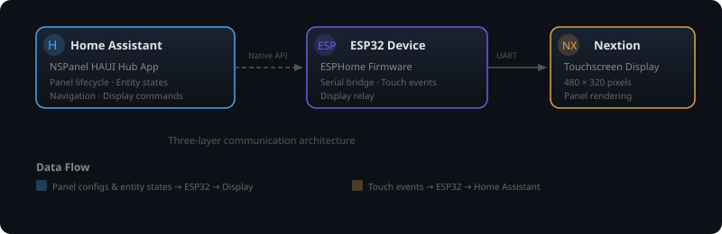

# Development

Everything you need to understand the internals of NSPanel HAUI, extend the
integration, or contribute to the project.

---

## Common local commands

A root `Makefile` provides shortcuts for common checks and the two throwaway
Home Assistant development instances. Run `make` or `make help` to list them.

- `make check` runs backend and frontend tests, Ruff, mypy, the strict docs
  build, and read-only HMI/layout and preview-coverage checks. It does not run
  ESPHome validation or mutate generated assets.
- Individual checks are available as `make test`, `make test-frontend`,
  `make lint`, `make typecheck`, `make docs`, and `make hmi-check`.
- `make esphome-config` validates the universal ESPHome config, but requires
  the separate ESPHome environment (`requirements-esphome.txt`); its pinned
  dependencies conflict with the Home Assistant development environment.
- `make ha-venv-setup` creates `.venv_ha` with Python 3.14 and Home Assistant
  2026.11.0, and links the integration into `.dev/ha-config`. Start it with
  `make ha-venv-start`; follow its log with `make ha-venv-logs`.
- `make ha-docker-up`, `make ha-docker-stop`, `make ha-docker-restart`,
  `make ha-docker-logs`, and `make ha-docker-down` manage the Docker instance
  from `compose.yaml`.

Activate the project virtual environment before running checks, and install the
development dependencies if needed:

```bash
source .venv/bin/activate
pip install -r requirements-dev.txt
```

Install `requirements-docs.txt` as well to use the docs target. Backend tests
also require Node 22+ for card-render replay; frontend tests require Node 22+.
The Docker instance's `.dev/ha-docker` and the virtualenv instance's
`.dev/ha-config` are ignored state directories; `.venv_ha` is ignored as well.
`ha-docker-down` removes the container but preserves its config. Resetting
either instance is intentionally not a Make target: follow the reset
instructions below only when you mean to delete that instance's Home Assistant
state. Docker bridge networking does not pass LAN mDNS; add panels by IP (see
the Docker notes below).

## Local development deployment

The repository has no separate integration build or frontend development
server. To run the checked-out code in a Home Assistant test instance, expose
the integration folder inside that instance's config directory:

```bash
HA_CONFIG=/path/to/home-assistant/config
REPO=/path/to/nspanel_haui
mkdir -p "$HA_CONFIG/custom_components"
ln -sfn "$REPO/custom_components/nspanel_haui" \
  "$HA_CONFIG/custom_components/nspanel_haui"
```

If a Marketplace or copied installation already exists at that destination, move it
aside before creating the link. `ln -sfn` replaces an earlier link; a plain
`ln -s` would follow it and create a second link inside the integration folder,
which Python then imports instead of the integration package. For containers, the symlink target must also be
available inside the container; otherwise copy the integration folder into
`$HA_CONFIG/custom_components/nspanel_haui` instead. Restart Home Assistant
after Python or frontend changes so it reloads the integration and its versioned
static assets.

### Development instance in a virtual environment

A throwaway Home Assistant runs from its own virtual environment with the
checked-out integration, without touching the Home Assistant instance that runs
the house. Its state lives in the git-ignored `.dev/ha-config` directory, its
packages in the git-ignored `.venv_ha`. It runs the Home Assistant version the
integration requires, [2026.11](install.md#requirements) (the minimum in the
Marketplace metadata), which needs Python 3.14. Set it up once from the repository root:

```bash
python3.14 -m venv .venv_ha
.venv_ha/bin/pip install homeassistant==2026.11.0
mkdir -p .dev/ha-config/custom_components
ln -sfn "$PWD/custom_components/nspanel_haui" \
  .dev/ha-config/custom_components/nspanel_haui
```

Start the instance; Ctrl+C stops it:

```bash
.venv_ha/bin/hass -c .dev/ha-config
```

Open <http://localhost:8123> and complete onboarding. The first start installs
the requirements of the default integrations into `.venv_ha` and takes a few
minutes. The log goes to the terminal and to `.dev/ha-config/home-assistant.log`.
Python edits apply after a restart: Ctrl+C and start it again (**Settings →
System → Restart** only stops it, since nothing starts `hass` again when it
exits for a restart); also reload the browser after frontend edits,
since the editor is served as versioned static assets. To try another Home
Assistant version, install it into the same environment, for example
`.venv_ha/bin/pip install homeassistant==2026.12.0`.

The instance runs on the host's own network, so mDNS discovery works as on a
regular installation: ESPHome offers the panels it finds, and the HAUI hub picks
them up through their ESPHome entries. Home Assistant listens on all interfaces,
so other devices on the LAN can open the UI too. On macOS, allow **Local
Network** access for the terminal app that starts `hass` (System Settings →
Privacy & Security → Local Network); without it, connections to the panels fail
with "No route to host". If the panels answer the production Home Assistant but
not the development machine, see
[panels reachable from one machine but not another](troubleshooting.md#panels-reachable-from-one-machine-but-not-another).

To reset the instance, stop it, delete its state and link the integration again:

```bash
rm -rf .dev/ha-config
mkdir -p .dev/ha-config/custom_components
ln -sfn "$PWD/custom_components/nspanel_haui" \
  .dev/ha-config/custom_components/nspanel_haui
```

### Development instance in Docker

The same throwaway instance can run from the official container image instead.
`compose.yaml` in the repository root bind-mounts the git-ignored config
directory `.dev/ha-docker` (apart from the virtual environment's
`.dev/ha-config`) and the integration folder, so the container sees the
checkout itself (a symlink in the config directory would point outside the
container). Its image is the required Home Assistant version as well,
[2026.11](install.md#requirements). Start it from the repository root:

```bash
docker compose up -d
```

Open <http://localhost:8123> and complete onboarding. **Settings → System →
Restart** works here, because the container starts Home Assistant again;
`docker compose restart` does the same from the shell and
`docker compose logs -f` follows the log. Reload the browser after frontend
edits. To reset the instance, run `docker compose down` and delete
`.dev/ha-docker`; to try another Home Assistant version, change the image tag
in `compose.yaml`.

With the `ports` mapping the container sits on Docker's bridge network, which
mDNS from the LAN does not reach: add the panels by IP address in the ESPHome
integration. On Linux, `network_mode: host` in place of `ports` gives the
container the host's network, and discovery works as in the virtual
environment.

Do not point the development hub at a panel that the production Home Assistant
drives: two hubs sending commands to one display fight over it. Use a test panel
or stop the production hub first.

For local ESPHome development, configure the secrets required by
`esphome/nspanel_haui_dev.yaml` and activate the separate environment with
`requirements-esphome.txt` installed. Then build and upload to the test panel:

```bash
esphome run esphome/nspanel_haui_dev.yaml
```

The dev config includes the optional web server and `debug.yaml` diagnostics.
Release builds use `esphome/nspanel_haui_universal.yaml`; they do not include the
dev-only diagnostics. Keep test firmware and test integration instances separate
from production devices.

---

## Git hooks

A repository-local pre-commit hook can keep the generated virtual display assets
in sync and catch portrait HMI geometry drift before a commit. Install it from
the repository checkout:

```bash
scripts/git_hooks/install.sh
```

The hook runs `scripts/hmi_layout/gen_virtual_layout.py`, stages only its
outputs (`layout_*.json`, `icon_map.json`, and `pictures/`), then checks both
specs with `python -m scripts.hmi_layout.gen_layout --check` (landscape) and
`python -m scripts.hmi_layout.gen_layout --spec portrait --check`. It never
rewrites either HMI. The project `.venv` is preferred; otherwise it uses
`python3` from `PATH`.
Install the development dependencies first (`pip install -r requirements-dev.txt`)
so both generators can run. The hook is opt-in per checkout; to remove its local
configuration, run `git config --unset core.hooksPath`.

## Architecture

The system has three layers:

<p align="center">
  
</p>

| Layer | Component | Role |
|-------|-----------|------|
| **Hub App** | `NSPanelHAUI` (runs in HA) | Reads entity states, renders display commands, manages navigation |
| **ESP32** | ESPHome firmware | Serial bridge between HA and the display, relays touch events |
| **Nextion** | Touchscreen display | Renders panels, manages widget state, handles touch input |

---

## Live preview regression checklist

The live simulator starts with a blank browser-side display and replays the running
hub app's output; it does not render a second copy of the panel. Changes to page
lifecycle, display commands, WebSocket delivery, or simulator replay should keep
that contract covered end to end.

Before review, run the focused regression tests and then the normal project checks:

```bash
pytest tests/test_live_panel.py tests/test_page_weather.py tests/test_card_renders.py
node --test tests/frontend/virtual-session.test.mjs
```

These cover a fresh full-page attach, replays of content drawn in different
page lifecycle hooks, reconnecting onto a blank simulator before the new stream
arrives, live page switches, and replay of actual hub commands in the browser's
Nextion simulator. Weather tests also cover missing, malformed, and failed
forecast service responses, with the last good forecast retained or empty slots
cleared when no good result exists. Keep cross-layer tests fed by captured hub
output rather than duplicating an expected command stream in JavaScript.

For changes that affect live mode, manually verify on a connected device when
available:

1. Open Live after the device is already showing a clock or weather page; check
   current time, weather details, forecast, and any page-specific content.
2. Close and reopen Live, then reconnect the device; the simulator should first
   start clean and then reproduce the complete current page.
3. Change pages on the physical panel and confirm the simulator follows. Exercise
   a slider or button and confirm the real device responds once.
4. Switch Simulated → Live and Live → Simulated; entering Live drops the
   simulated states and follows the physical panel, and Simulated starts again
   on its home panel (also when the physical panel was on its idle page).
   Confirm sandbox interactions do not operate real entities.
5. If forecast rendering changed, verify both a successful forecast refresh and
   temporary unavailability with and without a previously rendered forecast.
6. Repeat for portrait hardware if the change can affect layout or page IDs.

Record any unavailable hardware checks in the change's PR checklist instead of
marking them as verified.

---

## Developer Docs

- **[Design Guidelines](design.md)** — Styling, theming, and panel design principles
- **[Communication Overview](communication.md)** — How the layers talk to each other
- **[ESPHome Component](esphome.md)** — ESP32 firmware details
- **[Hub Component](hub.md)** — Core logic: state management, panel lifecycle, navigation
- **[Nextion Component](nextion.md)** — Display-level operations and widget management
- **[Services Reference](services.md)** — Home Assistant services for display control and TFT upload
- **[Update Process](update-process.md)** — How the hub checks for and installs firmware and TFT updates, universal and custom builds, and the notifications it shows

---

## Versioning

The hub app version lives in `custom_components/nspanel_haui/manifest.json`
(read at runtime by `haui/version.py`; keep `pyproject.toml` in sync); the ESPHome
config and the TFT carry their own compatibility version. The four places that
must agree and the tag policy are in
[Release process & strategy](release.md#versioning-and-tag-policy).

---

## Release decisions (maintainers)

These decisions shaped the 0.4 release. When a future release changes them,
update this section. The mechanics — runbook, version places, CI gates and the
asset contract — are owned by [Release process & strategy](release.md).

### Universal prebuilt firmware (0.4)

0.4 ships one prebuilt binary (`nspanel_haui.bin`) for every panel, EU and
US/portrait alike. It cannot know your Wi-Fi, so it is provisioned at first boot:
the device opens a setup access point named after itself (e.g.
`nspanel-haui-a1b2c3`; the MAC suffix keeps every AP unique) with a captive
portal, and the user enters their Wi-Fi once. A fixed, documented API key is
baked in. Provisioning steps are in [Installation](install.md) → *Universal
image*; the asset contract and CI rules are in
[Release process & strategy](release.md#what-a-release-ships).

**Constraints (by design):**

- **One binary installs any number of panels.** `name_add_mac_suffix: true`
  appends the last six MAC digits at runtime, so every panel gets a unique
  hostname, mDNS name and setup access point from the same `.bin`. Runtime
  *credential* adoption (Improv-style onboarding) is post-0.4.
- **The image carries no Wi-Fi network.** With a network in the YAML, ESPHome
  keys the captive-portal Wi-Fi to the build's config hash, and every firmware
  update with a changed config forgets it. Without one it uses a fixed key; an
  `on_boot` step moves Wi-Fi saved by builds before 0.4.3 there.
- **The credentials are public** (the API key, which also encrypts native
  OTA). Anyone on the LAN can reflash the panel. Use `install.yaml` + secrets when
  that is not acceptable.
- **Entity ids after a rename/area assignment** are resolved through HA's entity
  registry (by ESPHome-authored name), so the hub works with the universal
  binary regardless of how the device is renamed or assigned to an area.

### Display layouts (0.4): portrait TFT from a scripted geometry spec

The US portrait panel gets its own TFT, but not a hand-maintained second
project: `nextion/nspanel_haui_portrait.HMI` is the landscape project with the
device orientation switched and every widget's geometry written by
`scripts/hmi_layout/gen_layout.py` from a spec module (`portrait_layout.py`
for the 320 × 480 layout, `landscape_layout.py` for refinements of the
480 × 320 one). Object names, ids and event code are identical in both
projects, so the hub addresses either TFT with the same `COMPONENTS`.

- The script patches attributes in place and recomputes each page block's
  content stamp, so the editor accepts the file; adding widgets, event code,
  pictures or fonts remains Nextion Editor work.
- The hub's `display_model` (`eu` / `us`) is the single switch
  (`HAUIDevice.display_model` / `.is_portrait`): it picks the TFT asset, syncs
  the firmware's *Display Model* number (gesture dimensions and the URL the
  firmware's own *Update Display* button uses), positions the light page's
  colour wheel and turns the editor previews into the 320 × 480 layout.
  The editor asks before installing the matching TFT after a saved model
  change, because the display cannot report which layout it runs.
- Portrait keeps the header title full-width with the four function buttons
  at its ends, as in landscape; grids re-flow (grid 2 × 3, select 2 × 6, rows
  with their controls under the name line).

### Firmware OTA goes through the hub's update entity

The integration's **HAUI Firmware** update entity (`update.py`, driven by the
update controller) reads the firmware manifest at the device's
`firmware_manifest_url` — by default the one of the latest GitHub release — and
installs a newer firmware through the firmware's `install_firmware_url` action
(`ota.http_request.flash` with the image URL and md5). The device pulls the
image over HTTP, reboots, and then installs the matching TFT. The firmware
declares no update entity of its own, so the ESPHome side shows only the
ESPHome integration's stock dashboard entity. The first flash onto firmware
without the install action (0.4.2 and older) is still a manual step, because
the hub cannot reach it; the editor's **Device Info → Download firmware**
action remains the manual fallback.

For your own `custom` firmware, follow
[Your custom firmware: choose `dev` or `master`](release.md#your-custom-firmware-choose-dev-or-master)
to build the checked-out branch with a commit-identifying version and publish it
to a local manifest. For the CI-built universal `dev` image, set the test panel's
**Firmware update channel** to `dev` and leave its **Firmware manifest URL**
empty; the hub follows the newest
[published dev prerelease](release.md#published-development-firmware).
The hub logs manifest reads, install starts and outcomes; the Device Manager
shows install errors. [Update Process](update-process.md) describes the whole cycle:
when checks run, the update settings and both firmware variants.

### Development builds are dispatched manually (0.4.7)

Development firmware no longer builds on every push to `dev`. The
**Development Firmware** workflow is dispatched by hand (Actions → Development
Firmware → **Run workflow** on `dev`) when the build changes what a device
installs — firmware or display inputs — and hub-only, docs and frontend pushes
ride along in the next build. Each run still publishes a versioned universal
prerelease, commits its version back to `dev` and regenerates the screens.

The per-push trigger made every commit publish a prerelease, push a bot version
commit and regenerate the screens, and a fix push published `0.4.6.dev53`
minutes before the stable `0.4.6`. The 2026-11-09 GitHub Actions outage then
failed those chained runs before their jobs started. The build keeps its PEP 440
tag (identical to the manifest version, no `+g<sha>` segment) so the Marketplace
ordering is unchanged; the mechanics are in
[Release process & strategy](release.md#published-development-firmware).

### Release assets and gates

The release asset names (frozen contract), the Nextion gate and the CI
workflow checks are owned by
[Release process & strategy](release.md#what-a-release-ships); keep that page as
the single source.

---

## Roadmap

Planned work lives in the [Roadmap](https://github.com/happydasch/nspanel_haui/blob/master/ROADMAP.md);
shipped changes are listed in the [Changelog](https://github.com/happydasch/nspanel_haui/blob/master/CHANGELOG.md).
