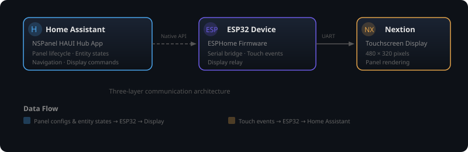

# Development

Everything you need to understand the internals of NSPanel HAUI, extend the
integration, or contribute to the project.

---

## Architecture

The system has three layers:

  

| Layer | Component | Role |
|-------|-----------|------|
| **Hub App** | `NSPanelHAUI` (runs in HA) | Reads entity states, renders display commands, manages navigation |
| **ESP32** | ESPHome firmware | Serial bridge between HA and the display, relays touch events |
| **Nextion** | Touchscreen display | Renders panels, manages widget state, handles touch input |

---

## Developer Docs

- **[Design Guidelines](design.md)** — Styling, theming, and panel design principles
- **[Communication Overview](communication.md)** — How the layers talk to each other
- **[ESPHome Component](esphome.md)** — ESP32 firmware details
- **[Hub Component](hub.md)** — Core logic: state management, panel lifecycle, navigation
- **[Nextion Component](nextion.md)** — Display-level operations and widget management
- **[Services Reference](services.md)** — Home Assistant services for display control and TFT upload

---

## Versioning

The hub app version lives in `custom_components/nspanel_haui/manifest.json`
(read at runtime by `haui/version.py`; keep `pyproject.toml` in sync); the ESPHome
config and the TFT carry their own compatibility version. The four places that
must agree and the tag policy are in
[Release process & strategy](release.md#versioning-and-tag-policy).

---

## Release decisions (maintainers)

These decisions shaped the 0.4 release. When a future release changes them,
update this section. The mechanics — runbook, version places, CI gates and the
asset contract — are owned by [Release process & strategy](release.md).

### Universal prebuilt firmware (0.4)

0.4 ships one prebuilt binary (`nspanel_haui.bin`) for every panel, EU and
US/portrait alike. It cannot know your Wi-Fi, so it is provisioned at first boot:
the device opens a setup access point named after itself (e.g.
`nspanel-haui-a1b2c3`; the MAC suffix keeps every AP unique) with a captive
portal, and the user enters their Wi-Fi once. A fixed, documented API key is
baked in. Provisioning steps are in [Installation](install.md) → *Universal
image*; the asset contract and CI rules are in
[Release process & strategy](release.md#what-a-release-ships).

**Constraints (by design):**

- **One binary installs any number of panels.** `name_add_mac_suffix: true`
  appends the last six MAC digits at runtime, so every panel gets a unique
  hostname, mDNS name and setup access point from the same `.bin`. Runtime
  *credential* adoption (Improv-style onboarding) is post-0.4.
- **The image carries no Wi-Fi network.** With a network in the YAML, ESPHome
  keys the captive-portal Wi-Fi to the build's config hash, and every firmware
  update with a changed config forgets it. Without one it uses a fixed key; an
  `on_boot` step moves Wi-Fi saved by builds before 0.4.3 there.
- **The credentials are public** (API key, OTA password, web credentials).
  Anyone on the LAN can reflash the panel. Use `install.yaml` + secrets when
  that is not acceptable.
- **Entity ids after a rename/area assignment** are resolved through HA's entity
  registry (by ESPHome-authored name), so the hub works with the universal
  binary regardless of how the device is renamed or assigned to an area.

### Display layouts (0.4): portrait TFT from a scripted geometry spec

The US portrait panel gets its own TFT, but not a hand-maintained second
project: `nextion/nspanel_haui_portrait.HMI` is the landscape project with the
device orientation switched and every widget's geometry written by
`scripts/gen_portrait/gen_portrait.py` from a spec module (`portrait_layout.py`
for the 320 × 480 layout, `landscape_layout.py` for refinements of the
480 × 320 one). Object names, ids and event code are identical in both
projects, so the hub addresses either TFT with the same `COMPONENTS`.

- The script patches attributes in place and recomputes each page block's
  content stamp, so the editor accepts the file; adding widgets, event code,
  pictures or fonts remains Nextion Editor work.
- The hub's `display_model` (`eu` / `us`) is the single switch
  (`HAUIDevice.display_model` / `.is_portrait`): it picks the TFT asset, syncs
  the firmware's *Display Model* number (gesture dimensions and the URL the
  firmware's own *Update Display* button uses), positions the light page's
  colour wheel and turns the editor previews into the 320 × 480 layout with
  the function buttons in a bottom bar. Saving a changed model re-installs
  the TFT, because the display cannot report which layout it runs.
- Portrait keeps the header title full-width and moves the four function
  buttons to a bottom bar; grids re-flow (grid 2 × 3, select 2 × 6, rows with
  their controls under the name line).

### Firmware OTA goes through the device's update entity

The firmware declares an `update: platform: http_request` component named
**HAUI Firmware**, so Home Assistant's ESPHome integration exposes it as a normal
update entity and the hub can install a firmware update without the ESPHome
dashboard. The device pulls the image over HTTP, reboots, and then installs the
matching TFT. The first flash onto firmware that predates the update entity is
still a manual step (dashboard → Update → Install), because an older image cannot
update itself; the editor's **Download firmware** button remains the manual
fallback.

### Release assets and gates

The release asset names (frozen contract), the Nextion gate and the CI
workflow checks are owned by
[Release process & strategy](release.md#what-a-release-ships); keep that page as
the single source.

---

## Roadmap

Planned work lives in the [Roadmap](https://github.com/happydasch/nspanel_haui/blob/master/ROADMAP.md);
shipped changes are listed in the [Changelog](https://github.com/happydasch/nspanel_haui/blob/master/CHANGELOG.md).
