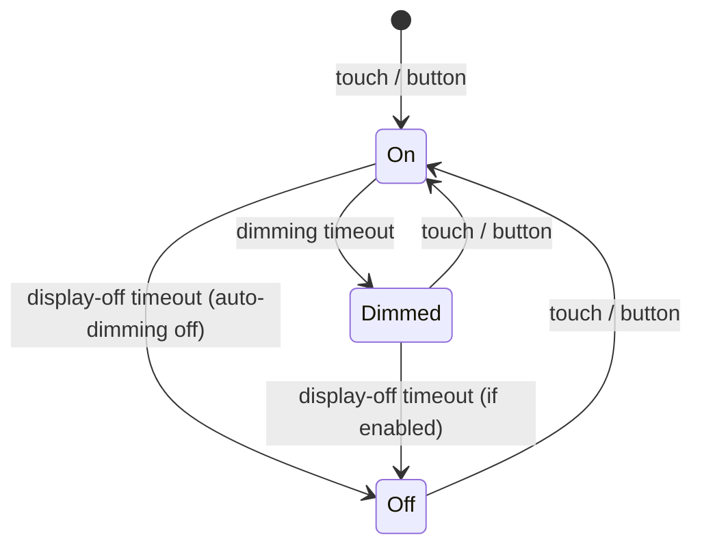

# ESPHome Component

The NSPanel runs on an ESP32 with ESPHome, which exposes it to Home Assistant. The release firmware (`nspanel_haui.bin`) needs no ESPHome installation — the hub connects through Home Assistant's built-in ESPHome integration. ESPHome is only needed for **local development or a local firmware build**:

- ESPHome 2026.10 or later (`min_version` in `esphome/nspanel_haui/base.yaml`).
- A **temporary vendored patch** of the stock `nextion` component. The numeric-response fix ([esphome#17744](https://github.com/esphome/esphome/pull/17744)) that the firmware's `read_response` path relies on missed the 2026.10.0 release and only ships in ESPHome 2026.11.0; `esphome/nextion_patch/` also carries the TFT upload TX buffer option ([esphome#21435](https://github.com/esphome/esphome/pull/21435)) and a TFT-upload retry fix that is not upstream yet. The configs override the stock component through `external_components` — a git source for installed setups, a local source for the universal/dev configs. Remove the patch and its override blocks once a released ESPHome contains every fix in `esphome/nextion_patch/README.md`, and bump `min_version` with it.
- Scripts and actions for display communication and device functionality.

Device ↔ hub communication uses ESPHome Native API events.

## Installation

`esphome/install.yaml` is installed on the device; `esphome/nspanel_haui.yaml` contains all ESPHome functionality.

Copy `esphome/secrets.yaml.example` to `esphome/secrets.yaml` (git-ignored; the dev config uses it too) and fill in real values, or add the secrets through the ESPHome dashboard's **Secrets** link. The reference build compiles without editing YAML: `name` and friendly name have usable defaults (`nspanel-haui` / `NSPanel HAUI`) and every credential comes from `secrets.yaml`. A per-device build only changes the `name` substitution (it becomes the hostname and default entity IDs).

`esphome.project.name` is fixed at `happydasch.nspanel_haui` (Home Assistant splits it into manufacturer `happydasch`, model `nspanel_haui`); the config flow and Device Manager match it. Keep it when forking.

**Universal prebuilt firmware.** Every release also carries `nspanel_haui.bin`, built from `esphome/nspanel_haui_universal.yaml` with documented default credentials and no Wi-Fi network. The device boots its open access point and is provisioned over the captive portal; the entered Wi-Fi survives firmware updates. `name_add_mac_suffix: true` appends the last six MAC digits at runtime, so one binary installs any number of panels. See [Installation](install.md) → *Universal image (no YAML)*.

When the device appears in Home Assistant, install the TFT with **Install** on its **HAUI Display** update entity; otherwise the hub installs the version the firmware needs about a minute after connection (see [Installation](install.md#tft-and-firmware-updates)). See [Nextion](nextion.md) for display details.

## Config

Configuration variables in the ESPHome YAML:

- `heartbeat_interval` (5)
- `name` (nspanel-haui)
- `api_encryption_key` (`!secret`; also encrypts native OTA)
- `wifi_ssid`, `wifi_password`, `ap_password` (`!secret`)
- `tft_update_url` (default TFT URL of the display component; enables TFT uploads. The hub always sends the URL of the TFT it installs.)

### Encrypted native OTA

Wireless installs (dashboard **Install → Wirelessly**, `esphome run`, `esphome upload`) use native OTA, encrypted with the device's API key: `base.yaml` sets a bare `encryption:` block that inherits `api_encryption_key`. There is no OTA password — next to an API key ESPHome warns that one wastes significant flash and RAM.

Nothing else changes: the `on_begin` hook that suspends device activities still runs before every OTA, and the separate `http_request` OTA platform used by the hub's **HAUI Firmware** entity stays. Wired flashing and hub firmware updates do not use native OTA.

**Panels flashed with the password config.** The next wireless install depends on the firmware the panel runs:

| Panel firmware | Next wireless install |
|----------------|-----------------------|
| ESPHome 2026.9 or later (every HAUI 0.4 release) | Nothing to do: it already offers encryption with the API key and skips the password prompt. |
| Older ESPHome (HAUI 0.3.x and earlier) | The upload stops with "the device did not offer encryption; refusing to send the image in plaintext". Install once with the migration block below. |

Add the migration block to your device YAML (the file that includes `nspanel_haui.yaml` as a package), with the password the panel was flashed with:

```yaml
ota:
  - platform: esphome
    password: !secret ota_password
    encryption:
      allow_plaintext_upload: true
```

ESPHome merges it into the package's OTA block and logs "Found and merged multiple configurations for ota platform esphome". The upload answers the old firmware's password prompt in plaintext; the new firmware has no password and accepts encrypted uploads only. **Delete the block after the install** — left in place, `allow_plaintext_upload` lets someone on the network downgrade a later upload to plaintext.

**Leftovers.** An `ota_password` substitution or secret is no longer used and can be deleted. A `password:` in your own `ota: platform: esphome` block now fails validation ("'password' cannot be combined with 'encryption'"); remove it, or keep it only with `allow_plaintext_upload` for the migration install.

### Web server (optional)

The shipped firmware does **not** enable the ESPHome web server. It costs flash and RAM that the HTTP OTA path (TLS, JSON, `http_request`) needs, so `esphome/nspanel_haui/base.yaml` leaves it out. Home Assistant shows a **Visit** link only for firmware that runs it.

Enable it in *your own* device YAML (the file that includes `nspanel_haui.yaml` as a package, not a package file itself):

```yaml
web_server:
  port: 80
  auth:
    username: admin
    password: !secret web_password
```

`esphome/nspanel_haui_dev.yaml` enables it for local development and reads `web_username` / `web_password` from `secrets.yaml`. The web UI's `/update` is plain HTTP and not covered by [OTA encryption](#encrypted-native-ota); ESPHome warns about it when it builds. Add `ota: false` to the `web_server:` block to turn that upload off.

## Communication

The device and hub exchange ESPHome Native API events. Event publishing lives in `esphome/nspanel_haui/scripts_event.yaml`, the connection handshake in `scripts_connection.yaml`, commands and sounds in `scripts_common.yaml`. See [Communication](communication.md) for the full protocol.

### Connection globals

Defined in `esphome/nspanel_haui/globals.yaml`:

| Global | Meaning |
|--------|---------|
| `hub_availability` | Whether a Native API client is connected. Set by `on_client_connected`; reset by `on_client_disconnected` once the last client is gone (it stays true while other API clients remain). While false, the device sends no `req_connection` and drops an active hub connection. |
| `hub_heartbeat` | Device uptime seconds (`millis() / 1000`) of the last hub heartbeat; used by `check_hub_connection` for timeout detection. |
| `hub_connection` | Whether the handshake with the hub has completed. Set by `set_hub_connected`. |
| `haui_init` | Whether the device has been initialized by the hub. |
| `haui_display_state` | Display state: 0 off, 1 dim, 2 on. |

### Connection scripts

Defined in `esphome/nspanel_haui/scripts_connection.yaml`:

- `set_hub_connected(connected, force)` — a disconnect (`connected = 0`) is skipped while other API clients remain unless `force = 1` (device-detected heartbeat timeout or hub unavailability). Updates `hub_connection`, anchors/resets `hub_heartbeat`, wakes the display on disconnect (`update_display` then pins the device to system page 0 while disconnected), writes `system.firstRun.txt="0"` on connect, and publishes the `client_status` sensor.
- `check_hub_connection` — runs every 100 ms; detects a heartbeat timeout (`heartbeat_interval × 2`) or hub unavailability.
- `check_connection` — runs every 100 ms; sends `req_connection` when disconnected but the hub is available, with a 10 s cooldown.

### Events

Device → hub events, published under the `esphome.` prefix (`esphome.heartbeat`, `esphome.page`, …):

| Event | Value / notes |
|-------|---------------|
| `heartbeat` | Empty. Published every `heartbeat_interval` (5 s) while `hub_connection = true`. |
| `req_connection` | JSON: `yaml_version`, `name`, `friendly_name`, `ip`, `ssid`, `rssi`, `uptime`, `firmware_variant`. Sent when disconnected and the hub is available. |
| `res_connection` | JSON: `heartbeat_interval`. Reply to `hub_connection_response`. |
| `res_device_state` | JSON: `page`, `brightness`, `button_left`, `button_right`, `relay_left`, `relay_right`, `use_relay_left`, `use_relay_right`, `display_state`, `yaml_version`, `tft_required_version`, `tft_version`, `ssid`, `rssi`, `firmware_variant` (`universal` or `custom`). Reply to `req_device_state`. |
| `read_response` | JSON: `name`, `type` (`"number"` or `"text"`), `value`. Reply to `req_val` / `req_txt`. |
| `connected` | Empty. Sent after the connection was established. |
| `display_off` / `display_on` | Empty. Hardware sleep/wake on the no-hub path only; with a hub the display only dims or turns its brightness off. |
| `page` | New page id. A new page was opened. |
| `component` | `page_id,component_id,touch_event`. A Nextion component was touched. |
| `touch_start` | Empty (also value `1` on a Nextion touch press). |
| `touch_end` | `start_x,start_y,end_x,end_y`. |
| `gesture` | `swipe_left`, `swipe_right`, `swipe_up` or `swipe_down`. |
| `button_left` / `button_right` | `1` on press, `0` on release. |
| `relay_left` / `relay_right` | State `1` or `0`. |
| `send_notification` | JSON: `title`, `message`, `icon` (only if set), `persistent`, `text_size` (only if set). Published by the `send_notification` script. |
| `buffer_overflow` | `1`. The display reported a buffer overflow. |
| `display_state` | `on`, `dim` or `off`. |

### Actions

Hub → device actions (ESPHome Native API service calls):

| Action | Notes |
|--------|-------|
| `hub_heartbeat` | Resets the `hub_heartbeat` timestamp. |
| `hub_connection_response` | Acknowledges `req_connection`; the device answers with `res_connection`. |
| `hub_connection_initialized` | Handshake complete; sets `hub_connection = true`. |
| `hub_connection_closed` | Sets `hub_connection = false`. |
| `req_device_state` | The device answers with `res_device_state`. |
| `reset_last_interaction` (`offset`) | Resets the inactivity timer (dimming and display-off); the offset is applied to now. The hub's idle-page timer uses its own activity clock. |
| `req_val` / `req_txt` (`name`) | Read a number/text value from the display; answered with `read_response`. |
| `send_command` (`cmd`) / `send_commands` (`commands`: string[]) | Send one or more commands to the Nextion display. |
| `goto_page` (`page`) | Switch the active display page. |
| `set_brightness` (`intensity`) | Change display brightness. |
| `display_off` / `display_on` | Hardware sleep/wake (no-hub path). |
| `install_firmware_url` (`url`, `md5sum`) | Flash the OTA image at `url`. The hub sends it for every firmware install; use `nspanel_haui.update_firmware`, the **HAUI Firmware** entity or the editor's **Install firmware** picker instead — they track the install. |
| `upload_tft_url` (`url`) | Update the TFT from a URL. The hub sends it; use `nspanel_haui.update_tft` (optionally with `url`) or the **HAUI Display** entity instead. |
| `play_rtttl` (`song_str`) | Play any standard RTTTL string (`name:d=...,o=...,b=...:notes`). |
| `play_sound` (`name`) | Play a built-in sound (list below). |
| `send_notification` (`title`, `message`, `icon`, `persistent`, `text_size`) | All parameters are required (ESPHome has no optional action variables): pass `""` for no icon, `false` and `"auto"` for the defaults. No severity or force-show fields, so alerts are `info` and never re-open over the idle page. `persistent` loops the sound and re-opens the popup about every 60 s until dismissed; the first re-open comes about a second after the action and waits while a notification popup or list is open. |

A playing tune is stopped before a TFT upload, an OTA firmware update or a reboot — those block the buzzer's main loop, so the current note would otherwise keep sounding.

Built-in `play_sound` names (`scripts_common.yaml`):

```text
startup      startup:d=4,o=5,b=200:8c7,8g7,8d7,8g7
tone         tone:d=8,o=6,b=200:16e6
tone_up      tone_up:d=8,o=6,b=200:16d6
tone_down    tone_down:d=8,o=6,b=200:16g6
seq_up       seq_up:d=16,o=5,b=160:16e6,16g6
seq_down     seq_down:d=16,o=5,b=160:16g6,16d6
notification notification:d=8,o=6,b=200:16e,16c6,16g6,8c6,8g6
alert_fast   alert_fast:d=8,o=6,b=200:16c7,16d7,16c7,16d7,16c7,16d7,16c7,16d7,16e7
alert        alert:d=16,o=6,b=400:16c7,16d7,16c7,16d7,16c7,16d7,16c7,16d7,16e7
elise        elise:d=8,o=5,b=125:32p,e6,d#6,e6,d#6,e6,b,d6,c6,4a.,32p,c,e,a,4b.,32p,e,g#,b,4c.6,32p,e,e6,d#6,e6,d#6,e6,b,d6,c6,4a.,32p,c,e,a,4b.,32p,d,c6,b,2a
```

## Page

- `page` (0–255): the page that is displayed.
- `Current Page` (text sensor): the Nextion page name the display shows (e.g. `grid`, `weather`, `light`, `clock`), published whenever the display reports a page change. An entity popup reports its page (`light` for the light popup). The value comes from the display itself, so it stays available while the hub is disconnected.
- `Current Page Number` (sensor): the Nextion page id of the same page (`9` for `grid`; the order of the HMI pages).
- Both sensors are disabled by default; enable them on the device page under **Settings → Devices & services → ESPHome** before using them in automations.

```yaml
trigger:
  - platform: state
    entity_id: sensor.nspanel_kitchen_current_page
```

- `timeout_page` and `use_auto_page` are **not** firmware settings: automatic page switching is owned by the hub, which checks the activity clock once per second. Page switching is separate from display brightness: the page timeout neither dims nor turns the display off. A hub reconnect (for example a Home Assistant restart) is no interaction; the hub restores the page and starts the page timeout again from the reconnect.

## Interaction

Configured in `esphome/nspanel_haui/scripts_interaction.yaml`. Two input methods count as interaction: the touchscreen and the buttons; `use_button_interaction` disables the buttons as a source. A touch counts when the firmware's coordinate poll (every 200 ms) sees it or when the display reports a touched widget, so a tap shorter than one poll still counts. A hub (re)connect, a changed setting and serial recovery are not interactions.

Sensors and switches:

- `touch` (binary sensor, disabled by default): touch state, derived from `touch_x` / `touch_y`.
- `touch_x` (0–480; 0..450 is visible, the rightmost 30 px are behind the bezel) / `touch_y` (0–320): current coordinates, 0 when released.
- `button_left` (binary sensor, GPIO 14) / `button_right` (GPIO 27): physical button state.
- `use_button_interaction` (switch): whether a physical button press resets the inactivity timer.
- `use_auto_dimming` (switch): automatic dimming.
- `use_auto_display_off` (switch): automatic brightness to zero after the display-off timeout. Brightness only — it never switches pages and never requires an idle page, and it reaches zero whether or not auto-dimming is enabled.
- `relay_left` / `relay_right` (relay switches): the internal relays.
- `use_relay_left` / `use_relay_right` (switches): whether the physical buttons use the internal relays.

## Brightness and Dimming

Configured in `esphome/nspanel_haui/scripts_display.yaml`. One `update_display` script runs every 100 ms and derives the state and brightness from the same interaction age: on (full brightness until the dimming timeout), dimmed (`brightness_dim` until the display-off timeout) and off (brightness 0). Both transitions ramp over `duration_dim` seconds, and display-off is an independent switch: it reaches brightness 0 even with auto-dimming off. Dimming and turning off never require a page switch — automatic page switching is a separate hub behaviour.



Sensors and numbers (values are restored on reboot; a timeout > 0 activates it):

- `brightness` (0–100, disabled by default): current brightness, the last value set by the device (not read back from the Nextion).
- `brightness_full` (0–100): full brightness.
- `brightness_dim` (0–100): dimmed brightness.
- `duration_dim` (0.0–5.0): dimming duration.
- `timeout_dim` (0–3600): dimming timeout after the last interaction.
- `timeout_display_off` (0–3600): display-off timeout.

## Temperature

- `temperature` (°C): temperature sensor reading.
- `temperature_correction` (-10.0–10.0): correction for the sensor reading.

## Display Model

- `display_model` (0–1): display orientation, synced by the hub from the device's `display_model` setting (0 = landscape, 1 = portrait). The gesture script reads it to detect edge swipes on the correct screen dimensions.

## Buttons and Switches

- `Restart Display` (`restart_display`, disabled by default): restarts the display.
- `Screen Power` (`screen_power`, disabled by default): powers the display. It is on after every boot; turning it off leaves the screen without power until it is turned on again or the device restarts.

## Diagnostics

The production package and universal release image expose the diagnostic entities used by the integration. The local development config also includes `debug.yaml`, which adds uptime and ESPHome debug entities for troubleshooting; these are not included in release firmware. Your own device YAML must not duplicate entities that its selected packages already include.

- `Client Status`: `online` / `offline`, the hub connection state.
- WiFi information: IP, SSID and RSSI; BSSID is disabled by default.
- `Touch` and `Brightness`: current touch activity and display brightness; both are disabled by default.
- `TFT Version`: read by the firmware from the display and sent to the hub through the device-state protocol; it is not exposed as a Home Assistant entity.

### Exposed sensors (curated set)

ESPHome `id:` values identify components inside the firmware; they are not Home Assistant entity IDs. A component marked `internal: true` remains usable by ESPHome automations but is not exposed to Home Assistant. The following entities are exposed by `esphome/nspanel_haui/sensor.yaml`; the rows marked disabled by default only exist as disabled entities until they are enabled on the device page. The example entity IDs are illustrative: Home Assistant may assign different IDs based on device naming, areas or later renames.

When a sensor value is needed by both firmware and HAUI, keep the ESPHome `id:` for firmware references and expose the sensor to Home Assistant (do not mark it `internal: true`). HAUI then resolves the entity by its domain and ESPHome-authored name on the linked device; it does not derive the HA entity ID from the ESPHome `id:` or the device slug. Keep components internal only when the value is firmware-only, or when it is exchanged through the existing ESPHome ↔ hub event/device-state protocol instead of an HA entity.

| Example entity ID (device `nspanel_kitchen`) | Purpose |
|----------------------------------------------|---------|
| `binary_sensor.nspanel_kitchen_touch` | A touch is currently active on the display; disabled by default |
| `binary_sensor.nspanel_kitchen_button_left` / `..._button_right` | Physical relay buttons (diagnostic) |
| `sensor.nspanel_kitchen_ip` / `..._ssid` / `..._rssi` | WiFi/network info; also read by the editor's Device Manager |
| `text_sensor.nspanel_kitchen_client_status` | `online` / `offline`, the hub connection state |
| `sensor.nspanel_kitchen_current_page` / `..._current_page_number` | Nextion page name / id the display shows; disabled by default (see [Page](#page)) |
| `sensor.nspanel_kitchen_brightness` | Current display brightness (the last value the hub set, 0–100); disabled by default |
| `sensor.nspanel_kitchen_temperature` | Internal panel temperature (NTC, °C) |

The firmware-only readback components `touch_x`, `touch_y`, `tft_version`, `req_val_component`, `req_txt_component`, `res_txt` and `res_val` are marked `internal: true`. They support the firmware ↔ hub pipeline and are not Home Assistant entities; their number and text values are published through the unified `esphome.read_response` event, so no sensor is needed per value. The inactivity timer uses a rollover-safe `millis()` clock inside the firmware; changing timeout or brightness settings never resets it. The current page sensors, the `touch` binary sensor, the `brightness` sensor, the WiFi BSSID and the temperature calculation's `adc` and `resistance` sensors are instead `disabled_by_default: true`; they are not enabled as entities by default, but are not marked internal.

The hub resolves the built-in temperature entity through the entity registry using ESPHome's authored name (`Temperature`), so the example entity ID above is not a stable identifier. A renamed device or HA area-prefixed entity ID (e.g. `sensor.nspanel_bedroom_temperature` on a device called "NSPanel Bedroom") does not break the clock and weather panels. A clock/weather panel can also override the sensor per panel with the editor's **Inside temperature sensor** picker, e.g. to show a room sensor's value instead.
