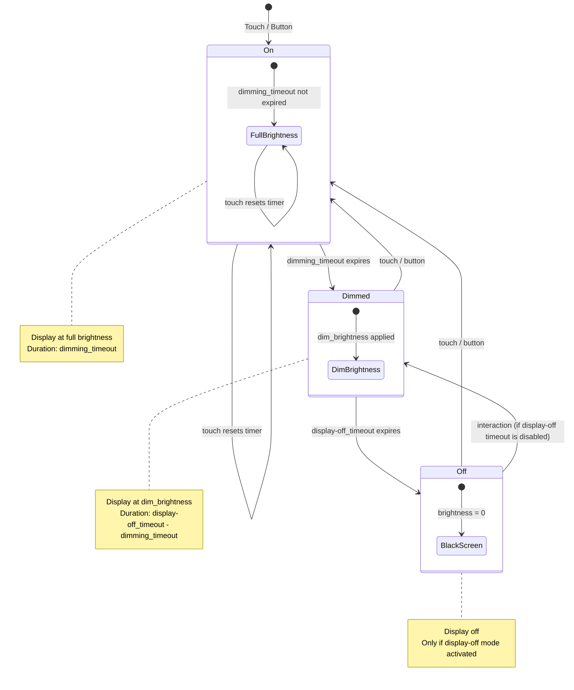

# ESPHome Component

The NSPanel is operating on a ESP32. To provide access to the NSPanel via HomeAssistant, ESPHome is being used.

- Requires ESPHome 2026.10 or later (enforced by `min_version` in `esphome/nspanel_haui/base.yaml`); the stock Nextion component before 2026.10 lacks the numeric-response delivery fix ([esphome PR #17744](https://github.com/esphome/esphome/pull/17744)) the firmware's `read_response` path relies on
- Uses the stock ESPHome `nextion` display component (no custom or patched component, no `external_components`)
- Provides scripts and actions for communication with the display
- Responsible for handling the device functionality

For the communication between the device and the server ESPHome native API events are used.

## Installation

See `esphome/install.yaml` for the installation configuration. This file is going to be installed on the device.
See `esphome/nspanel_haui.yaml` for the esphome configuration file. This file contains all ESPHome functionality.

Copy the secrets from `esphome/secrets.yaml.example` and add them in ESPHome by pressing the `Secrets` Link in the right corner. This step is not necessary if you add the secrets directly in the config file.

When building locally (e.g. with `esphome/nspanel_haui_dev.yaml`, which uses `!secret`), copy `esphome/secrets.yaml.example` to `esphome/secrets.yaml` and fill in real values. `esphome/secrets.yaml` is git-ignored.

The reference build (`esphome/install.yaml`) compiles without editing YAML:
the device name and friendly name are substitutions with usable defaults
(`nspanel-haui` / `NSPanel HAUI`) and every credential comes from
`secrets.yaml`.  Per-device builds only need to change the `name` substitution
(ESPHome uses it for the hostname and default entity IDs) before flashing.

The discovery identity is fixed: `esphome.project.name` is
`happydasch.nspanel_haui` (split by Home Assistant into
manufacturer `happydasch`, model `nspanel_haui`), which is what the
integration's config flow and Device Manager match on.  Keep that value
unchanged when forking.

To install ESPHome on the device use the config from `esphome/install.yaml`. Edit the substitution values and install the device.

**Universal prebuilt firmware:** every release also carries `nspanel_haui.bin`,
compiled from `esphome/nspanel_haui_universal.yaml`.  That config bakes in
documented default credentials (no `secrets.yaml` needed) and a never-matching
Wi-Fi, so the device boots its open access point and is provisioned over the
captive portal.  See [Installation](install.md) → *Universal image (no YAML)*.
`name_add_mac_suffix: true` appends the last six MAC digits at runtime, so one
binary installs any number of panels with unique names and access points.

If the device shows up in Home Assistant you can manually install the TFT file by pressing the `Update Display` button. Otherwise the Hub app installs the TFT version the firmware needs about a minute after the device connects (see [Installation](install.md#5-step-install-tft-file)).

See [Nextion](nextion.md) for more details about the display.

## Config

An overview of all configuration variables defined in the ESPHome yaml file.

- `heartbeat_interval` (5)
- `name` (nspanel-haui)
- `ota_password` (!secret ota_password)
- `api_encryption_key` (!secret api_encryption_key)
- `web_username` (!secret web_username)
- `web_password` (!secret web_password)
- `wifi_ssid` (!secret wifi_ssid)
- `wifi_password` (!secret wifi_password)
- `ap_password` (!secret ap_password)
- `tft_update_url` (URL to the ``nspanel_haui.tft`` file, e.g. ``http://homeassistant.local:8123/local/nspanel/nspanel_haui.tft``)
- `tft_update_url_portrait` (URL to the ``nspanel_haui_portrait.tft`` file, used by the `Update Display` button when `display_model` is 1)

## Communication

All communication between the ESPHome device and the Hub app uses ESPHome Native API events. The configuration for events is in `esphome/nspanel_haui/scripts_event.yaml`. The connection scripts are in `esphome/nspanel_haui/scripts_connection.yaml`.

See [docs/communication.md](communication.md) for the full protocol description.

### Connection Globals

The device maintains these globals for connection and display state (defined in `esphome/nspanel_haui/globals.yaml`):

- `hub_availability` (bool) - Whether the ESPHome Native API is connected to Home Assistant. Set to true by `on_client_connected`; reset to false by `on_client_disconnected` once the last API client is gone (it stays true while other API clients remain). While false, the device does not send `req_connection` requests and drops an active hub connection.
- `hub_heartbeat` (int) - Last timestamp (epoch seconds) when a hub heartbeat was received. Set by the `hub_heartbeat` action; used by `check_hub_connection` for timeout detection.
- `hub_connection` (bool) - Whether the connection handshake with the Hub app has completed. Set by `set_hub_connected` script.
- `haui_init` (bool) - Whether the device has been initialized by the Hub app.
- `haui_display_state` (int) - Display state: 0 off, 1 dim, 2 on.

### Connection Scripts

Defined in `esphome/nspanel_haui/scripts_connection.yaml`:

- `set_hub_connected(connected: int, force: int)` - A disconnect (`connected = 0`) is skipped while other API clients remain, unless `force = 1` (used when the device itself detects a heartbeat timeout or hub unavailability). Updates `hub_connection`, anchors/resets `hub_heartbeat`, wakes the display on disconnect (`check_display` then pins the device to the system page 0 while the hub is disconnected), writes `system.firstRun.txt="0"` on connect, publishes `client_status` sensor.
- `check_hub_connection` - Runs every 100ms. Detects timeout (hub heartbeat not received within `heartbeat_interval × 2`) or hub unavailability.
- `check_connection` - Runs every 100ms. Sends `req_connection` when disconnected but hub is available, with 10s cooldown between attempts.

### Events

The primary events used for connection management:

- **`esphome.heartbeat`** - Device→Hub heartbeat. Published every `heartbeat_interval` seconds (5s by default) when `hub_connection = true`. Value: empty string.
- **`esphome.req_connection`** - Device→Hub connection request. Published when disconnected and hub is available. Value: JSON with `yaml_version`, `name`, `friendly_name`, `ip`, `ssid`, `rssi` and `uptime`.
- **`esphome.res_connection`** - Device→Hub connection response. Published after receiving `hub_connection_response`. Value: JSON with `heartbeat_interval`.
- **`esphome.res_device_state`** - Device→Hub state response. Published after receiving `req_device_state`. Value: JSON with `page`, `brightness`, `button_left`, `button_right`, `relay_left`, `relay_right`, `use_relay_left`, `use_relay_right`, `display_state`, `yaml_version`, `tft_version`, `ssid` and `rssi`.

### Actions

Actions that the Hub app can call on the device (via ESPHome Native API service calls):

- **`hub_heartbeat`** - Hub→Device heartbeat. Resets `hub_heartbeat` timestamp on the device.
- **`hub_connection_response`** - Hub acknowledges connection request. Device transitions to sending `res_connection`.
- **`hub_connection_initialized`** - Handshake complete. Sets `hub_connection = true` on the device.
- **`hub_connection_closed`** - Hub disconnects the device. Sets `hub_connection = false`.
- **`haui_discover`** - Device discovery. Device publishes `esphome.haui_discover` with `name`, `friendly_name`, `ip`, `yaml_version`, `device_version`, `ssid` and `rssi`.
- **`req_device_state`** - Hub requests device state. Device responds with `res_device_state` event.
- **`req_device_info`** - Hub requests device info. Device responds with `res_device_info` event.
- **`req_reconnect`** - Hub requests device to reconnect. Calls `set_hub_connected(false)` without `force`, so it is skipped while other API clients remain.
- **`reset_last_interaction`** - Resets the device's display inactivity timer (dim/display-off).

## Requests

These events will get a response.

- `req_device_info` Device Info Request
- `req_device_state` Device State Request
- `req_reconnect` Reconnect Request
- `req_val` Number Request
- `req_txt` Text Request

## Responses

These responses will be sent after a request.

- `res_device_state` Device State Event:

  Will be published after sending request `req_device_state`
  Value: json encoded string

- `res_device_info` Device Info Event:

  Will be published after sending request `req_device_info`
  Value: json encoded string

- `read_response` Component Read Response

  Unified response for component reads (number or text).  Published after
  sending `req_val` or `req_txt`.  Value: JSON encoded string with the
  keys `name` (component name), `type` (`"number"` or `"text"`), and
  `value` (the read value).

## Commands

These are commands that are being executed on the ESP.

- `send_command` Sends a command to the nextion display
- `send_commands` Sends multiple commands to the nextion display
- `goto_page` Sets the active page on display
- `send_notification` Sends a notification to the display

  Parameters: `title` (string), `message` (string), `icon` (string - optional; when empty, the notification uses its severity's default icon — these actions default to `info`, so the info icon is used). Optional: `persistent` (bool; loops the alert sound and re-opens the popup about every 60 seconds until dismissed, default `false`) and `text_size` (`"auto"` or a font size 1-3, default `"auto"`).

  The action does not expose severity or force-show fields; `persistent` loops the sound and re-opens the popup periodically without force-showing it. The first re-open comes about a second after the action; if a notification popup or list is already open, the re-open waits until it is dismissed. Because the action cannot set a severity, its alerts default to `info` and never re-open over the idle page.

## Events

Different ESP device events.

- `connected` Connected Event:

  Will be sent after connection was established

- `display_off` Display-Off Event:

  The display entered hardware sleep (no-hub path only). With a hub connected
  the display is never hardware-slept — it only dims/turns off its brightness.

- `display_on` Display-On Event:

  The display woke up from hardware sleep (no-hub path only). With a hub the
  touch itself drives the wake and the hub's idle-page exit.

- `page` Page Change Event:

  A new page was opened
  Value: page_id

- `component` Component Press Event:

  A Nextion component was touched
  Value: `page_id,component_id,touch_event`

- `touch_start` Touch Pressed Event:

  The touch screen was pressed (also published with value `1` on a Nextion touch press)
  Value: empty string

- `touch_end` Touch Released Event:

  The touch screen was released
  Value: start_x,start_y,end_x,end_y

- `gesture` Touch Gesture Event:

  The gesture was recognized on the screen
  Value: `swipe_left`, `swipe_right`, `swipe_up` or `swipe_down`

- `button_left` Left Physical Button Pressed Event:

  The left physical button was pressed or released
  Value: `1` on press, `0` on release

- `button_right` Right Physical Button Pressed Event:

  The right physical button was pressed or released
  Value: `1` on press, `0` on release

- `relay_left` Relay Switched Event:

  The left relay was switched
  Value: state (1 or 0)

- `relay_right` Relay Switched Event:

  The right relay was switched
  Value: state (1 or 0)

- `timeout` Timeout Event:

  An inactivity milestone was crossed (dim, off, page)
  Value: timeout type (string)

  The hub reacts to `page` only (automatic page switching opens the idle page);
  `dim` and `off` are brightness milestones handled by the firmware itself.

- `use_relay_left` / `use_relay_right` Relay Mode Event:

  The "use relay" switch was changed
  Value: state (1 or 0)

- `send_notification` Notification Event:

  Published by the `send_notification` script
  Value: JSON with `title`, `message`, `icon` (only if set), `persistent` and `text_size` (only if set)

- `buffer_overflow` Nextion Buffer Overflow Event:

  The Nextion display reported a buffer overflow
  Value: `1`

- `display_state` Display State Event:

  Current display state (on, off, dim)
  Value: state type (string)

## Actions

This actions below are defined on the ESP. The communication between the Hub server and the ESP is using these.

- `send_command` Action to send a command

  This will send a command to the nextion display

- `send_commands` Action to send multiple commands (`commands`: string array) to the nextion display

- `display_off` / `display_on` Actions to put the display into / out of hardware sleep (publish `esphome.display_off` / `esphome.display_on`)

- `upload_tft` Action to update a TFT file

  This will update the nextion display with the tft file

- `upload_tft_url` Action to update a TFT file from URL

- `set_brightness` Action to change the brightness of the display

- `goto_page` Action to change the page of the display

- `play_rtttl` Action to play a song for RTTTL strings

  The song string is a standard RTTTL string (`name:d=...,o=...,b=...:notes`).
  Built-in sounds played by `play_sound` (see `esphome/nspanel_haui/scripts_common.yaml`):

  ```text
  startup:d=4,o=5,b=200:8c7,8g7,8d7,8g7
  tone:d=8,o=6,b=200:16e6
  tone_up:d=8,o=6,b=200:16d6
  tone_down:d=8,o=6,b=200:16g6
  seq_up:d=16,o=5,b=160:16e6,16g6
  seq_down:d=16,o=5,b=160:16g6,16d6
  notification:d=8,o=6,b=200:16e,16c6,16g6,8c6,8g6
  alert_fast:d=8,o=6,b=200:16c7,16d7,16c7,16d7,16c7,16d7,16c7,16d7,16e7
  alert:d=16,o=6,b=400:16c7,16d7,16c7,16d7,16c7,16d7,16c7,16d7,16e7
  elise:d=8,o=5,b=125:32p,e6,d#6,e6,d#6,e6,b,d6,c6,4a.,32p,c,e,a,4b.,32p,e,g#,b,4c.6,32p,e,e6,d#6,e6,d#6,e6,b,d6,c6,4a.,32p,c,e,a,4b.,32p,d,c6,b,2a
  ```

  Other sounds from different sources:

  ```text
  startup_long:d=16,o=5,b=180:c,e,g,c6,8p,c,16p,e,c
  startup:d=16,o=5,b=180:c,e,g,c6
  two short:d=4,o=5,b=100:16e6,16e6
  short:d=4,o=5,b=100:16e6
  scale_up:d=32,o=5,b=100:c,c#,d#,e,f#,g#,a#,b
  chirp6:d=4,o=5,b=400:c6
  doodle-dah:d=8,o=5,b=250:d#6,a5#,d#6
  doodle-duh:d=8,o=5,b=250:d#6,a5#,d#5
  ```

- `play_sound` Action to play a named sound

- `reset_last_interaction` Action to reset the last interaction value

  Takes an `offset` (int); the last interaction value is set to now with that offset applied

- `send_notification` Action to send a notification to a display

  Parameters: `title`, `message`, `icon`; optional `persistent` (bool; loops the alert sound and re-opens the popup about every 60 seconds until dismissed) and `text_size` (`"auto"` or a font size 1-3). `persistent` does not force-show the popup; the first re-open comes about a second after the action.

- `req_val` / `req_txt` Actions to read a number / text value from the display (parameter `name`)

- `haui_discover` Action to publish the `haui_discover` event

## Page

These events will be sent out when the device have some page related events.

- `page` (0 - 255)
  The page that is being displayed

- `timeout_page` (0 - 3600)

  Page switch timeout, will be restored on reboot

  Value > 0 activates the timeout

- After the page timeout the firmware publishes `esphome.timeout "page"` and the **hub** (when connected and `use_auto_page` is on) opens the configured idle page (`idle_panel`). Page switching is separate from the display brightness: the page timeout neither dims nor turns the display off.

## Interaction

The configuration for this functionality is in `esphome/nspanel_haui/scripts_interaction.yaml`

When tracking the last interaction with the device, two input methods are possible: Touchscreen and Buttons. It's possible to disable button as an interaction source by switching off `use_button_interaction`.

### Interaction Sensors

The ESP provides some interaction related events. See below for a overview of all sensors. Some sensors are set to internal to not pollute HA.

- `touch` (binary sensor)

  Touch State, the state is being set based on the `touch_x` and `touch_y` values

- `touch_x` (0 - 480=display width, only 0..450 is visible; the rightmost 30px are behind the bezel)

  Current touch x coordinates (0 when released)

- `touch_y` (0 - 320=display height)

  Current touch y coordinates (0 when released)

- `button_left` (binary sensor, GPIO 14)

  Physical button left state

- `button_right` (binary sensor, GPIO 27)

  Physical button right state

- `use_button_interaction` (switch)

  Should buttons be used for updating last interaction time.

- `use_auto_dimming` (switch)

  Should display be automatically dimmed.

- `use_auto_page` (switch)

  Should the hub automatically switch to the configured idle page after the page timeout.

- `use_auto_display_off` (switch)

  Should the display automatically turn off (brightness to zero) after the display-off timeout. This is a brightness behavior only — it never switches pages and never requires an idle page.

- `relay_left` (relay switch)

- `relay_right` (relay switch)

- `use_relay_left` (switch)

  Defines if the physical button left should use the internal relay

- `use_relay_right` (switch)

  Defines if the physical button right should use the internal relay

- `last_interaction` (millis()/1000)

  Last time when a interaction happened with the display

## Brightness and Dimming

The configuration for this functionality is in `esphome/nspanel_haui/scripts_display.yaml`

The display has 3 states: on, dimmed and off

The whole brightness and dimming functionality is implemented on the ESPHome device.
Turning the display off (`use_auto_display_off`) and dimming (`use_auto_dimming`) never
require a page switch - automatic page switching is a separate hub behavior.

The brightness change process is processed this way:

- **Within Dimming Timeout:** full brightness is being used (State on)

- **After Dimming Timeout:** dimmed brightness is being used, duration is defined by dimming duration (State dimmed)

- **After Display-Off Timeout:** brightness goes to 0 if display-off mode is activated,
  duration is defined by dimming duration (State off)




### Brightness Sensors

Brightness related sensors.

- `brightness` (0 - 100)

  Current brightness (last value set by the device, not read back from the Nextion)

- `brightness_full` (0 - 100)

  Full brightness, will be restored on reboot

- `brightness_dim` (0 - 100)

  Dimmed brightness, will be restored on reboot

- `duration_dim` (0.0 - 5.0)

  Dimming duration, will be restored on reboot

- `timeout_dim` (0 - 3600)

  Dimming timeout after last interaction, will be restored on reboot
  Value > 0 activates the timeout

- `timeout_display_off` (0 - 3600)

  Display-off timeout, restored on reboot
  Value > 0 activates the timeout

## Temperature

Temperature related sensor.

- `temperature` (in celsius)

  Temperature sensor reading

- `temperature_correction` (-10.0 - 10.0)

  Correction for sensor reading

## Display Model

- `display_model` (0 - 1)

  Display orientation synced by the hub from the device's `display_model`
  setting (0 = landscape, 1 = portrait).  The gesture script reads it to
  detect edge swipes on the correct screen dimensions.

## Buttons

Buttons provided by the ESP.

- `Update Display` (`tft_update`)

  This button uploads the tft from a configured url to nextion

- `Restart Display` (`restart_display`, disabled by default)

  Restarts the display

## Diagnostics

Diagnostics related sensors.

- TFT Version: Version of the TFT file (read from the display)
- Client Status: `online` / `offline`, the hub connection state
- WIFI Info: IP, SSID, BSSID and RSSI
- Reset Reason: reason of the last reset (only with `esphome/nspanel_haui_dev.yaml` / `debug.yaml`)

### Exposed sensors (curated set)

Only these ESPHome entities are exposed to Home Assistant.  Everything else
(`page`, `touch_x`, `touch_y`, `last_interaction`, `tft_version`,
`req_val_component`, `req_txt_component`, `res_txt`, `res_val`) stays
`internal: true` — it exists only for the firmware ↔ hub pipeline and would
only clutter the entity registry.

| Entity (device `nspanel_kitchen`) | Purpose |
|-----------------------------------|---------|
| `binary_sensor.nspanel_kitchen_touch` | A touch is currently active on the display |
| `binary_sensor.nspanel_kitchen_button_left` / `..._button_right` | Physical relay buttons (diagnostic) |
| `sensor.nspanel_kitchen_ip` / `..._ssid` / `..._rssi` | WiFi/network info; also read by the editor's Device Manager |
| `text_sensor.nspanel_kitchen_client_status` | `online` / `offline`, the hub connection state |
| `sensor.nspanel_kitchen_brightness` | Current display brightness (the last value the hub set, 0–100) |
| `sensor.nspanel_kitchen_temperature` | Internal panel temperature (NTC, °C) |

The temperature chain uses two further sensors (`adc`, `resistance`) that are
`disabled_by_default: true` — only the final `temperature` sensor is enabled.

## Other

For number and text retrieval the internal sensors `req_txt_component`,
`req_val_component`, `res_txt`, and `res_val` are used.  These feed the
unified `esphome.read_response` event and make it possible to get values
from the display without adding a sensor for every single value to retrieve.
