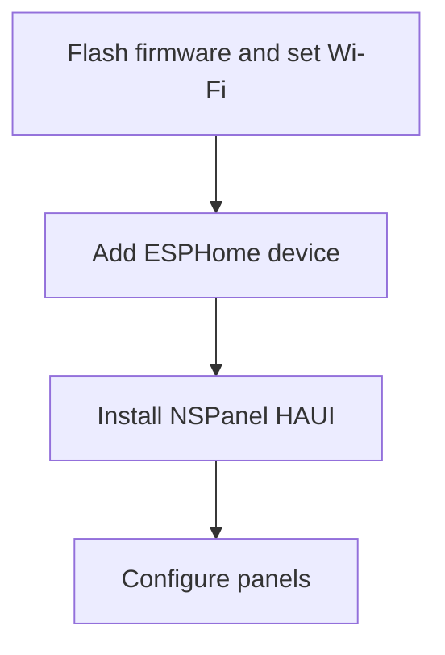
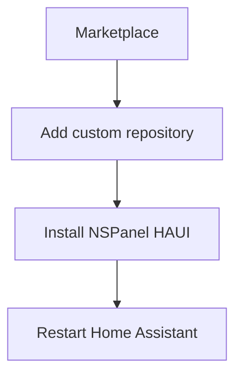
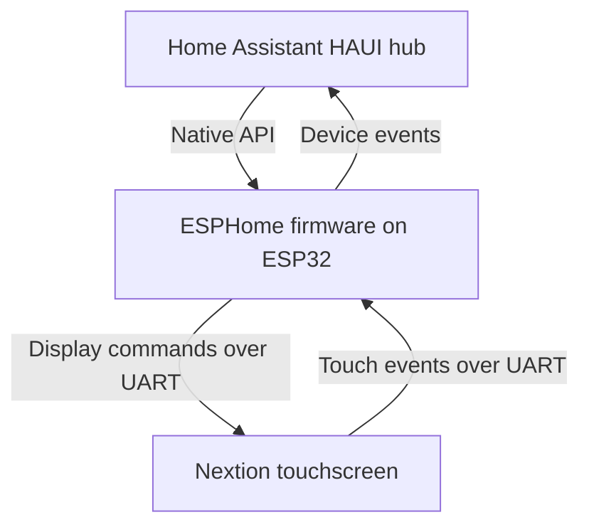
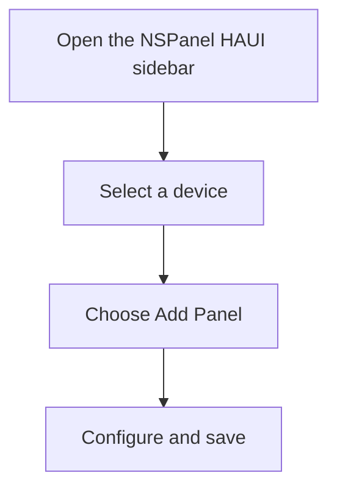

# Quick Start Guide

Connect your NSPanel to Home Assistant, then add your first panel. For the full
flashing and update instructions, see the [Installation Guide](install.md).

## Requirements

- Home Assistant **2026.11** or later (it brings the Marketplace)
- The prebuilt `nspanel_haui.bin` from the latest release (no ESPHome installation needed)
- A USB-UART adapter (for first-time flashing)
- A Sonoff NSPanel device

For development or custom firmware builds, see the [ESPHome development instructions](esphome.md#installation).

## Flash the panel

Open the panel and connect the USB-UART adapter. Connect GND to IO0 for
flashing mode, then flash the prebuilt `nspanel_haui.bin` from the latest
release. On first boot, join the panel's access point (for example,
`nspanel-haui-a1b2c3`) and enter your Wi-Fi details.

In Home Assistant, add the panel to the ESPHome integration. If prompted for an
encryption key, use the one in the [Installation Guide](install.md#flash-the-panel).

See [Flash the panel](install.md#flash-the-panel) for the full instructions.

## Install the integration

NSPanel HAUI is not in the Marketplace catalog. Add it as a custom repository:

[Open the NSPanel HAUI repository in Home Assistant](https://my.home-assistant.io/redirect/marketplace_repository/?owner=happydasch&repository=nspanel_haui&category=integration).

1. Open **Settings → Marketplace** and select **Add from link**.
2. Enter `happydasch/nspanel_haui`, then select **Add**. Connect GitHub if prompted.
3. Install **NSPanel HAUI**, then restart Home Assistant.

## Configure panels

### Connect the hub

Go to **Settings → Devices & Services → Add Integration → NSPanel HAUI**. The
hub discovers the ESPHome device you added above. If your panel does not appear,
check the [FAQ](faq.md).

### Open the editor

Open **NSPanel HAUI** in the Home Assistant sidebar (admin only) and select your device. The editor shows your panel list.

### Add your first panel

Choose a panel type, such as **Clock** for a screensaver or **Grid** for entity tiles. Fill in the required fields, then select **Save**. The display updates automatically.

These sample screens show how the two panel types differ. Your Grid panel shows the entities you select.

  <figure style="flex: 1 1 18rem; margin: 0;">
    
    <figcaption>Clock shows the time and date at a glance.</figcaption>
  </figure>
  <figure style="flex: 1 1 18rem; margin: 0;">
    
    <figcaption>Grid arranges your chosen entities as tiles.</figcaption>
  </figure>

See [all panel previews](screens.html), including portrait layouts.

## Next steps

- Browse all [panel types](panels/README.md) to see what's available
- Read [example configurations](examples.md) for setup ideas
- Check the [FAQ](faq.md) if something isn't working
