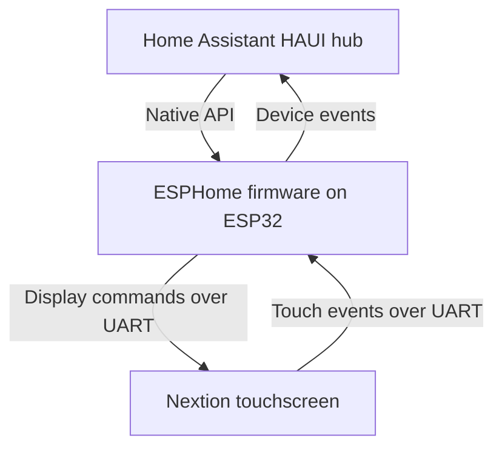
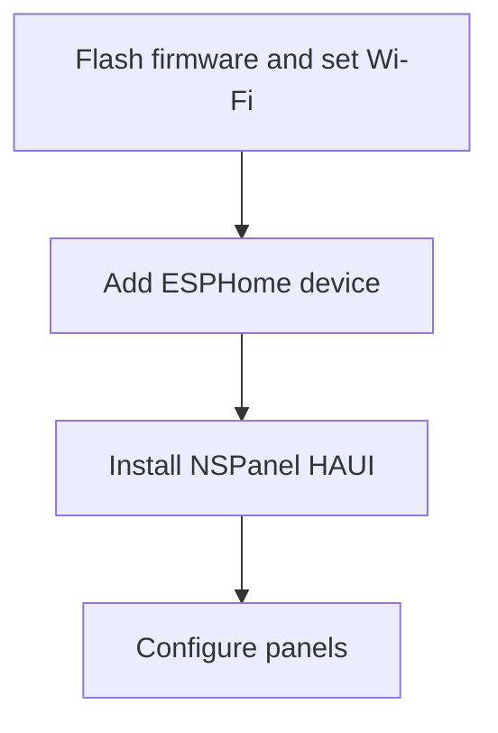
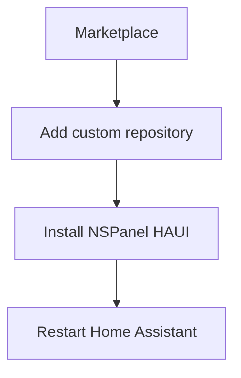
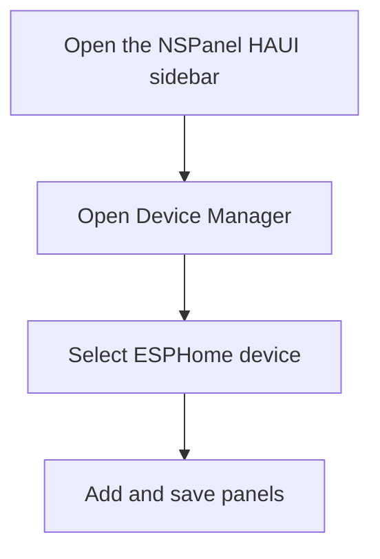
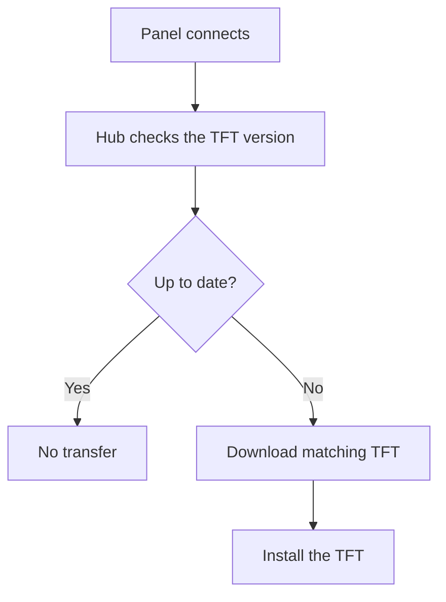

# Installation Guide

For a short walkthrough, see the [Quick Start Guide](get-started.md).

Use the release firmware for a standard install. It needs no local build or YAML edits.

## Requirements

- Home Assistant 2026.11 or later (includes the Marketplace)
- A Sonoff NSPanel
- A USB-UART adapter for the first flash

The release firmware connects through Home Assistant's built-in ESPHome integration. You do not need to install ESPHome.

## Flash the panel

### Universal image (no YAML)

Every release includes `nspanel_haui.bin` for EU and US/portrait panels. Set up each panel:

1. Download `nspanel_haui.bin` from the latest release. Existing users can also get it from **Device Info → Download firmware** in the editor.
2. Open the panel and connect a USB-UART adapter. Connect GND to IO0 to enter flashing mode. Flash the file with the [ESP Web Flasher](https://web.esphome.io/). See the [NSPanel teardown guide](https://blakadder.com/nspanel-teardown/) for disassembly and wiring.
3. Join the panel's open access point, such as `nspanel-haui-a1b2c3`. Follow the captive portal to enter your Wi-Fi name and password. The panel reboots onto Wi-Fi and keeps those settings across firmware updates.
4. In Home Assistant, add the device to the ESPHome integration. If prompted for an encryption key, use `TlNwYW5lbC1IQVVJLXVuaXZlcnNhbC1rZXktMDAwMDE=`.

One binary supports any number of panels. Its `name_add_mac_suffix: true` setting appends the last six MAC digits to each hostname, mDNS name, and setup access point. Repeat steps 2–4 for each panel.

!!! warning "The universal image uses a public key"
    The key above also authenticates wireless ESPHome installs. The release image does not include the ESPHome web server. For private credentials or a web server, see the [ESPHome development instructions](esphome.md#installation).

## Install the integration

Install NSPanel HAUI through the [Home Assistant Marketplace](https://www.home-assistant.io/integrations/marketplace/) (recommended). It is not in the catalog, so add it as a custom repository:

[Open the NSPanel HAUI repository in Home Assistant](https://my.home-assistant.io/redirect/marketplace_repository/?owner=happydasch&repository=nspanel_haui&category=integration).

1. Go to **Settings → Marketplace**. Accept the community-content warning if it appears.
2. Select **Add from link**, enter `happydasch/nspanel_haui`, then select **Add**. Connect GitHub if prompted.
3. Open **NSPanel HAUI**, select **Install**, then restart Home Assistant.

For a manual install, copy `custom_components/nspanel_haui/` into Home Assistant's `custom_components/` directory, then restart. Manual copies do not receive update notifications.

After restart, add the integration from **Settings → Devices & Services → Add Integration → NSPanel HAUI**.

??? note "Coming from HACS"
    Home Assistant 2026.11 replaces HACS with the Marketplace and migrates existing installations on first startup. NSPanel HAUI stays installed and keeps receiving updates.

    To receive development releases, enable the repository's **Pre-release** switch on the NSPanel HAUI device page under **Settings → Devices & Services → Marketplace**. The update entity is disabled by default.

## Configure panels

You do not need to edit `configuration.yaml`.

1. Open **NSPanel HAUI** in the Home Assistant sidebar.
2. In **Device Manager**, add the ESPHome device it finds automatically. If the panel is missing, add it to Home Assistant's ESPHome integration first.
3. Select **Add Panel**, choose a panel type, fill in the required fields, then select **Save**. The display updates automatically.

See [Configuration Details](configuration/README.md) for panel options and the [FAQ](faq.md) for common questions.

## TFT and firmware updates

The hub installs the matching TFT automatically.

About a minute after connection, the hub compares the installed TFT with the version required by the firmware. If the TFT is missing or outdated, it downloads and installs the display model's asset from `firmware-manifest.json`. The display is busy for a few minutes during transfer.

When a firmware update requires a new TFT, update the firmware first. The hub installs the matching TFT after the next connection.

On firmware 0.4.3 or later, use the **HAUI Firmware** update entity for future releases. If your panel runs an older version, flash its first update manually with the ESP Web Flasher, **Install firmware → From URL**, or the ESPHome dashboard.

For manual TFT installation, see [Nextion Display](nextion.md).
