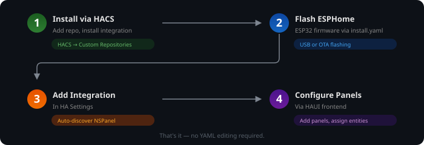

# Installation Guide

> **Quick start:** See the [Quick Start Guide](get-started.md) for a 5-minute setup overview.

  

## Requirements

HomeAssistant needs to provide following applications:

- Home Assistant 2026.10 or later (the integration targets the 2026.10 API; `hacs.json` declares the same minimum)
- ESPHome 2026.10 or later
- Hub (nspanel_haui custom integration)

Please install all requirements before continuing.

## 1. Step: Preparations

It is necessary to flash the panel once with ESPHome.

To be able to flash the panel the first time the device needs to be opened and connected via a USB-UART-Adapter.

For disassembly and connection details, see the [NSPanel teardown guide](https://blakadder.com/nspanel-teardown/).

When connecting the USB-UART adapter, connect GND to IO0 to put the device in flashing mode.

## 2. Step: Install ESPHome

With the prepared and connected device it is now possible to install ESPHome on it.

1. **Get the config**: Use [`esphome/install.yaml`](https://github.com/happydasch/nspanel_haui/blob/master/esphome/install.yaml) as a starting point. Copy its content into the ESPHome dashboard and adjust the values.

2. **Create a new device**: In the ESPHome dashboard, create a new device. Set the device name to your chosen hostname (default: `nspanel-haui`). Store the generated OTA password and API encryption key.

3. **Edit configuration**: Replace the generated config with the content of `install.yaml`. Only the substitution values need editing:
   - `name` — host and device name
   - `wifi_ssid` / `wifi_password` — Wi-Fi credentials
   - `ota_password` / `api_encryption_key` — from step 2
   - `ap_password` — fallback access point password

   You can set these directly in the file or in the ESPHome dashboard's **Secrets** (the keys are listed in [`secrets.yaml.example`](https://github.com/happydasch/nspanel_haui/blob/master/esphome/secrets.yaml.example)).

   The ESPHome **web server is optional and off by default** (it costs flash
   and RAM that HTTP OTA needs). If you want the web UI, uncomment the
   `web_server:` block at the end of `install.yaml`; Home Assistant then shows a
   **Visit** link for the device. See [ESPHome Component → Web server](esphome.md#web-server-optional).

4. **Install**: Click "Install" and select either "Plug into this computer" (if connected via USB and your browser supports WebSerial) or "Manual download" to get `nspanel_haui.bin`.

5. **Alternative — Flash via web**: Open [web.esphome.io](https://web.esphome.io/), load `nspanel_haui.bin`, and click Install. When finished, disconnect the USB-UART adapter and reassemble the panel.

When a release ships the **universal prebuilt firmware** (`nspanel_haui.bin`
attached to the GitHub release), you can skip the dashboard entirely. See
*Universal image (no YAML)* below.  The editor's **Device Manager → Download
firmware** button opens the binary directly.

### Universal image (no YAML)

Every release carries `nspanel_haui.bin` — the same firmware for EU and
US/portrait panels, with Wi-Fi left to you at first boot:

1. Download `nspanel_haui.bin` (release assets or the editor's **Device
   Manager → Download firmware**).
2. Flash it once (wired, as above — web.flasher or **Install → Manual
   download → Install** in the ESPHome dashboard).
3. The panel boots into its **open access point named after the device**, e.g.
   `nspanel-haui-a1b2c3` (the MAC suffix keeps every panel's AP unique).
   Connect your phone/laptop to it and follow the captive portal to enter your
   **Wi-Fi name and password**. The device reboots onto your network and keeps
   that Wi-Fi across firmware updates.
4. In Home Assistant, add the ESPHome device. When asked for the **encryption
   key**, use the fixed key `TlNwYW5lbC1IQVVJLXVuaXZlcnNhbC1rZXktMDAwMDE=`.
5. Add the device in the **NSPanel HAUI editor** (Device Manager → Scan). The
   hub links it and installs the matching TFT automatically.

**Notes:**

- **One `.bin` installs any number of panels.**  `name_add_mac_suffix: true`
  appends the last six MAC digits at runtime, so each panel gets a unique
  hostname, mDNS name and setup access point — no per-device YAML edit or local
  ESPHome build.  Repeat the five steps for every panel.
- The baked API key and OTA password are documented and public.  If you don't
  want LAN peers to reflash the panel, use the per-device YAML build with your
  own secrets instead.
- The universal image does **not** run the ESPHome web server (see
  [Web server (optional)](esphome.md#web-server-optional)). Build your own YAML
  from `esphome/install.yaml` if you want the web UI.

## 3. Step: Install Hub App

Install the NSPanel HAUI integration via HACS (recommended) or by copying `custom_components/nspanel_haui/` into your Home Assistant `custom_components/` directory, then restart Home Assistant.

This needs to be done only once. After restart, add the integration via **Settings → Devices & Services → Add Integration → NSPanel HAUI**.

## 4. Step: Configuration for Hub

The Hub app is configured through the Home Assistant UI via the NSPanel HAUI integration's config flow and panel editor. No manual `configuration.yaml` editing is needed.

See [Configuration Details](configuration/README.md) for all available options and the [FAQ](faq.md) for common questions.

## 5. Step: Install TFT File

The display needs a custom interface which is provided in a TFT file. About a minute after the device connects to the Hub App, the Hub App compares the display's TFT version with the version the ESPHome firmware needs. If the display has an older TFT (or none), the matching TFT file is downloaded from the GitHub release with that version and installed automatically. The display is busy for a few minutes while the file is transferred.

After an update that changes the firmware version, update the ESPHome firmware first; the matching TFT then follows on the next connect. Once the device runs firmware with the `HAUI Firmware` update entity, the hub can trigger future firmware updates through Home Assistant; the first flash onto older firmware remains a manual ESPHome step.

The installation process can also be executed manually. See [Nextion Display](nextion.md) for details.

## Finished

To install more devices, repeat the process.  With the universal prebuilt
firmware the device names are unique automatically (MAC suffix); with a
per-device build, set a unique `name` substitution for each panel.

See [Documentation](README.md) for more details.
