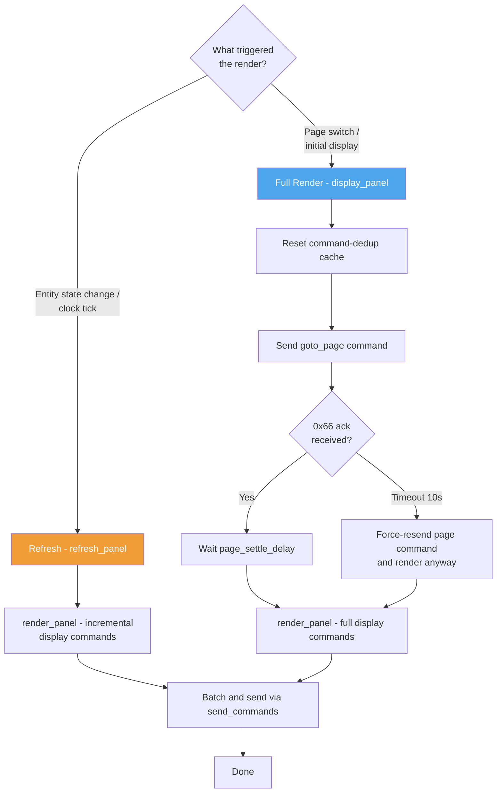

# Nextion Component

## Installation

To install the TFT file on the display, the device needs to be already flashed with ESPHome.

The device will provide a button `Update Display` in the device settings. There are also services
available.

- **Using a button**:

  - Button: `Update Display`
    This will load the TFT file from the URL configured on the ESP.

- **Using a service**:

  - Service: `esphome.<device>_upload_tft`
    This will load the TFT from the configured URL

  - Service: `esphome.<device>_upload_tft_url`
    This will load the TFT from the URL provided to the service.

See the [Services Reference](services.md#tft-display-upload) for full details and examples.

## Nextion display configuration used in this project

### Display dimensions and non-visible area

The Sonoff NSPanel Nextion display has the following physical touch characteristics:

- **Total display/touch resolution:** 480 × 320 pixels
- **Visible (effective) area:** 450 × 320 pixels
- **Non-visible area:** 30 pixels on the right side (x = 450..479)

The display is 480 pixels wide, but the LCD bezel hides the rightmost 30 pixels. Touch coordinates in that band (x = 450..479) are valid but no pixels are visible there.

This is relevant for edge-based gesture detection — swipe-from-right gestures (swipe left) start in the non-visible zone. The ESPHome gesture logic in `scripts_interaction.yaml` uses `visible_width` (450 in landscape, 320 in portrait) for its right-border check (in landscape a swipe starting at x > 410 counts as a right-edge start, using a 40px margin), so touches in the non-visible zone also count as right-edge starts.

This project uses the stock ESPHome `nextion` display component (with a temporary vendored patch for the numeric-response fix until a released ESPHome contains it, ESPHome 2026.11.0 — see `esphome/nextion_patch/`; ESPHome 2026.10 or later) with a hardware UART and the following key options:

- `uart_id`: references the UART bus used for the Nextion display.
- `wake_up_page`: the Nextion page shown on wake-up from *hardware* sleep. Hardware sleep only happens without a hub connection; with a hub the display stays awake (at brightness 0) and the hub restores the panel itself.
- `tft_url`: URL used by `upload_tft` to update the TFT file.
- `on_setup`: triggered after ESPHome connects to the Nextion.
- `on_page`: triggered when the display changes pages.
- `on_touch`: triggered when a touch event happens.

### Advanced queue tuning options

These options are set in `esphome/nspanel_haui/display.yaml` and are not needed for normal use.

- `max_queue_size` (default: 800): caps the command queue to prevent heap fragmentation when the Nextion serial buffer overflows and orphans pending entries. 800 entries is enough to absorb a full panel render burst plus concurrent state updates.

- `max_commands_per_loop` (default: 50): limits commands processed per loop iteration to spread out allocation/deallocation. With command pacing active, the pacer further limits output to one command per loop iteration.

- `command_spacing` (`2ms`): enables ESPHome's Nextion command pacer globally. The ESP32 loop timestamp is constant within an iteration, so the pacer sends at most one queued command per loop. This spreads large renders over time and prevents bursts from overrunning the Nextion's 1 KB RX buffer. The configured minimum is 2ms; actual throughput is also bounded by the ESPHome loop cadence.

HA-side batching reduces service-call overhead but does not itself prevent UART bursts. The firmware pacer is the general buffer-overflow protection and applies to every page and command source. Flash the updated ESPHome firmware for this protection to take effect.

The repo also exposes these actions via API:

- `upload_tft`
- `upload_tft_url`
- `send_command`
- `set_brightness`
- `goto_page`
- `send_commands`
- `display_off`

This project also handles Nextion runtime issues such as buffer overflow using the `on_buffer_overflow` automation.
When a buffer overflow is detected, the display logs the warning and publishes a `buffer_overflow` event so the app can react or retry safely.

These match the official ESPHome Nextion component behavior used by the project.

### Panel rendering and refresh

Commands are batched at the HA layer to reduce native API service-call overhead, then queued and paced by ESPHome before being written to the UART. The firmware's `command_spacing` setting is the primary protection against overrunning the Nextion's 1 KB RX buffer; HA batching alone is not a buffer-safety guarantee.

The rendering cycle has two paths:

- **Full render** (`display_panel`): used for initial page display, panel switches, and overflow recovery. Resets the command-dedup cache so the first batch is never suppressed as a duplicate of the previous page.
- **Refresh** (`refresh_panel`): used for incremental updates (entity state changes, clock ticks, etc.). Re-runs `render_panel` on the already-active panel without a page transition.

#### Page settle delay

After a page-change command the Nextion sends a 0x66 ack once the new page is active. The hub waits for this ack before sending render commands — commands arriving before the ack are rejected with "Invalid variable name" (0x1A) because page components are not yet initialised.

After the ack the hub waits an additional settle delay (default `0.1s`, configurable via `page_settle_delay`) before calling `display_panel`. If the ack never arrives within `page_timeout` (default 10s), the hub force-resends the page command and renders anyway as a fallback.

#### Buffer overflow recovery

If the Nextion reports a buffer overflow (0x24), the hub debounces a full `display_panel` re-render, starting at a 500ms delay (doubling for each consecutive overflow, and pausing after 5 consecutive recoveries until the display has been overflow-free for 30s), to let the ESPHome queue drain any remaining commands before re-sending the complete panel state. This is a recovery safety net; normal output is paced in firmware by `command_spacing`.

## How to edit the HMI file

To edit the HMI file, no special care is needed. Following are some helpful infos. The HMI is used mostly to design the interface but does not need any special code. Only on a page based lifetime of events should be done on the display. If possible, the logic should be placed in the Hub App.

All pages need to send a `sendme` in `Preinitialize`. This is needed to know of a page change event.

Prepare the page in the `Preinitialize` event because the Hub App cannot control the display at this stage. Only after a page is shown, it is possible to change anything or interact with it.

If you want to process any click events, you need to enable `Send Component ID` on the event to be used.

If you want to interact with any component on the display, the component id and objectname is required. They are being used and are defined in the Hub App.

When changing order of components on a page, be aware, that the id of the components will change.

> ✍️ **Maintainers:** a step-by-step, human-oriented guide for editing the HMI
> in the Nextion Editor — adding widgets/pages, fonts & images, and creating
> or updating the US portrait TFT — lives in
> [Nextion Editor (Human Guide)](nextion-editor.md).

## Scripts for display

see `scripts` in the root directory for different scripts.

- Font generation
- Image generation
