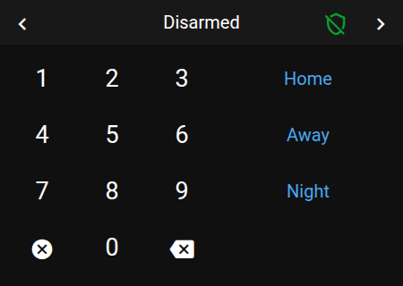
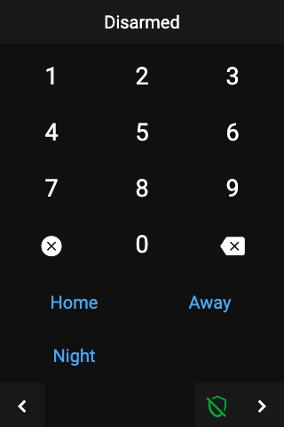

# Panel Alarm

 

## About

The alarm panel provides a numeric keypad (0-9, CLR, DEL) for entering an alarm code, and up to 4 action buttons for arming/disarming the security system. It is intended for use with `alarm_control_panel` entities.

Tapping an `alarm_control_panel` item on another panel (e.g. a grid tile) opens the popup variant (`popup_alarm`) for that entity.

## Display

- **Title** — Shows the current alarm state label (e.g., "Disarmed", "Armed Home", "Triggered"). While entering a code on the keypad, the title shows password dots instead.
- **Header indicator** — A shield icon in the top-right header reflects the armed state: red (armed), green (disarmed), amber (arming/pending).
- **Keypad** — 12 buttons: digits 0-9, CLR (clear all), DEL (delete last digit).
- **Action buttons** — 4 bottom buttons whose content depends on the alarm state:
  - **Any other state** (armed, arming, pending, triggered, disarming) — A single "Disarm" button.
  - **Disarmed** (also `unknown`, `unavailable` or no state) — Up to 4 arm mode buttons, filtered by the entity's supported features. Modes (in priority order): Home, Away, Night, Vacation, Bypass. If the entity reports no supported features, Home, Away and Night are offered.

## Code Handling

- If the alarm entity has a `code_format` attribute, the code is always required to disarm. Arm actions require it too, unless the entity reports `code_arm_required: false`.
- If a code is required but none has been entered, the action is silently ignored (the keypad entry is preserved).
- The entered code is passed as the `code` parameter to the alarm service call.
- After a successful action (or on alarm state change), the entered code is cleared.
The keypad, action buttons, and alarm-state indicator use the active color scheme by default. Optional color settings let you override keypad button background/text colors and arm/disarm button text/background colors; leave them empty to follow the scheme.
## How to configure

In the **panel editor**, set:

- **Item** (entity picker) — An `alarm_control_panel` entity to control. Required.
- **Keypad** section — **Keypad font size** (font ID 0–7; default `2`), **Keypad button background**, and **Keypad text color**. Leave a color empty to use the scheme.
- **Action buttons** section — configure hidden arm modes, whether action icons are shown, and optional arm/disarm button text and background colors. Leave a color empty to use the scheme.

**Hidden arm modes** excludes selected modes even if the entity supports them. **Show action icons** prefixes each action with its destination-state icon when the label fits. Neither option changes the scheme colors.

Alarm-state colors use the scheme's alarm state definitions for the active dark/light contrast variant.
