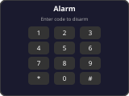

# Panel Alarm

## About

The alarm panel provides a numeric keypad (0-9, CLR, DEL) for entering an alarm code, and up to 4 action buttons for arming/disarming the security system. It is intended for use with `alarm_control_panel` entities.

Tapping an `alarm_control_panel` item on another panel (e.g. a grid tile) opens the popup variant (`popup_alarm`) for that entity.

## Display

- **Title** — Shows the current alarm state label (e.g., "Disarmed", "Armed Home", "Triggered"). While entering a code on the keypad, the title shows password dots instead.
- **Header indicator** — A shield icon in the top-right header reflects the armed state: red (armed), green (disarmed), amber (arming/pending).
- **Keypad** — 12 buttons: digits 0-9, CLR (clear all), DEL (delete last digit).
- **Action buttons** — 4 bottom buttons whose content depends on the alarm state:
  - **Any other state** (armed, arming, pending, triggered, disarming) — A single "Disarm" button.
  - **Disarmed** (also `unknown`, `unavailable` or no state) — Up to 4 arm mode buttons, filtered by the entity's supported features. Modes (in priority order): Home, Away, Night, Vacation, Bypass. If the entity reports no supported features, Home, Away and Night are offered.

## Code Handling

- If the alarm entity has a `code_format` attribute, the code is always required to disarm. Arm actions require it too, unless the entity reports `code_arm_required: false`.
- If a code is required but none has been entered, the action is silently ignored (the keypad entry is preserved).
- The entered code is passed as the `code` parameter to the alarm service call.
- After a successful action (or on alarm state change), the entered code is cleared.

## How to configure

In the **panel editor**, set:

- **Item** (entity picker) — An `alarm_control_panel` entity to control. Required.
- **Keypad** section — visual styling for the numeric keypad:
  - **Keypad font size** — Font ID for the keypad digits (0-7, larger = bigger text). Default: `2`.
  - **Keypad button background** — Background color of each key. Default: the theme's page background (`4226`), so the keys sit flat on the page.
  - **Keypad text color** — Color of the keypad digits. Default: the theme's component text (`65535`).
- **Action buttons** section — the four bottom buttons:
  - **Hidden arm modes** — Arm modes that are never offered, even when the entity supports them (`home`, `away`, `night`, `vacation`, `custom_bypass`). Default: none. The remaining supported modes move up into the freed slots.
  - **Show action icons** — Puts the icon of the state an action leads to (e.g. the night icon on *Night*) before its label. An action button holds at most 10 bytes of text and an icon takes 3 bytes plus a space, so the icon is left out for labels that would not fit (e.g. French *Désarmer*). Default: off.
  - **Arm button text color** / **Arm button background** — Colors of the arm mode buttons. Empty: the theme's button colors.
  - **Disarm button text color** / **Disarm button background** — Colors of the disarm button. Empty: the theme's button colors.
