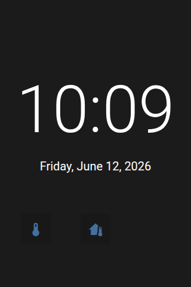

# Panel Clock

 

## About

The clock panel displays a large digital time with optional date, outside/inside temperature, and weather information. The center display area cycles through configurable [cycle cards](#cycle-cards) and can be tapped to manually advance. Up to 6 entity buttons can be shown at the bottom for quick action access. The [weather panel](panel_weather.md#cycle-cards) has the same cycle cards.

## How to configure

In the **panel editor**, set:

**Item** (entity picker) — A weather entity to display weather data (optional).

### Background

The clock panel can have different background images. Select from the dropdown in the editor:

- Dark — a clean dark theme
- Light — plain off-white
- Light — plain off-white
- Modern — modern gradient
- Spring — floral theme
- Summer — warm theme
- Autumn — fall colors
- Winter — cold theme
- Dog 1, Dog 2, Cat — pet-themed backgrounds

For dynamic backgrounds, choose **Template…** in the Background field and enter a Home Assistant template, for example `{{ 'dark' if is_state('sun.sun', 'below_horizon') else 'modern' }}`. The result must be a background name; the template is evaluated when the panel opens.

### Cycle Cards

The center area (the big time and the line below it) cycles through the enabled cards; after the last card, the first card stays longer before the cycle restarts. Only the time card is on by default, so nothing cycles until you enable another card. Tap the time area to advance to the next card immediately. The options are in the editor's **Cycle cards** section:

| Option | Default | Description |
|--------|---------|-------------|
| **Show time** | On | Show current time (HH:MM) with the date below it |
| **Show date** | Off | Show a separate date card: the weekday and day (e.g. "Mon 16") with the full date below |
| **Show outside temperature** | Off | Show outside temperature from the weather entity; skipped when the panel has no weather entity |
| **Show inside temperature** | Off | Show inside temperature as a cycle card (uses the **Inside temperature sensor**, or the internal sensor when unset) |
| **Card entities** | — | Up to 4 entities shown as extra cards: the value large, the entity's name below. The item dialog's **Name** and **Value** (Advanced) fields override them |
| **Seconds per card** | 5 | How long each card is shown; clear the field for the default |
| **First card pause** | 15 | How long the first card stays after a full cycle, in seconds; clear the field for the default |

The date is always shown below the time when the time card is active, regardless of the Show date toggle. The Show date toggle only controls whether a separate dedicated date card is added to the rotation. If no cards are enabled, the time card is shown as a fallback; with a single card nothing cycles.

**Cards always fit.** The hub measures every card with the display font. A card wider than the time area switches to a shorter form instead of being clipped: a 12-hour time drops AM/PM, a temperature shows `21°` instead of `21°C`, and an entity value is rounded (`21.456 °C` → `21.5°C` → `21°C`) before its unit is dropped. A card with no shorter form left is drawn in a smaller font, as is a card with a character the font has no glyph for (the largest fonts hold Latin-1 only); the date card has no shorter form, so it always keeps the weekday ("Mon 16" in a smaller font rather than "16"). Only a value too wide even for the smallest font is cut and ends in `..`.

**Cards stay current.** The card on screen redraws as soon as its value changes: the time every minute, the outside temperature with the weather entity, the inside temperature with its sensor (which also updates **Show home temperature**) and an entity card with its entity.

### Weather

If a weather entity is set, you can configure:

| Option | Default | Description |
|--------|---------|-------------|
| **Show weather** | On | Show the weather condition icon |
| **Show temperature** | On | Show temperature and pressure text |
| **Show home temperature** | Off | Show the inside temperature alongside the weather |
| **Inside temperature sensor** | NSPanel internal sensor | Any `sensor` entity used for the inside temperature (see below); leave empty for the internal sensor |
| **Weather icon color** | Color | Icon style: Color (condition-based) or Monochrome |

### Inside Temperature Sensor

**Show home temperature** and the **Show inside temperature** cycle card both
read the *Inside temperature sensor* picker. Leave it empty to use the
NSPanel's internal NTC temperature sensor (looked up through the entity
registry); pick any `sensor` entity to use that value instead — e.g. a room
sensor — on this panel.

### Item Buttons

Up to 6 quick-action buttons can be placed at the bottom of the clock. Each button uses the standard entity picker in the items list.

### Show Notifications

Toggle the notifications icon on/off.

### Leaving the Panel

This page has no header buttons. Swipe left or right from a screen edge to change panel, or enable **Long press to go back** (*Advanced* section): holding anywhere for about a second then goes back to the panel this one was opened from, or to the home panel. See [Standard Fields](../configuration/panels.md#standard-fields).
