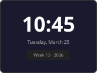

# Panel Clock

## About

The clock panel displays a large digital time with optional date, outside/inside temperature, and weather information. The center display area cycles through up to 4 configurable cards every 5 seconds (after the last card the first card is shown for 15 seconds before the cycle restarts), and can be tapped to manually advance. Up to 6 entity buttons can be shown at the bottom for quick action access.

## How to configure

In the **panel editor**, set:

**Item** (entity picker) — A weather entity to display weather data (optional).

### Background

The clock panel can have different background images. Select from the dropdown in the editor:

- Dark — a clean dark theme
- Modern — modern gradient
- Spring — floral theme
- Summer — warm theme
- Autumn — fall colors
- Winter — cold theme
- Dog 1, Dog 2, Cat — pet-themed backgrounds

For dynamic backgrounds, choose **Template…** in the Background field and enter a Home Assistant template, for example `{{ 'dark' if is_state('sun.sun', 'below_horizon') else 'modern' }}`. The result must be a background name; the template is evaluated when the panel opens.

### Cycle Cards

The center area cycles through enabled cards every 5 seconds; after the last card, the first card stays for 15 seconds before the cycle restarts. Tap the time area to advance to the next card immediately. Each card is a toggle in the editor:

| Option | Default | Description |
|--------|---------|-------------|
| **Show time** | On | Show current time (HH:MM) with the date below it |
| **Show date** | On | Show a separate date card (e.g. "Mon 16") |
| **Show outside temperature** | On | Show outside temperature from the weather entity |
| **Show inside temperature** | Off | Show NSPanel internal temperature |

The date is always shown below the time when the time card is active, regardless of the Show date toggle. The Show date toggle only controls whether a separate dedicated date card is added to the rotation. If no cards are enabled, the time card is shown as a fallback.

### Weather

If a weather entity is set, you can configure:

| Option | Default | Description |
|--------|---------|-------------|
| **Show weather** | On | Show the weather condition icon |
| **Show temperature** | On | Show temperature and pressure text |
| **Show home temperature** | Off | Show NSPanel internal temperature alongside the weather |
| **Weather icon color** | Color | Icon style: Color (condition-based) or Monochrome |

### Item Buttons

Up to 6 quick-action buttons can be placed at the bottom of the clock. Each button uses the standard entity picker in the items list.

### Show Notifications

Toggle the notifications icon on/off.
