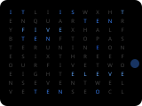

# Panel ClockTwo

## About

The clocktwo panel is a word clock: a grid of letters in which the words spelling the time (rounded to 5 minutes, e.g. "IT IS HALF PAST TWELVE") are highlighted, with four dots for the extra minutes. It supports multiple languages and customizable colors.

## How to configure

In the **panel editor**, set:

### Background

The clocktwo panel can have different background images. Select from the dropdown in the editor:

- Dark, Modern, Spring, Summer, Autumn, Winter, Dog 1, Dog 2, Cat

For dynamic backgrounds, choose **Template…** in the Background field and enter a Home Assistant template, for example `{{ 'dark' if is_state('sun.sun', 'below_horizon') else 'modern' }}`. The result must be a background name; the template is evaluated when the panel opens.

### Language

Set the display language from the dropdown. Supported languages:

- English (default), German, Polish

### Custom Colors

Customize the text colors in the panel editor:

- **Off Color** — Color for inactive/dim text segments (Default: `8452`)
- **Letter Color** — Color for active letter text (Default: `65535`)
- **Special Color** — Color for special text elements, i.e. the minute dots (Default: `62694`)

Colors accept RGB565, `[r,g,b]` or `#rrggbb`.

### Show AM/PM

Toggle to enable AM/PM display (Default: Off). Only works with the English language.

### Show Intro Text

- **Show Intro Text** — Show intro text always (Default: On)
- **Show Intro Text Full Hour** — Show intro text on full hours (Default: Off)

### Show Notifications

Toggle the notifications icon on/off.
