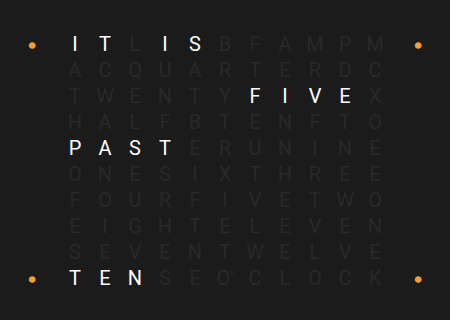
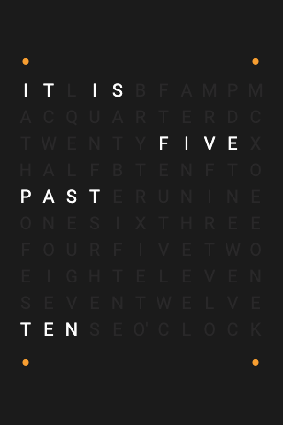

# Panel ClockTwo

 

## About

The clocktwo panel is a word clock: a grid of letters in which the words spelling the time (rounded to 5 minutes, e.g. "IT IS HALF PAST TWELVE") are highlighted, with four dots for the extra minutes. It supports multiple languages and customizable colors.

## How to configure

In the **panel editor**, set:

### Background

The first option, **Use color scheme**, uses the active device scheme's foreground/state definitions on the TFT's built-in solid dark/light fill selected from its background color. This avoids the page's design-helper picture; custom background colors use the nearest contrast fill. The remaining options select images in this order: Dark Color, Light Color, Modern, Spring, Summer, Autumn, Winter, Dog 1, Dog 2, and Cat. Each image is mapped to a light/dark contrast variant controlling active letters, minute dots, and state icons together. Currently **Light Color** uses light-background colors and the other images use dark-background colors.

For dynamic backgrounds, choose **Template…** in the Background field. The result must be `scheme` or a background name; the template is evaluated when the panel opens.

### Colors

On pages set to **Use color scheme**, word-clock colors come from the active device scheme. When a decorative background image is selected, the background's paired light/dark contrast palette is used instead. Legacy `off_color`, `letter_color`, and `special_color` values remain until reset through **Editor → Colors**.

### Language

Set the display language from the dropdown. Supported languages are English (default), German, and Polish.

### Show AM/PM

Toggle to enable AM/PM display (Default: Off). Only works with the English language.

### Show Intro Text

- **Show Intro Text** — Show intro text always (Default: On)
- **Show Intro Text Full Hour** — Show intro text on full hours (Default: Off)

### Show Notifications

Toggle the notifications icon on/off.

### Leaving the Panel

This page has no header buttons. Swipe left or right from a screen edge to change panel, or enable **Long press to go back** (*Advanced* section): holding anywhere for about a second then goes back to the panel this one was opened from, or to the home panel. See [Standard Fields](../configuration/panels.md#standard-fields).
