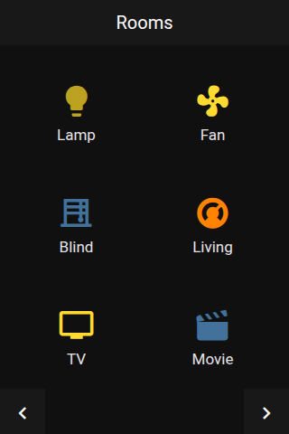

# Panel Grid

 

## About

The grid panel shows up to 6 entities as large tiles in a scrollable layout. Each tile displays the entity name and an icon whose color reflects the state. If more than 6 entities are configured, a next-page button appears for scrolling.

This panel is a great starting point for grouping lights, switches, sensors, and scenes on a single screen.

## How to configure

In the **panel editor**, add the entities you want to display as items. Each item uses the standard entity picker — select an entity, then optionally customize its appearance.

### Colors

Grid item colors come from the selected device color scheme. Older saved per-item color values continue to override the scheme until reset in **Editor → Colors** using **Reset existing device and panel color overrides**. The **Show Power Button** option remains available. Deliberate entity-specific color styling is still available through the standard item `color` option.

## Display Behavior

- If more than 6 entities are configured, a next-page button appears.
- The panel remembers which page you last viewed and returns to it on revisit — this is automatic, not configurable.
- Tapping a tile opens the entity's default popup control (e.g., a light popup for a light entity).
