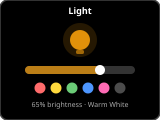

# Panel Light

## About

The light panel provides full control for a single light entity — brightness, color temperature, RGB color, effects, and power. Only controls for features the entity supports are shown.

## Popup Variant

The popup variant (`popup_light`) mirrors the main panel layout. It is used automatically when a light entity is assigned as an item on another panel (e.g., tapping a light tile in the grid panel).

## Controls

| Widget | Description |
|--------|-------------|
| **Power** | On/off toggle button in the centre. Shown while no function (brightness, color, color temperature) is active. |
| **Brightness Slider** | Adjustable slider (0–100%). Shown when the entity supports `brightness`. |
| **Color Temp Slider** | Adjusts white color temperature within the light's Kelvin range. Shown when the entity supports the `color_temp` mode and reports a valid Kelvin range. |
| **Color Wheel** | Tap-and-drag rectangular color picker. Shown when the entity supports an `hs`, `rgb`, `rgbw`, `rgbww` or `xy` color mode. |
| **Function Buttons** | Up to 4 buttons below the main controls that switch between brightness, color and color temperature. The effect button (shown when the light has effects) opens an effect selection popup. |

## How to configure

In the **panel editor**, set:

- **Item** (entity picker) — A light entity to control. Required.
- **Show Kelvin** (toggle) — When enabled, color temperature is displayed in Kelvin (e.g., 3500K); when disabled it is displayed in mireds (e.g., 286Mired). This only changes the displayed unit: Home Assistant reports and sets color temperature in Kelvin. Default: on.

### Per-Item Options (when used as a popup)

When a light panel is used as a popup from another panel, the parent entity's advanced settings can override the following:

- **Name** — Custom display name, used as the popup title

## Display Behavior

- The **title** is the item's custom name if set, otherwise the entity's friendly name. The panel's title field is only used when no light item is available.
- Controls automatically hide or show based on the light entity's supported features.
- When the light is off, only the power button is shown; the function buttons and sliders are hidden. While a function is active, the centre power button is replaced by a header power-off button; tap the active function button again to return to the centre power toggle.
- The color wheel always appears when RGB/XY color is supported, regardless of other features.
