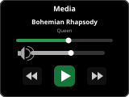

# Panel Media

## About

The media panel controls a media player entity — TV, speaker, or receiver. It displays the currently playing song/album art, and provides play/pause, volume, track navigation, and grouping controls. The album art, title, and artist info span the full panel width for a cleaner look. A vertical volume slider is on the right; a playback progress bar is shown while a track with a known duration is playing.

## Popup Variant

The popup variant (`popup_media_player`) mirrors the main panel layout. It is used automatically when a media player entity is assigned as an item on another panel.

## How to configure

In the **panel editor**, set:

- **Item** (entity picker) — A media player entity to control. Required.

### Media Favorites

You can add media favorites as quick-select items. The editor shows one editable row per favorite:

- **Sonos favorites** (sensor entity picker) — A sensor holding the Sonos favorites in its `items` attribute. This requires the Sonos integration to be configured in Home Assistant. By default the favorites appear under the **Media** button; enable **Sonos favorites in source list** to show them in the source selection popup instead.
- **Media Favorites** — Add individual media items. Each entry is a single string: a media content ID (played as type `music`, shown by its last path segment), or a `media_player` entity ID whose current `media_content_id` and friendly name are used.

The **Source** button is shown when the player supports source selection and has a source list (or Sonos favorites are in the source list). The **Media** button is shown when media favorites are configured or a Sonos favorites sensor is set and not in the source list.

## Grouping / Ungrouping

If the media player supports grouping (e.g., Sonos speakers), you can group and ungroup devices. Available group members are determined automatically from the entity's `group_members` attribute, plus any players listed in **Group media player entities**. The **Group** button is shown when the player supports grouping and at least one such player is available.

## Display Behavior

- Album art, title, and artist span the full panel width.
- Shuffle, repeat, previous and next buttons are shown and usable whenever the media player reports support for them.
- The vertical volume slider is on the right side. Dragging it doesn't trigger swipe navigation; the new volume is applied when you release it.
- When nothing is playing, title and artist are blank. The header shows the channel name if the player reports one, otherwise the player's name.
