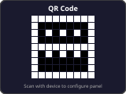

# Panel QR-Code



## About

The QR code panel displays a QR code, for example for Wi-Fi network access. It can show two different sizes: a large QR code, or a smaller QR code with network info or item values on the other half.

- Tapping the QR code toggles between big and small sizes.
- When the big QR code is shown by tapping the QR code, the display will not turn off (auto-dimming and auto-page are paused). The header zoom button toggles the size without changing these.
- Item values longer than 19 characters continue on a second line.

## How to configure

In the **panel editor**, set:

### WiFi SSID and WiFi password

Enter the Wi-Fi network name (SSID) and password as text fields. The integration automatically builds the QR code in the standard Wi-Fi format:

```
WIFI:S:<SSID>;T:WPA;P:<PASSWORD>;;
```

### Show big code (toggle)

When enabled, the panel starts with the QR code displayed large. Default: Off.

### Show network info (toggle)

When enabled and no text items are configured, the SSID and password are shown as plain text labels alongside the QR code. The zoom toggle controls visibility — big QR hides the text, small QR reveals it. Default: On.

### Text items

You can add up to 2 items to display alongside the QR code. When items are configured, they replace the network info text: the QR code appears smaller on one side with the item values on the other.
