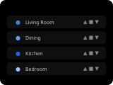

# Panel Row

## About

The row panel shows up to 5 entities as stacked rows, each with an icon and name plus a control suited to the entity type. If more than 5 entities are configured, a next-page button appears for scrolling. This panel is ideal for placing simple toggles, sensors, and quick actions in a single view.

## How to configure

In the **panel editor**, add the entities you want to display as items. Each item uses the standard entity picker.

## Display Behavior

- If more than 5 entities are configured, a next-page button appears.
- Control by entity type: covers get open/stop/close buttons; `number`/`input_number` a slider; `switch`, `input_boolean`, `automation` and `light` a toggle; `button`, `input_button`, `scene`, `script`, `lock` and `vacuum` a button; everything else (including `timer`) a text value.
- `number` and `input_number` entities are shown as a slider; releasing it sets the entity's value. While the entity is unavailable, its state is shown next to the slider instead of a value.
- Covers show open, stop and close buttons; the stop button is only active while the cover is moving.
- The panel remembers which page you last viewed and returns to it on revisit — this is automatic, not configurable.
