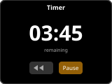

# Panel Timer

## About

The timer panel provides a local countdown timer with start, pause, and stop controls. The timer runs in the Hub — it does not use a Home Assistant `timer` entity, and it keeps running while the panel is closed. If a duration greater than 0 is set, the timer counts down from that value; if 0 is set, it counts up (stopwatch mode).

## Popup Variant

The popup variant (`popup_timer`) mirrors the main panel layout. Since the timer has no entity, open it from an item by setting the item's `popup_key` to `popup_timer` (or with a `navigate:popup_timer` item).

## Controls

| Widget | Description |
|--------|-------------|
| **Time display** | Shows `MM:SS` format. Large digits in the center of the panel. |
| **Up/Down buttons** | 4 sets of up/down arrows for setting digits (M1 M2 : S1 S2) before starting. |
| **Start button** | Starts the timer (with 00:00 it starts the stopwatch). While running it becomes a pause button, and a resume button when paused. |
| **Stop button** | Stops the running timer. When stopped with a non-zero value it resets to 00:00. Disabled at 00:00. |
| **Header stop button** | Right secondary header button; visible only while the timer is active. Stops the timer. |

## How to configure

In the **panel editor**, set:

- **Show Notification** (toggle) — When the timer finishes (reaches 00:00 in countdown mode), the alert sound is played if the device's `sound_on_notification` option is enabled. If this option is enabled, a notification popup is also shown on the display. Default: Off.

## Display Behavior

- **Before starting:** The up/down arrow buttons allow setting the initial duration.
- **Running:** The time display updates every 0.5 seconds. Start button becomes a pause/resume button.
- **Finished (countdown):** The alert sound plays (if `sound_on_notification` is enabled); if Show Notification is enabled, a popup notification appears.
- **Stopwatch mode:** When initial duration is 00:00, the timer counts up from 0.
- The timer state is kept in the Hub's memory — it survives display restarts but is lost when Home Assistant or the integration restarts.
