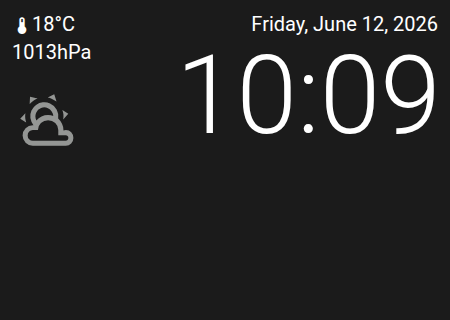
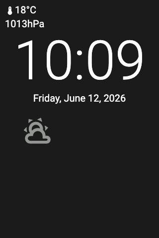

# Panel Weather

 

## About

The weather panel can be used as a screensaver. It displays weather details, time/date, and optional background images. The time area cycles through the same [cycle cards](#cycle-cards) as the clock panel. Up to two info items can be placed below the weather display.

## How to configure

In the **panel editor**, set:

**Item** (entity picker) — A weather entity to display. Required.

### Info Items

Additional sensor entities can be shown as info panels below the main weather data. You can add up to 2 info items. Common uses: indoor temperature, humidity, CO2 level.

### Cycle Cards

The time area (the big time and the date line next to it) cycles through the enabled cards exactly like the [clock panel's cycle cards](panel_clock.md#cycle-cards), with the same options in the editor's **Cycle cards** section and the same defaults:

| Option | Default | Description |
|--------|---------|-------------|
| **Show time** | On | Show current time with the date |
| **Show date** | Off | Show a separate date card: the weekday and day (e.g. "Mon 16", in a smaller font when it does not fit) with the full date |
| **Show outside temperature** | Off | Show the weather entity's temperature |
| **Show inside temperature** | Off | Show the inside temperature (see [Inside Temperature Sensor](#inside-temperature-sensor)) |
| **Card entities** | — | Up to 4 entities shown as extra cards: the value large, the entity's name |
| **Seconds per card** | 5 | How long each card is shown |
| **First card pause** | 15 | How long the first card stays after a full cycle, in seconds |

Cards are fitted to the time area and redraw when their value changes; see the clock panel for the details. Only the time card is on by default, so the time area shows the time and date until you enable more cards. Unlike the clock, the weather panel's time area takes no touch: its cards only cycle, they cannot be tapped to skip ahead.

### Background

The first option, **Use color scheme**, uses the active device scheme's foreground/state definitions on the TFT's built-in solid dark/light fill selected from its background color. This avoids the page's design-helper picture; custom background colors use the nearest contrast fill. The remaining options select images in this order: Dark Color, Light Color, Modern, Spring, Summer, Autumn, Winter, Dog 1, Dog 2, and Cat. Each image is mapped to a light/dark contrast variant controlling text, time/date cards, and domain icons together. Currently **Light Color** uses light-background colors and the other images use dark-background colors.

For dynamic backgrounds, choose **Template…** in the Background field. The result must be `scheme` or a background name; the template is evaluated when the panel opens.

### Show Forecast

Toggle **Daily** or **Hourly** forecast display in the editor. If the weather entity returns fewer than 5 forecast entries, the remaining forecast slots stay empty.

### Show Weather

Toggle the main weather icon on/off.

### Show Temperature

Toggle the main temperature text. When **Show Home Temperature** is also enabled, the inside temperature is shown alongside the weather.

### Inside Temperature Sensor

**Show Home Temperature** and the **Show inside temperature** cycle card read the *Inside temperature sensor* picker. Leave it empty to use the NSPanel's internal NTC temperature sensor (looked up through the entity registry); pick any `sensor` entity to use that value instead — e.g. a room sensor — on this panel.

### Weather Icon Color

Choose **Color** (default) to color the main and forecast icons by condition, or **Monochrome** to use the text color.

### Show Notifications

When enabled, the main weather icon blinks as a notification bell while there are new notifications. When all notifications have been read but some are still queued, the bell stays visible statically so the queue is not overlooked. Tapping the icon opens the queued notifications.

### Leaving the Panel

This page has no header buttons. Swipe left or right from a screen edge to change panel, or enable **Long press to go back** (*Advanced* section): holding anywhere for about a second then goes back to the panel this one was opened from, or to the home panel. See [Standard Fields](../configuration/panels.md#standard-fields).
