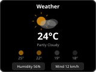

# Panel Weather

## About

The weather panel can be used as a screensaver. It displays weather details, time/date, and optional background images. Up to two info items can be placed below the weather display.

## How to configure

In the **panel editor**, set:

**Item** (entity picker) — A weather entity to display. Required.

### Info Items

Additional sensor entities can be shown as info panels below the main weather data. You can add up to 2 info items. Common uses: indoor temperature, humidity, CO2 level.

### Background

The weather panel can have different background images. Select from the dropdown in the editor:

- Dark — a clean dark theme
- Modern — modern gradient
- Spring — floral theme
- Summer — warm theme
- Autumn — fall colors
- Winter — cold theme
- Dog 1, Dog 2, Cat — pet-themed backgrounds

For dynamic backgrounds, choose **Template…** in the Background field and enter a Home Assistant template, for example `{{ 'dark' if is_state('sun.sun', 'below_horizon') else 'modern' }}`. The result must be a background name listed above; the template is evaluated when the panel opens.

### Show Forecast

Toggle **Daily** or **Hourly** forecast display in the editor. If the weather entity returns fewer than 5 forecast entries, the remaining forecast slots stay empty.

### Show Weather

Toggle the main weather icon on/off.

### Show Temperature

Toggle the main temperature text. When **Show Home Temperature** is also enabled, the inside temperature is shown alongside the weather.

### Inside Temperature Sensor

**Show Home Temperature** reads the *Inside temperature sensor* picker. Leave it empty to use the NSPanel's internal NTC temperature sensor (looked up through the entity registry); pick any `sensor` entity to use that value instead — e.g. a room sensor — on this panel.

### Weather Icon Color

Choose **Color** (default) to color the main and forecast icons by condition, or **Monochrome** to use the text color.

### Show Notifications

When enabled, the main weather icon blinks as a notification bell while there are new notifications. When all notifications have been read but some are still queued, the bell stays visible statically so the queue is not overlooked. Tapping the icon opens the queued notifications.
