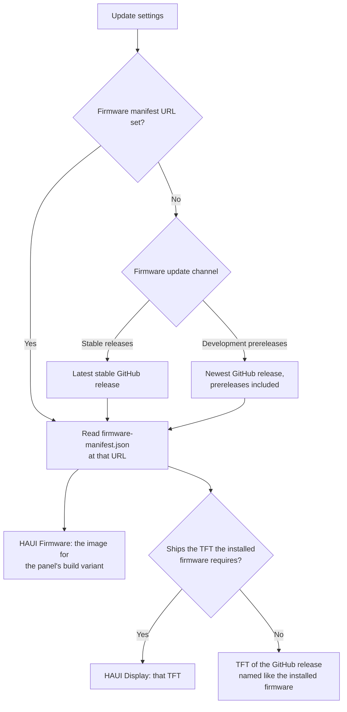
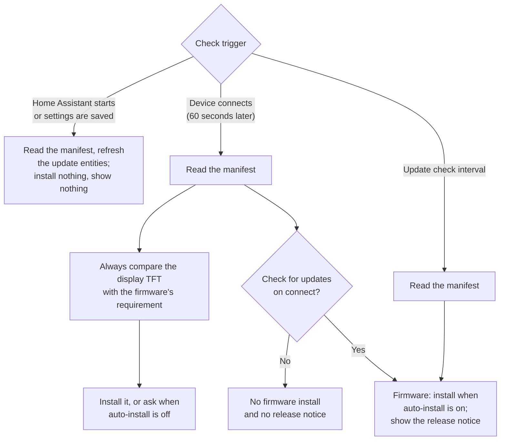
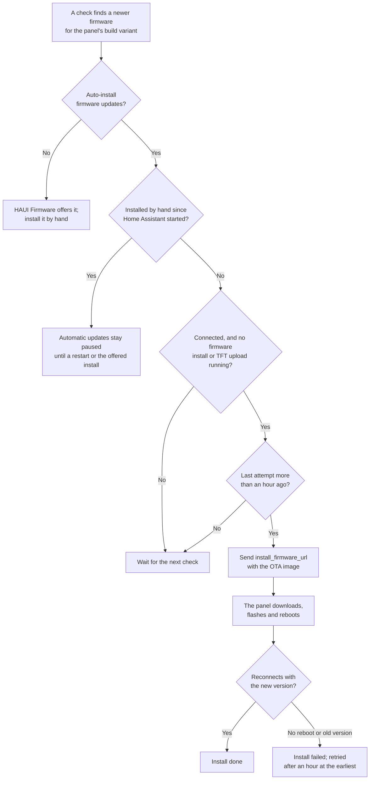
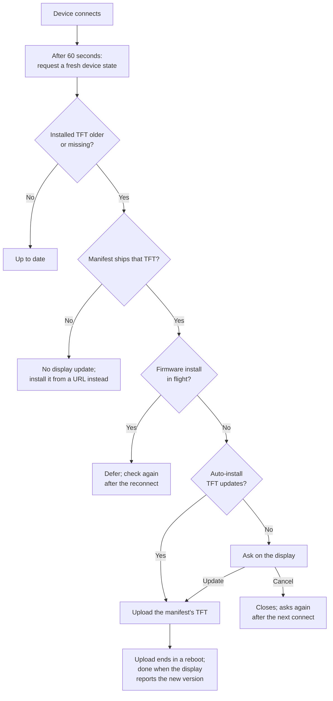
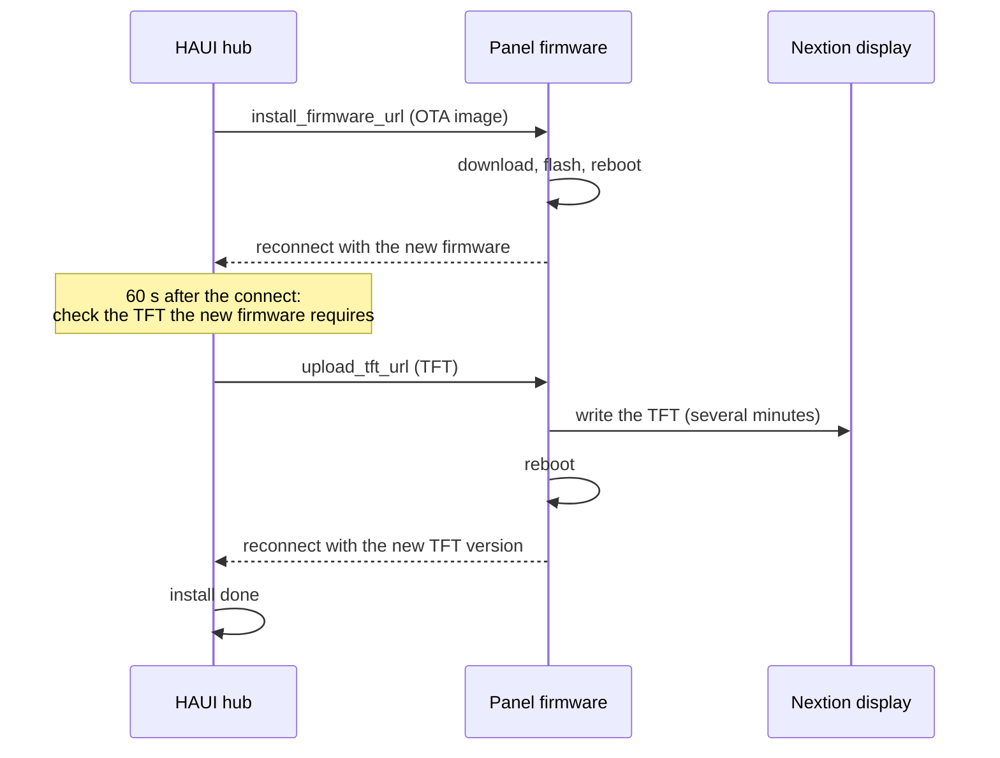

# Update Process

The hub updates each panel's **ESPHome firmware** (**HAUI Firmware**,
`update.<device>_haui_firmware`) and **display TFT** (**HAUI Display**,
`update.<device>_haui_display`); the integration itself comes from the
Marketplace, see [Updating](update.md). Settings live in the editor: **Device
Manager** → the device's menu → **Settings** → **Updates**.

## Where updates come from

Every release publishes a **firmware manifest** (`firmware-manifest.json`) that
names the firmware version with its over-the-air image and the display TFT for
each display model. The hub reads one manifest per device:

| Channel | Manifest |
|---------|----------|
| **Stable releases** (default) | The latest stable GitHub release |
| **Development prereleases** | The newest release in the GitHub release list, development builds included (see [Published development firmware](release.md#published-development-firmware)) |
| **Firmware manifest URL** | The URL set in the device settings overrides the channel, for example to follow a [local test release](release.md#test-firmware-updates-with-a-local-release) |

The display always gets the TFT the **installed** firmware needs: the firmware
reports the TFT version it requires and the hub installs that version from the
manifest. A newer TFT is never installed ahead of its firmware; after a firmware
update it follows once the device has rebooted into it. A manifest without a TFT
(a local test release ships none) offers no display update.



## Build variants

Every firmware reports a **build variant**, and the hub offers a device only
firmware of its own variant:

| | Universal firmware | Custom firmware |
|---|---|---|
| What it is | The prebuilt `nspanel_haui.bin` of every release | Built from your own YAML: `esphome/install.yaml`, `esphome/nspanel_haui_dev.yaml`, or a device YAML that includes `nspanel_haui.yaml` |
| Wi-Fi and API key | Wi-Fi entered in the panel's access point at first boot; the public fixed API key | Your own, from the YAML |
| Firmware updates | By the hub: every manifest offers the new universal image | Not from the releases: you rebuild and install |
| Display TFT updates | By the hub | By the hub |

Firmware older than 0.4.4 reports no variant; see
[Older firmware](#older-firmware) for the one manual flash it needs.

### Universal firmware

The manifests ship the universal image, so the hub runs the whole cycle:

1. **First install.** Flash `nspanel_haui.bin` once by cable and connect the
   panel to your Wi-Fi through its access point, see
   [Universal image](install.md#universal-image-no-yaml).
2. **A new release.** The next check reads the manifest: **HAUI Firmware** offers
   the release and the display shows the [release notice](#on-the-display).
3. **Install.** Press **Install** on **HAUI Firmware** or **Device Info → Install
   update → Firmware**, or let **Auto-install firmware updates** do it.
4. **Flash and reboot.** The panel downloads the release's over-the-air image
   (`nspanel_haui_ota.bin`), flashes it and reboots with its Wi-Fi and API key
   unchanged. About a minute after the reconnect the hub installs the TFT the new
   firmware needs, or the display asks first.

The same cycle runs for every development build on the **Development
prereleases** channel, which is universal too. To stay on a version, leave
**Auto-install firmware updates** off and skip the update in Home Assistant, or
install a specific release (the entity's `version`, or Device Info's release
list).

### Custom firmware

Releases ship only the universal image, and the hub never installs it on a
custom build: it would replace your API and OTA credentials with the public
ones. For a custom panel:

- **HAUI Firmware** offers nothing. Its state is unknown and its release summary
  names the variant mismatch; **Auto-install firmware updates** does nothing.
- The [release notice](#on-the-display) still appears when a new release is out:
  your cue to rebuild.
- The **display TFT** is still updated by the hub, because both variants use the
  same TFT. The hub takes the TFT your firmware needs from the channel's
  manifest or, when that one ships another TFT version, from the GitHub release
  whose version equals your firmware's. A build whose version no release has (a
  local test build) keeps the TFT the display has; install a matching one with
  **From URL** when the display layout changed.

Update a custom build in one of three ways:

1. **ESPHome dashboard.** Open the device and choose **Install → Wirelessly**.
   ESPHome compiles your YAML with the current package source and flashes it over
   the network. `install.yaml` takes `nspanel_haui.yaml` from GitHub at
   `remote_package.ref`, by default `master` (the latest stable release). When the
   dashboard runs, the ESPHome integration also adds a **Firmware** update entity
   (disabled by default); it is independent of the hub.
2. **From URL.** Build the OTA image (in the dashboard: **Install → Manual
   download**, OTA format), put it where Home Assistant serves it
   (`/config/www/…` is served as `/local/…`) and install it with **Device
   actions → Info → Install update → Firmware → From URL**, or with
   `nspanel_haui.update_firmware` and `url`. Use your own build: the release's
   `nspanel_haui_ota.bin` is the universal image and would replace your
   credentials.
3. **Your own manifest.** To update custom panels like universal ones, publish
   each build with a manifest: `scripts/dev_release.py --variant custom` writes
   the image and a `firmware-manifest.json` into Home Assistant's `www` folder.
   Set **Firmware manifest URL** to that manifest; **HAUI Firmware** offers every
   newer build and **Auto-install firmware updates** installs it. Each build needs
   a higher version than the last. See
   [Test firmware updates with a local release](release.md#test-firmware-updates-with-a-local-release).

After the reboot the hub installs the TFT the new firmware needs, as on a
universal panel.

## When the hub checks

**Enable updates** is on by default. The hub then checks at these moments:

| When | What the hub does |
|------|-------------------|
| Home Assistant starts, or the device settings are saved | Reads the manifest and refreshes the two update entities. Installs nothing and shows nothing on the display. |
| 60 seconds after the device connects | Compares the display's TFT with the TFT the firmware needs and installs or offers it (always). With **Check for updates on connect**, it also installs a firmware update (when **Auto-install firmware updates** is on) and shows the release notice. |
| Every **Update check interval** (hourly by default) | Reads the manifest, installs a firmware update (when **Auto-install firmware updates** is on) and shows the release notice. The TFT is not checked here. |



The update entities do not poll: they show what the last check found.

### Firmware

With **Auto-install firmware updates** on, a check installs the firmware when:

- the manifest offers a newer version than the device runs, for the device's
  build variant;
- the device is connected and no TFT upload or other firmware install is
  running;
- the last automatic attempt is more than an hour old (a failed install is
  retried at most once an hour);
- no other release or URL was installed by hand since Home Assistant started
  (see [Other releases and URLs](#other-releases-and-urls)).



Only the checks start an automatic install, so with both **Check for updates on
connect** and periodic checks off, the firmware is never installed
automatically. With **Auto-install firmware updates** off (the default), the
**HAUI Firmware** entity offers the update and you
[install it yourself](#installing-updates).

During the install the display shows a [popup](#on-the-display) that a new
firmware is installing. The device downloads the image, flashes it and reboots;
the TFT follows after the reboot.

### Display TFT

After every connect the hub compares the TFT the display reports with the TFT
the firmware needs. When the display's TFT is older:

- **Auto-install TFT updates** on (the default): the hub installs it right away.
- **Auto-install TFT updates** off: the display asks *Your TFT-version is
  outdated. Do you want to update?* **Update** starts the install; **Cancel**
  closes the question, which comes back after the next connect.

The hub never starts a TFT upload while a firmware install is running, because
the firmware's reboot would cut the upload off. An install the display never
confirms is not retried automatically: the editor reports an error and you retry
it by hand.



## When updates are disabled

Turn off **Enable updates** to stop all update activity for the device:

- No checks run: not on connect, not periodically, not after saving settings.
- Nothing installs automatically, and the display shows neither the TFT question
  nor the release notice.
- The **HAUI Firmware** and **HAUI Display** entities become unavailable.
- Manual installs are refused: **Install update** and **Download firmware** are
  hidden in Device Info, and `nspanel_haui.update_firmware` and `nspanel_haui.update_tft` fail with
  *Updates are disabled for this device*.
- An install already running finishes; its entity stays available until it ends.

The other update settings are kept while updates are off (the editor hides them)
and apply again when you turn updates back on, which reads the manifest right
away.

A device that is disabled in the Device Manager runs no app on the hub at all,
so it gets no updates either, whatever its update settings say.

## Notifications

### On the display

| Popup | Title | Shown when | Buttons |
|-------|-------|------------|---------|
| Release notice | **Update** | A check finds a GitHub release newer than the device's firmware, see below | close |
| Firmware install | **Update** | A firmware install starts, automatic or by hand: *A new firmware release is installing. The display updates after the device reboots.*, with the version (or the URL) | close |
| TFT question | **TFT** | After a connect, when the display's TFT is older than the firmware needs and **Auto-install TFT updates** is off: *Your TFT-version is outdated. Do you want to update?* | **Cancel**, **Update** |
| TFT starting | **Updating** | You pressed **Update** on the TFT question: *Please wait while the update is starting* | close |

An automatic TFT install starts without a popup. No popup appears while updates
are disabled.

These popups are not part of the [notification queue](panels/popup_notify.md):

- They open right away over the current panel and stay until you close them
  with the header's close button.
- While one is open the display does not dim, turn off or switch to the idle
  page, and a display that is off wakes up.
- They play no sound, do not appear in the notification list and fire no
  `nspanel_haui.notification` event.

**Release notice.** It shows the release name, the first 200 characters of its
release notes with Markdown formatting removed, and the release tag, and
reminds you that installs come from the configured firmware manifest.

- Only the check after a connect (with **Check for updates on connect**) and the
  periodic check show it.
- It compares the newest GitHub release with the firmware version the device
  runs; the manifest and the TFT play no part. A custom build, or a panel with
  its own **Firmware manifest URL**, therefore gets the notice too, although the
  hub does not offer it that release.
- **Stable releases** ignores prereleases; **Development prereleases** includes
  them. Each release is shown once; the hub keeps this in memory, so it can
  appear again after a restart or a channel change.

### In Home Assistant

- **Update entities.** When a newer version is offered, **HAUI Firmware** or
  **HAUI Display** turns on and Home Assistant lists it under **Settings →
  Updates**, like any other update. The release summary shows the last install
  error, or why nothing is offered (for example a build variant mismatch, or a
  manifest without the TFT the firmware needs). When no firmware can be offered,
  **HAUI Firmware**'s state is unknown.
- **No persistent notifications.** The hub creates no persistent notification or
  repair issue for updates. Use an automation to be told elsewhere.
- **Events.** The hub fires an event whenever it publishes the update state
  (checks, connects, install steps), not only when a value changes, so compare
  values in automations instead of reacting to every event:

| Event | Payload |
|-------|---------|
| `nspanel_haui.firmware_update_changed` | `device`, `connected`, `enabled`, `installed_version`, `latest_version` (`null` when no firmware can be offered), `installing`, `reason` (why no firmware is offered), `last_error` |
| `nspanel_haui.display_update_changed` | `device`, `connected`, `enabled`, `installed_version`, `latest_version` (the TFT the firmware needs), `state` (`idle`/`checking`/`installing`/`done`/`error`), `update_reason`, `last_error` |

An automation that tells your phone about a new firmware:

```yaml
alias: NSPanel firmware update available
triggers:
  - trigger: state
    entity_id: update.nspanel_kitchen_haui_firmware
    to: "on"
actions:
  - action: notify.mobile_app_my_phone  # your notify action
    data:
      title: NSPanel update
      message: >-
        Firmware {{ state_attr('update.nspanel_kitchen_haui_firmware', 'latest_version') }}
        is available for the kitchen panel.
```

### In the editor

- **Install update** answers with a toast: *Firmware update started for "…"* or
  *TFT update started for "…"*, or the reason the install could not start.
- The Device Manager row shows chips: **Firmware update available**,
  **Firmware mismatch** when the known HAUI and firmware versions differ,
  **Installing firmware…**, **update pending** next to the display version,
  **Checking for update…**, **Installing TFT…**, **TFT installed** and **TFT
  update failed** (hover it for the error).
- **Device Info** shows the HAUI version, device `yaml_version` and offered firmware as **Firmware Update Version**.

The HAUI version and firmware `yaml_version` are expected to match. A mismatch is
a diagnostic that the hub and panel firmware are out of sync; it does not itself
trigger an install. Firmware update availability still compares the release
manifest with `yaml_version`, while TFT update checks compare `tft_version` with
the firmware-reported `tft_required_version`.

## Settings

| Setting in the editor | Key | Default | What it does |
|-----------------------|-----|---------|--------------|
| **Enable updates** | `enabled` | on | Master switch for checks, update entities and every install, see [When updates are disabled](#when-updates-are-disabled). |
| **Check for updates on connect** | `check_on_connect` | on | Lets the check after a connect install firmware and show the release notice. The TFT is checked after every connect either way. |
| **Enable periodic update checks** / **Update check interval (seconds)** | `update_interval` | `3600` | Seconds between periodic checks, `0` turns them off. Turning the toggle off sets `0`; turning it on restores hourly checks. At most one week (`604800`). |
| **Auto-install firmware updates** | `firmware_auto_update` | off | Installs a newer firmware without asking, see [Firmware](#firmware). |
| **Firmware update channel** | `firmware_update_channel` | **Stable releases** (`stable`) | Which manifest to follow when the URL below is empty: stable releases, or **Development prereleases** (`dev`). Also decides whether the release notice considers prereleases. |
| **Firmware manifest URL** | `firmware_manifest_url` | empty | A manifest to follow instead of the channel. |
| **Auto-install TFT updates** | `auto_install` | on | Installs the TFT the firmware needs without asking; when off, the display asks first. |

Saved settings apply immediately; a changed channel or URL is read at once. The
delay before the check after a connect (`on_connect_delay`, 60 seconds) is fixed
and not shown in the editor. The full option reference is in
[Device Configuration](configuration/device.md#updates).

## Installing updates

### Order

1. Update the **integration** (Marketplace) and restart Home Assistant.
2. Install the **firmware**. The device reboots.
3. The **display TFT** follows about a minute after the device reconnects (with
   **Auto-install TFT updates** off, confirm the question on the display, or
   install it yourself).

Only one install runs at a time: the firmware cannot be installed during a TFT
upload, and the TFT cannot be installed during a firmware install (the automatic
TFT install simply follows after the reboot).



### Home Assistant update entities

Open the device in **Settings → Devices & services** and press **Install** on
**HAUI Firmware** or **HAUI Display**. Both show the install as in progress and
stay available while the device is offline for the install. Both accept a
version:

```yaml
action: update.install
target:
  entity_id: update.nspanel_kitchen_haui_firmware
data:
  version: "0.4.4"
```

### Editor: Device Info

Open **Device actions** (⋮) in the editor toolbar → **Info**. Whenever updates are
enabled for the device, **Install update** opens the full manual picker, even if
no automatic compatible update is offered. Choose **Firmware** or **Display
(TFT)**, then choose an offered update, another release, **From URL**, or **From
local file**.

**Download firmware** opens the latest stable release's prebuilt
`nspanel_haui.bin`, for flashing the device by hand (ESPHome web installer or
serial). The hub's own installs use the over-the-air image.

### Update sources in the Device Info picker

After choosing **Firmware** or **Display (TFT)** in the picker, choose what to install:

- **Firmware**: the offered update, another release that ships an OTA image
  (older ones included), **From URL**, or **From local file**: a release's
  `nspanel_haui_ota.bin` on a universal panel, your own build on a custom one,
  never a factory image such as the release's `nspanel_haui.bin`.
- **Display (TFT)**: the version the firmware needs, the TFT the manifest ships
  when that differs, **From URL**, or **From local file** for a custom or
  development `.tft` file.

**From local file** uploads the image to Home Assistant, which serves it back to
the device over HTTP(S); the device must reach the configured **Internal URL**.
No internal URL or an unreachable address prevents the install. The file is
staged in memory for at most one hour at a random, temporary URL; it is not
placed in the unauthenticated frontend files.

- **TFT**: a compiled Nextion `.tft` (up to 16 MiB); the hub checks the Nextion
  signature before uploading.
- **Firmware**: an ESPHome OTA app `.bin` (not a factory image); the hub checks
  the ESP image magic and the app-partition size limit before MD5 validation and
  the OTA download.

A local file or URL is a manual override: a TFT stays installed until the
firmware version changes or Home Assistant restarts; a firmware install pauses
automatic firmware updates until Home Assistant restarts. Use an image built for
the target panel, especially for custom firmware.

The Device Manager row shows firmware and display versions, **update pending**
when the TFT is older than the firmware needs, and install progress or errors; it
does not start manual updates.

### Actions

`nspanel_haui.update_firmware` and `nspanel_haui.update_tft` install for one
device, optionally a given `version` or the file at a `url`. They suit
automations; see [Services](services.md#display-updates) for the fields and
examples.

### The TFT question on the display

With **Auto-install TFT updates** off, the display asks after a connect when its
TFT is older than the firmware needs; press **Update** to install.

### Other releases and URLs

- A firmware installed from another release or a URL **pauses automatic firmware
  updates** until Home Assistant restarts or you install the offered update, so
  the hub does not replace your choice on the next check.
- A TFT installed from another release or a URL **stays on the display** until
  the firmware version changes or Home Assistant restarts. A TFT that does not
  match the firmware may lack pages or widgets the firmware uses.

### When an install fails

- **Firmware**: the hub waits up to ten minutes for the device to reboot. No
  reboot, a reconnect without a reboot, or a reboot into the old version is an
  error. A failed automatic install is retried after an hour at the earliest.
- **Display TFT**: the upload takes several minutes (about 13 on a portrait
  panel) and ends in a reboot; the hub waits up to 20 minutes. An upload that
  ends without a reboot, or a TFT the display does not report afterwards, is an
  error and is not retried automatically.

Errors show in the Device Manager row and in the update entity's release
summary. See [Troubleshooting](troubleshooting.md#tft-upload-failures) for the
common causes.

## Upgrading

What changes between versions, and what panels on older firmware need. For the
regular update steps see [Updating](update.md).

Check the section for the version you run before installing a newer one.

### First stable release (from 0.3.x)

!!! note "Only relevant if you run 0.3.x or earlier"

    For a fresh installation, follow [Installation](install.md) and
    [Quick Start](get-started.md) instead — everything here is already the
    default for new installations.

The first stable release removes the backward-compatibility layer: settings,
service names, ESPHome actions/events and config keys from 0.3.x and earlier
are **not migrated and not aliased**. It also stops overloading "sleep": the
display idle state (brightness `on` / `dim` / `off`), the Nextion *hardware*
sleep and the automatic idle page are now named and configured independently.

#### 1. Who must read this

- You saved panel or device settings from **0.3.x or earlier**.
- Your automations or scripts call `nspanel_haui.sleep`.
- Your custom ESPHome YAML uses `display_sleep`, `display_wakeup`, a
  `send_notification*` action, or listens for `esphome.sleep`, `esphome.wakeup`
  or the `esphome.timeout` payload `"sleep"`.
- A dashboard or automation uses `switch.<device>_use_auto_sleeping` or
  `number.<device>_timeout_sleep`.

#### 2. Before you start

- Back up `.storage/nspanel_haui*` (and your `configuration.yaml`, if you
  imported device YAML).
- Note the entity ids your dashboards and automations use: two are renamed.
- Keep the integration, the firmware and the TFT at matching versions.

#### 3. Update order

1. Update the **integration** first (Marketplace or zip) and restart Home
   Assistant.
2. Then flash the matching firmware **and** TFT together, as released.

The firmware and the hub exchange event names, so a mismatched pair publishes
events the other side no longer understands. After updating the integration the
display installs the matching TFT on first connect (or asks, depending on
`auto_install`), but this first upgrade needs the firmware binary flashed by
hand. After that the hub's **HAUI Firmware** entity installs later releases
([see below](#11-firmware-updates-moved-to-the-integration)).

#### 4. What changed

**HA services**

| Old | New |
|-----|-----|
| `nspanel_haui.sleep` | `nspanel_haui.idle` |

`nspanel_haui.wakeup` is unchanged. `idle` opens the configured idle page
immediately, like `sleep` did. It never turns the display off.

**Device config keys and entities**

Saved settings from 0.3.x or earlier are **migrated automatically** on the first
start: the store loader renames the keys below in place and saves them back. A
value already set under the new key wins; legacy keys are dropped either way.
Only these keys are migrated — other editor changes stay as they are.

| Old key | New key | Old entity | New entity |
|---------|---------|------------|------------|
| `sleep_panel` | `idle_panel` | — | — |
| `sleep_panel_extra` | `idle_panel_extra` | — | — |
| `show_sleep_button` | `show_idle_button` | — | — |
| `use_auto_sleeping` | `use_auto_display_off` | `switch.<device>_use_auto_sleeping` | `switch.<device>_use_auto_display_off` |
| `timeout_sleep` | `timeout_display_off` | `number.<device>_timeout_sleep` | `number.<device>_timeout_display_off` |

Editor labels are **Auto display off** / **Display-off timeout (seconds)**; the
firmware entities are *Use Auto Display-Off* / *Timeout Display-Off*.
`use_auto_dimming` and `timeout_dimming` are unchanged. `use_auto_page` and
`timeout_page` stay device settings, but the firmware's *Use Auto-Page* switch
and *Timeout Page* number are gone: the hub owns automatic page switching.

**ESPHome actions**

| Old | New |
|-----|-----|
| `display_sleep` | `display_off` |
| `display_wakeup` | `display_on` (new; waking was previously one-way) |

The four notification actions are **one action** now:

| Old | Use instead |
|-----|-------------|
| `send_notification` | `send_notification` (with optional variables) |
| `send_notification_with_timeout` | `send_notification`; the ESPHome action no longer takes a timeout — use the HA service for auto-dismiss |
| `send_notification_persistent` | `send_notification` with `persistent: true` |
| `send_notification_persistent_with_timeout` | `send_notification` with `persistent: true`; use the HA service if it also needs a timeout |

Optional variables: `persistent` (bool; loops the alert sound) and `text_size`
(`"auto"` or 1–3). The service `nspanel_haui.send_notification` accepts an
optional `timeout` (1–3600 seconds) that starts when the notification is queued,
including while it waits to be shown; omit it or set `0` to keep the
notification until dismissed. `notify` entities and the ESPHome action expose no
timeout. The `nspanel_haui.notification` event carries `timeout` (seconds, or
`null`). See [Services](services.md#nspanel_hauisend_notification).

**ESP events**

| Old | New |
|-----|-----|
| `esphome.sleep` | `esphome.display_off` |
| `esphome.wakeup` | `esphome.display_on` |
| `esphome.timeout` payload `"sleep"` | payload `"off"` |

Payloads `"dim"` / `"page"` and the `esphome.display_state` payloads `on` /
`dim` / `off` are unchanged.

**Removed automatic migrations and shims**

- **Saved panels are not migrated.** The 0.3.x renames `show_forecast` →
  `forecast_type` and `mode` → `show_in_navigation` no longer happen; verify
  both settings per panel in the editor.
- **No pydantic fallback.** Validation always runs.
- **YAML import needs a bare `config:` / `panels:` mapping**; a file wrapped
  under the device name is rejected.
- **`[r, g, b]` colors are rejected.** Use `#rrggbb` or an integer.
- **`template:` is not a marker.** Only bare `{{ ... }}` / `` render.
- **`touch_events` removed** from `update_function_component`.
- **Vacuum fallback removed.** The battery icon needs a configured battery
  sensor; the old `battery_level` / `battery_icon` attributes are ignored.
- **Log-only `on_sleep` / `on_wake` handlers removed**; the Nextion hardware
  sleep is still used on the no-hub path.

#### 5. How to update

1. Update the integration and restart Home Assistant.
2. Re-enter saved settings: forecast type per weather panel, **Show in
   navigation**, colors and notifications.
3. Update automations: `nspanel_haui.sleep` → `nspanel_haui.idle`, plus the
   renamed switches/numbers.
4. Update custom ESPHome YAML: `display_sleep` → `display_off` (add
   `display_on`), consolidate the notification actions, update event listeners.
5. Update dashboards/cards that used the renamed entities.
6. Flash the matching firmware + TFT together, then verify.

#### 6. Verification checklist

- `nspanel_haui.idle` opens the idle page; `nspanel_haui.wakeup` still wakes.
- Automatic page switching opens the idle page **without** turning the display
  off, and display-off happens after its own timeout **without** a page switch.
- Touch/button wake works with and without a configured idle page.
- The no-hub hardware sleep/wake path still works, with `esphome.display_off` /
  `esphome.display_on` as the events.
- Saving a device or panel applies without an error, and YAML import rejects a
  `config:`/`panels:`-less root.

#### 7. Rollback

Restore a Home Assistant backup from before the update (the Marketplace does
not downgrade) or copy the previous integration folder back, and restore the
storage backup from step 2. The old firmware and TFT must match the old
integration — restore those too before reconnecting the device.

### 0.4.5

#### 8. Update behaviour changes

| Change | Behaviour |
|--------|-----------|
| Empty `tft_version` | Treated as **unknown**, not `0.0.0` (which re-installed on every reboot). The hub requests a fresh device state and acts only on a known version; no answer, no install. |
| Unconfirmed install | Reported as an error and **not retried automatically**; retry from **Device actions → Info → Install update → Display (TFT)**. |
| `installing` across the reboot | Stays until the device reconnects with the new version (`done`) or the verification window times out (`error`). |
| Failed installs | A toast when the command cannot be sent or the state ends in `error`; the REST API returns HTTP 502 instead of a silent success. |
| Buzzer | A playing tune stops before a TFT upload, a firmware update or a reboot (new firmware). |
| Firmware auto-update order | Firmware first, then the matching TFT after the reboot; a running TFT upload is never interrupted. Off by default; **Device Info → Install update** works either way. Firmware 0.4.3 needs one manual flash first. |

#### 9. Web server is no longer enabled by default

The shipped firmware no longer runs the ESPHome **web server**: it costs flash
and RAM that the HTTP OTA path (TLS, JSON, `http_request`) needs next to the
display stack. When you flash the new firmware:

- The web UI on port 80 disappears, and Home Assistant's **Visit** link with it.
- Nothing else breaks: the hub, the editor and the TFT install path all use the
  ESPHome native API.

To keep it, add the component to *your own* device YAML (the file that includes
`nspanel_haui.yaml` as a package) before flashing:

```yaml
web_server:
  port: 80
  auth:
    username: admin
    password: !secret web_password
```

`esphome/nspanel_haui_dev.yaml` keeps it for local development. See
[ESPHome Component → Web server](esphome.md#web-server-optional).

#### 10. TFT install actions moved to the integration

Installing the TFT is an integration feature now:

- Each linked panel gets a **HAUI Display** update entity
  (`update.<device>_haui_display`), showing the installed TFT and the TFT the
  firmware needs; **Install** installs it.
- `nspanel_haui.update_tft` takes an optional `url` for a custom TFT.

The firmware drops the matching public pieces:

| Removed | Use instead |
|---------|-------------|
| Action `esphome.<device>_upload_tft` | `nspanel_haui.update_tft` |
| Action `esphome.<device>_upload_tft_url` in automations | `nspanel_haui.update_tft` with `url` |
| Substitution `tft_update_url_portrait` | nothing — the hub picks the portrait TFT by display model |

`esphome.<device>_upload_tft_url` itself still exists: the hub uses it to hand
the URL to the device. Calling it directly bypasses the hub's install tracking.
A leftover `tft_update_url_portrait` is ignored and can be deleted.

The **Update Display** button (`button.<device>_update_display`) is gone: TFT
management is exclusively the hub's — **Install** on
`update.<device>_haui_display`, `nspanel_haui.update_tft`, or **Device actions →
Info → Install update → Display (TFT)**. The `tft_update_url` substitution stays
for local TFT builds.

The new firmware also fixes TFT installs from GitHub releases, which failed with
`HTTP_CLIENT: Out of buffer` (see
[Troubleshooting](troubleshooting.md#firmware-updates-work-tft-installs-stay-installing-and-then-time-out)).
Update the firmware first; the TFT follows after the reboot.

#### 11. Firmware updates moved to the integration

The **HAUI Firmware** update entity belongs to the integration now, next to
**HAUI Display**. The firmware no longer declares one; on the ESPHome side only
the stock **Firmware** entity (for the dashboard) remains.

- The hub reads `firmware-manifest.json` and installs a newer firmware through
  the firmware's `install_firmware_url` action — automatically with
  `firmware_auto_update`, or with **Install** on the entity.
- **Build variants are never crossed.** The manifest names its variant
  (`"variant": "universal"`); the device reports the one it runs
  (`firmware_variant`: `custom` for `install.yaml`/dev builds). The hub only
  offers, lists or installs a matching variant and treats both unknowns as
  incompatible, so a custom build is never flashed the public image. Custom
  builds update through **Install firmware → From URL**.
- **Firmware manifest URL** in the device editor's Updates section
  (`update.firmware_manifest_url`, see
  [Device settings](configuration/device.md#updates)) replaces the
  `firmware_manifest_url` substitution. A leftover substitution is ignored.

What to do depends on the firmware the panel runs:

| Panel firmware | What to do |
|----------------|------------|
| 0.4.4 and later | Nothing: the hub installs the new firmware through `install_firmware_url`. |
| 0.4.3 | Flash **once** by hand: it reports no build variant, so the hub withholds the image from it (a custom 0.4.3 build must not be silently replaced). Use the ESPHome dashboard, or **Install firmware → From URL** with a release `nspanel_haui_ota.bin`. After the reboot the hub updates it again. |
| 0.4.2 | The hub cannot install firmware (no `install_firmware_url` action). Press **Install** once on the firmware's own `update.<device>_haui_firmware`, or flash through ESPHome. |
| 0.4.1 and older | Flash the new firmware through ESPHome. |

**Entity id.** While the panel still runs firmware with its own **HAUI
Firmware** entity, that entity holds `update.<device>_haui_firmware` and the
hub's entity is registered as `update.<device>_haui_firmware_2`. ESPHome removes
its entity after the reboot; the next Home Assistant restart renames the hub's
entity back, so automations keep working.

**Test panels.** A panel following
[local test releases](release.md#test-firmware-updates-with-a-local-release)
through the `firmware_manifest_url` substitution needs the same **Firmware
manifest URL** in the device editor before you update the integration — or
**Auto-install firmware updates** off. Otherwise the hub reads the GitHub
manifest and installs a newer release over the test build.

#### 12. Display TFT updates come from the firmware manifest

The TFT is part of the firmware's update path now: every manifest carries a
`tft` block (version + per display model asset), and **HAUI Display**, the
automatic TFT check and **Install TFT** read it instead of looking up a matching
GitHub release.

- **The TFT picker lists only the manifest's TFT** plus **From URL** and **From
  local file**. Installing another release's TFT by version is no longer
  possible.
- **A manifest without a `tft` block needs no display update.** A local test
  release names no TFT: **HAUI Display** reports the installed TFT and offers
  nothing; the display keeps its TFT. Dev prereleases name their TFTs like a
  stable release.
- **Version comparisons match Home Assistant.** A final release is offered over
  its dev builds (`0.4.5` over `0.4.5.dev3`), and an unparseable version (an old
  `dev-<run>-<sha>` tag) is withheld as unknown. Rebuild such a panel with a
  parseable version. Dev builds published before 2026-11-04 carry a `+g<sha>`
  segment that sorts above the final release and later dev builds: install a
  newer build once by hand (**Install firmware** with its version; in the
  Marketplace, **Install another version**), then updates resume normally.
- **New device setting:** `firmware_update_channel` (`stable`/`dev`) picks the
  manifest when the URL is empty. An explicit **Firmware manifest URL** still
  overrides it.

#### 13. Native OTA is encrypted with the API key

The native OTA platform (wireless installs from ESPHome) is encrypted with the
API key instead of protected by a password, so the `ota_password` substitution
and secret are gone. Panels on 0.4 firmware need nothing. Panels on older
firmware need one wireless install with a migration block, and a `password:` on
`ota: platform: esphome` in your own YAML now fails validation. See
[ESPHome Component → Encrypted native OTA](esphome.md#encrypted-native-ota).

#### 14. The Current Page sensor moved to the firmware

The firmware provides the **Current Page** sensor now; the integration's sensor
platform is gone. The value is still the Nextion page name (`grid`, `weather`,
`light`, …), and it no longer turns unavailable while the hub is disconnected.

- The old sensor stays in the registry as unavailable. Delete it under
  **Settings → Devices & services → Entities** so the firmware's entity can take
  `sensor.<device>_current_page`; if the firmware connected first, rename its
  `..._current_page_2` entity back.
- The firmware's **Current Page** (and new **Current Page Number**) is disabled
  by default. Enable it on the panel's ESPHome device page first.
- `panel`, `type` and `title` attributes are gone. Read the
  `nspanel_haui.page_changed` event instead (see
  [Services → HA Events](services.md#ha-events-automation-triggers)).

#### 15. Home Assistant 2026.11 and the Marketplace

NSPanel HAUI now requires **Home Assistant 2026.11** or later (declared in the Marketplace metadata). It
replaces HACS with the built-in
[Marketplace](https://www.home-assistant.io/integrations/marketplace/), and the
install docs describe only the Marketplace.

- **Update Home Assistant first.** On 2026.10 or older this release is not
  offered.
- **Installed through HACS:** nothing to do. Home Assistant migrates HACS on the
  first 2026.11 start; NSPanel HAUI stays installed as a custom repository, and
  its update entity keeps its name, area and labels.
- **Development builds:** the HACS beta toggle is the repository's
  **Pre-release** switch (**Settings → Devices & services → Marketplace**,
  NSPanel HAUI's device page; disabled by default).
- **Rolling back:** the Marketplace does not downgrade; restore a backup.
- **Fresh install:** add `happydasch/nspanel_haui` under **Settings →
  Marketplace → Add from link**; this needs a GitHub connection. See
  [Installation](install.md#install-the-integration).

#### 16. Unused firmware actions and events removed

The firmware drops actions and events the hub never used. Panels work as before;
only automations that used them directly need a change:

| Removed | Use instead |
|---------|-------------|
| Action `esphome.<device>_haui_discover` and its `esphome.haui_discover` event | nothing — the integration finds panels through the ESPHome device registry |
| Action `esphome.<device>_req_device_info` and its `esphome.res_device_info` event | `esphome.<device>_req_device_state`; its `res_device_state` event also carries `yaml_version`, `tft_required_version` and `firmware_variant` |
| Action `esphome.<device>_req_reconnect` | `esphome.<device>_hub_connection_closed`, which does the same |
| Events `use_relay_left` / `use_relay_right` (`esphome.nspanel_event`) | a state trigger on `switch.<device>_use_relay_left` / `switch.<device>_use_relay_right` |

#### 17. Cycle cards are off by default

Clock and weather panels show only the time in their big time area until more
cycle cards are enabled. Clock panels cycled the date and outside temperature by
default before, so a clock panel that never changed these options stops cycling
after the update.

- To keep the old rotation, turn on **Show date** and **Show outside
  temperature** under **Cycle cards**. A panel that already set them keeps them.
- Weather panels behave as before: time and date until you enable more cards
  (see [Weather panel](panels/panel_weather.md#cycle-cards)).

#### 18. Services fail on a device that is no panel

The `nspanel_haui` services raise an error when their `device` matches no
running panel. They logged a warning and did nothing before, so the call looked
successful. An automation or script naming a disabled panel, a removed panel or
another integration's device now stops at that step.

- Select the panel's **NSPanel HAUI** device or its ESPHome device; see
  [Services](services.md#navigation-display-control).
- For a step that may target a disabled panel, set `continue_on_error: true`.

#### 19. Automatic page switching moved to the hub

NSPanel HAUI 0.4.5 moves automatic page switching from the firmware to the hub.
The hub checks the active profile's `use_auto_page` and `timeout_page` settings
once per second against its interaction clock. A timeout that passes while a
page holds automatic switching opens the idle page on the next check after the
hold ends, unless an interaction has since reset the clock. A reconnect starts
the timeout again after the restored page is displayed.

- `hub_idle_timeout` is removed; `use_auto_page` and `timeout_page` remain device
  settings. There is no fallback timer.
- The firmware removes the **Use Auto-Page** switch, **Timeout Page** number,
  and `esphome.timeout` event with the `page` payload. Delete the orphaned
  entities and remove or update automations that listened for that event; there
  is no firmware event replacement.
- Day and Night idle destinations are independent. An empty `night_idle_panel`
  disables the idle page at night rather than inheriting Day's `idle_panel`.
  When the active profile enables automatic switching but has an empty key
  while the other profile has one configured, the hub logs a warning.
- Update the integration first, then install the matching firmware from the
  panel's **HAUI Firmware** entity. The matching TFT follows after reboot. Do
  not run a hub and firmware from different releases; mixed versions are
  unsupported.
- The firmware's consolidated `update_display` script also turns the display
  off at its configured timeout when automatic dimming is disabled.

#### 20. Notification types replaced by icon colour and sound

The notification `type` (`info`, `warning`, `critical`) is gone. A notification
now carries a generic `icon_color` and `sound`:

| Old | Use instead |
|-----|-------------|
| `type: info` | `icon_color: ""` (the theme's text colour) and `sound: notification` |
| `type: warning` | `icon_color: "#f69d31"` and `sound: notification` |
| `type: critical` | `icon_color: "#4aa5ee"` and `sound: alert` |

- `nspanel_haui.send_notification` replaces `type` with `icon_color` and
  `sound`. `icon_color` accepts `#rrggbb`, an RGB565 number, `[r, g, b]` or an
  integer string; empty uses the theme's `component_text` colour.
- `sound` is any `play_sound` name (`startup`, `tone`, `tone_up`, `tone_down`,
  `seq_up`, `seq_down`, `notification`, `alert`, `alert_fast`, `elise`) or
  `none` for silence. The default is `notification`.
- A persistent notification now forces its popup open on **every** path,
  including the ESPHome action, and re-opens over the idle page. Quiet hours
  still keep the display dark. The `critical`-only idle guard was removed.
- The HA `nspanel_haui.notification` event replaces `notif_type` with
  `icon_color` and `sound`.
- The ESPHome `send_notification` action gained the required `icon_color` and
  `sound` variables. Update custom YAML that calls the action: pass
  `icon_color: ""` and `sound: "notification"` to keep the old `info`
  behaviour, or `sound: "alert"` for the old `critical` sound. A panel still
  running a firmware build without the variables sends the old payload, which
  this hub release still accepts: the icon uses the theme's text colour and the
  sound defaults to `notification`.
- The [preset notification script](services.md#preset-notification-script)
  recreates the old `info`/`warning`/`alert`/`critical`/`silent` combinations
  and can be called from existing automations.

### Older firmware

Panels below 0.4.4 need one manual flash before the hub can update them:

- **Firmware 0.4.3** can install firmware but reports no build variant, so the
  hub offers it nothing: flash it once with **From URL** (a release's
  `nspanel_haui_ota.bin` for the universal image, your own build for a custom
  one), or through ESPHome.
- **Firmware 0.4.2 and older** cannot install firmware from the hub: flash the
  current firmware once through ESPHome.

After that one manual flash the hub updates a universal panel itself, and a
custom panel continues as in [Custom firmware](#custom-firmware). See
[Firmware updates moved to the integration](#11-firmware-updates-moved-to-the-integration).
