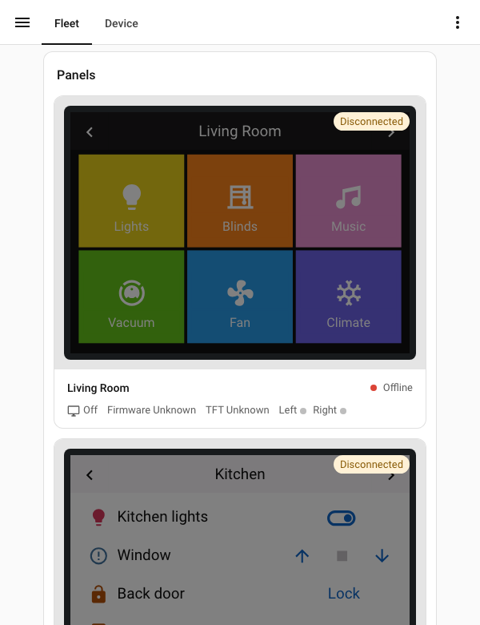
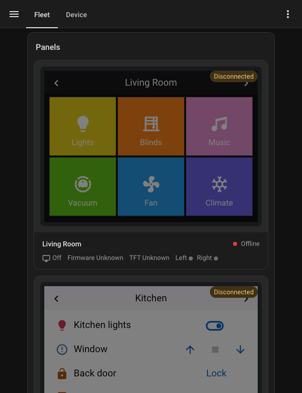
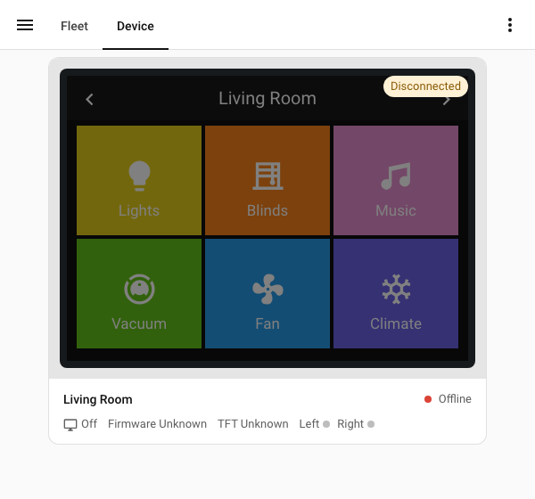
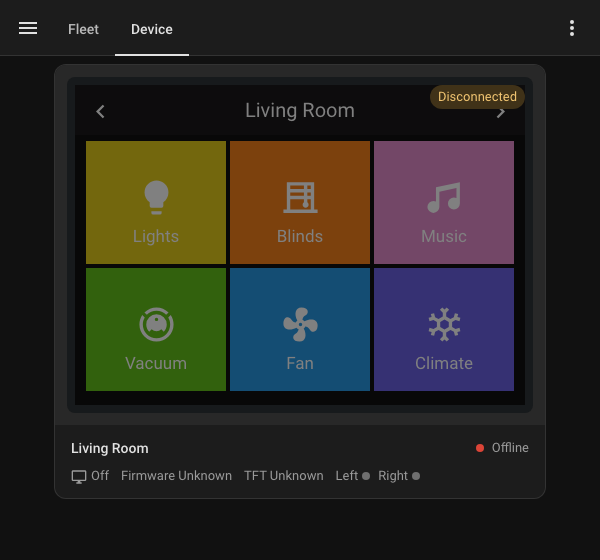

# Dashboard Card

The **NSPanel HAUI** card puts panels on a Home Assistant dashboard. It has two modes:

- **All panels of the hub** (a fleet): every device of the hub, arranged with the chosen display mode.
- **One panel**: one selected device, arranged with the same display modes.

Choose one of three display modes for either card type:

- **Big preview** — a large screen with its device status below.
- **Small preview** — a compact screen beside its status.
- **Status only** — the device status without a screen.

The card draws what the hub sends to the display, so a screen looks like the panel. With
**Live screen** on, it shows what the real panel shows; otherwise it shows the hub's render of the
device's home panel, which follows entity changes and the clock even while the panel is idle.

The card is for watching: the screen and the button lights are shown, and taps on them do nothing.
To change panels or try them out, use the [editor](editor/README.md) and its live preview.

## Add the card

1. Open a dashboard, select **Edit dashboard**, then **Add card**.
2. Search for **NSPanel HAUI** and pick it.
3. Choose **All panels of the hub** or **One panel** and select a device, then choose a display mode.

The card is installed with the integration; there is no extra resource to add. It is available to
every signed-in user.

## What it shows

A fleet card lists one panel card per device of the hub:

=== "Light"

    

=== "Dark"

    

| Show | The card shows |
|------|----------------|
| **All panels of the hub** | One panel card per device of the hub, all using the selected display mode. In **Big preview**, each screen fills its own row; **Small preview** arranges compact previews beside status; **Status only** shows a tidy status list. |
| **Big preview** | A device's screen with the panel's status beneath it: **Connected** or **Offline**, **On**, **Dimmed** or **Off**, queued notifications, firmware and TFT versions, and hardware button lights. |
| **Small preview** | A compact screen beside the same device status. On narrow cards, the status moves below the screen. |
| **Status only** | The panel's status without a screen, for a dashboard that shows the screen elsewhere. |

The screens show real entity states only, never the simulated states of the editor's preview.
The status area is read-only and shows the panel's real relays and button entities.
A value the panel has not reported yet reads **Unknown**.

A device switched off with **Device Enabled** in the editor keeps its card: the hub still renders
its panels, so the screen is there, and its state reads **Disabled** instead of a connection. Only
**Live screen** needs the panel itself, so a disabled device has no live screen; its card says so.

## Options

| Option | Default | Meaning |
|--------|---------|---------|
| `mode` | `fleet` | `fleet` (every device of the hub) or `device` (one selected device). |
| `device_id` | | The panel's Home Assistant device, for `mode: device`. Renaming the device in the editor keeps the card working. |
| `device` | | The device's name in NSPanel HAUI, for `mode: device`. Used when no `device_id` is set. |
| `display_mode` | `big` | `big` (large screen and status), `small` (compact screen beside status) or `status` (status only), for either card mode. |
| `live` | `false` | Show what the real panel shows instead of the hub's home panel, in either mode. |
| `title` | | An optional heading above the card. |
| `scale` | `100` | The big preview's size, in percent of the available width (20–100), for either mode. |

## YAML

Every panel of the hub:

```yaml
type: custom:nspanel-haui-card
mode: fleet
title: Panels
```

One panel, full-size preview (the default):

```yaml
type: custom:nspanel-haui-card
mode: device
device_id: 4f2a…
```

=== "Light"

    

=== "Dark"

    

One panel as a small preview, showing the real screen:

```yaml
type: custom:nspanel-haui-card
mode: device
device_id: 4f2a…
display_mode: small
live: true
```

Only the status, for a dashboard that shows the screen elsewhere:

```yaml
type: custom:nspanel-haui-card
mode: device
device_id: 4f2a…
display_mode: status
```

`device_id` is preferred when writing YAML by hand: it is the panel's Home Assistant device, which a
rename does not change.

## A smaller preview

The big preview normally fills its available width. On a wide dashboard, `scale` draws it smaller and
centers it. It works in either `fleet` or `device` mode:

```yaml
type: custom:nspanel-haui-card
mode: device
device_id: 4f2a…
scale: 50            # half the size the card would use
```

## Cards of the first release

A card saved before the modes were named `fleet` and `device` keeps what it showed: `overview` is
the fleet, `home` and `live` are one panel as `preview` (with `live` on for the latter), and `tile`
is one panel as `info`. Such a card's `devices` and `focus_mode` options are no longer used: the
fleet is every panel of the hub.

## Who can see it

Every signed-in Home Assistant user, admin or not, can see the card. It only reads: nobody can
change the panel, its settings or its entities through it. The NSPanel HAUI editor stays admin-only.

## When it shows a message

| Message | Why |
|---------|-----|
| Choose a device in the card settings | A `mode: device` card without a `device_id` or `device`. |
| The hub has no panel | The hub has no device. |
| Device not found: *name* | No NSPanel HAUI device has that name or id: it was removed, or Home Assistant is still starting. The card tries again every 30 seconds. |
| This device has no home panel | The hub has no panel to run for the device's screen. |
| The device is disabled in NSPanel HAUI | **Status only** on a device that does not run: it reports no state, and there is no screen to draw instead. |
| The device has no live screen | **Live screen** is on and the device does not run (it is disabled), so there is no panel to mirror. |
| The preview could not be started / shown | The hub could not run the panel this time; it tries again every 30 seconds. |

After a Home Assistant restart or integration reload, the card reconnects its sessions and keeps
the cards it drew until the new ones arrive.
