# The Editor

NSPanel HAUI is configured in an editor inside Home Assistant. There is no YAML. The editor is available to administrators in the Home Assistant sidebar and manages three things:

1. **[Device settings](device.md)** — language, display model, brightness, buttons, sounds and updates.
2. **[Panels](panels.md)** — the screens the panel shows, their navigation and their roles.
3. **[Items](items.md)** — the entities and controls on a panel, and how they look.

Themes, display files, backups and logs have their own tools in the editor; this page explains where they are.

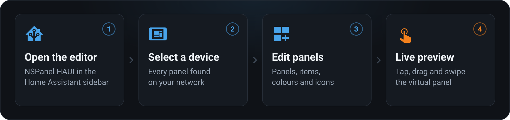

## Open the editor

1. Open **NSPanel HAUI** in the Home Assistant sidebar. Only administrators see it.
2. Select a device on the dashboard.
3. A device opens on its **Device** view; a device without panels opens on **Panels**. **Panels** switches to its panel list.

The highlighted action card holds the next actions: **Add panel**, and the **Settings** cog beside its title. Below the **Connection** and **Diagnostics** cards, the **Themes**, **Logs**, **Updates** and **Backups** buttons open their sidebars. In **Panels**, the cog sits in the list's action card.

If the editor stays on its loading screen, see [Troubleshooting](../troubleshooting.md#editor-loading-problems).

## Dashboard

The dashboard is the editor's start screen. It lists every NSPanel HAUI device as a card and as a row of the **Device inventory**. A selected device scopes **Latest events** and **Logs**; with none selected, both list every device.

=== "Light"

    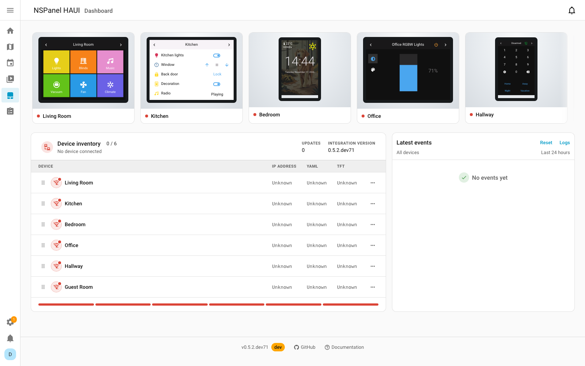

=== "Dark"

    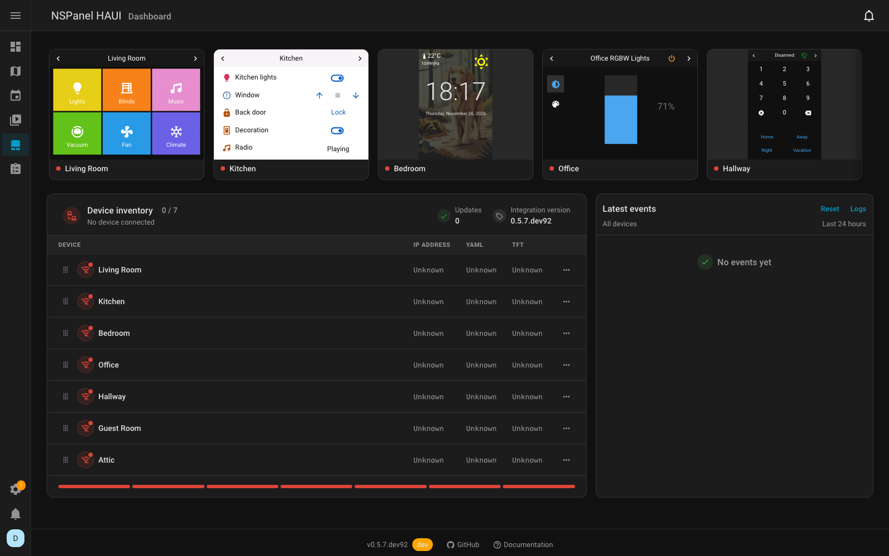

### Adding a device

The editor searches Home Assistant's ESPHome integration and lists new panels under **Discovered Devices**. Select **Add** or **Add All**. Reload the editor to search again, or use **Scan for devices** in the empty state. It only reads ESPHome devices; it does not scan the network.

### Device cards and inventory

A row shows the firmware version, the display (TFT) version, the IP address and an **Update** badge when an update is available. Its Wi-Fi icon is coloured like the signal bars; its dot shows whether the hub is connected. Values the panel has not reported show **Unknown**. A pending display update is listed in **Diagnostics**.

- **Select** — select a row outside its name and buttons, or the name strip under a card. Selecting a row scrolls the cards to it; select again to clear. The card's screen still opens the device.
- **Reorder** — drag a card or row by its grip.
- **More** — **View**, **Panels**, **Logs**, **Disable** / **Enable**, **Remove**.
- **Disable** — keeps the device and its settings but stops serving it. Its card still shows the last render. Updates need an enabled, connected device.
- **Remove** — after confirmation, deletes the device with its settings and panels.

**Install updates** starts a rollout for every device with an offered update; see [Updating](../update.md).

## Device view

The device view holds the panel's screen beside its cards: **Connection**, **Diagnostics** and **Backups**, with the **Themes**, **Logs**, **Updates** and **Backups** sidebars below them.

=== "Light"

    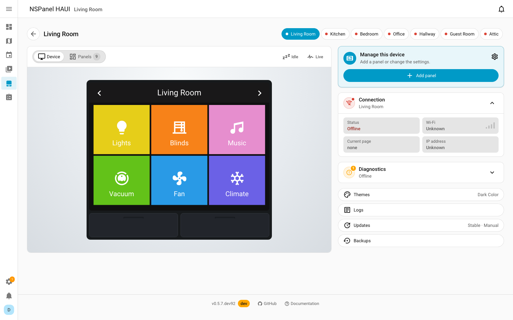

=== "Dark"

    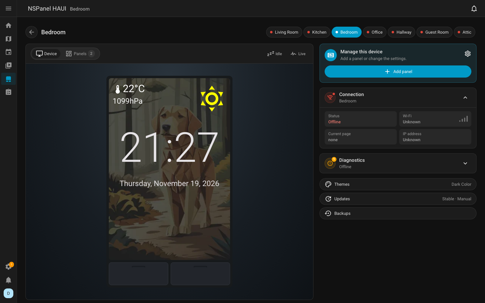

### Connection

Four tiles: uptime (or offline), Wi-Fi signal, current page and IP address. Hover over or tap a tile for details such as the network, the last disconnect or the last panel update. If the status could not be refreshed, the card says so and shows the last values it read. Firmware and display versions are in **Diagnostics** and in **Updates**.

### Diagnostics

The header icon is a green check, or an alert with the number of issues:

- the panel is offline
- the firmware does not match the integration
- a display update is pending or failed
- the Wi-Fi signal is weak
- the connection dropped three or more times in 24 hours
- the integration log has warnings or errors from the last 24 hours

Expand the card for:

- **Versions** and **Integration log** tiles. Hover over or tap the **Versions** tile for its details: the integration version, the firmware (**YAML**), the display (**TFT**) and the **Display link** — the speed of the panel's link to its display, 921600 bps with a current TFT and lower with an older one, **Unknown** while no display answers or the firmware does not report it. The log tile opens the logs.
- **Integration details** — display state, idle page, disconnects, late heartbeats and the entities of the current page. Select an entity to open it in Home Assistant.
- **Copy report** — a text report for a bug report, without network name, IP address or entity ids. It repeats the display link as a `Display link: … bps` line.
- Preview tools, see [The Live Preview](#the-live-preview).

### Backups

The **Backups** sidebar exports, imports and copies a device's settings and panels.

=== "Light"

    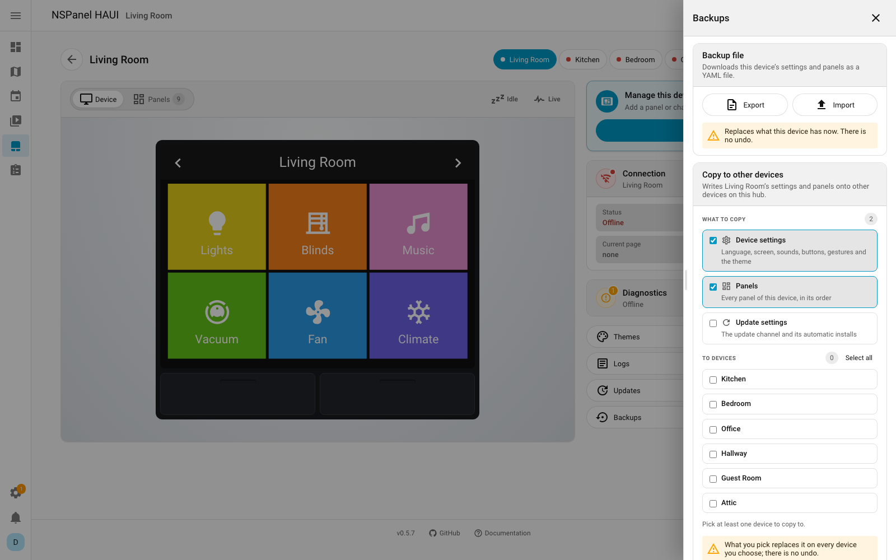

=== "Dark"

    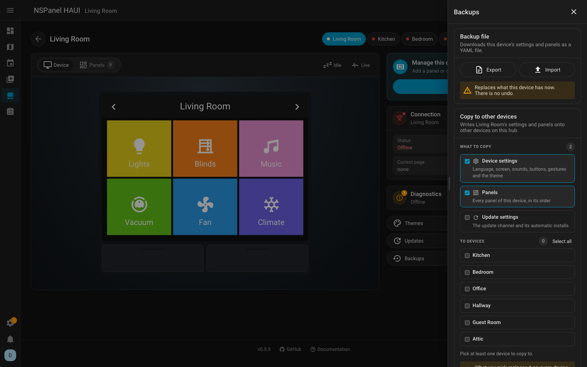

**Backup file** exports this device's settings and panels to `<device key>.yaml`, and imports such a file again. Import replaces the current setup; there is no undo, so export first.

**Copy to other devices** writes parts of this device onto other devices of the hub. Pick any of **Device settings**, **Panels** and **Update settings**, then the target devices. The picked parts replace what each target has; there is no undo. A device stays enabled or disabled as it was. **Copy** stays off until at least one part and one device are picked.

### Logs

The **Logs** sidebar shows the 50 most recent messages for a device, newest first and grouped by day. Open it from the **Integration log** tile, from the **Logs** button below the device's **Connection** and **Diagnostics** cards, or from **Logs** in the device's row menu. Filter by **All**, **Warnings** or **Errors**, or search; the copy button copies the lines shown.

On the dashboard, **Latest events** lists warnings and errors of the last 24 hours. **Logs** shows the full log and **Reset** restarts the window from now; **Last 24 hours** brings the default back. A reset is remembered in the browser, so reloading the editor keeps the shorter window. Both follow the selected device, or show all devices when none is selected.

The logs contain only NSPanel HAUI messages. They are not the full Home Assistant or ESPHome log, and they are not saved to disk.

### Notifications inbox

The editor header has a **Notifications** inbox. It lists the notifications waiting on all your panels and updates as they arrive. Dismissing one there removes it from the panel too. See [Actions → Notifications](../actions.md#notifications).

## Panels view

The **Panels** view is where you build the screens. It groups panels into **Navigation**, **Hidden** and **Popups**, shows a picture with the current entity states, and offers **Add panel**, **Set up this device**, edit, duplicate, move and delete. See [Panels](panels.md).

=== "Light"

    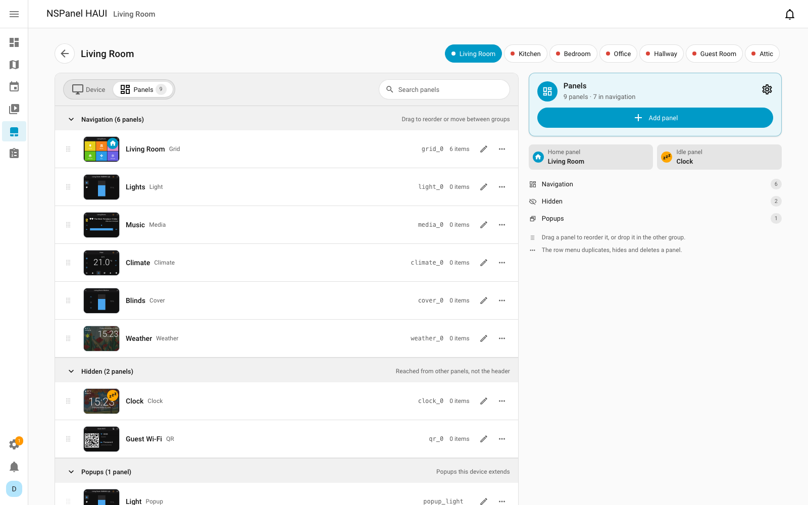

=== "Dark"

    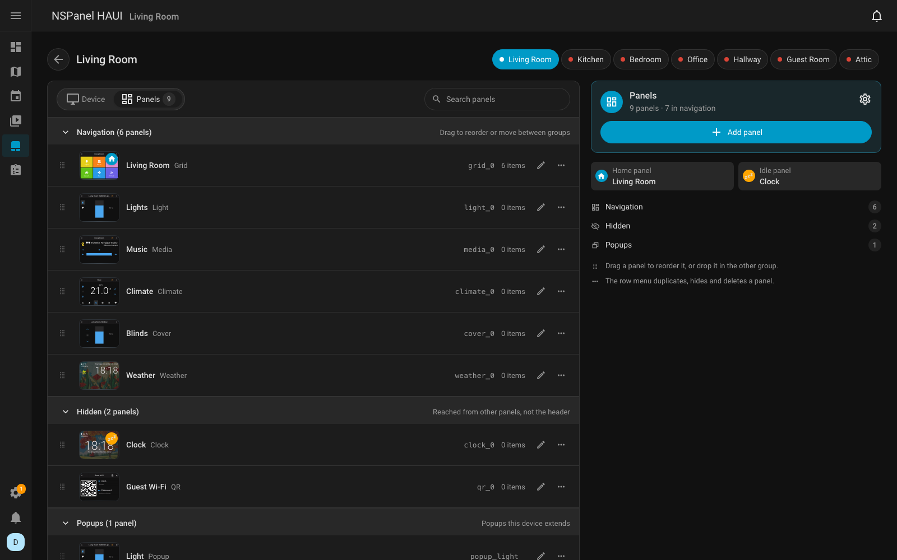

## Saving and storage

Settings and panels are kept in Home Assistant's storage.

- **Saving applies immediately**; no restart is needed. A cleared field falls back to its default or to the panel's own value. Enabling or disabling a device reloads its app.
- **New devices start enabled.** A disabled device stays disabled; a removed one stays removed until added again.
- **Deleting in Home Assistant is the same as Remove**: **Delete** on *Settings → Devices & services → NSPanel HAUI* removes the device with its settings and panels.
- **Upgrading from 0.3.x.** On first start, legacy settings keys are renamed automatically. Saved panels and other editor changes are not migrated; check them in the editor.

## The Live Preview

The preview is interactive: tap, drag sliders and swipe from the screen edges. It has two modes.

=== "Light"

    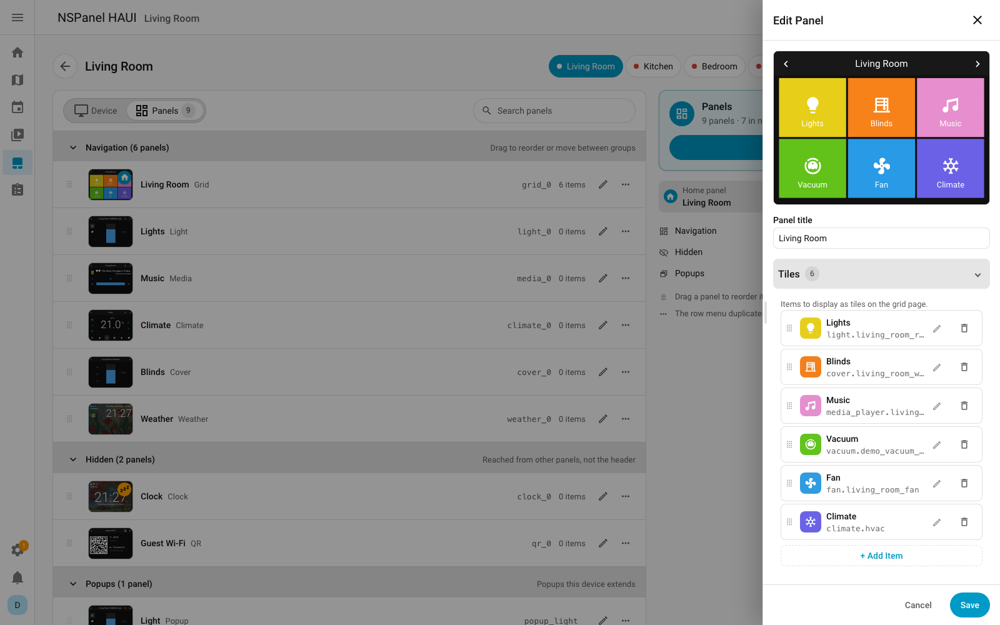

=== "Dark"

    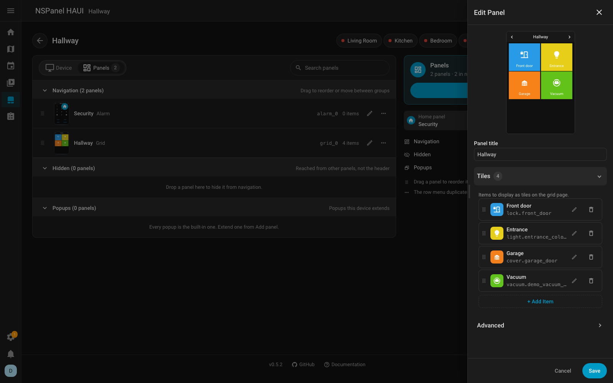

### Simulated

- **Nothing real changes.** Taps only change a simulated state; entities and automations are not touched.
- It opens on the home panel with the real entity states.
- Simulated states end with the preview: leaving it — another device, the **Panels** view, Fleet, or a closed browser tab — drops them, so the next preview starts from the real states again.
- It follows every save immediately.
- Notifications waiting on the real panel appear here; dismissing one here does not dismiss it on the panel.
- It never checks for or installs updates.
- A device has one simulated copy; several browser tabs show the same screen.

### Live

The **Live** button above the screen switches to the real panel and back. Live is highlighted and the workspace has a teal tint.

- The preview shows what the real panel shows.
- **Everything you do is real**, including taps and hardware button presses.
- Input is accepted only while the panel is connected.
- Live ends by itself as soon as you leave the preview it belongs to — another device, the **Panels** view, or any sidebar such as **Edit panel** — so a change never runs against the panel on screen. Coming back shows Simulated again.

### Controls

| Control | Where | What it does |
|---------|-------|--------------|
| **Live** | Above the screen | Switches between Simulated and Live |
| **Idle** (moon) | Above the screen | Opens the idle page; press again to leave it |
| **Left button**, **Right button** | Below the screen | The two hardware buttons. The light is blue for a relay, yellow for an entity. |
| **Show entities in the preview** | Diagnostics card | Hover over a tile or button to see its entity |
| **Current page** | Connection card, Simulated | Opens the page the real panel is on in the preview; an idle panel opens its idle page |
| **Reset sandbox** | Diagnostics card, Simulated | Drops simulated states now and reloads the real ones, without closing the preview; shown after the first simulated change |
| **Reset interaction** | Diagnostics card, Live | Restarts the panel's inactivity timer without restarting the panel |
| **Redraw display** | Diagnostics card, Live | Redraws the current page |

### Panel pictures

Pictures are drawn like the display, with the current entities, translations and templates, including unsaved changes. Popups are shown with an example such as a sample notification or an entity of their type.

The browser keeps the last picture of every panel and refreshes it as soon as the hub draws it. After an integration update the pictures start empty once.

The live preview and the Nextion simulator were created by [@jameshiscott](https://github.com/jameshiscott).
