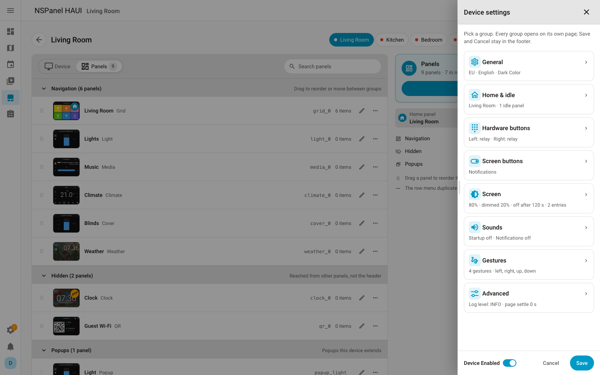
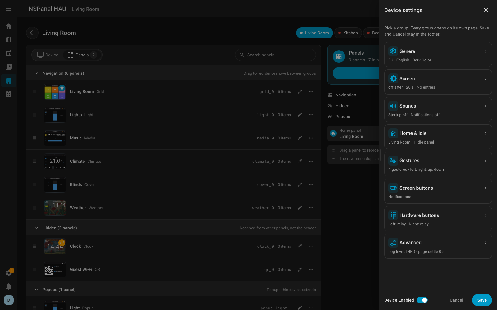
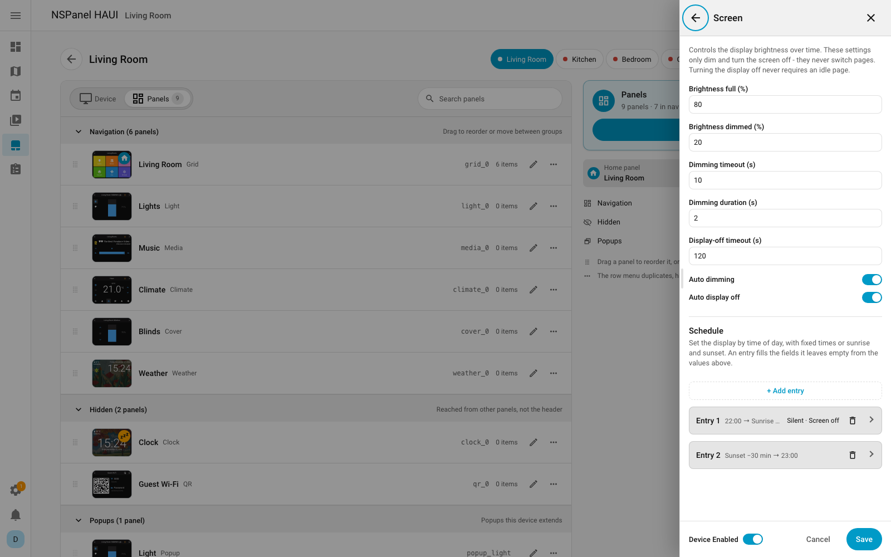
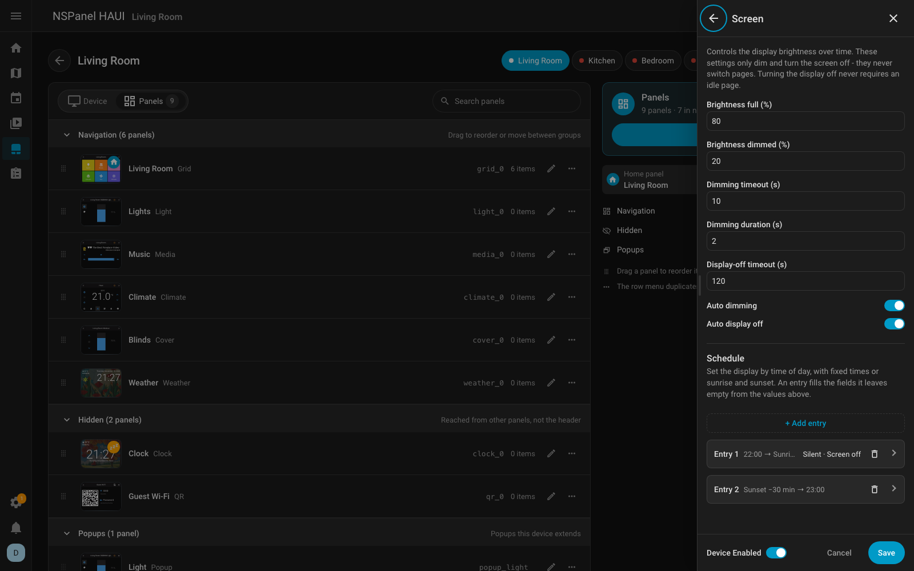

# Device Settings

Open the settings with the **Settings** cog in the **Device** or **Panels** action card. They open on a grid of groups:

**General**, **Home & idle**, **Hardware buttons**, **Screen buttons**, **Screen**, **Sounds**, **Gestures**, **Advanced**.

Select a tile to open its group; the back arrow returns to the grid. Every group is one draft: **Cancel** discards it and **Save** applies all of it. The footer also carries **Device Enabled**. The **Updates** sidebar is separate; open it with the **Updates** button below the side cards.

=== "Light"

    

=== "Dark"

    

## General

### Display model

**Display Model** tells the editor and the updater which panel you have:

- **European (standard)** — landscape, 480 × 320. The default.
- **US (portrait)** — portrait, 320 × 480.

The firmware is the same for both. Only the display file (TFT) differs, and every release includes both. A US panel mounted in landscape works like an EU panel and uses the default.

Saving a changed model asks whether to install the matching TFT when updates are enabled. If you answer no, install it later from the **Updates** sidebar. The display cannot report its layout, so the hub cannot detect a wrong one on its own. See [Display Models](display-models.md).

### Language and formats

**Language** sets the display language and how dates, times and numbers are formatted: `en_US`, `de_DE`, `nl_NL`, `pl_PL`, `fr_FR` or `sk_SK`.

**Time format** and **Date format** apply to every panel. Presets cover 24-hour, US 12-hour and 12-hour without AM/PM; **Custom strftime…** accepts any [strftime](https://strftime.org/) format. **Locale-aware date layout** is used while **Date format** is at its default: Full, Long, Medium, Short or a weekday form, with translated day and month names.

Date, time and datetime entities, `input_datetime` and `event` entities, and sensors with the `date` or `timestamp` device class use these formats. A narrow field, such as a row value, may cut a long date; choose **Short** or a numeric format for those. An item's own value template is shown as it renders.

For Slovak, set the device language to **Slovenčina** and the Home Assistant profile to Slovak. ClockTwo has its own clock language: English, German or Polish.

### Theme

**Theme** selects the colours this panel draws with. The **Themes** button below the side cards opens the Theme sidebar to edit the selected theme and the shared library. See [Themes](themes.md).

## Home & idle

These settings change the panel that is shown, never the brightness.

### Home panel

**Home panel** is the panel shown when navigating home. If it is empty, the first navigation panel is used. A missing key falls back the same way.

### Idle panels

**Idle panels** is an ordered list. After **Page timeout** seconds without interaction, the panel shows the next one; each automatic switch advances through the list and cycles.

- **Auto page** turns automatic page switching on or off.
- **Page timeout** is the number of seconds before the next idle panel opens; `0` disables it, maximum 3600.
- An empty list means nothing opens automatically.
- The idle page only changes the panel. The display can be on, dimmed or off while it is shown.
- A reconnect to Home Assistant, for example after a restart, does not count as an interaction. The panel shows the previous page again, and the timeout starts over.

### Return after the idle page

**Snapshot max age** controls which panel returns when you leave the idle page:

- **Always restore** — the panel you were on before the idle page. This is the default.
- **Never restore** — the home panel.
- **Custom time limit…** — the previous panel if it is younger than the limit, otherwise the home panel.

**Return to the home panel after (seconds)** goes back to the home panel after that many seconds without interaction on another panel. Set it shorter than the dimming and display-off timeouts. `0` turns it off.

## Hardware buttons

Each of the two hardware buttons either switches its built-in relay or toggles a Home Assistant entity:

- **Left Button - Use Relay** / **Right Button - Use Relay** on (the default) means the button switches its built-in relay.
- Off means the button toggles the entity set in **Left Button Entity** or **Right Button Entity**. The entity is toggled when you release the button, so holding it does not toggle again.

The relays keep their state across a restart, a firmware update and a power loss, so connected loads do not switch off during an update.

**Interact on button press** is on by default. A button press then also wakes the display and leaves the idle page. With it off, the button only switches its relay or entity.

## Screen buttons

These settings add or hide buttons in the panel header:

- **Show home button** — a home button on panels. It never appears on the home panel itself.
- **Show idle button** — a button that opens the idle page. On the home panel it takes the home button's place.
- **Show notifications button** — a notifications button where the header has room.

If the right side of the header is full, the notifications button takes the idle button's place. See [Panels → Header buttons](panels.md#header-buttons).

## Screen

These settings only change brightness; they never change the shown panel. Turning the display off never requires an idle page.

| State | When |
|-------|------|
| **On** | Full brightness. Every touch brings the display back to this state. |
| **Dimmed** | After **Dimming timeout** seconds without interaction, when **Auto dimming** is on. |
| **Off** | After **Display-off timeout** seconds without interaction, when **Auto display off** is on. |

- **Brightness full** is the full brightness, 0–100 %. Empty keeps the panel's own value. A schedule requires a value here.
- **Brightness dimmed** is the brightness the display dims to, 0–100 %. Empty keeps the panel's own value. A schedule entry that dims requires a value here.
- **Dimming timeout** is the seconds until the display dims; `0` disables it, maximum 3600.
- **Dimming duration** is the fade between full and dimmed brightness, 0–5 seconds.
- **Display-off timeout** is the seconds until the display turns off; `0` disables it, maximum 3600.
- **Auto dimming** and **Auto display off** turn the two timeouts on or off.

**Use Auto-Dimming** and **Use Auto Display-Off** also exist on the panel. The integration writes them only when you change the setting, so automations can control them. The exception is **Use Auto Display-Off** while a schedule has entries.

With a **Brightness full** or **Brightness dimmed** value, the integration sets **Brightness Full** / **Brightness Dimmed** on every connect and at every schedule boundary. While a field is empty, the editor shows the panel's current reading.

While the panel has no connection to Home Assistant, the display still dims after the dimming timeout, even with auto-dimming off. It never turns off while disconnected.

### Waking the panel

A touch or a button press wakes the panel. What happens depends on the state:

| State | Touch | Hardware button |
|-------|-------|-----------------|
| Display off, idle page shown | First touch wakes the display, second touch leaves the idle page | Wakes the display and leaves the idle page |
| Display on or dimmed, idle page shown | Leaves the idle page | Leaves the idle page |
| No idle page shown | Wakes the display | Wakes the display |

A hardware button only wakes the panel when **Interact on button press** is on.

## Schedule

A schedule changes sound, brightness, dimming and display-off at set times. It is a list at the end of **Screen**; each entry folds to a summary row and is part of the settings draft. The **Screen** tile shows how many entries there are.

=== "Light"

    

=== "Dark"

    

Each entry has:

| Field | What it does |
|-------|--------------|
| **From** / **To** | `HH:MM`, `sunrise` or `sunset`. The window may cross midnight; the end is exclusive. |
| **From offset** / **To offset** | Minutes added to a sun boundary, -720 to 720. Ignored for a clock time. |
| **Notification sound** | Off: no sounds, and a notification does not wake the display. |
| **Brightness** | Full brightness during the entry, 0–100 %. |
| **Brightness dimmed** | Dimmed brightness during the entry, 0–100 %. |
| **Dimming timeout** | Dimming timeout, 0–3600 seconds. |
| **Dimming duration** | Fade duration, 0–5 seconds. |
| **Screen off** | Whether the display turns off during the entry. |
| **Display-off timeout** | Display-off timeout, 0–3600 seconds. |

**Brightness**, **Brightness dimmed**, **Dimming timeout**, **Dimming duration** and **Display-off timeout** are optional; an empty value falls back to the matching **Screen** setting. **Notification sound** and **Screen off** are always explicit.

- Outside every entry, **Screen** and **Sounds** apply.
- A schedule needs **Brightness full** to restore after an entry. When you add the first entry with it empty, the editor fills in the panel's **Brightness Full** reading (100 if none), says so, and saves it.
- A **Brightness dimmed** entry needs a **Brightness dimmed** setting; the editor fills in the panel's reading (20 if none) the same way.
- When entries overlap, the first one in the list wins.
- Automatic page switching is not part of the schedule.
- `sunrise` and `sunset` use Home Assistant's location. Where the sun does not rise or set, an entry using it is inactive that day.
- While entries exist, the integration owns **Use Auto Display-Off**. Removing every entry hands it back to **Auto display off** and then to automations.
- A schedule boundary does not count as a touch.

## Sounds

The panel can play a sound on two occasions. Both are off by default:

- **Sound on startup** — when the panel starts shortly after boot. A later reconnect is silent.
- **Sound on notification** — when a notification arrives. Also used for the Timer alert; a schedule entry can override it.

**Persistent sound interval** is the number of seconds between repeats while a persistent notification waits; the default is 5.

### Silent times

A schedule entry with **Notification sound** off makes the panel silent during its time window:

- No sounds are played. The repeating sound of a persistent notification pauses and continues when the entry ends.
- Notifications are still collected and shown, but they do not wake the display.
- The time window can cross midnight, for example 22:00–07:00, and can start or end at sunrise or sunset.

## Gestures

**Gestures** maps one or more swipes to an action. Each gesture folds to one row and is part of the settings draft.

| Field | What it does |
|-------|--------------|
| **Swipes, in order** | One or more of **Swipe left**, **Swipe right**, **Swipe up**, **Swipe down**, in order. Drag to reorder. |
| **Action** | **Next panel**, **Previous panel**, or a panel key such as `sys_about`. Empty does nothing. |
| **Within (s)** | Seconds from the first to the last swipe, 1–60. Only multi-swipe gestures use it. |

Swipe from a screen edge to navigate. Unless you change it, a swipe does this:

| Swipe | Opens |
|-------|-------|
| Left / right | The next / previous panel |
| Up | About |
| Down | Settings |

How a swipe picks its gesture:

- It runs one action at most: the completed gesture with the most swipes wins, then the first in the list. The swipes it used are consumed.
- With a left/right gesture that opens a lights panel, the first swipe still steps next; the second opens the lights panel instead.
- A wrong swipe, or a last swipe after the timeframe, breaks a multi-swipe gesture; it restarts on the next matching first swipe.
- A swipe no gesture uses does nothing. A gesture without swipes or action does nothing.

Older swipe settings are converted into gestures when the device settings load and when a YAML backup is imported.

## Advanced

- **Log Level** — how much this device writes to the Home Assistant log: Critical, Error, Warning, Info or Debug. Debug adds state changes and display commands.
- **Stale data threshold (seconds)** — marks old **Row** values: a value whose entity has not updated for this many seconds is dimmed and ends in `…`. Set it just above the slowest sensor's update interval. `0` turns it off.
- **Page settle delay (seconds)** — how long the hub waits after the display confirms a page change before drawing. The default of `0.05` s is enough because the confirmation already means the new page is active; `0` renders immediately. Raise it only if the log shows invalid-variable errors right after page changes.

To see Debug messages, allow them in Home Assistant's [logger configuration](https://www.home-assistant.io/integrations/logger/):

```yaml
logger:
  logs:
    custom_components.nspanel_haui: debug
```

## Updates

The **Update settings** card in the **Updates** sidebar controls checks and installs for this device. Changes save automatically; text fields save after a pause. Its title carries **Enable updates**; the main fields are **Update channel**, **Check for a new version** and **Install firmware updates automatically**, and the rest are under **Advanced**.

See [Updating](../update.md#update-settings) for every setting and for the update flow.
