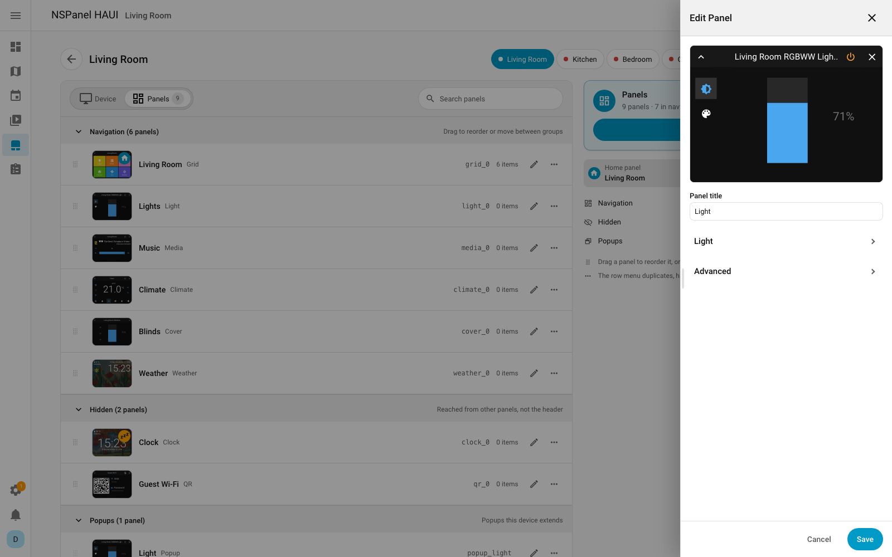
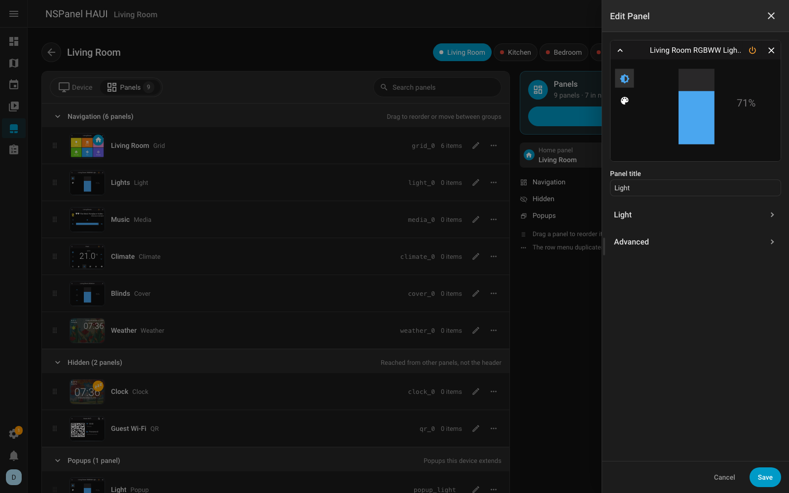

# Items

An **item** is one thing a panel shows or acts on: a tile on a grid, a row on a row panel, the light of a light panel. You edit items in the panel editor: select an item in the list to open its editor, or drag it to reorder.

Every item has its own editor. **Entity picker** searches for an entity or chooses an internal item type. **Name**, **Icon** and **Color** each take one value, one value per state, or a template. The rest sits under **Advanced**: the value, the state, the popup and the panel type's item options, such as the grid's tile colours. An invalid field is marked and **Save** stays disabled.

There are two kinds:

- **Entity items** show a Home Assistant entity, e.g. `light.kitchen`.
- **Internal items** have no entity: show text, open a panel or call a service. See [Internal items](#internal-items).

## Fields

Pick the entity in the entity picker. **Name**, **Icon** and **Color** follow it; the remaining fields are in **Advanced**. Empty fields use the entity's own values.

| Field | What it changes | Default |
|-------|-----------------|---------|
| **Entity** | The entity, or the type of an internal item | |
| **Name** | The name shown | The entity's name |
| **Value** | The value shown | The entity's state |
| **Icon** | The icon | The entity's icon |
| **Color** | The icon colour | A colour for the entity type and state |
| **State** | Which attribute counts as the state | The entity's state |
| **Popup** (`popup_key`) | The panel opened on tap | The popup for the entity type, if it has one |

## Values that depend on the state

`name`, `value`, `icon` and `color` accept:

- **A fixed value**, e.g. `Kitchen` or `mdi:lightbulb`.
- **One value per state**, e.g. *Lights On* for `on` and *Lights Off* for `off`.
- **A template** in Home Assistant syntax:

    ```jinja
    {{ states('sensor.temperature') }} °C
    ```

    The editor previews the result. `mdi:` icon names inside a template are shown as icons.

For an entity item, each of these fields has a **One value** / **Per state** switch. **Per state** turns the field into a list of rows:

- **State** — the state the row is for. Suggestions include the current state, the usual states of that entity kind (`on`/`off`, `home`/`not_home`, select options) and `unavailable`.
- **Value** — the value for that state, in the field's own control.
- **+ Add state** adds a row; the bin icon removes one.

A state without a row, or a row without a value, uses the default. The first row of a state counts; a duplicate state row is marked and ignored. Switching back to **One value** keeps the value of the entity's current state.

When the [state](#state) is an attribute, the rows match that attribute's text value.

The rows are stored as a JSON object, e.g. `{"on": "Lights On", "off": "Lights Off"}`. Typing such an object opens it as rows.

## Field details

- **Name** — plain text, one name per state, or a template.
- **Value** — a number (`42`, `3.14`), text, one value per state, or a template. A person can show *At home* for `home` and *Away* for `not_home`.
- **Icon** — pick one in the icon picker, or one per state, e.g. `mdi:lightbulb` for `on` and `mdi:lightbulb-outline` for `off`. The [Icons Cheatsheet](../icons.md) lists all icons.

### Color

Click the swatch to open the colour picker, choose a preset or recent colour, or type one:

| Format | Example |
|--------|---------|
| Hex | `#ff6600` |
| RGB | `[255, 102, 0]` |
| RGB565 number | `63488` |
| Template | `{{ ... }}` |

A typed RGB list or number is stored when you leave the field and then shown as its hex colour.

### State

By default the entity's state is used. To use an attribute instead, enter:

- the attribute's name, e.g. `brightness`
- a JSON path for a nested value: `["forecast", 0, "condition"]`

## Internal items

An internal item has no entity. Choose its type in the item's type selector, then enter its value.

| Type | What it does | Value |
|------|--------------|-------|
| `skip` | Leaves the place empty | |
| `text` | Shows text | The text |
| `navigate` | Opens another panel | The panel key |
| `action` | Calls a Home Assistant service | The service, e.g. `light.toggle` |

An `action` can pass data as a JSON object in **Service data**:

```json
{"brightness": 255, "transition": 2}
```

The keys are available as variables when the service is a script.

## Override a default popup

Tapping an item opens the popup for its entity type:

| Entity type | Popup |
|-------------|-------|
| `light` | `popup_light` |
| `media_player` | `popup_media_player` |
| `vacuum` | `popup_vacuum` |
| `cover` | `popup_cover` |
| `climate` | `popup_climate` |
| `alarm_control_panel` | `popup_alarm` |

Other types run their normal action, such as toggle or press.

To open something else, enter a panel key in `popup_key`:

- **Another popup**, e.g. `popup_timer`; works for every item, including types without their own popup.
- **Your own panel**, e.g. a cover panel outside navigation. It opens for the item's entity, on top of the current panel. See [Stacked Panels and Popups](panels.md#stacked-panels-and-popups).

To change the popup for *all* items of a type, change the popup itself: see [System Panel Overrides](panels.md#system-panel-overrides).

Extending a popup opens it in the panel editor, with the hub's render beside it:

=== "Light"

    

=== "Dark"

    
