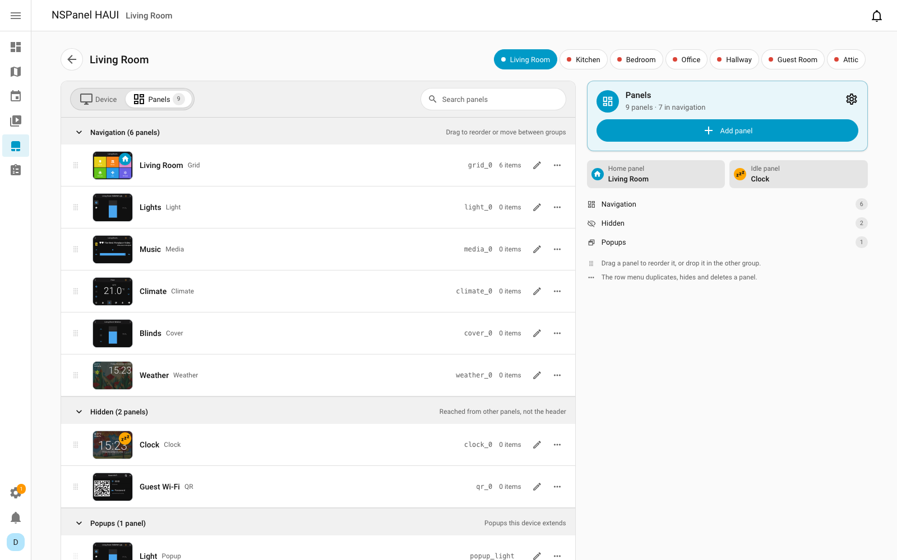
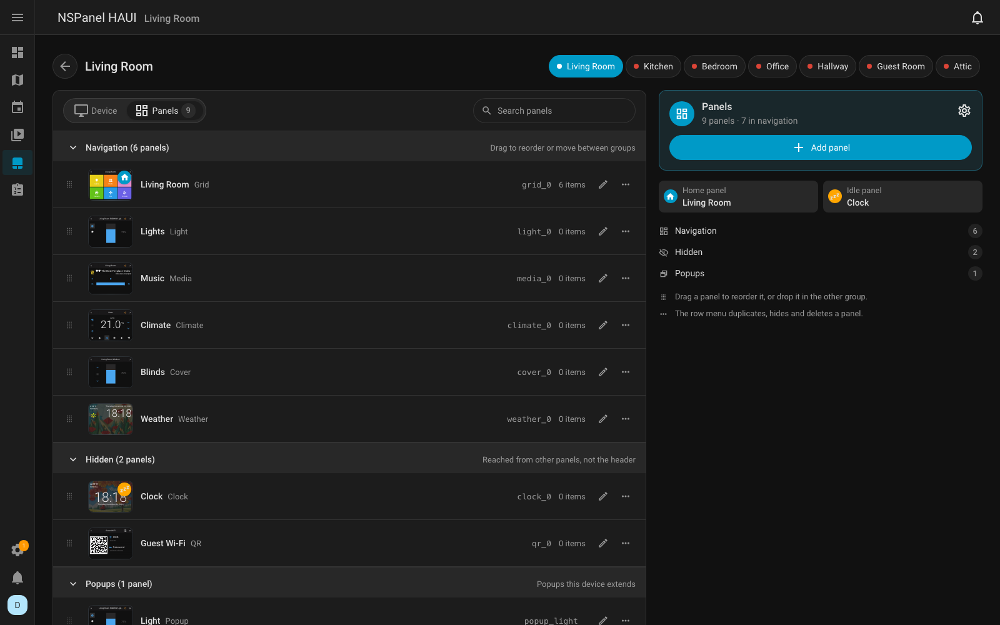
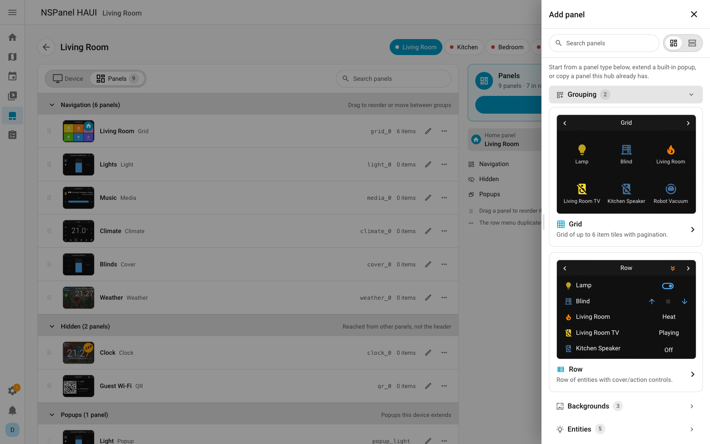
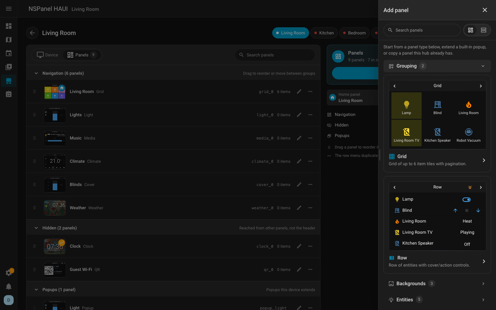
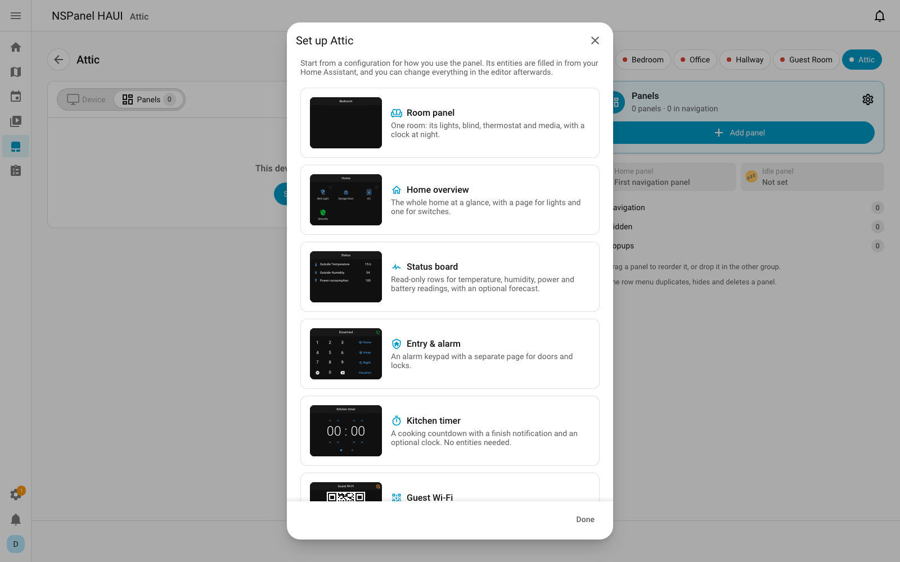
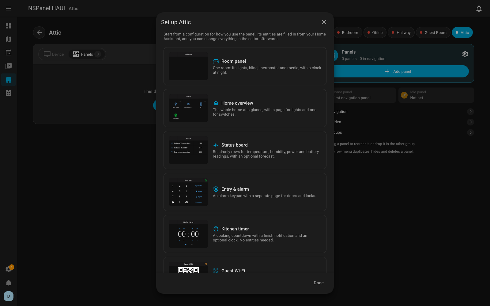
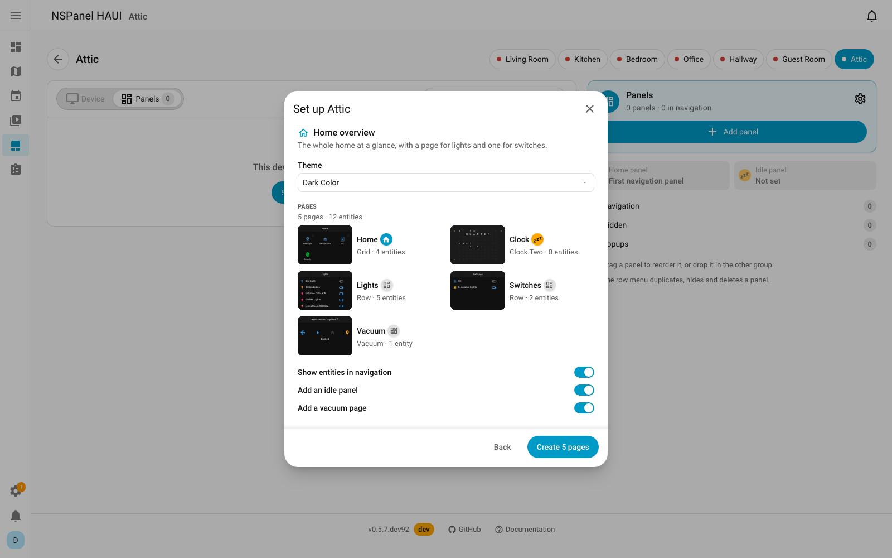
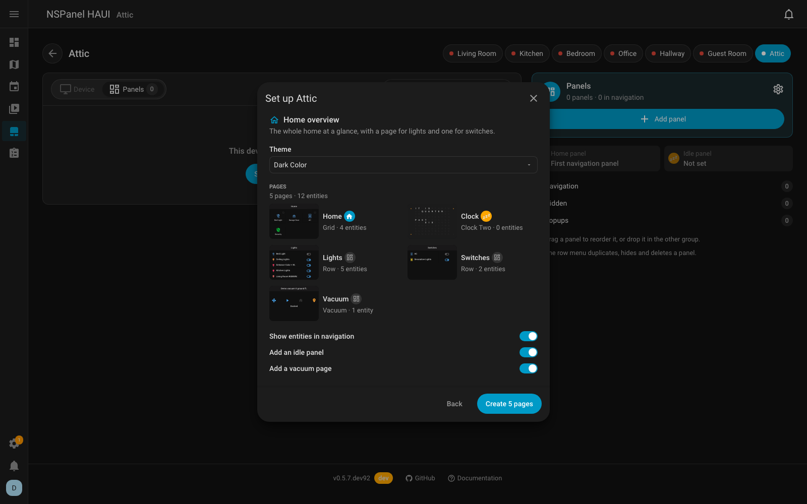
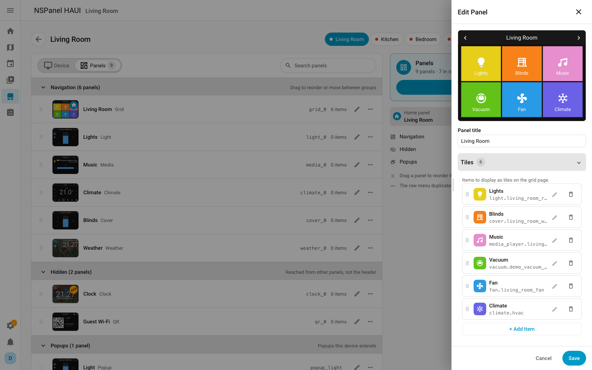
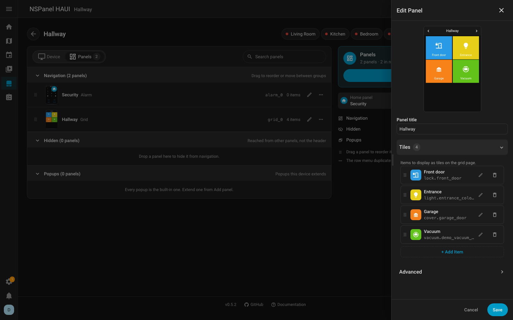

# Panels

A panel is one screen on the display. Add and edit panels in the **Panels** view: **Add panel** for a new one, or select a panel to edit it. The type's own options are described in the [Panel types overview](../panels/README.md).

## Panel list

The **Panels** view groups the panels in three lists:

| Group | Contains |
|-------|----------|
| **Navigation** | Panels reached by swiping or with the header buttons |
| **Hidden** | Panels opened from another panel |
| **Popups** | Built-in popups changed on this device |

Each row shows a picture of the panel with the current entity states. Markers show the home panel and the idle panels. Search by title, key or type; select a row to see its details, role buttons and **Edit**, **Duplicate** and **Delete** actions. Close the card or select the row again to clear it.

=== "Light"

    

=== "Dark"

    

You can:

- **Set up this device** — a device without panels offers a preset: **Room panel**, **Home overview**, **Status board**, **Entry & alarm**, **Kitchen timer** or **Guest Wi-Fi**. Each asks only for its details; the wizard creates the panels, assigns home and idle roles and applies its **Theme**. See the [Quick Start Guide](../get-started.md#3-add-your-first-panel).
- **Add panel** — opens the catalog with **Backgrounds**, **Entities**, **Grouping** and **Tools**, each type with a preview. Below them, **Extend a popup** edits a built-in popup and **Copy an existing panel** starts from a panel of any device, under a free key. Search opens the groups it matches.
- **Edit** — select the panel's name or the pencil.
- **Preview** — hover over or tap the picture to enlarge it.
- **Duplicate**, **Move to…**, **Delete** — in the row's **More** menu. A moved panel goes to the end of the target's list. It keeps its key unless that key is taken; a message then names the new key. The source's home and idle assignments drop the panel; gestures and items that name its key keep it. Extended popups stay with the source device.
- **Reorder** — drag a row by its grip, also between Navigation and Hidden.

A panel whose saved options no longer fit its type shows **Check settings**; open it to fix them.

The fixed panels **System**, **Blank**, **Settings** and **About** cannot be changed and are not listed.

The catalog behind **Add panel** groups the panel types, each with a preview:

=== "Light"

    

=== "Dark"

    

A device without panels offers the quick start instead, with one card per configuration:

=== "Light"

    

=== "Dark"

    

Its second step lists the pages the configuration creates, each with its render and its role:

=== "Light"

    

=== "Dark"

    

## The panel editor

Selecting a panel opens its editor in a sidebar.

=== "Light"

    

=== "Dark"

    

### Standard fields

| Field | What it does |
|-------|--------------|
| **Type** | The panel type, e.g. `clock`, `grid` or `light`. Set when the panel is added and cannot be changed; delete and re-add it instead. |
| **Title** | Header text. A title too long for the header is cut and ends in `..`. |
| **Key** | Unique name of the panel on this device, used by items, gestures and actions. |
| **Show in navigation** | On (default): reached by swiping and header buttons. Off: opened stacked on another panel, see [Stacked panels and popups](#stacked-panels-and-popups). |
| **Panel pin** | A numeric PIN the panel asks for before it opens. |
| **Close automatically after (seconds)** | Closes the panel and goes back after this many seconds. `0` (default) keeps it open. |
| **Long press to go back** | Clock, ClockTwo and Weather only: hold anywhere for about a second to go back to the previous panel or home. Default: off. |
| **Color theme** | Colours for this panel only; empty follows the device theme. |

A panel that controls a single entity, such as a light or cover panel, shows the entity's name instead of its title. An empty title shows the panel type's name, e.g. *Grid*.

Of the standard fields, only **Type** and **Title** sit above the **Advanced** section; **Long press to go back** only appears for pages without a header. Between them, the **Configuration** section holds the options of the panel type; see the [Panel types overview](../panels/README.md).

### Editing aids

- **Preview** — the picture follows every unsaved change.
- **Items** — the item list is open and shows its count. Select an item to edit it, or drag it to reorder.
- **Errors** — an invalid field is marked and **Save** stays disabled: a duplicate key, a wrong entity type, a missing entity, a value out of range, too many items, an invalid choice or an unreadable colour.
- **Warnings** — an entity Home Assistant does not know right now can still be saved.
- **Width** — drag the left edge of a sidebar; double-click it to restore the default.

## Opening a panel

Navigation panels are reached by swiping or with the header buttons. Any panel can also be opened by its key:

- from a `navigate` item, see [Internal items](items.md#internal-items)
- from an item's `popup_key`, see [Override a default popup](items.md#override-a-default-popup)
- with a gesture, see [Gestures](device.md#gestures)
- with the [`nspanel_haui.open_panel`](../actions.md#nspanel_hauiopen_panel) action

## Stacked panels and popups

A panel with **Show in navigation** off opens *on top of* the current panel; closing it returns to where you came from. Any panel type can be used this way, which suits detail views and sub-pages.

The built-in popups open the same way:

- entity popups: `popup_light`, `popup_media_player`, `popup_vacuum`, `popup_climate`, `popup_cover`, `popup_timer`, `popup_alarm`
- `popup_notify`, `popup_select`, `popup_unlock`
- Settings and About

### Header buttons

The header buttons are set automatically:

| Panel | Left | Second left | Right |
|-------|------|-------------|-------|
| Navigation panel | Previous panel | Home | Next panel |
| Stacked panel or popup | Up | Home | Close |

- **Up** and **Close** return to the panel you came from.
- **Home** appears only when **Show home button** is on, and never on the home panel itself. With **Show idle button** on, the home panel shows the idle button in its place.
- The second button on the right shows the next-page button on a grid or row with several pages, the unlock button on a locked panel, or otherwise the notifications button while **Show notifications button** is on.

### Locked panels

A panel with a **Panel pin** opens the unlock popup first. The popup carries the header of the panel it protects, so you can move on without unlocking:

- in front of a navigation panel: previous, home and next
- in front of a stacked panel: up, home and close

Closing the unlock popup never opens the locked panel. In front of a locked navigation panel, closing goes to the home panel.

## System panel overrides

You can change the built-in **popups**, not the other built-in panels.

**To change one:** choose **Add panel → Extend a popup** and select the popup. Saving stores your version for this device and lists it under **Popups**. **Reset to default** in its row menu removes your version.

| Popup | What you can edit |
|-------|-------------------|
| Entity popups (`popup_light`, `popup_climate`, `popup_media_player`, `popup_cover`, `popup_vacuum`, `popup_timer`, `popup_alarm`) | Everything the panel type offers. The entity still comes from the item that opens the popup. |
| **Notify**, **Select**, **Unlock** | Title and **Color theme**. A PIN or auto-close would get in the way, so they are not offered. |

A changed popup keeps the built-in value for everything you leave unset. Its key and **Show in navigation** cannot be changed; it stays a popup. **System**, **Blank**, **Settings** and **About** cannot be changed and are not listed.

## Home and idle panels

Home and idle are device settings, not panel settings. Set them in **Device Settings → Home & idle**, or with the **Home panel** and **Idle panel** role buttons in the **Panels** detail card. A popup has no roles.

- **Home panel** — the panel shown when navigating home. If unset, the first navigation panel is used.
- **Idle panels** — an ordered list shown after the automatic page-switch timeout. Each switch shows the next panel; an empty list means nothing opens automatically. The editor shows them as one ordered list.

Both roles resolve against the panels the device has. A missing panel counts as unset: the idle list drops it and home falls back to the first navigation panel. Deleting or moving a panel also removes its key from the device's **Home & idle** settings. A stale key from a restored backup is shown as `Unknown key "…"` and can be removed in **Home & idle**. A device without panels has neither role to offer: **Home & idle** says so under both fields instead of showing empty pickers.

In the panel list, the home panel carries a home marker. The first idle panel carries a solid idle marker and the rest dimmed markers numbered in cycle order.
