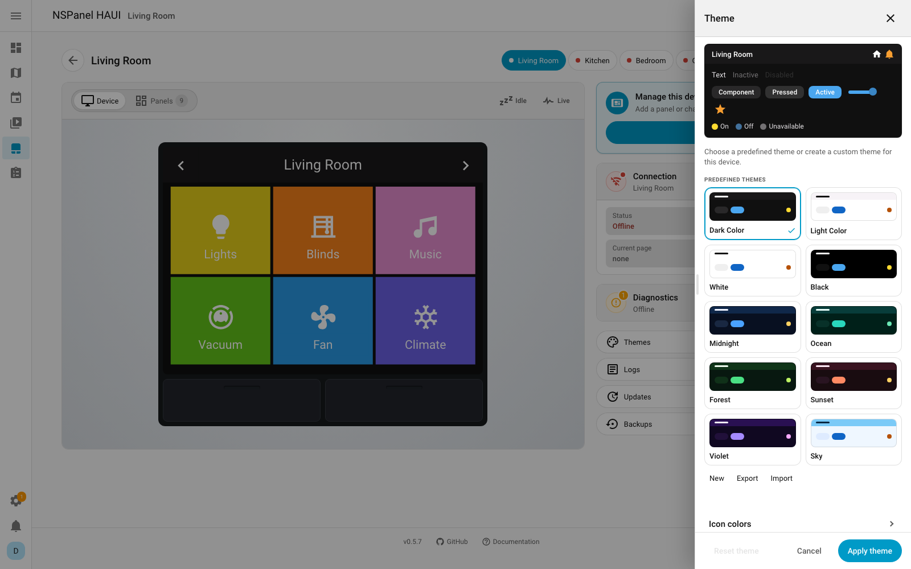
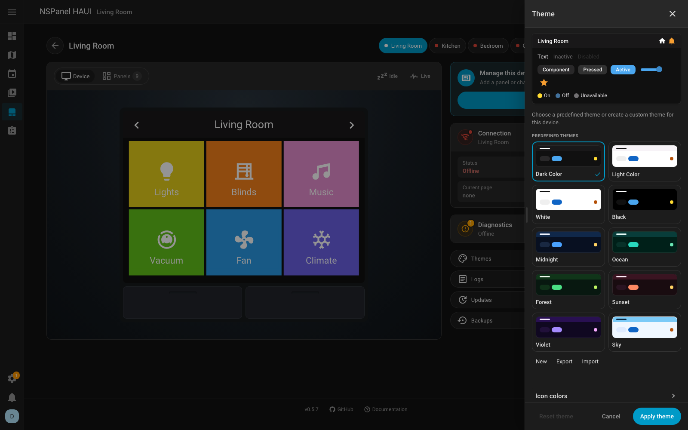

# Themes

A theme defines a panel's semantic colours and the weather, alarm and climate icon palettes.

Predefined themes: **Dark**, **Light**, **White**, **Black**, **Midnight**, **Ocean**, **Forest**, **Sunset**, **Violet** and **Sky**. **Light**, **White** and **Sky** draw a light page, the others a dark one; **Sky** is the tinted light theme with a light blue page and a sky blue header.

## Choose and edit

The **Theme** field in **Device Settings → General** selects the device theme. The **Themes** button below the **Connection** and **Diagnostics** cards opens the Theme sidebar, where the selected theme and the shared library are edited. Its preview stays in view while you scroll. **Apply** saves the selection and colour changes; **Cancel** discards them.

=== "Light"

    

=== "Dark"

    

## Predefined and custom themes

The theme picker shows every theme as a tile with a miniature panel in its colours, under **Predefined themes** and **Custom themes**. **New**, **Export** and **Import** sit below; **Duplicate**, **Rename** and **Delete** appear for a custom theme. Editing a built-in theme creates a custom copy; **New** copies the current selection explicitly. **Export** downloads the selected theme, including its current edited colours and icon palettes; **Import** adds themes from a JSON file.

Custom themes are shared by all devices under the same hub entry. Each device selects its own.

## Per-panel theme

A panel can choose its own **Color theme** in the editor's **Advanced** section; empty follows the device theme. It applies to the panel, its items and icons, including an editable popup when opened over another panel. Item and panel colour fields are explicit overrides and take precedence.

## Icon colours

A theme carries weather, alarm and climate icon colours for both a dark and a light background. The theme's own page brightness selects the palette, so colours and page always match; there is no separate setting. The Theme sidebar's **Icon colors** section shows the palette the theme uses.

Clock, ClockTwo and Weather are the exception: their background is a firmware picture, so they use the built-in colours matching that picture — the dark theme's on dark pictures, the light theme's on **Light Color** — regardless of the selected theme. See [Background pages](#background-pages).

## Background pages

Clock, ClockTwo and Weather have a **Background** picture. Each picture belongs to a dark or a light palette so text and icons stay readable. **Dark Color** is the default.

| Background | Name | Palette |
|------------|------|---------|
| Dark Color | `dark` | Dark |
| Light Color | `light` | Light |
| Modern, Spring, Summer, Autumn, Winter | `modern`, `spring`, `summer`, `autumn`, `winter` | Dark |
| Dog 1, Dog 2, Cat | `dog_1`, `dog_2`, `cat` | Dark |

**Dark Color** and **Light Color** are the display's plain fills: `#1b1b1b` and `#f5f5f0`.

The picture is part of the display firmware, not a theme colour. These panels therefore use the built-in colours for that picture — the dark theme's colours on dark pictures, the light theme's on **Light Color** — whatever theme the device uses. Other panels follow the theme normally.

Anything that is not one of these names falls back to the plain fill matching the device theme, so an old picture is never left on screen.

For a changing background, choose **Template…** and enter a template that renders one of the names. It is evaluated when the panel opens:

```jinja
{{ 'dark' if is_state('sun.sun', 'below_horizon') else 'light' }}
```

See [Display color behavior](../../develop/design.md#themes-and-colors).

## Colour editing

**Theme colors** edits the selected theme's semantic colours. **Reset theme** restores its complete saved palette, including icon colours; **Revert to theme color** on a row restores only that value. Applying a theme leaves item and panel colours untouched.

A theme reaches every solid page: backgrounds, header, controls, texts and icons repaint from it, so a light theme never shows the dark theme's white text.
