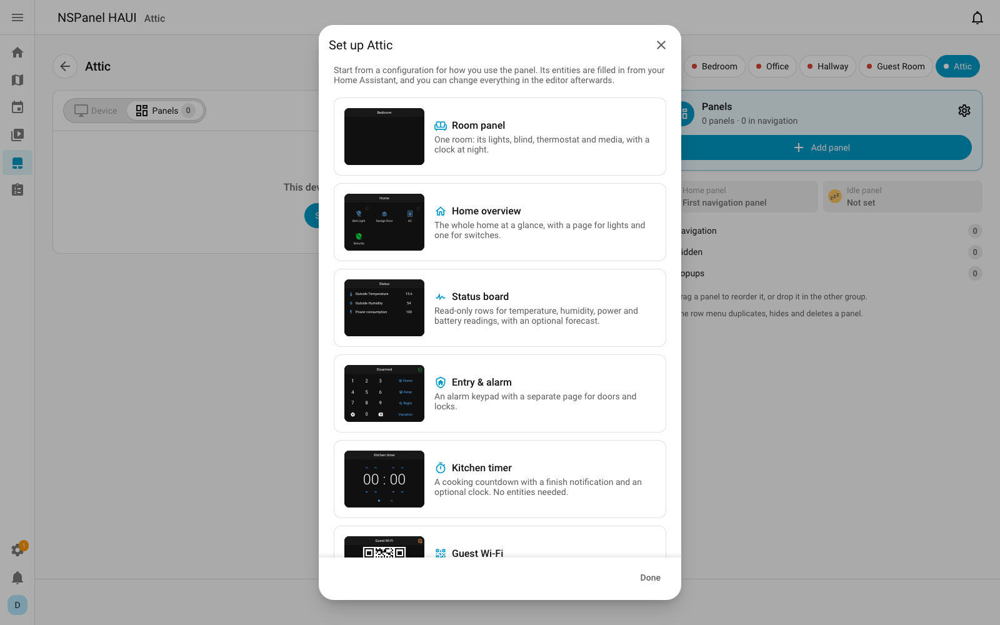
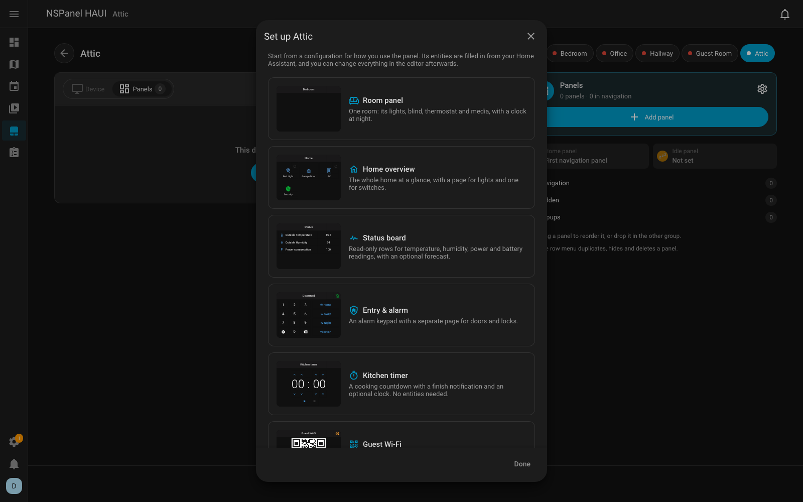
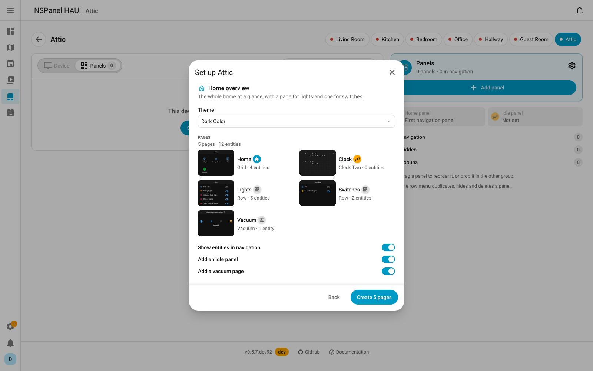
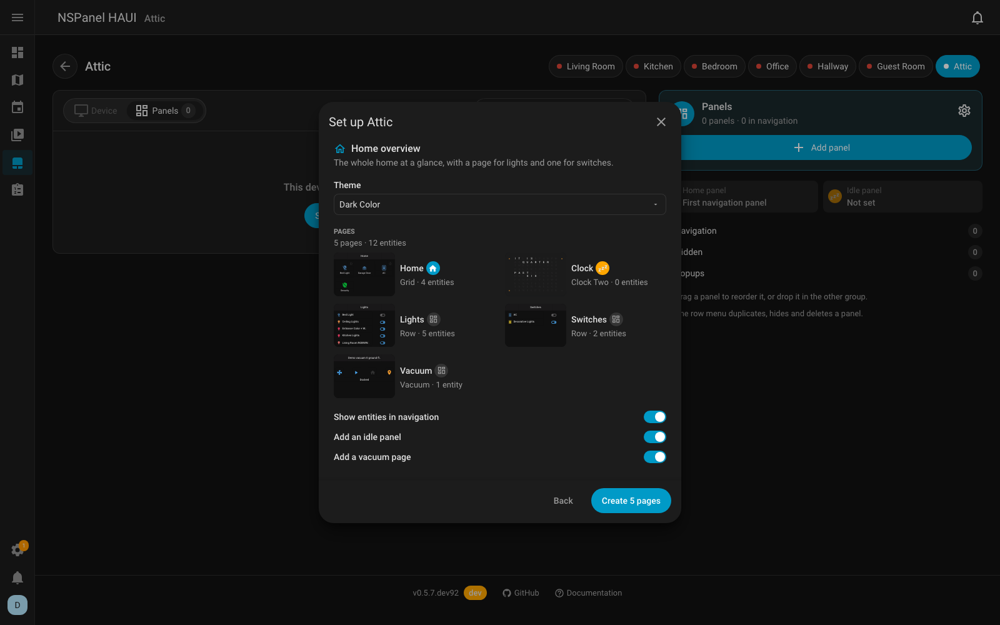

# Quick Start Guide

This is the short version. The [Installation Guide](install.md) has every detail.

## What you need

- Home Assistant 2026.11 or later (with the Marketplace)
- A Sonoff NSPanel
- A USB-UART adapter (first flash only)
- `nspanel_haui.bin` from the [latest release](https://github.com/happydasch/nspanel_haui/releases/latest)

## 1. Flash the panel

1. Open the panel and connect the USB-UART adapter with GND to IO0.
2. Flash `nspanel_haui.bin` with the [ESP Web Flasher](https://web.esphome.io/).
3. Join the panel's Wi-Fi access point, for example `nspanel-haui-a1b2c3`, and enter your Wi-Fi details.
4. Add the panel to Home Assistant's **ESPHome** integration. If it asks for an encryption key, use the one in the [Installation Guide](install.md#flash-the-panel).

## 2. Install the integration

1. Go to **Settings → Marketplace → Add from link**.
2. Enter `happydasch/nspanel_haui` and select **Add**.
3. Install **NSPanel HAUI** and restart Home Assistant.
4. Go to **Settings → Devices & services → Add integration** and add **NSPanel HAUI**.

## 3. Add your first panel

1. Open **NSPanel HAUI** in the Home Assistant sidebar (administrators only).
2. Under **Discovered Devices**, add your panel and open it.
3. On **Panels**, select **Set up this device**. **Add panel** builds a page yourself.
4. Pick a configuration, adjust its choices and select **Create**.

The setup fills its pages from your Home Assistant. Optional pages without entities are left out, and the banner names a required entity that is missing. **Theme** sets the device colours; change everything later in the editor.

=== "Light"

    

=== "Dark"

    

The second step lists the pages the configuration creates, each with its render and its role:

=== "Light"

    

=== "Dark"

    

| Configuration | What it sets up |
| --- | --- |
| **Room panel** | A grid of one area's controls, with optional pages for its lights, blind, thermostat and media, and a clock when idle. |
| **Home overview** | A whole-home grid, row pages for lights and switches, and an optional vacuum page. |
| **Status board** | Read-only rows for temperature, humidity, power and battery, with an optional weather screen. |
| **Entry & alarm** | An alarm keypad and a row page for covers and locks. Needs an alarm entity. |
| **Kitchen timer** | A countdown with a finish notification and an optional clock. No entities needed. |
| **Guest Wi-Fi** | A full-size QR code for your guest network; enter its name and password here. |

## Next steps

- Browse all [panel types](panels/README.md) and the [Screens overview](screens.md)
- Read the [Editor overview](editor/README.md)
- Set a home panel and an idle (screensaver) panel in **Device Settings → Home & idle**
- Check the [FAQ](faq.md) if something is not working
