# Panel Overview

A panel is one screen on the display. There are **13 panel types** you can add, plus built-in popups and system panels. The **Add panel** catalog lists them under four categories: **Backgrounds**, **Entities**, **Grouping** and **Tools**. Select a panel below to read what it shows and which options it has.

You add panels in the editor, see the [Configuration Overview](../configuration/README.md). The [Screens overview](../../screens.html) shows every panel in the landscape and the portrait layout.

## Backgrounds

Full-screen panels without header buttons. They work well as the home panel or as the idle panel.

| Preview | Panel | Type | Shows |
|---------|-------|------|-------|
| <a href="panel_weather.md">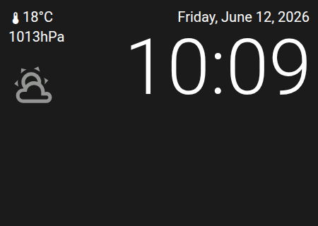</a> | [Weather](panel_weather.md) | `weather` | Current weather, a forecast, the time and up to two extra values |
|  | [Clock](panel_clock.md) | `clock` | A large time and date, optional weather and up to six buttons |
| <a href="panel_clocktwo.md">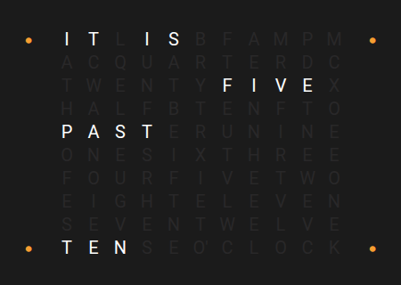</a> | [ClockTwo](panel_clocktwo.md) | `clocktwo` | The time in words, for example "IT IS HALF PAST TWELVE" |

## Grouping

Panels that show and control several entities at once.

| Preview | Panel | Type | Shows |
|---------|-------|------|-------|
|  | [Grid](panel_grid.md) | `grid` | Six tiles per page, each with an icon and a name |
| <a href="panel_row.md">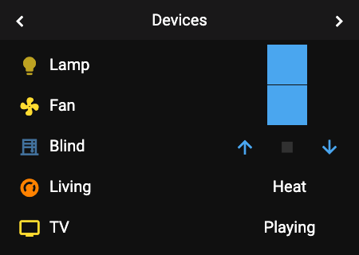</a> | [Row](panel_row.md) | `row` | Five rows per page, each with a control that fits the entity: toggle, slider, buttons or a value |

## Entities

Panels that control a single entity in full.

| Preview | Panel | Type | Controls |
|---------|-------|------|----------|
| <a href="panel_light.md">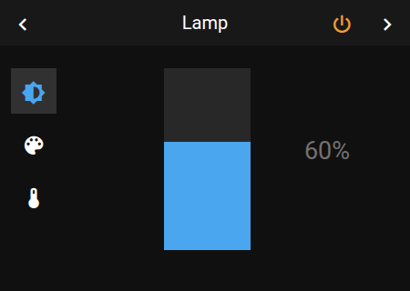</a> | [Light](panel_light.md) | `light` | Brightness, color temperature, color and effects |
| <a href="panel_media.md">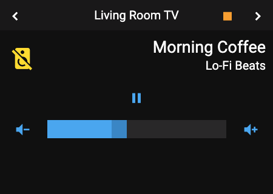</a> | [Media](panel_media.md) | `media` | Playback, volume, sources and speaker groups of a media player |
| <a href="panel_vacuum.md">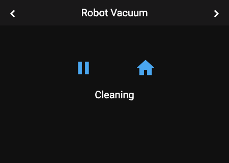</a> | [Vacuum](panel_vacuum.md) | `vacuum` | Start, stop, return to dock, fan speed and locate |
| <a href="panel_cover.md">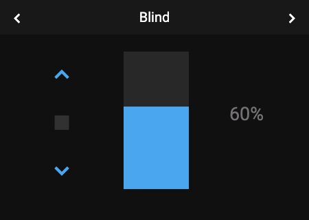</a> | [Cover](panel_cover.md) | `cover` | Open, stop, close and a position slider |
| <a href="panel_climate.md">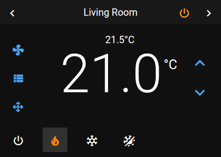</a> | [Climate](panel_climate.md) | `climate` | Target temperature, modes, fan, swing and presets |

## Tools

Panels for special tasks.

| Preview | Panel | Type | Shows |
|---------|-------|------|-------|
| <a href="panel_timer.md">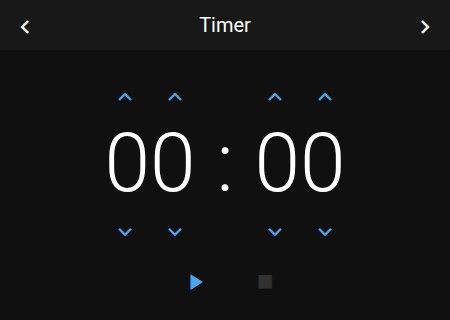</a> | [Timer](panel_timer.md) | `timer` | A countdown timer or stopwatch. Needs no entity. |
| <a href="panel_qr.md">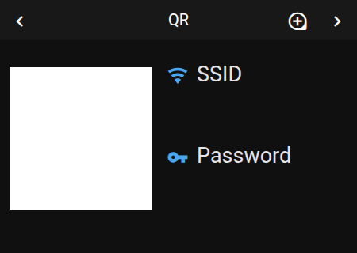</a> | [QR Code](panel_qr.md) | `qr` | A QR code for your Wi-Fi |
| <a href="panel_alarm.md">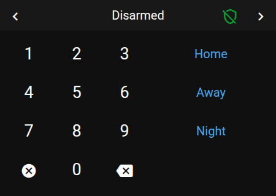</a> | [Alarm](panel_alarm.md) | `alarm` | A keypad to arm and disarm an alarm system |

## Popups

Popups open on top of the current panel and close again. They are built in; you do not add them.

| Popup | Key | Opens when |
|-------|-----|------------|
| [Notify](popup_notify.md) | `popup_notify` | A notification is shown |
| [Select](popup_select.md) | `popup_select` | You choose from a list, for example a fan speed or a preset |
| [Unlock](popup_unlock.md) | `popup_unlock` | You open a panel that has a PIN |
| Entity popups | `popup_light`, `popup_media_player`, `popup_vacuum`, `popup_climate`, `popup_cover`, `popup_alarm`, `popup_timer` | You tap an entity on a grid, row or other panel. They look like the panel of the same type. |

You can change a popup for a device with **Add panel → Extend a popup**, see [System Panel Overrides](../configuration/panels.md#system-panel-overrides). To open one of your own panels on top of another panel, see [Stacked Panels and Popups](../configuration/panels.md#stacked-panels-and-popups).

## System Panels

Always there. They need no configuration and cannot be changed.

| Panel | Key | Shows |
|-------|-----|-------|
| [Blank](panel_blank.md) | `sys_blank` | Nothing. Use it as the idle panel for an empty screen. |
| [System](panel_system.md) | `sys_system` | A message while the panel connects or has lost its connection |
| [Settings](panel_settings.md) | `sys_settings` | Brightness sliders. Swipe down to open it. |
| [About](panel_about.md) | `sys_about` | Versions and the IP address. Swipe up to open it. |
